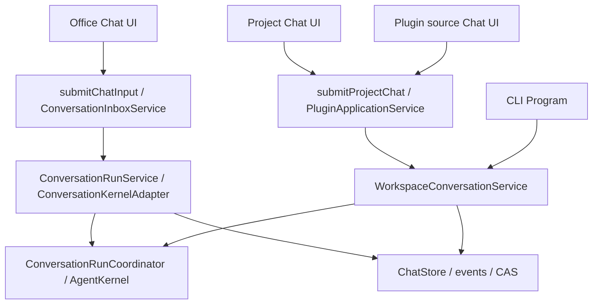

# Unified Shell и Visual Annotator: аудит фазы 0

Дата: 2026-10-23. Owner: application/chat UI; resource, storage и Office owners
сохраняют свои границы. Статус: аудит выполнен, реализация не начата.
Решения для согласования — [RFC / ADR-0017](../decisions/ADR-0017-unified-shell-and-visual-annotations.md).

## Основание и границы проверки

Проверены предоставленные пользователем
[RNAssistant_Unified_Shell_Plan.md](../proposals/RNAssistant_Unified_Shell_Plan.md)
(SHA-256 `ecd33ad0f440f45f8c0668d5d647b5ab9dc4adc2eca7ca0a181c142953a00b71`)
и [RNAssistant_Visual_Annotator_Plan.md](../proposals/RNAssistant_Visual_Annotator_Plan.md)
(`c0487560b16c752af7ef86a288e8e13857fd9d4b21e08824479382970e0e2280`).
Unified Shell имеет приоритет; его §13 требует сначала только Phase 0 и принятия
RFC перед Phase 1. Ранее пользователь исключил общее дерево файлов из scope.

Начальная ревизия чтения — `c6ad3e9d`; браузерные измерения —
`0fcf3e9409612673aa1d586cfd4b69a5ce9047de`. Во время аудита другой работой
обновлялся resource inspector. Семь проверяемых UI-файлов имеют одинаковые SHA-256
до и после измерений; полный список находится в локальном `results.json`.
Чужие изменения не переносились и не откатывались. Проверка: macOS, Node 26.0.0,
Chrome 155.0.8059.86, реальный product JS с существующим mock bridge.
Office/COM/WebView2, LLM и native cold start не запускались; build/Harness не нужны
для этого этапа. Mock не доказывает сохранение пользовательских историй на диске.

## Фактическая карта вызовов



Это **три UI-контроллера, два пути подготовки запуска и один kernel/store**.
CLI не имеет собственного model loop. Office и Runtime импортируют один
`RNAssistant.Application.projitems`; разные framework targets не означают копию
исходников. Причина различий — сохранённая document-oriented композиция Office
и позднее добавленный folder-oriented workspace path, а не потребность в трёх чатах.

| Область | Office | Project | Plugin source |
|---|---|---|---|
| Разметка | `web/index.html`: `chatLayout`, `chatForm`, `messages` | `projectChatLayout`, `projectChatForm` | `pluginChat`, `pluginChatForm` внутри preview-экрана |
| Контроллер | `app-chat-state.js`, `app-chat-run.js`, `app-chat-inbox.js` | `app-project-chats.js`: `open`, `runChat`, `setScope` | `app-plugins.js`: `readChat`, `chatAction`, `select` |
| Рендер | `app-chat.js`: `renderMessages`, `renderMessageArticle`; полная Office presentation | `app-workspace-chat.js`: `renderMessages` вызывает общий `renderMessageArticle`, но отдельно строит actions | Тот же workspace renderer; не третья реализация Markdown |
| Composer | `app-chat-composer.js` и `captureChatDraft/restoreChatDraft` в `app-chat-state.js` | `app-workspace-chat.js`: `bindComposer` | Тот же `bindComposer`, но отдельный экземпляр и отдельный `drafts Map` |
| Отправка/повтор | `submitInboxMessage` → operation ID, receipts, queue/steer | `runChat` → request ID, awaited `submitProjectChat` | `chatAction` → тот же request contract, отдельные busy/poll/pendingSend |
| Обновление | per-chat run state, push/stream и inbox reconciliation, paging истории | Опрос `getProjectChat` каждые 1200 мс; snapshot presentation | Тот же опрос с отдельным epoch/таймером |
| Вложения | staged originals, chips, message-linked `ResourceRefs` | upload сразу создаёт файл в workspace; в текст добавляется относительный путь | file-upload hook у composer не подключён |
| История | Общий `ChatStore`, JSONL + derived SQLite + CAS | Тот же store, `WorkspaceId`; временно `Host="Workspace"` / `DocumentKey=WorkspaceId` | Та же workspace-сессия, доступная и в дереве проектов |
| Контекст/источники | `ConversationModelSession`, `ResourceGatewayService` | `WorkspacePorts`, `WorkspaceResourceHandler`, `WorkspaceFileResourceProvider` | Те же, плюс разрешённые plugin tools |

Точные backend входы:

- [AssistantController.Inbox](../../src/RNAssistant.Office/Controller/AssistantController.Inbox.cs):
  `SubmitChatInput`, `StartInboxWorker`; [ConversationRunService](../../src/RNAssistant.Office/Services/ConversationRunService.cs): `CreatePorts`.
- [PluginApplicationService](../../src/RNAssistant.Application/PluginApplicationService.cs):
  `ProjectChat`, `SubmitProjectChatAsync`, `ChatState`; `ProjectChat` отдаёт последние
  100 user/assistant messages. Полная история остаётся в store; отсутствие paging
  в этом DTO нельзя переносить в общий ChatView как новый предел истории.
- [WorkspaceConversationService](../../src/RNAssistant.Application/Workspace/WorkspaceConversationService.cs):
  `SubmitInputAsync`, `WorkspacePorts`, `ResourceSchema`; [CLI Program](../../src/RNAssistant.Cli/Program.cs)
  вызывает этот же application service.
- [WorkspaceOfficeCapabilityService](../../src/RNAssistant.Office/Services/WorkspaceOfficeCapabilityService.cs):
  `CaptureCurrentTarget`, `ForTarget` фиксируют exact Office target на run и
  переиспользуют native resource handlers. Общий ресурсный API частично выполнен:
  schemas и подготовка чтений ещё имеют два владельца, хотя parsing/projections
  и `ModelContextCompiler` общие. Их объединение относится к фазе 2, не к CSS-правке.

## История, идентичность и время жизни

Истории не лежат в CustomXML документа. [ChatStore.EventLog](../../src/RNAssistant.Core/Storage/ChatStore.EventLog.cs)
(`GetDocumentDirectory`, `GetSessionPath`) размещает streams в локальном app-data;
[session-events](../session-events.md) определяет replay и защиту истории.
[DocumentIdentity](../../src/RNAssistant.OfficeHosts/Identity/DocumentIdentity.cs)
читает `RNAssistantDocumentId` из custom property; без него применяется текущая
path/runtime identity. Property — идентичность документа, не тело чата.

Office-chat связан с документом, не с произвольным активным окном. Save As может
изменять storage binding; это отдельный незакрытый crash-safe layout gate D07 в
[backlog](../stabilization/BACKLOG.md). Закрытый/недоступный документ не разрешает
перенаправить Office write в другую книгу. Workspace живёт независимо от Office;
в одном run уже могут сочетаться папка и точно закреплённый Office target.
Plugin source workspace, опубликованный release и granted data project — три
разные идентичности; общий экран не должен их объединять.

`switchTab` в [app.js](../../web/js/app.js) меняет видимость панелей и не отменяет run.
`AssistantWebBridge.Dispose` останавливает inbox workers и отменяемые bridge
requests; это закрытие самого host, а не переход в настройки. Сохранение истории
не равно автоматическому продолжению прерванной операции. Existing events/receipts
и explicit recovery следует сохранить без нового recovery engine.

Геометрия хранится через `app-layout.js` в localStorage; Office drafts находятся
в `state.chatDrafts`, workspace drafts — в локальных Map. Единого persisted
composer draft или полного shell Back/Forward сейчас нет. Layout-настройки и
повторное чтение истории не доказывают восстановление несохранённого ввода после
пересоздания WebView.

## Preview, bridge и места интеграции Annotator

| Узел | Текущее поведение / точка подключения |
|---|---|
| [AssistantPaneControl](../../src/RNAssistant.Office/WebView/AssistantPaneControl.cs) | Создаёт главный WebView2; `RebindControllerAsync` не требует нового UI. Top-level bridge принимает только trusted document, host objects отключены |
| HTML material | `app-html-workspace-preview.js` собирает snapshot; `app-html-workspace-editor.js:renderHtmlWorkspacePreview` управляет reuse. Iframe `htmlWorkspacePreviewFrame`: `sandbox="allow-scripts allow-modals"`, без same-origin. Parent не может просто читать его DOM |
| Plugin UI | `app-plugins.js:showView/closeView/select`; отдельный instance origin, immutable release/candidate. Повторный выбор сейчас закрывает старый frame |
| [PluginWebViewHost](../../src/RNAssistant.Office/WebView/PluginWebViewHost.cs) | `Transport.OnFrame`: exact frame + instance + entry URL, revocation при navigation/destroy; отдельный Frame channel. Команды работают в скрытом in-private controller, не в UI-frame |
| Inspector aliases | `ModelContextInspectorService.AliasIndex`: `Q1`, `O1`, `E1`, `R1@v1`, chat-local projection сохранённых запросов. `E1` уже значит evidence, не DOM element. Это не model-facing API |
| Приём вложений | `ChatResourceIngestionService.Stage/LoadDrafts/CommitAndLink`, `AttachmentStore`, `ConversationInputJournal`, `ChatMessage.ResourceRefs`; сейчас commit originals требует document authority. Для annotations нельзя подделывать Office document у workspace |
| Запись исходников | `WorkspaceFileService` + `files.patch` либо существующий HTML domain writer. Инспектор должен только создавать selection evidence, без собственной записи/patcher |

Готового visual Inspector, annotation contract и доказуемого DOM→source mapping
не найдено. Сохранять `outerHTML` как исходный файл нельзя. `data-ui-id`, CSS
selector и текст помогают искать, но не дают write authority и не гарантируют
однозначность динамического DOM. UI/DOM ID, revision и hash — разные понятия.

Пакет WebView2 1.0.2903.40 уже содержит `CoreWebView2Frame.ExecuteScriptAsync`;
его локальная XML-документация требует дождаться ContentLoading. Это возможная
инъекция host-owned Inspector только в выбранный frame. Работу при CSP, navigation
и destroyed frame надо отдельно проверить на Windows. Не расширять основной
bridge до origin плагина и не добавлять CDP как production dependency. CDP в
браузерном аудите ниже использован исключительно для счётчиков тестового Chrome.

## Воспроизведения и измерения

Локальное evidence: `/tmp/rnassistant-shell-audit-20261023/` — `probe.cjs`,
`results.json`, `results-ui-only.json`, `results-loaded-preview-1.json`,
`results-undrained-server.json`, screenshots и HTTP log. Product sources не менялись.

| Проверка | Факт | Следствие |
|---|---|---|
| Один source chat: plugin → project → plugin | `audit plugin draft` не появляется в project composer; отдельный `audit project draft` не заменяет plugin draft | Подтверждены два независимых черновика одной сессии. Первый конкретный scope — общий draft owner |
| Повторный выбор того же плагина в development | iframe заменён; 2 `openPlugin` и 2 `closePlugin` (release, затем preview) | Нужен выбор по exact surface identity с reuse, а не безусловный reopen |
| Два `requestSubmit` подряд | Один `submitProjectChat`, одно user message | Дубликат отправки в этом mock-сценарии не воспроизведён |
| Переход в Settings при незавершённой отправке | Ноль cancel-команд; после ответа одно сообщение | Обычная смена раздела уже не отменяет запуск |
| `workspace-chat-layout.test.js` | Timeout на disabled `#pluginChatHistory` во время run | Повторена уже зарегистрированная проблема теста/политики navigation, не новое доказательство зависания агента |
| `html-preview-reuse.test.js` | Fixture не задаёт `preview.missingVendors`; TypeError до проверок reuse | Устаревший stub, не доказанный product-дефект. Исправление fixture отдельно |
| `chat-input-delivery.test.js` | PASS | Реальный Office Send DOM, pre-ack echo, delayed history и scroll прошли с mock transport |

Последний полный прогон с ожиданием `previewReady` и видимого `dtViewSources`:

| Метрика | Результат | Граница |
|---|---|---|
| Загрузка до готового UI, 3 новых browser contexts | 233 / 223 / 222 мс | Уже запущенные Chrome/server; не native cold start |
| 12 циклов Settings → chat/project → plugin → project | медиана 217 мс, диапазон 217–221 мс | Включает готовность preview; mock bridge, не COM/LLM |
| JS listeners / DOM nodes / documents до и после GC | 795 → 795 / 7121 → 7121 / 5 → 5 | В этом ограниченном прогоне нет роста этих счётчиков |
| JS heap после GC | 8 078 316 → 8 466 788 байт | Рост 388 472 байта; не native RAM и не доказательство отсутствия утечки |
| Page errors | 0 в повторе | Предыдущий полный прогон дал один `undefined.create` без stack; в повторе со stack-capture не воспроизведён, причина открыта |
| Iframe / native WebView count | 2 iframe в DOM / native count не измерен | Нельзя считать iframe числом WebView2 controllers |

Первый диагностический прогон ожидания preview остановился после 5 циклов:
дочерний HTTP server имел непрочитанный stderr pipe. После отвода log в файл два
полных прогона завершились. Это ограничение probe, не квалификация product freeze.
Ранние UI-only timings 48–51 мс не включали загрузку iframe и не используются
как browser-ready baseline. Screenshots просмотрены: сейчас preview слева от
plugin chat, то есть целевая компоновка central chat/right surface ещё не сделана.

Команды для повторения на этой машине:

```sh
export NODE_PATH=/Users/mutagrey/.cache/codex-runtimes/codex-primary-runtime/dependencies/node/node_modules
export BROWSER_EXECUTABLE='/Applications/Google Chrome.app/Contents/MacOS/Google Chrome'
node /tmp/rnassistant-shell-audit-20261023/probe.cjs
node tests/web/chat-input-delivery.test.js
node tests/web/workspace-chat-layout.test.js
node tests/web/html-preview-reuse.test.js
```

Без `NODE_PATH` browser tests не нашли Playwright; зависимости не устанавливались
в репозиторий. Последние два теста остаются красными по причинам выше. Один
пройденный smoke не закрывает всю матрицу планов.

## Поправки к исходным предположениям

1. Не писать три renderer заново: Markdown/message atom уже общий; различаются
   orchestration, full transcript presentation, drafts и capabilities.
2. Не мигрировать историю из CustomXML: её там нет. Не вводить второй ChatStore.
3. CLI — тонкий вход к тому же workspace service. Свести Office/workspace
   preparation и resource contracts, а не переносить COM в CLI.
4. Workspace с Office уже частично поддержан exact per-run binding; multiple
   logical mounts — следующий scope, не текущая возможность.
5. «Ленивая совместимость» не должна включать скрытую конверсию неподдерживаемого
   protocol stream. Сохранить поддерживаемые истории и действующий explicit reset.
6. `a1/e1/r1@…` не являются текущей универсальной модельной адресацией;
   diagnostic aliases и input selections имеют разные роли.
7. Переключение вкладки уже работает; фоновое выполнение после закрытия host
   не включено в задачу. Native crash/restart нельзя доказать браузерным mock.
8. В MVP включить selection без комментария: это тот же selection с optional
   comment. Self-inspection, source maps и screenshots — последующие расширения.
9. Не включать общее дерево файлов. Workspace/chat navigation и внутренние
   разделы Data Templates остаются; это не файловый менеджер.
10. `execute/reflection/finish` относятся к предложению ADR-0016. Shell/Annotator
    не меняют действующий v7 и не должны зависеть от параллельного cutover.

Phase 0 даёт проверяемый RFC и browser baseline; native performance, COM identity
сценарии и новый Inspector остаются явно непроверенными. Первый ограниченный
срез после принятия RFC — общий session draft/composer с проверкой двух экранов,
без смены storage layout, ядра и механизмов preview.
