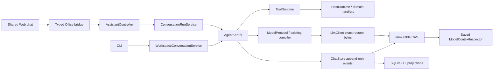

# V8: владельцы и зависимости

Owner: Core/Application architecture. Baseline `ba44ad1b573aa4a5f6daf0f79c0b6c3c35a5a98a`;
дата 2026-10-26. Это проверенный inventory для
[ограниченного плана](../proposals/v8-stabilization-execution-plan.md), после его
закрытия — исторический срез. Canonical boundaries: [architecture](../architecture.md).

Пути ниже относительно repo; строковые позиции и lexical candidates находятся в
[dependencies.json](evidence/v8-architecture-2026-10-26/dependencies.json).
Автоматический граф не является доказательством отсутствия dynamic consumers.

## Матрица authority и реальных consumers

| Component / symbol / path | Current owner / state | Consumers / dependencies | Competing owner, classification, удаление и guard |
|---|---|---|---|
| `Core/Agent/AgentKernel.cs` RunAsync/ResumeAsync | lifecycle, counters, terminal outcomes | Office ConversationRunService; Application WorkspaceConversationService; Harness | none; KEEP. No second loop. Kernel + replay tests |
| `Core/Agent/AgentProgressTracker.cs` Observe | projection unknown/retry/inspection facts | kernel, continuation Restore; ToolExecutionProgress + ResourceEvidence/Effect | global inspection bool DELETE; typed target list KEEP. No durable registry; replay/nonretry tests |
| `Core/ModelProtocol/ModelProtocolClient.cs` GetResponseAsync | run-local format negotiation/repair | ConversationRunService factory, WorkspacePorts; LlmClient | none; KEEP documented fallback. Endpoint cache не вводится; bounded fallback tests |
| `Core/ModelProtocol/ModelRequestPreparation.cs` | frozen request options/surface | Office ConversationModelSession, workspace model port; ModelContextCompiler | none; KEEP; strict/object, reserves, repair tests |
| `Core/Services/ModelContextCompiler.cs`, `ContextCompactionRuntime.cs` | единственный model context compilation/compaction owner | Office/Workspace request and admission; preview; immutable bodies, resource authority | none; KEEP. Не объединять saved Inspector с compiler; budget/ref/repair tests |
| `Core/Services/SkillTaskService.cs` Select/Compile | candidate skill pins/arsenal; atomic selection publication | SkillLoadToolHandler; Office/Workspace candidate callbacks, Harness setup | half-budget gate DELETE; existing full compiler KEEP. Oversized refusal, >half positive, restart |
| `Core/Tools/SkillLoadToolHandler.cs` ExecuteAsync | tool-facing load/remove | OfficeToolExecutor and WorkspacePorts registration; SkillTaskService | missing-callback permissiveness DELETE. Removal remains available; unbound load error test |
| `Office/Services/ConversationModelSession.cs` | Office model request composition | ConversationRunService, ModelRequestPreparation/compiler, native runtime | not a second compiler; KEEP. Actual host delivery needs Windows evidence |
| `Application/Workspace/WorkspaceConversationService*.cs` WorkspacePorts | workspace orchestration/profile/acceptance | CLI, Office workspace bridge; Core kernel/runtime/storage, optional verifier | catalogue-only attachment provider construction DELETE. KEEP local host composition; CLI env and negative permissions |
| `Core/Llm/LlmClient.cs` request materialization | exact bytes sent and saved | LlmHttpTransport, ModelTracePersistenceService | none; KEEP one byte[]. CLI HTTP/CAS equality |
| `Core/Storage/ChatStore*.cs` SaveInternalLocked/CommitScalarMetadata | event authority and optimistic cursor | ChatConversationStoreAdapter, ChatEventStoreAdapter; SQLite/CAS derived indexes | duplicated catch/recovery MERGE in same owner. AppendAttempt is private, not public second store; faults/stale/replay |
| `Core/Storage/ChatStore.ModelReferences.cs` allocators | durable monotonic E/R bindings | save, ModelReferenceProjection, finish admission, Inspector | none; KEEP. No second allocator; model refs and replay tests |
| `Core/Storage/ChatStore.cs` MoveDocument/reassociate | document binding and physical path | ChatSessionService, controllers | INVESTIGATE D07; no code deletion before new layout/migration fixtures |
| `Core/Tools/ToolRuntime.cs` | descriptor/policy/binding, prepare/dispatch/read-back | NativeToolRuntimeAdapter, workspace; exact registry | none; KEEP. NativeToolRuntimeAdapter is composition, not duplicate executor |
| `Office/Runtime/HostRuntime.cs`, `DocumentAccessGate.cs` | document session serialization | host-bound adapter, controller/tool operations | none; KEEP. Gate never spans model/user wait; host qualification open |
| `Office/Tools/OfficeToolExecutor.cs` | Office registration/native composition | controller, ConversationRunService, typed handlers | INVESTIGATE change-driven extraction only; no generic service locator |
| `Office/Controller/AssistantController*.cs` | UI/application façade + current concrete composition | bridge/ribbon/services, host runtime | D02/D04 INVESTIGATE; size alone not a duplicate owner. Remove construction path only with concrete next change |
| `Office/Services/PromptContextInspectorService.cs` | prospective request preview | prompt diagnostics/controller, existing compiler | none; KEEP separate from saved trace. Preview never durable execution fact |
| `Office/Services/ModelContextInspectorService.cs` | saved exact trace query/download | model context bridge/UI, ChatEventStoreAdapter/CAS/DataPlane | none; KEEP; restart exact bytes and read-only query tests |
| `Office/Contracts/BridgeOperationCatalog.cs`, `Office/WebView/AssistantWebBridge*.cs` | typed operation dispatch/cancellation | web bridge callers + controller; DTOs | D03 embedded Core DTO casing INVESTIGATE per exact shape; no blanket alias deletion |
| `web/js/app-chat-{state,session,run,composer,edit}.js` | shared presentation, drafts, lifecycle routing | app.js boot, app-workspace-chat, app-messages, bridge | shared owner already exists; KEEP; races/routing/draft tests. WebView qualification separate |
| `web/js/app-messages.js`, `app-agent-model.js`, `app-utils.js` | rendering and normalized v8 presentation | Office/workspace shared transcript, VM/browser fixtures | incomplete test bootstrap DELETE; load existing dependencies, no production fork |
| `Office/Services/ResourceGatewayService*.cs` | typed resource reads/authority, table + retained records | resources tools, HTML/JS, providers; Core contracts | records INVESTIGATE; active reader must remain until migration fixtures |
| `Core/Services/ArtifactTransferPackage.cs` | exact exported artifact bodies | HTML import/export and transfer consumers | records KEEP pending saved-format inventory/migration; no silent alias |
| `tests/RNAssistant.Harness`, `tests/cli`, `demo/MockDemo`, `tests/web` | regression evidence only | production owners and controlled transports/adapters | stale fixtures DELETE/MERGE; no test wire compatibility in product |

`Core/`, `Office/`, `Application/` в таблице означают `src/RNAssistant.*`.
Код вне focused inventory не объявляется мёртвым.

## Граф и динамические границы

`tools/audit-v8-dependencies.py` читает tracked `.csproj`/`.projitems` и focused
C#/JS source, сохраняет project/import/compile edges, declaration/call candidates,
reflection/Invoke и registration/subscription candidates со строками и hash файла.
На срезе 18 project/import files и 147 focused source files; project-reference
cycles не обнаружены. Это **не** доказательство отсутствия object lifecycle cycles.
MSBuild properties/conditions не вычисляются; glob imports остаются unresolved.
Roslyn semantic graph не строился. Lexical names не разрешают overloads, aliases,
reflection, string bridge routes или callbacks; всё это требует ручного inventory.

`RNAssistant.Application.projitems` импортируется в Office/Runtime/Harness/MockDemo:
shared source compilation, не четыре исполняющихся одновременно владельца состояния.
Office-host COM остаётся в OfficeHosts/AddIn, Core не получает COM/WebView dependency.
JS использует shared globals/load order вместо npm imports: dependency ошибки
проверяются через настоящий bootstrap или явную VM composition, не через поиск
неиспользуемого имени.

## Дорогие операции и removal gates

- `SaveInternalLocked`: full projection/diff, Messages clone, artifact/html/context/chart
  rebuild. D06 recovery объединён; incremental optimization отложена до счётчиков
  touched operations, latency и peak RSS на длинной истории. Новое O(1) не заявлено.
- Office source read может материализовать live source; bounded model hunk не означает
  bounded COM capture. Existing snapshot-aware patch остаётся владельцем правки.
- D07: новый стабильный storage layout требует explicit old-layout refusal/import,
  crash fixture каждого boundary, whole-chat-set conflicts, cold catalog; нельзя
  считать File.Move безопасным fallback.
- records: прежде удаления нужны saved HTML exact/head bindings, derived mapping,
  Excel/Outlook/JSON, custom JS, transfer package, restart/export fixtures. Пока KEEP.
- Embedded bridge casing: переключать typed producer и точные consumers одновременно;
  opaque tool JSON не нормализуется глобально. Временные adapters фиксируются только
  в существующем MIGRATION_MAP; эта работа новых adapters не вводит.
