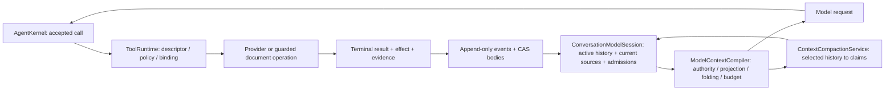

# Conversation JSON flow

The current `main` uses the [v8 response contract](protocols/CONVERSATION_RESPONSE_V8.md)
and format-8 execution streams with [typed short references](decisions/ADR-0018-typed-model-references.md).
Formats 6/7 remain read-only. Intermediate 9/10 candidates have no compatibility path.
Format-8 history must satisfy the current accepted-call and reference contract. Dated v7 audit and qualification records below
are historical and do not define the current wire contract.

RNAssistant uses one `Core/Agent/AgentKernel`, invoked by Office's
`ConversationRunService` and CLI's `WorkspaceConversationService`. A request may
finish with zero calls; neither a router LLM nor a mandatory planner is involved.

`finish` is a final assertion with nonblank answer text, a brief reason for ending
and an explicit model `outcome` (`completed`, `partial`, `unable_to_complete`).
The parser checks its consistency with `results`; runtime separately checks cited
terminal evidence, effects and explicit task acceptance. Accepted finish ends the
run, but does not establish whole-task success. Questions go through
`common.questions_ask`. The exact shape, correction and reflection-limit behavior
are owned by the [v8 contract](protocols/CONVERSATION_RESPONSE_V8.md).

- Agent is the default behavior, without a mode selector in the UI.
- The single **Plan** toggle in the composer `+` menu stays active until disabled.
  It permits discovery, skills, questions, Plan save and Task List updates, but
  never execution of the proposed work. Disabling it waits for the next user input.
  The menu also offers file attachments, document selection and context compaction.
  Approval controls and status are absent from the composer; automatic approval
  is configured in Settings → Agent.
- Independent per-chat `MutationPolicy` is `Ask` (default) or `Deny`. Ask requires
  approval of each effect/code invocation, supplied automatically only by the
  user's captured opt-in below. Deny and Plan prohibit effects
  and code, except built-in `common.plan_doc_save` and `common.task_list_set`.
  Restore/delete are not exceptions. Runtime events/CAS remain trusted bookkeeping.
- `ToolPolicy` retains source-owned effect/verification and additionally marks
  `ExecutesCode`. Sandboxed `common.js_run`, JS packages and CLI `web.verify`
  require approval even when their result semantics are read-only. Unknown policy
  is refused. VBA execution retains its opaque external-effect classification.
- `ToolRuntime` checks the effective policy before preparation/dispatch and again
  on approval. The planning exception requires the exact built-in binding and
  trusted `IPlanningArtifactToolHandler` (including the Office wrappers); a matching
  tool name alone grants nothing. Model/document text
  cannot grant authority. Explicit manual-tool execution remains separate.
- A run records `ConversationPolicy`; tool snapshots capture effective permissions
  and intent. Changed policy rejects a stale approval. Switching Plan/permissions
  cancels pending work and never starts execution itself.

### Automatic action approval

Settings → Agent → **Автоподтверждение действий** is a global saved setting,
off by default. It authorizes changes and code without individual approval for
new runs in all chats. The typed `SettingsControlsDto.AutoConfirmToolActions`
round-trips through settings storage. Office captures it in
`ChatRunRecord.ConversationPolicy.AutoConfirmToolActions` before the first model
request; workspace requests capture the explicit typed value or their settings.
Only `ConversationRunPolicy.AutoConfirmsToolActions` can authorize the central
ToolRuntime approval gate for Agent/Ask. Plan/Deny and the exact built-in planning
exceptions remain unchanged. Dynamic packages and read-producing code use the
same gate; tool classification, singleton effect rules and exact binding remain.

The value is pinned for the whole accepted run, including refreshed catalogs,
approval and explicit continuation after restart. Saving a changed setting neither
executes a pending call nor changes subsequent calls in that run. A pending Ask
call still needs explicit approval, and the rest of that run stays Ask. The next
run captures the saved setting. Missing opt-in is false; no history is rewritten.
Preparation, target guards, mutation journaling, cancellation, read-back and the
prohibition on repeating unknown effects all remain in force. Model output,
document contents and tool results cannot change the setting.

CLI `run` and `answer` accept `--auto-confirm on|off`, defaulting to **off for each
new turn**, including an existing session. `approve` and `resume` reject this
override and retain the accepted run's value. `inspect` exposes the complete
`ConversationPolicy`; the flag also participates in typed input fingerprints.
This is approval authority, not a promise of successful effects or automatic
recovery of interrupted work.

### Unified-agent audit and cutover (2026-10-13)

Owners: Core `ConversationRunPolicy`/`ToolRuntime`; Office and workspace application
services; composer UI. The audited baseline already had one kernel, v7 no-call
terminal actions, exact registrations, durable confirmation and recovery. The
consolidation changes permission composition, not the kernel, registry or stores.

| Path | Entry and authority | Outcome/evidence |
| --- | --- | --- |
| Direct response | composer → typed bridge → `ConversationRunService.ExecuteAsync` → kernel; CLI `SubmitInputAsync` uses the same coordinator | `ModelStepStarted`, accepted response, terminal summary; zero tool dispatches |
| Read → answer | same loop → resource handlers via `ToolRuntime` | accepted call/result, `ToolStarted`/`ToolCompleted`, terminal summary |
| Several tools | kernel continues after each accepted result; exact bound native/workspace handler | existing guards, mutation journal and read-back; no effect inferred from prose |
| Plan → stop | the same loop with Plan-filtered authority | optional Plan/Task List revisions, `done`/`blocked`/`needs_input`; no auto-execution |
| Plan → execution | explicit toggle off, then new user input | fresh run snapshot; approval follows the captured user setting |
| Forbidden mutation/code | schema admission plus independent runtime permission gate | `permission_denied` before preparation/handler dispatch; no effect |

The former Chat runtime prompt/admission branches are removed. Legacy `chat`
values remain decodable as history, not as a runnable third path. No compatibility
adapter, shadow store or historical mode remapping is introduced.

New chats use `ChatSession.FormatVersion=7`; format 6 remains readable but cannot
continue/approve/fork into new execution authority. Normalization preserves the
original version. Older already-unsupported formats remain reset/skip only. No
stream or CAS rewrite/deletion is performed. An old binary's exact format-6 reader
rejects new format-7 chats. Rollback: stop running invocations, set
`RNA_DISABLE_UNIFIED_AGENT=1`, restart the host; viewing/CLI inspect remains
available, while new runs/approval/continuation are refused. Removing the variable
reenables the new contract; never downgrade a chat's stored format.

### Unified-agent verification

Host-neutral evidence (2026-10-13); no real Office/WebView2 qualification:

| Spec IDs | Evidence |
| --- | --- |
| T01–T03 | `no-tool` 3/3; controlled CLI direct answer, reads, create/patch with approval; `turn_decisions_smoke.py` 4 response-format/result-role combinations |
| T04 | `plan mode:` 3/3; CLI saved Plan under Deny, sticky Plan and explicit switch |
| T05 | Removed by product decision: no AnswerOnly mode/button |
| T06–T10 | `unified policy:` 6/6; `tool runtime:` 15/15; effect matrix, no preparation under Deny, forged planning binding, code classification, captured Office approval across setting changes/restart, CLI approval/rejection |
| T11 | Kernel cancellation/typed failure paths; provider timeout classification/recovery checks; no real Office timeout claim |
| T12 | Format-6 history/header reads retain original stream bytes; execution rejected; older pre-cutover formats remain rejected (1/1) |
| T13 | CLI inspect after pending approval does not resume; explicit approval reconstructs file read guards; permission change closes pending without dispatch |
| T14 | `conversation: stream` 2/2, normal no-tool path, controlled HTTP response formats; real provider/WebView2 delivery remains unqualified |
| T15 | CLI build succeeds; all listed C# checks use the net8 host-neutral Harness |
| T16 | **Open qualification gap:** Windows x64 + Office x64 + WebView2 not run on this machine |
| T17 | `kernel:` 55/55 includes stale confirmation, policy changes, unknown-effect non-retry and recovery boundaries |
| T18 | CLI reads an injected permission grant from a document; attempted write under Deny is never dispatched; runtime ignores model-origin permission claims |

Commands: `dotnet build tests/RNAssistant.Harness/RNAssistant.Harness.csproj --no-restore`;
`dotnet run --no-build --project tests/RNAssistant.Harness/RNAssistant.Harness.csproj -- "<filter>"`
with the filters above; `dotnet build src/RNAssistant.Cli/RNAssistant.Cli.csproj --no-restore`;
`python3 -B tests/cli/unified_agent_smoke.py`; `python3 -B tests/cli/turn_decisions_smoke.py`.
Composer behavior/layout: `tests/web/chat-composer-layout.test.js` with bundled
Playwright and local Chromium passes at 1100/740/360 px, light/dark.
`node tests/web/prompt-review.test.js` passes 11/11 after repairing its accent fixture.
`dotnet run --project demo/RNAssistant.MockDemo -- --unified-agent-test` checks the
real controller with a fake host: direct answer, approval after settings change
and restart, automatic next run, Plan/Deny artifacts, and stale approval rejection.
`python3 -B tests/cli/mode_questions_smoke.py` covers Plan/Agent typed questions,
restart and invalid answers. Review also fixed permission loss in session/run
clones, the retired Chat compaction estimate, and trusted planning-handler wrappers.
The isolated commit candidate passes 838 of 862 Harness checks. All 24 failures
also reproduce on pre-change `10f78f40`; no new failure remains. They are tracked
in [BACKLOG](stabilization/BACKLOG.md#host-neutral-harness-baseline-failures--2026-10-13).
The final inspector check separately verifies that draft AutoConfirm uses the next
run's settings without altering an accepted run. Version-format validation passes.
Real-model task quality remains unqualified.

All modes now return conversation-response v8: `action`, `reason`, action-specific
fields and `message` last; calls contain `name` and `arguments`, never a
model-owned ID. The shared ModelProtocol boundary owns strict parsing/schema,
bounded repair and provider compatibility; the kernel receives one validated
draft, separate provider-native refusal, or typed failure. Model wording and
`action` are never execution evidence.

ChatStore assigns `E1`, `E2`, … in the accepted-call commit. The shared model
projection puts the same alias into historical call/result correlation fields;
raw model calls still contain only `name` and `arguments`. Finish citations must
resolve to a terminal accepted operation of this run and have been delivered in
the successful model request. Canonical IDs remain runtime-owned. Resource labels
`R1` / `R1@v2` identify a scoped resource / observed revision; they are neither
finish evidence nor tool arguments. Native transport pairing remains canonical.

The workspace prompt includes Core's `AgentPromptDefaults.StructuredResponseContract`,
the same complete response contract used by Office defaults. Both response formats
receive the raw JSON envelope, exact `name`/`arguments` call shape, escaping,
batching and commentary rules on the initial request. Workspace per-call storage
keeps the accepted narration on the first sibling only; kernel replay rejoins the
batch with that one narration and retains each call/result identity. Catalog metadata is not a
substitute for this contract when `json_object` has no provider-enforced schema.
The parser and captured tool authority remain unchanged.

For each accepted workspace call, the kernel carries the exact successful model
attempt ID into the durable per-call record with its runtime call ID, canonical
tool name, step ID and original batch index. Context projection verifies this
metadata before the next turn and preserves it through compaction. Old records
without the origin remain visible as chat text but cannot be replayed as an
accepted call: the run explicitly asks for a new chat and retains the old history.

Prompt schema 30 requires one mutation per model response; only independent local
reads may share a batch. The next mutation is proposed after the previous result
reaches the model. Reuse its included complete current after-state; read again only
when the required source body is absent or invalidated.
Unknown mutation effects remain visible in cumulative run health and the terminal
summary, but do not stop the current run by themselves. Schema 41 and v7 require
an explicit model action: `tool`, `done`, `blocked` or `needs_input`.
`ToolExecutionOutcome.NotDispatched` alone is not a cancellation. The runtime's
explicit `WasCancelled` fact identifies cancelled/superseded calls; rejected
replays and other undispatched work retain their error code and explanation in
Office/Web. These presentation distinctions do not change dispatch, counts or
the prohibition on repeating an unknown effect.
The model is directed to inspect affected current state after `unknown` and
continue feasible authorized work. Core rejects finish while target inspection
is unresolved, returning completion feedback under the existing run budgets.
Pending targets come from typed effect impacts and recovery identity, with the
terminal completion timestamp retained in ToolExecutionProgress. A successful
independent local read clears only matching ResourceIdentity targets with complete
whole coverage, non-immutable evidence and ObservedAt later than that completion.
Unrelated catalog reads, partial/stale/historical evidence, failed reads, writes,
confirmations and rejected replays do not satisfy this floor. Multiple unknown
resources require each target; missing identity/time remains unresolved rather
than inferring authority from text. Continuation reconstructs this from terminal facts.
This is an inspection prerequisite, not proof of goal success or reconciliation.
The model still compares actual state with the requested result; questions use the
typed question tool and unresolved outcomes must be reported honestly. Inspection
never clears cumulative uncertainty or permits replay of the uncertain call.
`RunViewState.GoalVerification=not_assessed` records that no independent general
goal check occurred. It remains separate from verified write/no-change counts in
the typed state; clean execution health never certifies the requested outcome or
Office/browser behavior. An ordinary `model_finish` answer adds no completion or
goal-verification card. Failed attempts, cancellation, failure and unknown effects
remain visible outside collapsed history, independently of goal verification.
`ModelProtocolWire.MessageGuidance` gives defaults, response schema and repair one
communication policy. Visible update frequency is independent of tool-call and
Task List note frequency: a brief initial approach, then only new relevant
findings, decisions, contradictions, blockers or meaningful stage changes.
`message=""` continues an already explained operation without another paragraph,
including routine capability preparation. Useful updates connect the changed
understanding to its basis/uncertainty and next action; they never repeat a plan
or treat earlier assistant wording as evidence.
They do not request private reasoning or turn narrative into execution evidence. The current settings
migration selects built-in defaults for an older schema and archives the prior
prompt texts on save; see [prompt migration](skills.md#continuity-after-compaction--2026-10-01).
Schema 51 consolidates repeated guidance: the shared contract owns action, message,
call and outcome rules; selected skills own domain workflows; tool descriptions
and schemas own exact arguments. Prompts omit runtime journal/storage/restoration
mechanics and the tool-result envelope the model does not produce. Plan respects
selected skill instructions while treating document and inspected source content
as data. Current delivered source may be reused within its observed coverage.
Runtime authority, confirmation and unknown-effect guards are unchanged.
Resource descriptions/snippets aid discovery but do not prove complete content.
Compaction guidance preserves findings, decisions, constraints, open questions and
next actions without upgrading intentions/interpretations to facts. Its
instructions reconcile earlier claims with later evidence and user corrections,
preserve unresolved contradictions and consequential values, and remove fulfilled
actions only with supporting evidence. A newer statement alone cannot resolve a
conflict. Only reasons needed by unfinished work survive; repeated narration and
obsolete chronological detail do not. Semantic summary quality remains a model
evaluation concern, distinct from source-role validation. The local parser
rejects an entire claims array containing non-object entries, preserving
the prior checkpoint rather than silently accepting a partial extraction.
The shared compaction helper honors `AgentResponseMode`: `json_schema` sends an
exact schema whose claim-kind alternatives allow only fully included, eligible
source IDs; `json_object` uses the same schema in the prompt. The schema and local
parser share the source-kind predicate. Schema bytes count toward request
admission. The parser still validates every claim and runtime attaches evidence;
constrained generation does not prove that a claim's text follows from its source.
The helper instructions name the transcript's exact eligibility flags:
`userSource=true` for constraints/decisions, `observationEligible=true` for current
observations. A successful mutation receipt is historical execution, not a current
observation; its outcome may be remembered as an interpretation. Prior claims retain
their source-kind restrictions. A kind mismatch names the offending source alias
and its allowed kinds, without copying rejected claim text into the next request.
Compaction uses the same normalized `MaxAgentFormatRetries` limit as the main
response: 1–20 attempts including the first, default 10. Limit 1 disables repair.
The counter belongs to each compaction operation; it does not consume or reset the
main response's counter. Each retry uses the same frozen instructions, source
transcript and schema plus one correction containing the latest parser error.
Rejected output and earlier correction messages are not copied into the request
or accepted history. Each attempt is compiled and budgeted separately, including
strict schema cost, and has
its own context receipt. Parsing and source-kind/provenance validation remain
mandatory before checkpoint publication. Transport errors, provider refusal and
cancellation are not format retries; no transport fallback is introduced. Exhausting
the configured attempts or a repair that cannot fit fails with the previous checkpoint
intact. A valid but oversized summary also fails without publication.
Prefix boundaries distinguish an accepted call from a typed `CompletedOperation`:
a completed receipt retains its correlation ID but is not an unanswered call.
It can be summarized together with the following history. Original durable batches
still require every result before the checkpoint boundary; incomplete calls remain
outside the summary.

Agent readiness precedes mutation. The model first maps explicit deliverables,
required source/current-artifact inspection, dependency order, applicable catalog skills
and tool schemas, and useful completion evidence. A concise Task List is expected
for multi-deliverable or staged Agent work after bounded discovery; a short
single-step task does not require one.
A separate Markdown Plan is created only when requested or needed as a design
artifact, without duplicating execution stages.
Source inspection precedes the primary deliverable; binding/testing
precedes any requested reusable Skill/Tool documentation. A terminal response must
reconcile every deliverable and Task List step with result evidence. Validation/tool
errors cannot be converted into success prose or justify silently replacing a richer
artifact with a simplified placeholder.

Task List is a revisioned planning aid owned by the agent's judgement. `save` may
revise the goal and add, remove, rewrite or reorder stages, with an optional
`reason`. Prior revisions remain intact. Runtime preserves identity and omitted
status/note for unchanged unambiguous stage text, never by its old position; new
or rewritten stages default to `pending`. The agent may explicitly carry progress
when rewording a stage. `update_statuses` uses current 1-based indexes and optional
notes; the goal is optional as a stale-list check. Multiple stages may be in progress.
Malformed/ambiguous indexes still reject atomically with identity-free
`currentTaskList` recovery data. Payload bounds and runtime-owned identities remain.

`close` records the agent's overall assessment and optional indexed step updates
in one revision. `completed`, `cancelled` and `superseded` archive the list;
`blocked` with a concrete reason retains it for resumption. Closing does not
require all steps to be completed, fabricate a source effect, or change unmentioned
statuses. No whole-source read, hash difference or tool count is a prerequisite
for a planning status. Notes can explain that an anticipated edit was unnecessary
or that verification remains unavailable. A blocked plan is not bound to one run;
a status update or revised save resumes it.

At a meaningful status change or decision, the agent records a short step note
with the decisive finding or choice, its evidence or uncertainty, and what
remains. Notes describe the current assessment; superseded conclusions are
replaced, with a short rejected-approach reason only when it prevents a likely
repeat. Unresolved contradictions remain explicit. Routine tool narration stays
in the run trace; note writes do not require a visible comment. A note may be updated
with the current status when only its content changes; it is an agent assessment,
not independent proof of a tool effect.

`RUNTIME_CONTEXT.active_task_list` pins the exact current goal, ordered steps,
statuses, notes, revision reason and blocker independently of history compaction
and the bounded discovery index. It projects the existing selected revision,
not another durable store; its budget is reserved before source bodies.
`statusSource=agent_assessment` distinguishes planning conclusions from actual
tool effects. Successful task-list writes verify saving the list only.

An open or blocked list never overrides a terminal model action. There is no
completion gate or corrective continuation based only on checklist state.
Terminal answers leave the plan unchanged; the next run receives remaining work.
The model decides whether the goal is met from user intent, context and results,
continues feasible authorized work and reports gaps honestly. Kernel `Completed`
means the answer ended, not proven semantic success. Actual tool receipts,
unknown-effect health/non-replay, source currency and mutation guards remain
authoritative and cannot be cleared by a task-list update. Target-model evaluation
is still necessary; the runtime cannot guarantee that a model's conclusion is true.

The development workspace CLI can accept explicit file/count postconditions with
the user task. It saves that contract in the run record before model dispatch,
checks it before accepting `done` and assesses it again after the kernel terminates.
Current expected files are read through
the file owner; read minimums count distinct complete file observations with
current authority evidence, and write minimums count verified changed file
effects. The final assessment remains a separate durable fact and exit condition.
It does not prove arbitrary semantic quality or replace browser evidence.

For requested workspace criteria only, the application port refreshes actual
file/read/browser authority after the model returns a valid `done`. The kernel
receives a typed completion rejection when criteria are unmet or refresh is
unavailable. It persists a running summary with reason
`completion_requirements_unmet` before another dispatch; the rejected answer is
not accepted assistant history and allocates no call IDs. The next fresh request
gets the concrete unmet conditions in `RUNTIME_CONTEXT.completionFeedback`.
This required field follows current results, participates in budgeting and stays
frozen during format repair. An accepted response clears the previous feedback.

Continuation uses the same kernel, run/session, cumulative iteration/tool limits
and effect/recovery guards. Each rejected `done` spends one ordinary iteration;
no format-repair allowance or outer loop is added. Cancellation and failed
persistence stop continuation. Unknown effects never become safe to replay.
`blocked`, `needs_input`, user questions, confirmation and tasks without explicit
criteria retain their behavior. Task-list state and response prose never gate
completion. Office does not opt into this workspace-specific check.

When a workspace task has a read minimum, each model request also contains a
typed `RUNTIME_CONTEXT.readAcceptance`: current distinct complete file reads,
the required/remaining count and expected paths without a current read. The
runtime derives it from this run's accepted `common.resources_read` facts using
the same currency predicate as final acceptance and the exact frozen authority
passed to `ModelContextCompiler`. Creation, mutation read-back, browser source
evidence and previous runs do not increase this count. A later edit invalidates
the earlier read. The projection is required context, participates in budgeting
and survives format repair unchanged; it carries no source body or write authority.
When browser verification is required, the same block includes typed
`webAcceptance.currentSnapshotVerified`. It reuses final acceptance's exact
run/session/call origin, admitted checks, expected-file coverage and snapshot
currency predicate with the request's frozen authority. Failed/historical results
and changed checked files do not count. Final assessment refreshes checked files
after the last model wait. The projection exposes no runtime IDs or source bytes.
For requests with a read minimum or required browser verification, the compiler
places this required message behind history and current tool results, before
budget selection and receipt projection. Format repair appends its notice after
the frozen snapshot without recalculating either projection. Other requests retain
their existing order.
The compiler still controls source delivery/omission and mutation prerequisites.
These are projections of existing evidence, not another durable read model.
Both pre-completion and final assessment refresh every accepted read target, even
without `--expect-files`, before freezing read authority; changes during the last
model wait cannot pass using an old head. An unavailable refresh fails assessment.

The workspace CLI uses the existing `AppSettings.SystemPromptRole` for its frozen
instruction message: `--instruction-role` / `RNA_INSTRUCTION_ROLE` selects `system`
or `developer` (default). Changing the role does not change the instruction text,
v7 schema/parser or tool-result role. Runtime rejects other roles before starting
a run. The selected role is saved in `ModelRunMetadata`; approval inherits it when
omitted and rejects an explicit/environment mismatch before dispatch. A historical
run whose model metadata lacks the role cannot be approved by guessing it; denial
remains available. There is no model-name heuristic or automatic role fallback.

The CLI's `files.delete` uses the kernel's durable `AwaitingConfirmation` state.
`approve` reconstructs the accepted call and complete file read from the chat
stream; the file owner rechecks current bytes before dispatch. `deny` records a
not-dispatched result and ends the run as `confirmation_denied`. Neither path
replays an uncertain effect. Other CLI question/approval flows remain open.

R29 switched client, prompts, schema, probes and accepted history together from v3
to v4 and removed the model-ID parser/context path; only the kernel creates
accepted IDs. R72 switches the active response intent contract from v4 to v5 by
adding required `final`. Full-history/context preflight rejects incompatible
chats before preparation or confirmation; no historical migration or dual-write is
performed. v6 replaced `final` with explicit actions; v7 removes no-call continuation.
See the [canonical v7 contract](protocols/CONVERSATION_RESPONSE_V7.md).

### Workspace CLI modes and questions

Core `ConversationRunPolicy` and `UserQuestionToolCatalog/Handler` are shared by
Office and the workspace runtime. The former Office implementations are removed.
CLI `run --mode agent|plan --mutation-policy ask|deny` defaults new chats to
Agent/Ask. Later turns inherit these settings; explicit changes between runs close
a pending approval without dispatch. `inspect` exposes the policy. Invalid values
fail explicitly. `env --mode ... --mutation-policy ...` lists the same filtered
capabilities enforced by ToolRuntime. The current workspace surface is:

| Mode | Available operations |
| --- | --- |
| Plan, either policy | File/Plan find/read, enabled skills, typed questions, Task Lists and Plan save; no code, file writes, restore/delete or confirmation |
| Agent/Ask | Read/skill/question tools, planning exceptions, guarded writes and browser execution; individual approval unless the new turn explicitly uses `--auto-confirm on` |
| Agent/Deny | Read/skill/question tools and planning exceptions only |

CLI uses the shared Core Task List service, catalog, handler and logical authority
publisher. Task Lists remain conversation-owned revisions in ChatStore events/CAS;
no workspace file or fabricated Office document identity stores their state.
The workspace session lease and a short conversation authority lease cover
preparation, dispatch, save, durable read-back and publication. Office retains its
DocumentAccessGate wrapper. Invalid updates have no effect; uncertain dispatched
attempts become unknown without replay. A published commit with a missing journal
terminal recovers only that terminal link. Unknown/mismatched authority exposes
`available=false` and denies another write; an explicit Task List reconciliation
command is still open scope.

`inspect` exposes the current `taskList`. Each model request pins its identity-free
`active_task_list` in required RUNTIME_CONTEXT against the frozen conversation
authority, before optional history/source bodies. Native tool transport retains
accepted call/result pairing; runtime list/step/artifact IDs stay out of model
results. Task List statuses express agent assessment and never count toward CLI
file-write acceptance. A read-only workspace still permits these chat-owned writes
in Plan/Agent.

CLI Plans use the shared Core `PlanDocumentService`, catalog/handler and
`PlanDocumentPublication`. The existing artifact store retains immutable Markdown
and metadata in CAS and publishes snapshot, logical head and operation receipt in
**workspace** authority. `ChatArtifact.WorkspaceId` is distinct from
`DocumentAuthorityId`; chat events retain only links and exact selection. This is
service artifact storage, not `.md` authoring in the mounted workspace. Office
uses the same owners with its existing document scope and gate.

`common.resources_find` with `type="plan"` inspects at most 100 logical heads and
returns at most 50 title targets with explicit incomplete/unavailable flags.
`common.resources_read` with `type="plan"` reads the active lineage when `target`
is omitted/null, or a complete, unambiguous exact title from discovery. A current
read selects that exact revision for subsequent guarded saves. Implicit selection
is pinned for the whole model step: one read in an independent batch cannot retarget
another; selection changes apply to the next step. Optional `version`
reads an immutable historical version without changing selection. Duplicate titles
or incomplete discovery cannot resolve a title. Reads retain exact whitespace and
are whole-body bounded to 32,000 characters; current evidence depends on the logical
head and is checked by the shared frozen compiler. Historical evidence is marked
explicitly and cannot authorize a current save.

`inspect.plan` and required `RUNTIME_CONTEXT.active_plan` contain only title, status,
version and availability. Bodies are delivered through resource reads. Stale
selection rejects a save before dispatch. Another chat in the same workspace may
find/read/select the shared Plan; another workspace cannot. Restore appends a new
version and delete appends a tombstone. Prepared attempts are abandoned, published
attempts recover their journal link, and uncertain dispatched attempts become
unknown without replay. Explicit uncertain Plan reconciliation is still open.
Plan mutations remain allowed with read-only file access and do not count toward
file-write acceptance. Windows/Office and real-model behavior require separate evidence.

The shared question tool produces 1–3 questions, each with 2–4 choices, a single
or multiple selection and an optional free-text answer. Runtime IDs are persisted
in the accepted tool result for UI/CLI correlation. The shared model projector
removes them; native `role: tool` still keeps the accepted call/result pairing.
Recommended choices are display metadata and never submitted automatically.
Each answer may explicitly set `skipped: true` with empty `optionIds` and
`freeText`. Skipping is a user fact, not a selected recommendation or approval.
An empty answer without that flag is invalid; skipped answers containing a
choice or text are also rejected. A set may contain both answers and skips.

The kernel terminates with typed reason `awaiting_user`. CLI returns
`run.needs_input`, action `needs_input`, exit 3 and `userInput` containing `RunId`
and `QuestionSet`. `resume` and `inspect` recover the same data without a model
request or replay. Submit a chosen answer with:

```text
rna answer --workspace <path> --session <id> --answers-file answers.json
```

```json
{
  "runId": "<returned RunId>",
  "questionSetId": "<returned questionSetId>",
  "answers": [
    { "questionId": "<returned question id>", "optionIds": ["<chosen option id>"], "freeText": "" }
  ]
}
```

The application owner validates these bindings against the current completed
question run under the session lease, before appending input or calling the model.
Unknown/duplicate/missing questions or choices, stale/already answered sets,
multiple choices for a single selection and disallowed free text fail explicitly.
Input is bounded to 32 KiB; each free-text answer to 4000 characters. The accepted
user fact is readable text: `Ответы на вопросы:`, then a `Вопрос:` and `Ответ:`
pair per question. It contains semantic question/choice text and any free text,
or an explicit statement that the user skipped the question. It contains no
JSON envelope or runtime IDs; the same accepted text reaches history and model.
It starts a new user turn through the same coordinator/kernel, inheriting the
session mode and default instruction/result roles. No second loop or pending store
is introduced. Ordinary explicit `run --message` starts a new task and supersedes
unanswered questions; stale `answer` submissions then fail. Approval waits still
require explicit approve/deny and cannot be bypassed by a new turn.

Typed answers carry the accepted file/count criteria forward. Runtime-owned prior
question-run IDs retain already verified writes in that assessment (up to 256
question turns); they are never model context or mutation authority. Reads/browser
verification are assessed for the new run at current authority. An unrelated new
task cannot borrow these write counts. While waiting for questions, plain model
`needs_input` or approval, assessment remains pending; none is reported as success.

### Workspace application requests and reconnect

CLI `run` and `answer` use one typed `WorkspaceSubmitInputRequest` and
`SubmitInputAsync`; the former separate application entry points are removed.
For retryable client delivery, create a session before submitting input:

```text
rna session create --workspace <path> --title "My task" --jsonl
rna run --workspace <path> --session <id> --request-id <client-id> --message "Create the app" --jsonl
rna inspect --workspace <path> --session <id> --jsonl
rna events --workspace <path> --session <id> --after <Cursor> --limit 50 --jsonl
```

`--request-id` accepts 1–128 characters and requires `--session`. Repeating the
same ID with the same input/criteria returns only `input.already_accepted` and the
original receipt, including for a currently running or older turn. Exit 0 confirms
receipt lookup, not task success. Changed input returns `request_id_conflict`
(exit 2). Typed `answer` supports the same flag; a repeated accepted answer is
acknowledged before checking whether the question has already been answered.
Without an ID, each explicit input is a new submission and stale answers fail.
Duplicate lookup does not require the model/endpoint to be available and does not
apply new model/endpoint settings. Persist the submitted input and criteria for
retries; the ID alone is insufficient. See [receipt semantics](session-events.md#application-input-receipts-and-event-reconnect).

`input.accepted` reports durable intake before delivery; `DeliveryRecorded` is not
completion or effect evidence. Tool progress and final run output carry canonical
event cursors. `inspect` exposes typed `WorkspaceSessionSnapshot` with a cursor
for its conversation state. `events` reads metadata notices after that position;
use `NextCursor` and the first page's `HighWater` as `--through` while `HasMore`.
Pages default to 50 notices, maximum 100. `events.resync_required` (exit 3) means
the client must refresh state/resolve history, never resubmit mutations. This is
bounded event delivery. `events --follow` uses `SubscribeEventsAsync` until timeout,
Ctrl+C or explicit resync; unchanged files reuse validated stream boundaries.
The interactive CLI projects canonical progress, file effects, typed questions and
approvals; redirected/JSONL input never waits for answers. Full Office UI adoption
remains open §11/M7 scope.

The same workspace application façade exposes typed `FindResources`,
`OpenResourceView` and `OpenPreviewAsync` independently of sessions and model
configuration. Resource views and snapshot preview do not become model observations,
verification outcomes or mutation permissions. Cancelling preview closes its owned
browser lifetime without signalling a conversation run. Bounds, exact continuation
and preview isolation are defined in
[Resource Fabric](resource-fabric.md#application-resource-views-and-development-preview).

### Workspace cancellation and bounded continuation

`inspect` exposes `RunId`, `IterationsUsed`, `ToolStepsUsed` and the original
`Limits` alongside `Cursor`. Control an exact inspected checkpoint with:

```text
rna cancel --workspace <path> --session <id> --run <RunId> --cursor <Cursor> --jsonl
rna resume --workspace <path> --session <id> --continue --run <RunId> --cursor <Cursor> --jsonl
```

Cancellation reports `run.cancel_request`: `Requested` or `AlreadyStopped` exits
0; `StaleState` or `Unconfirmed` exits 3. The acknowledgement does not certify
completion or undo changes. Observe `inspect`/events or the owning process's
terminal output. A cancelled invocation emits `run.cancelled`, exit 130, including
explicit denial of a pending approval. Pending approvals use approve/deny;
cancelling an already paused run does not approve or deny its call.

Continuation is explicit and requires the current cursor after cancellation or
process loss. It retains the original run, task contract and remaining budget;
changing task/mode/limits is rejected. Reusing a stale cursor fails before dispatch.
It cannot reopen a completed decision, replenish an exhausted budget, bypass an
approval or resume an incomplete/uncertain tool exchange. Endpoint/model/digest,
context, roles and thinking must match the accepted settings. Terminal acceptance
is recomputed from current evidence; a previously completed write is counted once.
See [durable recovery rules](session-events.md#workspace-run-control);
plain `resume` still inspects/reconciles without calling the model.

## Conversation context

`ConversationModelSession` is the Office owner for one start/confirmation invocation's
accepted model messages, request options/cache, callable evidence and temporary
media. It composes through `ConversationPromptComposer`, rematerializes the latest
valid durable callable snapshot after restart or automatic compaction, appends bounded
accepted tool results and emits the updated callable state after a response. The loop
supplies step IDs and complete accepted-call context; it does not own prompt, media or
ToolPack state. Confirmation uses the same kernel accounting and preserves replay/result
ordering. The whole accepted read batch is persisted before dispatch; bounded result
projection then keeps each native call/result pair adjacent in live and replayed requests.

Context retention is not the visible chat transcript. Before each model dispatch,
the compiler selects the active history window, validates observations against one
frozen authority snapshot, hydrates selected complete CAS payloads, projects semantic
results and then checks the complete request budget. The durable event stream keeps
original calls/results; filtering never deletes them. Search results are bounded
discovery metadata/snippets, not proof that the underlying body was read.

The frozen `ModelContextSnapshot.DeliveredObservations` is the single runtime-only
delivery projection consumed by Office and CLI. It includes current resource-read
and synthetic source evidence only after materialization, projection and final
budget selection. Native result roles and archived assistant views confer the
same delivery evidence; diagnostics, operation receipts and omitted/stale bodies
confer none. CLI refreshes retained source authority across user turns before
compilation, so unchanged prior reads can remain in context and external changes
invalidate their bytes. Its write guards still retain only previously admitted same-run file observations
with exact coverage. Whole-file operations require whole-text delivery; workspace
patch accepts a delivered exact excerpt containing its anchor. Verified patch
after-source retains the same bounded coverage, including through approval/restart.
This projection is neither a durable store nor a
model field. Source deduplication reserves coverage only for a materialized body;
successful/failed diagnostics that cite it, or an unavailable active payload,
cannot suppress a usable archived copy.

During budget folding/omission, `ModelContextCompiler` measures each projected atom
once and updates only changed atom costs. These values live only in that compile
call. Request-level calibration/intercept and the existing media rounding branch
remain unchanged, including removal of the last media message. The final complete
request still passes through `ModelContextBudget.EstimateMessagesTokens`; cached
costs neither select evidence nor grant authority. Before admitting archived bodies,
the compiler may fold eligible older completed mutation frames to fund the working
set; it then evaluates source candidates against the freed budget. Latest pairs,
required instructions and original durable facts remain intact.

Working-set recovery walks history backward and retains successful results as
candidates for earlier failures. Matching stays in `ToolRecoveryContract`;
earlier successes and later failed reads cannot release a recovery. A later
success remains relevant even when its message is active or excluded from the
prompt. The temporary candidate list does not change receipt order, unknown-effect
retention or body/optional-receipt budgets.

When a completed call/result is folded (including repeated reads and stale-source
receipts), its nonempty first-call narration remains a separate assistant update
with the original accepted-message identity. It is budgeted once, carries no tool
call or source/effect authority, and reaches compaction as an assistant source.
The latest intact pair keeps its original transport and wording. The compiler
does not classify text importance or deduplicate explanations by wording; the
model's sparse-update policy and bounded compaction claims handle relevance.
`AcceptedCallNarration` preserves exact commentary in an externalized call header,
so older large argument payloads need not be hydrated merely to recover it.
Hydration verifies that header against the canonical accepted body. Incompatible
archived headers fail explicitly; no historical transcript is rewritten or
previously omitted summary content invented. Task List notes remain the existing
current-state projection, without a second memory store or a new response field.

When several complete source/text reads fit individually but exceed the combined
request budget, the compiler omits older bodies until the request fits. Each
affected call/result pair keeps its selected transport, correlation and actual
outcome, with an explicit `bodyIncluded:false` observation and semantic target.
Omitted bodies grant no write authority. Recovery requests one needed target at
a time; it does not repeat the overflowing batch. Current-source copies from
verified writes use the same body bound without replaying the write. Original
CAS/events remain intact. User instructions, failed diagnostics and unresolved
effects are not aggregate-eviction candidates; if required facts still overflow,
admission fails explicitly. Compiler-created observation notices already contain
projected semantic data and are not passed through a domain envelope again.

- Optional tool schemas remain callable through durable admission events. A later
  turn in the same chat reuses unchanged exact schemas when the prior capability
  read remains in chat history and the complete request fits its budget. Edited or
  cleared history, changed schemas, host/mode drift, or insufficient budget fall
  back to the finite core; budget fallback is explicit in the model request. The
  current `schemaLoaded` flag and complete callable schemas are authoritative.
- Skill selection is carried in existing `run.updated` state across user turns,
  cancellation, restart and compaction. Each request revalidates package/tool pins
  and current policy, then injects complete selected instructions and compatible
  schemas. No repeated load is needed for an unchanged selection. Explicit removal
  or history reset clears it; changed/revoked dependencies remain unavailable until
  resolved. Supporting-file and artifact reads stay ordinary bounded history/CAS
  evidence: reuse current included bodies and reread only needed omitted/stale
  sources. Retained selection does not carry confirmations or write guards.
- Repeated input evidence does not supersede an earlier successful call. Different
  JS computations can use the same resource revision. After hydration/projection,
  byte-equivalent successful resource/capability results with equal evidence keep
  one full result and an earlier successful causal frame linked to its call id.
  Different result data remains distinct; redundant synthetic source copies can
  also be omitted. Deduplication never reports staleness or requests another read.
  Real revision drift still invalidates an old observation explicitly.
- Runtime owns Turn/Run/Step/call/effect identities. Model call/result pairs carry
  `tool_call_id`; folded completed mutations retain that correlation alongside
  semantic data and verified effects. It is never an argument or a retry token.
  Remaining work is expressed by the Task List/Plan and proposed next-action
  claims, not inferred automatically from a mutation's `ok` status.

For a repetition incident, compare the persisted `llm.request` bytes with accepted
calls/results and compaction/effect events. A UI tool label or low token percentage
cannot establish what evidence the model received or why it chose the next call.

Every request contains one editable instruction followed by one dynamic `RUNTIME_CONTEXT` JSON object. Agent composes general (`SystemPrompt`), tool-use (`AgentToolsPrompt`), and skill-use (`AgentSkillsPrompt`) Markdown; Plan uses `PlanSystemPrompt` with the same progressive capability policy. The instruction role is selected independently as `developer` (default), `system`, or `user`:

- current host and document identity;
- exact bootstrap and currently loaded callable tool descriptors;
- one compact `capabilities` catalog with exact `id`, explicit `kind` (`tool` or `skill`), summary, revision, and kind-specific safety/body metadata in Agent and Plan;
- chat-owned user context and artifact references.

Token reporting separates three quantities. The context ring's tooltip shows the
remaining percentage and exact input / window size. The inspector's primary
counter shows exact input and output counts from API usage, without an
approximation mark or calibration. Missing usage is shown explicitly;
partial usage never substitutes a total or an estimate for missing input.
The ring uses exact input divided by RNAssistant's effective context window, clamps its
fill to 0–100%, and shows an unknown state if either value is unavailable. Its
remaining percentage describes that window, including room reserved for output.
Live model results carry all supplied usage fields; the UI neither recomputes counts
from drafts nor searches paged history for usage. When a newer chat revision arrives, an open
inspector updates its usage counter while its next-request preview stays a manual
snapshot. The estimated *next* model input is in a separate, initially collapsed
inspector section. Its request sections (history, instructions, tool schemas,
compact skill/tool catalog, attachments and response format) sum to the estimated
input; per-section attribution is approximate because the provider reports only
the aggregate. Format-repair and continuation reserves are admission capacity,
not bytes sent in the first request. The inspector adds them only in its budget
line and remaining-capacity calculation. Full artifacts and historical attachments
are shown as local resource sizes; only their model-visible representations, often
compact references, count toward the next request.

### Model context window

For request admission, a positive `ContextWindowOverrideTokens` is an RNAssistant
upper bound: the effective window is the smaller of that limit and the selected
model's known `MaxContextTokens`. Zero uses the known model window. If the model
window is unknown, a positive limit is the planning window; otherwise the
fallback estimate is 32,768 tokens. This setting does not reconfigure the provider.

The composer’s **Контекст модели** button and the token inspector open the same
window. Its default view follows the latest saved model request; selecting an older
attempt pauses following. Requests are paged newest first, including repair/helper
attempts. The window keeps the original message order and renders messages lazily
as lossless JSON or Markdown/source, with request parameters separate from messages.
Changing chats closes the window and invalidates pending reads.

**Фактический запрос / ответ** reads the immutable `llm.request` body, its correlated
response/failure and optional SSE batches from the event stream/CAS. A prepared
request alone proves neither dispatch nor provider receipt. Streaming responses are
labelled as assembled results; source SSE data frames remain separately available.
The request download preserves the recorded UTF-8 bytes, including numeric lexemes.
Bodies use verified chunked downloads, without the older diagnostic 512 KiB preview
clipping. The inspector's Web downloader still has an explicit 50 MiB ceiling;
rendering bounds do not truncate downloads. Large text has a labelled bounded
rendering with full-source copy/download.

**Предварительный контекст** uses the existing compiler snapshot with current draft
and attachment metadata. It is explicitly not a sent HTTP body; transport materializes
attachment parts later. Refresh is manual and changed drafts/revisions mark it stale.
Token usage and admission estimates retain their existing separate meanings.

For read-only historical chats, the token inspector shows saved API usage and an
explicit new-chat notice without compiling a next request. Next-request estimates,
raw preview and the model window's preview mode are unavailable before bridge
dispatch. Saved request/response inspection remains available; becoming read-only
invalidates pending previews and releases their download leases.

Compiler/transport diagnostic provenance assigns final wire positions and records
full content, fragments, summaries, excluded sources or unknown presentation. Exact
resource coverage and unchanged projected data fields supply the evidence; stored
CAS placement or text length alone do not establish what was delivered. Mixed
messages expose part-level evidence. Original CAS bodies, when retained, are opened
separately as local originals, never substituted into the displayed request. Old
requests without provenance show unknown attribution. Diagnostic source references
and labels never enter provider JSON and do not change context selection or execution.

Saved request events also derive chat-local `Q`, `O`, `E` and `R@v` display aliases
from their append-only sequence and exact trace links. The resource key includes its
authority scope and canonical URI; `v` numbers distinct exact revisions of that
key, including a new revision created by restoring identical bytes. Aliases remain
stable across pagination/restart and are never model-facing resource addresses.
The alias search resolves only within the addressed chat and opens the latest saved
request containing the operation, evidence or resource revision. The Resources tab
shows exact URI/revision, scope, observed coverage, observation completeness and
body-delivery evidence from that request. It compares the revision with the current
authority head only for the same chat, current document or catalog; old traces with
no scope report unknown. Registered revision metadata is shown separately from
head currentness: it does not verify CAS bytes or imply that the model saw the body.
For those authorized scopes the tab also shows retained revision metadata: creation
time, content digest, exact parent/restore origin, dependencies and registered
payload byte length/type/digest. These are present-day authority metadata for the
exact saved reference, not additional facts about the sent request.

**Проверить сохранённое тело** explicitly verifies the selected revision's registered
payload through the existing streaming CAS reader. The request must bind a saved
request event and a resource alias occurring in that request; the UI cannot supply
an arbitrary CAS reference or access another document's authority. Verification
checks the full exact hash and length, supports cancellation, does not transfer the
body to the UI and does not use the diagnostic download size ceiling. The result
has a check timestamp and is not stored as permanent availability. Missing,
corrupt and inaccessible bytes produce `Unavailable`; unregistered metadata remains
`Unknown`, a registered revision without a payload is `NotRetained`, and an ordinary
metadata query returns `Unchecked` for a registered payload. Views/parts, dependency
bodies and live providers are outside this verification; absence of a revision
payload does not imply that all views are unavailable. CAS validity does not change
head currentness, observation completeness or model-delivery evidence.
The inspector does not perform a live provider reread or grant mutation authority.

Read diagnostics also retain the accepted read's requested coverage/section/part,
JSON Pointer child range/depth and VBA procedure name/kind,
actual source coordinates and independent selection, representation and source
completeness from `ResourceEvidence.ReadMetadata`. Exact PDF page/range text reads
also retain their content-order extraction profile and original page count there;
the enclosing evidence pins the original revision and actual coverage. Compiler
receipt links, including
excluded bodies, carry these immutable facts into the saved wire manifest and the
Resources tab. A later transport rewrite can make body delivery unknown without
changing read completeness. A requested window may extend past EOF while its actual
coverage ends at EOF; an adaptive first window still records a whole-read request.
Neither case changes mutation guards. Historical links without this metadata show
unknown request/completeness details rather than deriving them from body length,
the legacy `ObservationComplete` flag or the current resource. Diagnostic metadata
does not enter provider message JSON or create a separate observation store.

Transport diagnostics (2026-10-22): each saved request keeps a bounded
attachment-part manifest beside its exact JSON body. It records source attachment
IDs, zero-based array part positions when applicable, selected text length and
SHA-256, selected image/audio byte length and SHA-256, and PDF page numbers
supplied by the renderer. Text and media skipped by attachment or image limits,
and attachments replaced by auxiliary analysis, carry explicit reasons. A PDF
omission count is recorded only when the renderer confirms the total page count;
a PDF skipped before rendering has an unknown count. The message-level label
remains `Unknown` when transport augments or selects attachments; individual
parts retain their proved labels. Before saving the trace, source role/text and
tool-call correlation are checked against the serialized message. Selected text
is checked at its unique attachment boundary with UTF-8 length/digest; image and
audio parts are checked by final position, type, decoded byte length and digest.
A mismatch clears only that source or part's delivery proof, while separately
verified parts remain visible. Changed compiler content stays `Unknown` even when
its unchanged attachments are independently verified. Trace metadata never enters provider JSON,
which remains the authority for exact sent content. Older request events without
the manifest retain unknown attachment attribution. A host-neutral mixed-request
fixture compares the saved UTF-8 request bytes and the persisted manifest across
text, image, rendered PDF page and audio parts, plus an image omitted by the
shared request limit. It checks final message/part positions, selected-byte
digests and confirmed PDF omissions without claiming real provider delivery.

Media selection (2026-10-26): `LlmMessageBuilder` prepares one request-local set
before allocating optional attachment text. Message order and images-before-PDF
ordering within each message remain unchanged; image/PDF quota is shared. Only
selected images/pages and actual selected audio bytes reserve media tokens. Native,
excluded and analysis-replaced attachments do not consume that quota or reserve.
The former separate PDF estimate is removed; it counted ordinary images twice.
Request options, generated notices and text framing are included when allocating
attachment-text space. Final request admission remains the existing exact-wire gate.
This selection governs the transport attachment-text budget; earlier compiler and
protocol admission estimates retain their existing policy and reserves.

The model receives a compact `ATTACHMENT_DELIVERY` text block: semantic filenames,
one-based image order within the message, renderer-supplied PDF page numbers and
omission reasons/counts when confirmed. Filenames are JSON-escaped untrusted data;
canonical attachment IDs/hashes and the diagnostic manifest stay out of this block.
Partial PDF omission does not label the whole file omitted. Native tool-call/result
messages keep their wire contract and diagnostic-only attachment exclusion.
Quota exhaustion, explicit unsupported vision and unavailable preparation are
distinct outcomes. A skipped scanned PDF does not invent a capability failure;
its omission is visible to the model even when no other part of that message was
selected. Missing source-byte errors still fail preparation. No automatic reread,
new persistent cache, media-limit increase or image-resizing change is introduced.

The compiler receipt also keeps typed tool-call IDs and links to exact evidence
ID, resource revision, view and **observed** coverage. These are source links,
not inferred delivered coverage. `BodyIncludedInMessage=true` requires verified
exact payload hydration into a synthetic current-resource message; an excluded
source has `false` for that message, and transformed or otherwise unproved
delivery stays unknown.
Strict-schema wire projection invalidates any earlier positive body claim while
retaining the source link. The inspector displays the distinction. Known compiler
exclusions carry typed decisions; unattributed transformations remain `Unknown`.

Saved request composition (2026-10-25): `LlmTraceRecord.RequestComposition` v1
captures the existing message builder's uncalibrated baseline estimates for each
final wire message plus request-format overhead. The diagnostic method is
`base_text_media_v1`: text uses the existing UTF-8 estimate; images/audio retain
their existing media heuristics, never the length of base64 transport strings.
Whole messages form disjoint groups from unique compiler source IDs and exact
ordinals and matching source roles. A recorded post-compiler content projection
leaves the whole message's source group `Unattributed`; selected attachments can
still identify the whole message as containing attachments. Missing, duplicate,
misaligned or unknown source kinds remain
`Unattributed`; they still contribute their full estimate. Selected attachments
label the whole containing message, including its text, without counting each
attachment again. Omitted attachments add no share. Instructions/catalogue in a
single message remain one group; there is no inferred skill/tool split.

The component sum is a baseline estimate, separate from the calibrated admission
estimate and API usage; it never scales to provider counts. This metadata is
stored beside the exact request payload before dispatch and is not model-facing.
It does not prove provider receipt, body delivery or source completeness. Requests
without this snapshot explicitly lack a composition chart; UI validates the
version, method, totals and complete one-to-one message ordinals before displaying
shares. No new payload reader, storage projection or selection policy is added.

For an unchanged text-serialized `common.resources_read` tool result with one uniquely
mapped exact evidence/view/coverage link, the saved request trace estimates the
entire final serialized tool message from its actual `role`, `tool_call_id` and
`content` using `ModelContextBudget`. Inspector displays that message estimate
beside the linked observation. It is an estimate for this request attempt, not
measured provider usage, the view body alone, or a share of the global request
intercept/options. Multiple evidence links, ambiguous source IDs, changed wire
content, missing projection comparison, attachments and unproved presentations
leave this attribution unknown;
the estimate never changes `BodyIncludedInMessage` or mutation authority.

At each protocol attempt, transport compares visible messages with the frozen
compiler messages. If strict-schema projection changed content while retaining
its source ID, the request trace labels
that message `Unknown` and points to the exact saved JSON; the compiler receipt
still describes its pre-projection snapshot. Repair and json_object fallback make
the comparison again for their own request. The
[Resource Context audit](audits/resource-context-current-state.md) records the
original issue and follow-up; diagnostic labels grant no read/write authority.

Explicitly addressed background work (runs, context operations, diagnostics, resource staging) loads its target session without changing the user's selected chat. Only navigation actions such as select/create/activate change the active session.

The eight built-in Markdown prompts share one settings schema version. On load,
an absent, older or unknown marker selects the current defaults for all eight
prompts and updates the marker in memory. At controller startup, a pending prompt
schema migration saves the normalized settings and publishes the current prompt
snapshot before model dispatch or prompt editing. It archives the previous prompt
texts to a JSON recovery file under `prompt-backups/` before replacing the settings
file. If another settings writer already persisted the new marker and archive,
startup uses that archive to identify and repair a still-stale prompt publication.
Publication uses the existing prepared/dispatch/read-back mutation barrier; an
unresolved effect is not replayed automatically. Other
settings, user skills and user tools are untouched. Edits made to prompts after
migration persist normally until the next schema change. Library → Prompts has
one optional **«Вернуть встроенный текст»** action for the selected prompt.
The strict response parser remains authoritative; migration does not validate
authored instruction semantics. See
[history and prompts](protocols/CONVERSATION_RESPONSE_V8.md).

Agent bootstrap schemas are `common.resources_find/read` and `common.capabilities_search/read`. The final R61 Excel Agent core adds the exact 15 built-in `excel.*` schemas plus routine VBA editing intents `common.vba_write_module` and `common.vba_apply_patch` (21 schemas total). Word and PowerPoint add the same two VBA editing schemas when present; their host tools remain optional. `common.vba_rename_module`, `common.vba_restore_backup`, `common.vba_delete_module` and `common.office_run_macro` require exact capability admission because they represent explicit identity, rollback, destructive or arbitrary-execution intent. Outlook Agent and other hosts keep only bootstrap unless an optional schema is admitted. Plan keeps the four bootstrap schemas in core. These finite exact-ID profiles are intersected with the filtered run catalog. `RUNTIME_CONTEXT.capabilities.items` exposes the complete compact schema-free index of exact public runnable tool and enabled skill ids; it carries no catalog/package/descriptor revision. Already callable tools use `schemaLoaded:true`; unloaded tools and skills retain bounded selection metadata.

`common.capabilities_search` is an optional fixed-top-20 metadata filter accepting only `query` and optional `kind`. `common.capabilities_read` accepts one exact public id; a skill reference additionally accepts exact `referencePath` and semantic `action=read|next`. Offsets, sizes, catalog/package/descriptor revisions and admission guards are runtime-owned. Both ids execute through exact native ToolRuntime handlers with Agent/Plan `Read + None` policies. Durable results retain exact revisions for validation and continuation, while `ModelToolResultProjection` removes them from model results and invalidates stale evidence explicitly. A tool read returns the complete native-like descriptor and may stage an atomic optional extension; a skill read returns complete Markdown without changing callable membership. Runtime admits messages, request options, repair overhead and continuation reserve before publication. Failure publishes none and reports `TOOL_PACK_STATE.admitted=false`; success reports admitted public ids only. An optional tool cannot be called in the same response as its read.

No callable schema is touched by execution or removed by LRU. Before publication, runtime appends `tool_pack.extension.accepted` or `tool_pack.extension.rejected` to the canonical chat stream; an append failure leaves the live pack unchanged and stops the next model request. Each accepted event carries the exact requested ID/revision delta and before/after snapshot revisions. The ordered accepted chain for the same logical `TurnId` is the reconstruction authority across confirmation continuation, compaction, and crash/replay. The v8 run retains its `RunId` across confirmation. A rejected event and raw `capabilities_read` result prove no callable authority. Every delta is rematerialized atomically against the current filtered catalog; descriptor/profile drift or a broken chain leaves only finite core and emits `TOOL_PACK_RESTORE_STATE` until a later accepted event explicitly rebases from the current core revision. The finite global catalog remains local execution authority, and registry changes become visible on the next run. Another run's raw evidence cannot stage an extension. Tool and skill ids share one namespace, and a collision aborts request construction instead of choosing one implicitly. Catalog sources are rebuilt at every user-run and confirmation-continuation boundary (including fresh document-local VBA discovery). Phase 8A captures their complete execution authority in one immutable run `ToolPackSnapshot`: descriptor/schema, typed policy, binding/scope/host and package fingerprint cannot be replaced under the same id in an accepted call or confirmation. Native handlers consume the captured registration. This execution snapshot is outside `AgentKernel` and is distinct from model-visible callable membership.

When JSON names an exact runnable-catalog tool whose schema is not in the current callable set, the parser reports `Tool schema is not loaded` and the format-repair instruction requires a separate `common.capabilities_read` call for that exact id. It reports `Unknown tool` only for an id absent from the runnable catalog. This distinction prevents a known unloaded tool from entering a repeated unknown-id repair loop without silently auto-loading or retrying it.

The call's `arguments` value is itself the root object validated against the selected
tool schema. A nested `arguments`, `parameters`, schema or other wrapper is invalid.
Format repair explicitly maps `$ contains unsupported property arguments` to a
removed wrapper, moving declared fields up first only when necessary, and forbids
repeating the rejected object unchanged.

A descriptor over 24,000 compact JSON characters is omitted from the runnable catalog rather than being partially advertised. Complete resource/capability bodies count as observed evidence only when they fit with request options and both reserves. A successful complete source that cannot fit becomes an operation receipt with a `bodyIncluded=false` notice and bounded-read recovery, preserving outcome/effect without granting source authority. Other oversized exact reads/capabilities return explicit `resource_evidence_context_too_large` or `capability_evidence_context_too_large`; a later media/materialization failure likewise changes an otherwise successful read projection to `status:error`. Budget exhaustion is `PromptBudgetExceeded`, not infrastructure failure. Incomplete schema evidence cannot enter an extension. Prompt schema 23 introduced readiness-before-domain-work, dependency-ordered Task List/skill/tool loading, root tool arguments and evidence-reconciled completion. Schema 24 made that contract an explicit Understand → Prepare → Inspect → Execute → Verify → Finish workflow and assigned non-overlapping authority: system prompt owns universal lifecycle, skill bodies own domain workflow/quality, and current tool descriptions/schemas own exact calls, arguments and evidence. Schema 25 strengthens the finish gate and HTML binding guidance. Schema 26 adds the explicit v5 `final` response intent. Schema 27 requires final read-back, regression review and a quality decision. Schema 28 added the operational-summary/discovery guidance. Schema 29 allowed ordered managed-mutation batches. Schema 30 restricts multi-call responses to independent local reads. Schema 31 permits bounded source discovery before Task List/Plan creation and requires durable planning for complex Agent work. Schema 32 requires `final=true` for an answer without tool calls. Schema 33 reuses current source and durable tool admission. Schema 34 pinned task state and introduced source checks. Schema 35 introduced automatic default migration with a recovery copy of prior texts on settings save. Schema 36 removed source-hash checks and final gates. Schema 37 adds explicit actions, bounded no-call progress and Task List guidance for staged Agent work. Schema 38 clarifies meaningful step messages and durable Task List notes. Schema 39 directed the model from skill/schema preparation to the next needed tool call or a terminal decision and reserved `continue` for a new concrete finding or decision, discouraging repeated promises to start work. Schema 40 removed standalone `continue`; all modes, schema and repair share one action contract. Under schema 40, a no-call response ended the turn as `done`, `blocked` or `needs_input`, while progress accompanied actual calls. Schema 41 separates comment frequency from tool calls and Task List note updates through shared `MessageGuidance`, and retains concise decision reasons, uncertainty and unresolved conflicts during compaction. Current built-in prompt schema 53 follows the [v8 response contract](protocols/CONVERSATION_RESPONSE_V8.md).

Planning and execution tracking are separate. Exact native `common.plan_doc_save` accepts complete title/Markdown/status intent in Plan and Agent. It creates an active plan when absent, updates the guarded selected head, or creates an independent plan with `startNew=true` for a different task while retaining the previous lineage. `common.plan_doc_restore` and `common.plan_doc_delete` are Agent/Ask operations whose approval follows the captured run setting. `RUNTIME_CONTEXT.active_plan` exposes only current readable metadata, while the body is found and read through the semantic resource pair. `common.questions_ask` accepts prompt/options without question or option ids; runtime generates UI-only ids, and submitted answers return question text plus selected labels/free text. `common.task_list_set` has typed `save`, `update_statuses`, and `close` branches; runtime owns active-list and stable step ids while the model supplies complete goal/ordered steps for creation or append, sparse indexed status changes, or a terminal outcome with optional final status changes. Model Tool Results omit all these internal identities and guards. A ready-plan handoff revalidates the exact selected revision internally, switches to Agent, and submits a semantic instruction to find/read the active plan; no URI enters the model request.

The resource index is a bounded semantic working-set manifest, not a body store.
`common.resources_find` accepts optional literal `query` plus semantic `scope` and
returns at most 20 readable targets. Query results are filtered matches, not a
complete inventory. An unfiltered VBA browse pins the `VBA project` target first;
reading its `structure` returns the complete discovered component inventory.
When the exact bound document supports VBA, `RUNTIME_CONTEXT.document.vba_project_target`
publishes that same readable project target so a project-wide request can read it
without a preceding find. Its `vba_source_policy` asks the model to inspect this
project before asking for module code; omitted prompt content does not prove an
access failure. This guidance is available before skill selection and is not a
guarantee of real-model behavior. `common.resources_read` accepts this runtime target or
one returned target plus an optional
`metadata|text|structure|source|media` representation. Runtime supplies the exact
reference, reads all internal provider pages under revision guards and publishes
one complete representation. Internal provider list/resolve/search/read still use
revision-pinned `ResourceRef`, scope-bound cursors and live hash/collection guards.
Drift, provider truncation or insufficient request context returns an explicit
error; no partial successful prefix or model continuation action exists. Model
arguments, results, `RUNTIME_CONTEXT`, media projection, compaction input and replay
contain no URI, revision/hash, cursor/offset, provider identity or internal id.
Any `scheme://` argument is therefore invalid even when it resembles an older VBA
or resource address: runtime refuses it before provider dispatch, and retained
accepted calls using it require an explicit new chat/reset. No title-to-URI fallback
or compatibility translation exists.

Paste, drop, and paperclip use one chat-scoped staging action. `submitChatInput` accepts the resulting `resourceDraftIds` with an operation ID; before any model request, runtime promotes their bytes into CAS, creates immutable artifact revisions, links them to the user message, and persists that state. Existing resources are represented to the model only by bounded semantic targets and read through `common.resources_find/read`.

A resource draft is not durable history or model context. After the mandatory
pre-dispatch save, application must queue the committed message and artifact heads
under the new `sessionRevision` before the first model transport call. UI applies
this through the existing per-chat monotonic revision guard, while model execution
does not wait for a WebView acknowledgement. Local pending messages, progress text
and generated titles are not commit evidence. Delivery failure is recovered by chat
reload and cannot undo the durable turn. Format-specific viewing,
immutable/versioned classification and removal rules are defined in
[Artifact Library and Viewers](artifact-library.md).

If WebView `postMessage` throws, the shared UI send boundary removes that request's
pending entry and rejects its original promise, including calls queued behind
initialization. Other pending requests remain correlated. A send failure never
triggers automatic replay or establishes a physical mutation outcome.

A confirmed tool result always returns to the Agent loop, including `ok:false`, so
the model can explain failure, correct arguments or choose another tool. Runtime
failures carry a typed class (`RejectedNoEffect`, `ConflictNoEffect`, `BusyNoEffect`
or `ToolDefect`) and retry policy (`None`, `Replan`, `RefreshRequired`, `RetryLater`
or `ChangeRequired`). Identical failed calls stay blocked until their declared
recovery is satisfied; repeated ignored recovery is bounded by the existing
kernel progress guard. `RetryLater` allows its existing bounded retry attempts.
The model chooses the next semantic action; runtime never automatically replays a
tool. `Replan` normally requires corrected arguments. A domain owner may attach
the exact logical `ResourceIdentity` whose state caused a validation refusal,
including an absent state without a revision. Only a subsequent `VerifiedChanged`
or `Restored` effect impacting that identity permits the same call again; a read,
unrelated change, no-op or unknown effect does not. `RefreshRequired` can be
satisfied by an exact complete target read or matching resource effect.
`ChangeRequired` instead pins up to 32 failed dependency
versions and requires a verified exact whole-resource before/after change on one
of them, ending at a different revision. Fresh reads, unrelated/no-change writes
and unknown effects cannot clear it. The same predicate is used by kernel replay
and the context working set. Exact dependency references never enter model context.

Recovery eligibility does not authorize a mutation or establish task success.
The domain guard still validates current state before dispatch. Calls with an
`unknown` effect stay protected from replay independently of recovery, and their
uncertainty remains in run health/final status. Later calls retain their own policy,
confirmation and guards. Chat tools never require confirmation. Explicit user
cancellation is terminal and does not invoke the model again. Fresh and confirmed
controller invocations share the progress/checkpoint callback, finalizer and
run-lease release path. The lease remains per chat; global coordination and
document gates are not held across model wait. `ConversationRunService →
AgentKernel` remains the single execution loop.

The skill catalog contains metadata only. `common.skills_load(id, action?)` selects
or removes a published procedure for this chat. `SkillTaskService` resolves required
and optional dependencies against the policy-filtered frozen ToolPack, rejecting
missing contracts, version conflicts and oversized selections atomically. The next
request contains complete `SELECTED_SKILL` bodies and the deduplicated union of
core, direct admissions and declared compatible tools. Loading cannot change the
bindings of the already accepted response. Specialized tools reject direct schema
admission; source inspection through `common.capabilities_read` does not activate
a skill.

`ChatRunRecord.SelectedSkills` survives later user turns, compaction and
confirmation/restart via `run.updated`; removal/reset explicitly clears selection.
Each request revalidates the retained publications and policy. `ContextReceipt.Arsenal`
records the request's selected revisions, tool bindings, relationships and policy.
Dispatch requires that originating run/step and exact binding, in addition to the
existing permission, host, resource and approval gates. Updated/revoked selections
are suspended; catalog drift after compilation blocks dispatch. Complete
instructions that do not fit cause explicit refusal, not silent truncation.

Prompt schema 49 starts preparation by reusing included `SELECTED_SKILL` bodies
and current callable schemas. Follow-ups and failed edits continue from the current
stage; skill loading neither refreshes source nor repairs an edit. A failed intended
change stays pending until later evidence confirms that same change or shows it is
unnecessary in current source. Final claims distinguish confirmed and unfinished
changes and verification gaps. This is model guidance, not an automatic goal check
or permission to replay failed/unknown effects.

Supporting UTF-8 files under `references/`, `scripts/` and `assets/` remain bounded
resource reads, never executable authority. Read paths come from published metadata;
Office continuation stays runtime-owned. Attachments and workspace-local SKILL.md
remain untrusted resource content until explicit publication. Package format,
editor behavior and the typed chat Arsenal projection are defined in
[Skill Library](skills.md).

Tools use a native-like description (abbreviated discovery example):

```json
{
  "type": "function",
  "function": {
    "name": "common.resources_find",
    "description": "Find readable resources and return semantic targets for common.resources_read.",
    "parameters": {
      "type": "object",
      "properties": {
        "query": { "type": "string", "minLength": 1, "maxLength": 500 },
        "scope": { "type": "string", "enum": ["all", "conversation", "document", "selection", "html", "vba", "backups", "catalogs"], "default": "all" }
      },
      "required": [],
      "additionalProperties": false
    }
  },
  "safety": {
    "mutates_document": false,
    "mutates_local_state": false,
    "requires_confirmation": false,
    "risk_level": 0
  }
}
```

Custom tools must have a strict object JSON Schema with explicit `properties`, `required`, and `additionalProperties:false`. Every argument requires a type and useful description; real defaults, enums, limits, and array items belong in that same schema. Safety metadata is resolved locally and cannot be overridden by a prompt or skill.

## Model response

All modes return one JSON decision with no Markdown or surrounding prose. `AgentResponseMode` selects its transport constraint for the shared loop:

- `json_object` (default) asks the endpoint for a generic JSON object and relies on the local parser and tool argument validators;
- `json_schema` sends a strict response schema generated from the exact current callable working set. Its wire root is a closed object with one required `response` property containing the v8 decision, loaded tool names and each loaded argument contract; the full internal catalog is never copied into it.

Every string in the raw conversation object, including nested tool arguments, uses one JSON escaping layer. A real line break is `\n`; one literal source backslash is `\\`, so source `\n` or regex `\d` is represented as `\\n` or `\\d`. The local parser decodes the envelope once, then argument, runtime, storage and replay paths preserve the resulting text exactly. There is no source auto-unescape or repair because it would corrupt valid JavaScript, CSS, regular expressions and paths.

Inside ModelProtocol each decoded argument object remains one detached `JObject`
through optional-null removal and schema validation; canonical `ArgumentsJson` is
created directly from that tree. For handler dispatch, `ToolRuntime` remains the
single JSON-to-typed-arguments handoff. No intermediate dictionary normalization
or object re-materialization is part of response acceptance.

With SSE enabled, transport chunks still contain that raw JSON envelope. The live UI projection incrementally decodes only the decision's `message` string (root in `json_object`, inside `response` in strict mode) and never exposes `tool_calls` or other raw JSON. A new model attempt marks the previous provisional projection for replacement, but UI applies that reset only with the first new content/reasoning delta so a format repair cannot create an empty blink. Provider reasoning and one leading `<think>` block use the separate reasoning projection; its terminal update is emitted before visible message content starts or when the stream ends. `[DONE]` and EOF remain normal transport terminals; a non-empty `choices[0].finish_reason` also starts a one-second bounded drain for an optional final usage chunk, after which an OpenAI-compatible endpoint cannot hold the completed response open until the request timeout.

Strict response schemas require every object property to appear. Properties that are optional in the executable tool contract are therefore represented as nullable in the response schema. A model may return `null` for an irrelevant optional argument; ModelProtocol removes those optional nulls before schema validation; the executor later applies the declared defaults. Required arguments remain non-null unless their original tool schema explicitly allows null.

When `FallbackToJsonObject` is enabled and the endpoint explicitly rejects support for `json_schema`, ModelProtocol retries once with `json_object`, including during format repair, and keeps that choice for the rest of the run. An invalid supplied schema remains a typed provider HTTP error and does not trigger fallback. The exact current prompt is reused and the saved selection is unchanged. This compatibility fallback has its own limit and is not model routing.

For `json_schema`, the wire-only projection of the generated `RUNTIME_CONTEXT.tools`
omits `function.parameters` after checking that every callable name and its exact
structured argument contract matches `response_format.json_schema`. Descriptions,
safety metadata, capability membership, document policy and the v8 envelope stay
in the request. The accepted prompt retains full parameters: a schema-rejection
retry and direct `json_object` mode send those same contracts without recompiling
or changing the accepted messages. If the generated context or schema cannot be
matched, projection is skipped. Compilation and dispatch budget the actual strict
wire prompt plus its schema and required reserves; the frozen full prompt is
checked again before any `json_object` fallback dispatch.

Historical host-neutral fixture measured from the retained exact `llm.request` UTF-8 bytes:
the former Excel Agent core (20 callable schemas) plus one admitted
`common.html_workspace_write_file` extension, one short user request, no media.
Estimated tokens use the repository's UTF-8 bytes ÷ 4 approximation, not provider
usage. The earlier prompt preview is an estimate; these are materialized HTTP bytes.

| Request part | `json_schema` before | `json_schema` after | `json_object` before/after |
|---|---:|---:|---:|
| `RUNTIME_CONTEXT.tools` contribution | 41,891 B / ≈10,473 tokens | 11,715 B / ≈2,929 | 41,891 B / ≈10,473 |
| `response_format.json_schema` | 18,572 B / ≈4,643 | 18,572 B / ≈4,643 | 0 |
| Other messages | 26,827 B / ≈6,707 | 26,827 B / ≈6,707 | 26,827 B / ≈6,707 |
| Other request fields/wrappers | 163 B / ≈41 | 163 B / ≈41 | 148 B / ≈37 |
| **Full request** | **87,453 B / ≈21,864** | **57,277 B / ≈14,320** | **68,866 B / ≈17,217** |

The strict request saves 30,176 B (≈7,544 estimated tokens) on this fixture.
Live target-model and Windows/Office delivery checks remain open.

The current [minimal Office bootstrap](tool-library.md#minimal-office-bootstrap)
contains six Excel Agent schemas. The historical table above measures strict wire
deduplication, not the current initial request size.

`json_object` tool call (target copied from current runtime context or resource discovery):

```json
{
  "action": "execute",
  "reason": "Нужно уточнить используемую формулу итога.",
  "tool_calls": [
    {
      "name": "common.resources_read",
      "arguments": { "target": "Excel range: Data!A1:B4", "representation": "text" }
    }
  ],
  "message": "Читаю связанные ячейки."
}
```

Direct answer when this run has no accepted tool calls:

```json
{
  "action": "finish",
  "reason": "Ответ не требует вызова инструмента.",
  "results": [],
  "message": "Функция SUM складывает значения указанного диапазона."
}
```

The v8 parser rejects extra root/call fields in both response modes. Each call
contains only an exact callable `name` and object `arguments`; `id` is forbidden.
Duplicate JSON/argument names and unsupported JSON extensions are rejected.
`reflection` requires a nonblank decision and dispatches nothing; `finish`
requires results with current-run terminal citations after accepted calls.
Rejected attempts execute nothing. Text and model action never classify effects.

After whole-response validation, `AgentKernel` converts ID-less `ToolCallDraft` records to accepted `ToolCall` records. It allocates IDs once, before accepted persistence, confirmation and dispatch; IDs remain unique across the accepted user run. An allocator exception, invalid ID or collision fails before acceptance without asking the model to regenerate content. Identical calls still represent separate accepted positions; IDs do not authorize automatic retries or deduplicate effects.

Each accepted message persists `ToolCallId` and immutable `AcceptedCallOrigin { StepId, ModelAttemptId, CallIndex }` in the same `session.commit` before tool entry. The entire batch is saved before its first call. The raw model response is never rewritten to inject IDs; `SourceModelAttemptId` identifies the actual accepted attempt after any repair. Optional protocol verdicts do not allocate IDs or replace this durable mapping. Results, native history and continuation reuse these IDs; replay does not generate them. Argument strings, including HTML, literal backslashes and date-shaped values, remain intact through the ID boundary.

Only independent local reads may share an ordered batch. Every mutation is a singleton,
including a managed mutation with satisfied confirmation policy. A response mixing a
read and a mutation, or containing several mutations, is rejected before any call
dispatches. The next model step receives the previous mutation result before it can
propose another edit. Confirmation-required, external, opaque and unclassified calls
also remain singleton. Effective batch authority comes from the current local policy
snapshot, not tool-name guesses, serialized catalog flags or model claims.
Batch-repair diagnostics name the tool requiring a standalone call and state that
none of the rejected response's calls executed. For `common.skills_load`, they
explicitly require one load before using the skill's tools; rejected batched loads
do not imply that any skill was selected.

`execute` requires calls. A no-call `reflection` records a bounded decision and
continues; `finish` ends the turn with model assessments and runtime-checked
citations when calls were accepted. Explicit workspace acceptance criteria can
reject a premature finish. `common.questions_ask` waits for actual user input.
The kernel cannot prove arbitrary Office task completion from prose or invocation
count. `RunSummary` owns lifecycle and execution counts, while immutable
`RunViewState` projects source-owned effect evidence. Open Task Lists and provider
refusals retain their separate runtime controls.

The shared action guidance selects the next step from remaining work before
writing narration. Continue feasible authorized work; if no tool is needed,
deliver the actual requested answer/code in the current message. An initial
approach accompanies a concrete call, not a no-call promise. Unfinished work by
itself is not a blocker. Format repair explicitly forbids merely relabeling that
promise as `finish`. Agent completion review, Plan and Task Tracking use the same
distinction between remaining work and an actual obstacle or missing user answer.
This prompt correction does not add a prose classifier or semantic completion gate;
the [v8 contract](protocols/CONVERSATION_RESPONSE_V8.md) owns the current three actions.

Accepted history is marked protocol `8`: ID-less v8 call envelopes with
runtime metadata, native history with matching
runtime IDs/canonical names, or a no-call reflection/finish decision. A dedicated history reader
reconstructs accepted calls from metadata; the wire reader never reads IDs. Both
service entries and controller preparation check full history. Older or malformed
history blocks dispatch and requires explicit new chat/reset. Confirmation
validates the accepted-turn seed before tool entry. No stream is converted,
truncated, relabeled or deleted automatically.

A confirmation pause persists its pending id, cumulative iteration/tool-step counters and execution fingerprint. A native preparable handler may additionally persist one bounded opaque prepared-state payload and a separate bounded confirmation preview. The state belongs to the exact accepted call/policy: accepted argument JSON is not rewritten, confirmed execution does not re-prepare live state, and missing/oversized/mismatched state fails before dispatch. After the singleton call is confirmed, its result returns to the same logical user run. A new request stays blocked until confirmation or cancellation; replaced definitions cannot execute. There is no persistent batch state.

`ModelProtocolClient` permits `MaxAgentFormatRetries` total protocol responses per logical step (default 10, normalized 1–20), **including the first response**. Limit 1 means no format repair; limit 20 accepts a valid twentieth response and stops after twenty invalid responses. Every repair starts from the same accepted conversation plus one current `FORMAT_REPAIR` instruction; rejected output and prior repair instructions are never copied forward or stored in accepted history. Internal repair attempts are not shown as user-facing activity, while the rejected payload and exact parser error remain available in trajectory diagnostics. Native provider refusal is a separate accepted metadata outcome, including when accompanied by JSON content; it cannot dispatch calls. A model-authored refusal sentence is ordinary `message` text and does not set runtime status. Exhausting the limit ends the run with a visible diagnostic excluded from model replay. There is no separate repair state machine or legacy response-envelope normalization.

### Published prompt inspection

Model prompt inspection uses `common.resources_find` with `scope=catalogs`, followed
by `common.resources_read` on the returned `prompt: <key>` or `prompt default: <key>`
target. The nine keys are the three Agent sections (`systemPrompt`, `agentToolsPrompt`,
`agentSkillsPrompt`), `chatSystemPrompt`, `planSystemPrompt`, `systemPromptRole`,
`contextCompactionPrompt`, `chatTitlePrompt` and `attachmentAnalysisPrompt`.
Discovery lists keys/metadata without loading prompt bodies; a read returns one
complete published value, bounded to 100,000 characters. Empty text is preserved;
missing/null/oversized or corrupt snapshots fail explicitly. Role is plain text;
the other fields are Markdown.

`CatalogPublicationService` owns current `rna://catalog/prompts` and the source-owned
`rna://catalog/prompt-defaults` publication captured from builtin settings at startup.
The existing Catalog provider exposes exact field children under these roots.
Reads never reload mutable settings or regenerate missing defaults; they use the
existing CAS, exact continuation rules and catalog-root dependency evidence.
Saving current prompts supersedes their earlier evidence without replacing defaults
or deleting historical snapshots. Reading defaults is comparison data, not reset,
activation or execution authority. The frozen model compiler still applies only
the committed current templates through its existing capture path.

`common.prompts_read`, its include-defaults response branch and native/direct-settings
reader are removed without alias. Old accepted calls fail explicit model-history
validation, without automatic conversion or deletion of user history.
The Prompts UI uses the same publication through the source transport below.

The exact Agent-only native `common.prompts_save` accepts one enumerated `promptKey`
plus its complete `value` and requires confirmation; role values are validated as
`developer`, `system`, or `user`. Preparation binds that field to its current hash;
confirmation rejects changed pre-state before dispatch, preserves unrelated settings,
marks the storage boundary, then verifies the supplied value by read-back. An already
matching request returns verified no-change without dispatch. Endpoint compatibility
probes and JSON repair text remain fixed protocol safeguards, not authored prompts.

### Prompt editor transport

Initialization and settings responses expose `SettingsControlsDto` (no prompt
bodies) and `rnassistant.promptLibrary` v1 metadata for the eight Markdown fields.
The editor does not validate absent metadata before bridge initialization or after
transport loss; a completed host response missing the library still fails closed.
`systemPromptRole` remains a scalar settings control. Opening a selected prompt
calls typed `readPromptSource` with explicit chat and exact published field ref;
`PromptEditorResourceService` uses the same Gateway/CAS snapshot and shared download
owner `prompt-editor`. Capacity is reserved before capture: 100,000 characters,
400,000 UTF-8 bytes per field. Missing, corrupt, partial or mismatched snapshots
cannot enable editing; no direct settings/default reconstruction exists.

The UI retains one selected clean source plus at most eight explicit dirty drafts.
Chat/selection changes and page teardown cancel reads and close late leases;
stale revisions and edits made during save remain drafts, not silently rebased text.
Unloaded fields are omitted from writes, never interpreted as empty strings.
Returning the selected prompt to its built-in text remains an explicit empty-value
draft; settings normalization selects the default on save. Protocol-version
updates use the automatic migration above.

Changed fields use a single-use, chat/consumer-scoped upload: typed
`rnassistant.promptMutation` v1 JSON with one to eight unique exact field refs and
complete values, bounded to 8 MiB. Shared chunk transport verifies UTF-8, SHA-256,
extent, scope and cancellation before the existing settings writer is reached.
`saveSettings` carries body-free controls, the exact prompt publication and optional
upload lease/hash. Legacy inline prompt fields are rejected. Under the existing
catalog mutation lease, the writer checks both the expected committed revision and
live template equality before dispatch; stale preparation is abandoned without
changing the head. Omitted bodies come from that committed snapshot. The existing
prepared/dispatch/read-back commit barrier remains the only publication owner;
possible effect without successful read-back is `unknown`, never automatically
retried. Uploads create neither authority nor model observations.

The frozen compiler
and model-facing confirmed save path are unchanged. Real Windows settings/DPAPI,
multi-window and WebView2 editor/save/cancellation qualification remains open.

### Tool and skill authoring

The exact Agent-only `common.tools_upsert` and `common.tools_delete` authoring
operations execute through native ToolRuntime handlers. Existing implementation is
inspected through [published tool-source resources](tool-library.md#model-source-reads),
not a separate file reader. Upsert accepts only the semantic tool id,
complete ordered VBA components and human documentation; the VBA
manifest owns callable metadata/schema while runtime assigns conservative authority
and validates the complete effective definition before any write. Separate
model-facing `common.tools_validate`, list mode, executor, storage names and
self-granted safety/capability fields are absent. Upsert/delete preparation binds
the exact accepted arguments, operation and current stored definition hash; confirmation
rejects drift before dispatch. Storage writes are marked before the possible effect
and verified by exact effective-definition/absence read-back. A matching upsert is
verified no-change and does not dispatch. Authoring never changes the immutable
catalog already captured for the accepted run.
The model-facing operation always resolves create versus update from current state;
existence policy remains internal to revision-guarded Library mutations.

## ModelProtocol boundary (Phase 2)

One `IMaterializedModelProtocol` instance serves a conversation run. `GetResponseAsync` receives
the accepted materialized messages, current callable schemas, runnable catalog and
request-local transport options. It returns an accepted `ConversationResponse` and only
that completion's metadata, a separate `ProviderRefusal`, or a typed `ModelProtocolFailure`. Provider failures,
cancellation, prompt-budget rejection and protocol exhaustion are distinct. The
separate bounded provider retry policy is defined below.

`ModelProtocolWire` owns active response schema options, envelope writing and local
JSON validation. Core `ModelRequestPreparation` binds the callable tool surface,
response options, host-provided strict catalog projection, message budget and
admitted-token estimate, and constructs `ModelProtocolRequest` for Office and workspace.
Request creation rejects a tool-ID set different from the compiled snapshot arsenal.
The existing ToolRuntime still validates exact descriptor/policy/binding revisions.
Full accepted messages remain intact for explicit json_object fallback and frozen
repair; strict wire guidance and schema savings use the same projection as dispatch.
Host owners add reasoning/cache/trace fields and prepare authority/domain prompts;
AgentJsonProtocol retains native-role mapping and local history metadata.
Compatibility probes reuse that same contract and transcript writer, but retain
one raw attempt per check: no format repair, provider retry or fallback may turn a
failed qualification probe into a pass. Fixed sentinel values remain independent
of saved prompts. Prompt-authoring guidance refers to current defaults rather than
copying another protocol version's field/status rules.

The loop supplies an immutable `ModelProtocolCallContext` containing the conservative
local sequential-batch projection. Runtime IDs stay in kernel continuation, not the parser
context. Confirmation restores them under the same v8 `RunId` from full accepted
history. A missing/incomplete snapshot fails with typed
`Infrastructure` before any raw request or format repair. Full-session version
checks run before send/edit/retry preparation and manual compaction; confirmation
also validates the accepted-turn seed before consuming pending state or executing
the tool. Incompatible/unmarked history requires an explicit new chat or reset,
without automatic truncation, conversion or deletion. The v8 parser enforces
ID-less shape, action-specific fields and batch rules on every attempt; the
kernel owns ID allocation. See the canonical
[preflight and remaining gates](protocols/CONVERSATION_RESPONSE_V8.md#admission-persistence-and-presentation).

The loop owns step ids, tool execution, summaries and presentation timing.
`ConversationModelSession` appends accepted model messages; `AgentTranscript`
constructs visible activity, resource/chart provenance and HTML checkpoints. Core owns
raw attempt ids, parsing, fixed repair instructions, format fallback and the
accepted/rejected diagnostics sent through the existing configured trace sink.
Both rejected and accepted parser diagnostics are best-effort. Sink failure is
reported through `OptionalTraceFailed`; a rejected answer still consumes its normal
attempt and repair continues, while cancellation and the attempt limit remain
binding. Required runtime acceptance, tool execution/commit facts, and request /
response persistence retain their existing failure behavior. Persistent storage
failure can still stop those mandatory boundaries; this is not a bypass for them. Transient streaming still uses the Office projector
and is not accepted history. No new store or model self-repair events are introduced.

Hydrated media stays in the unchanged accepted prompt throughout all attempts of
one logical step. It is released in `finally` after acceptance, failure or
cancellation, before any following tool execution or model step. This may repeat
media traffic during repair (R24); it does not reread resources, change revisions
or load/evict tool schemas between attempts.

`ConversationKernelAdapter.Model` maps boundary failures to typed kernel failures;
`Failure.Cause` and exception rethrow are removed. Provider metadata/context usage
remain outside the kernel. A runtime diagnostic does not duplicate the usage of
a prior accepted response. R29 changes the wire shape; retry budgets remain unchanged.
See [ADR-0002](decisions/ADR-0002-model-protocol-boundary.md).

## Retry policy

| Outcome | Action | Budget |
|---|---|---|
| Received completion fails the v8 contract | Retry from accepted prompt + one fresh repair instruction | Total 1–20 responses, including first |
| Provider ends with `finish_reason=length` | Ask for a shorter complete proposal; never dispatch a truncated proposal | At most one correction inside the format budget; repeated truncation is `OutputTruncated` |
| Runtime ID allocation/restore failure | Fail before acceptance/dispatch; never regenerate model payload for an ID | No model repair |
| Typed timeout, network failure or HTTP 5xx/server failure | Retry the exact current prompt after a cancellable delay | Two extra requests for the whole step, delays 1s then 2s |
| Explicit `json_schema` rejection with fallback enabled | Switch to `json_object`, including during repair | One extra request, independent of other budgets |
| Authorization/other HTTP errors, 429, size limits, invalid provider envelope | Typed provider failure | No automatic retry |
| Cancellation | Typed cancelled failure | No further dispatch or acceptance |

The provider budget does not reset between format attempts; the next logical
step gets a new budget. With protocol limit N, no more than N+3 raw completion
requests can be made (maximum 23). Provider failures do not create format-repair
messages or consume protocol response slots. This wrapper does not change the
LLM adapter's HTTP classification, configure endpoint failover or retry tools.

A non-null top-level provider `error` in JSON or an SSE chunk is an
`InvalidResponse` provider failure, including after answer deltas. Accumulated
content is not accepted as a successful completion and no format repair runs.
Error-like text inside model content remains ordinary content.

The `MaxAgentFormatRetries` settings/bridge key and its stored number are kept;
the number means total responses, not additional corrections, for both main
responses and compaction. The form label and tooltip state that distinction.
Default 10 and normalization to 1–20 remain. `MaxConsecutiveReflections` is a separate
accepted-decision limit (0–20, default 2), not an attempt budget; see the
[v8 contract](protocols/CONVERSATION_RESPONSE_V8.md#admission-persistence-and-presentation).

Every raw attempt retains step correlation and gets a distinct modelAttemptId.
Existing rejected trace `Attempt` stays zero-based; repair instructions and the
exhaustion diagnostic use one-based total response counts. Cancellation during
backoff, a final rejection or a late completion cannot turn into acceptance.
Provider retries can repeat billable generation after a lost response (R25).
See [Phase 2B evidence](stabilization/PHASE_2B_RETRY_POLICY.md).

## Tool result

Tool Result v1 is the only active model-result envelope. Core owns the immutable
terminal value and `ModelProtocol.ToolResultWire`; Office owns budgeting, media and
resource materialization. The only statuses are `ok`, `error`, and `unknown`.
There is no root `ok`/`Success`, duplicated `error`, `retryable`, journal state or
model-facing pause status. Error details use `data.code`; other domain details
remain opaque data. `ok` certifies the invocation outcome, not a verified change.
Dispatch/effect evidence and the cumulative runtime summary remain independent.
See [ADR-0003](decisions/ADR-0003-tool-result-three-states.md#phase-4b-wire-gate).

Office Excel/Word/PowerPoint/Outlook services share immutable `DomainOutcome`
facts and one `OfficeDomainResult` projection into ToolRuntime. `Read` has no
mutation effect; `Verified` accepts only verified change/no-change. Definite errors
carry an explicit code and retry policy; `Unknown` always has unknown effect and
cannot be retried automatically. Domain-specific backends, preparation, dispatch
markers and exact read-back remain in their existing owners. This common value
replaces nine result/status/effect definitions and nine handler conversions; it is
not an executor or a second outcome authority. VBA retains its journal contract.

`ToolResultRole` is independent from the instruction role and controls transport:

- `user` (default) / `developer`: result JSON follows the `TOOL_RESULT:` prefix;
- `tool`: the same raw JSON follows a matching `assistant.tool_calls` entry;
  that accepted-history entry carries the exact public tool id and only the
  schema-valid semantic arguments accepted from conversation-response v8. RNAssistant
  does not advertise a second native function catalog. The result message contains
  exactly `role`, `tool_call_id` and `content`, with no message-level `name`; the
  same public id remains inside Tool Result v1 and local replay metadata. Stored
  pre-cutover resource/capability calls that no longer satisfy the current schema
  require an explicit new chat/reset before another model request.

The workspace CLI honors the same setting through `--tool-result-role` or
`RNA_TOOL_RESULT_ROLE` (`user` by default). It records the role in
`ModelRunMetadata`, inherits it on cross-process approval and rejects drift before
tool execution. A pending run without that recorded role requires denial and a
new turn; there is no guessed legacy profile. `resume` only reports/reconciles the
interrupted lifecycle; it does not issue another model request or replay a tool.
For a new turn, the selected role shapes accepted history through the same compiler;
durable v8 facts and runtime call IDs are unchanged.

`ModelContextCompiler` preserves the latest completed call/result pair, including
its result role, exact accepted arguments, status and short receipt. Older mutation
pairs also remain intact while they fit. Under budget pressure they may become
atomic completed-operation receipts, retaining error/recovery data and semantic
targets from the result or accepted arguments. Large archived call payloads may
stay unhydrated when such an older receipt suffices. The latest call requires its
exact bounded payload; missing/oversized arguments stop preparation instead of
producing a fabricated native call.

Source-body reduction is independent from transport: a latest stale/omitted read
still has a correlated Tool Result v1, with an explicit `data.observation` and no
delivered read authority. A stale failed evaluation keeps its original diagnostics
in `data.tool_data`; its outcome is not upgraded. Older stale observations and
identical reads may be folded atomically. Short mutation outcomes are not folded
unconditionally on the next request. These deterministic rules run regardless of
`AutoCompressContext`, which controls the separate checkpoint/LLM summary step.
Format repair reuses the frozen request, including the chosen pairs.
Office and workspace request preparation each detach messages and the receipt
once per request, then reuse them for evidence selection, tracing and delivery.
The frozen source remains isolated; later requests and repairs obtain their own copies.

```text
TOOL_RESULT:
{"tool_call_id":"call_1","name":"common.resources_read","status":"ok","message":"Complete resource representation read.","data":{"kind":"resource-read","target":"note: Example","type":"artifact","scope":"conversation","representation":"text","text":"Hello","coverage":{"kind":"whole","fields":[]},"returnedCharacters":5,"totalCharacters":5,"complete":true,"rawContentIncluded":true}}
```

All five root fields shown are required. `data` may be any JSON
value, including null. The durable optional `resources` array contains exact
`rna://` URI/revision references; at most one has `relation:"result"` for full
externalized data. Every model projection omits the complete array; produced
resources and full externalized results are rediscovered by semantic target.
Neither a resource `kind` nor CAS hash/internal artifact ID is a second transport.
The strict reader rejects aliases, extra fields, duplicate keys,
comments, trailing content and unsupported statuses; ISO and literal strings are
not date-converted. Writer, probes and all replay roles use the same contract.

The reader exposes one detached, request-local `Data` tree alongside the immutable
terminal result. Context compilation, compaction and model projection reuse this
validated tree without parsing `Result.DataJson` again. Editing the parsed view
cannot change the terminal JSON snapshot. `WriteParsed` validates and streams the
supplied tree directly, preserving its parent and contents without a deep copy;
envelope fields, resource order and the exact result relation remain unchanged.

`ToolResult` snapshots the resource collection once at construction and exposes
that read-only snapshot on each access. Immutable `ResourceRef` values are reused;
later edits to the input collection cannot change the terminal result.

`AgentJsonProtocol` bounds the parsed data without copying the full tree first.
An externalized chart uses its receipt directly; other payloads are copied only
when replacing a hint on the original object. The bounded view is passed directly
to `WriteParsed`, without an intermediate `DataJson` serialization. The source
tree and immutable terminal result remain unchanged.

For the R61-switched resource, capability, question, Plan, Task List, HTML and Prompt/Tool/Skill authoring families, Tool Result v1 keeps the
same required correlation/status fields but its model projection omits
`resources` and removes opaque identity from nested `data`; the accepted durable
result retains exact references for replay, provenance, hydration and read-back.
The runtime-generated `tool_call_id` remains the sole opaque wire exception because
it correlates the already accepted call and result. It is never present in tool
arguments or generated by the model. Exact public tool/skill ids may remain only as
stable semantic catalog identities; descriptor/package revisions and admission
guards do not enter model context after their R61 family cutover.
Switched-family operational result messages and accepted tool-call summaries also
remove runtime URI and SHA-256 values when projected into a model request, including
replay of older saved results. Tool/assistant-sourced compacted claims use the same
filter. New HTML file-write messages omit the content hash at creation; durable
historical results remain unchanged for diagnostics. Accepted call projection edits
only its operational `message`, preserving exact semantic `tool_calls.arguments`.
The built-in Excel/Word/PowerPoint replacement results remove their internal
`scopeSha256` from the model projection. Outlook draft/update results likewise
remove `EntryId` and state-token fields. Semantic outcome fields remain, while
durable tool records retain exact diagnostic data.
Workspace chats with a bound Office document use this same pure Office result
projection for saved and current tool results. The Office capability supplies it
to the shared workspace request compiler and compaction runtime; a missing
projection refuses the run before input acceptance. CLI and plugin source chats
keep the Core projection without acquiring Office dependencies.
Excel and native VBA model projections build detached results directly from the
parsed source. VBA selects permitted fields and sanitizes diagnostic text in one
recursive pass, without cloning intermediate subtrees. Field selection, nested
array values, invocation status and durable evidence are unchanged.
`RUNTIME_CONTEXT.active_plan` likewise contains only user-visible title/status;
the internal Plan id and exact revision remain runtime-owned.
Retained structured claims and compaction input reapply the same runtime-URI
sanitization, so an older current-format claim cannot bypass the request projection.
Compaction uses request-local source aliases and strips durable message/claim and
tool-call IDs from its text transcript; exact provenance is reattached locally.
Compaction checkpoint artifacts are runtime replay state: they are absent from the
model resource index and semantic resource discovery. Only their authority-filtered
structured claims enter a later request.
Core `ContextCompactionRuntime` owns prefix selection, structured claims and
checkpoint creation for both Office and the independent workspace CLI. Office's
`ContextCompactionService` captures host authority and supplies its domain result
projection; it has no separate compaction algorithm. CLI uses the same LlmClient
for the bounded summary request and retains its exact request/response trace.
With auto-compression enabled, a compactable CLI budget failure permits one
compaction operation (with the bounded response repair above), durable checkpoint
publication, fresh authority capture and recompilation.
If the request still cannot fit, it fails explicitly. The helper cannot call tools
or change kernel counters, acceptance criteria or the original run limits.

Checkpoint boundaries refer to stable durable message IDs and cannot split an
original accepted tool batch, even when presentation expands it into adjacent
call/result pairs. Model replay keeps the latest user task verbatim alongside
authority-filtered claims and the remaining history. Kernel recovery always reads
the complete accepted history. A compacted observation is not a delivered exact
source body and grants no workspace write authority; external edits invalidate
its evidence and require a new read before mutation.
Compaction `context-claims-v4` requires `claims[{kind,text,sourceIds}]`. Runtime
reattaches source roles, exact evidence and generations; the model cannot author
them. The compiler preserves claim kind/roles and rejects untyped claims. User
constraints/decisions, supported tool observations and assistant interpretations
remain distinct; proposed work is `next_action`. Recompaction cannot upgrade an
interpretation to a decision or observation. Older checkpoints are preserved but
skipped. In Office, successful compaction also publishes document-owned versioned context through
existing Resource Fabric/CAS. Cross-chat reads explicitly select it; the compiler
filters current claims and projects safe source excerpts, retaining raw source
snapshots only as runtime provenance. Oversized archives may be hydrated within a
fixed bound before model budget selection; direct result projections mask raw
archives. This preserves conversation-response v8 and runtime lifecycle; see [claim semantics](artifact-library.md#discovery-descriptions-and-model-context).
Semantic artifact search indexes public title/type/MIME/description only; raw
artifact metadata, storage ids and provenance cannot become a returned snippet.

For `common.resources_read`, the root `data.table` is a `ResourceTableBatch`
containing columns, rows and totalRows. Both `table` and `records` representations
preserve that entire payload, including nested user keys such as `id`, `revision`,
`hash` or `uri`; those names do not make user data runtime metadata. Runtime-field
filtering applies outside this payload and does not mutate the durable result.
The tool descriptor defines the input schema; Tool Result v1 defines the output
envelope, while the owning domain defines `data`. There is no separate output
JSON Schema advertised by `ToolDescriptor`.

Accepted call and result records carry local `ToolResultProtocolVersion=1`
metadata; it is not an extra JSON root field. Full-history preflight validates
markers, roles, runtime ID/name pairing and one present result per accepted call
within its user run, including suppressed/compacted history. Old result envelopes
and old pending calls require an explicit new chat/reset before preparation or
confirmation; no conversion, repair, fallback or automatic deletion is performed.
Plain current-v8 history without tools can start a new turn. Fork rebasing covers all three
roles without changing runtime IDs or resource revision; it rewrites the resource
URI into the new chat scope. Missing terminal results
alone do not invent a failure: in-flight calls and typed confirmation/user-input
pauses remain controlled by the kernel. Cancelling old pending work remains possible.

Native handlers pass typed results directly to materialization. Existing custom VBA
packages do the same since 11J2: their exact registration captures
`ToolPackageSource` contract v1, and arbitrary macro dispatch produces `unknown`
effect evidence even when VBA returns a normal string. Since 11K1, skill authoring
also returns a versioned native result with explicit
dispatch/change evidence after complete-package read-back. Since 11T10 no generic
definition/result adapter remains: model materialization consumes the typed runtime
record directly, while manual/bridge consumers receive strict `ToolRunResult` v1.
Neither path reads or converts old history. Pending/awaiting-user and proven
non-dispatch are runtime controls/evidence,
not inferred from prose or `data.code`. Known outcome/evidence is saved before
optional projection; projection failure cannot erase a known effect or authorize retry.

R61/11O4 splits that family into exact core `common.skills_upsert/delete` and
reference `common.skills_reference_upsert/delete` intents; mixed core/reference
arguments are not replayable. Prompt schema 21 was that authoring boundary; current
prompt schema is 29. Existing custom text and older markers are preserved until
explicit review/reset. Built-in prompt authoring requires only model call
name/arguments and assigns IDs to runtime (R31); matching `status=ok` alone does not
prove that a document changed.

`message` is bounded before it enters model context. Each accepted terminal result is parsed once into a strict detached token; externalization and semantic media selection reuse that raw representation, while sanitization and every request-budget candidate reuse one separate model projection. The immutable durable wire is archived before request compilation; storage externalization is not a per-result model-delivery limit. Eligible oversized generic `data` up to 2,000,000 characters is stored completely as a CAS-backed `tool_result` artifact before the next model dispatch. Durable materialization retains the exact `relation:"result"` reference, but every model projection removes all exact resource references; subsequent resource calls find and read semantic targets rather than accepting a URI. Generic/producing tool results also remove runtime `rna://` values from their model message/data while preserving ordinary business fields and non-runtime URIs. Resource/capability read evidence is provider-bounded and is neither rewrapped as an untrusted artifact nor silently truncated by transport; its model projection has no exact relation. Completed mutation folding consumes this same model projection rather than durable result prose/effect labels. A specialized chart payload is materialized once at the result boundary and follows the same durable-reference/model-projection separation. After the durable tool-result checkpoint, the controller queues that complete revisioned artifact projection before later progress or the next model step, including confirmation continuation; progress itself carries no artifact authority. Before every conversation model request, including initial dispatch, format repair and continuation after confirmation, ModelProtocol verifies the same messages + options + applicable repair + continuation calculation and stops with a visible diagnostic instead of sending an oversized request.

Before request projection, the compiler hydrates selected `ResultPayload` bodies
from CAS, including generic reads such as `excel.inspect` and terminal mutations.
A single complete source exceeding request capacity may instead retain only its
operation/effect receipt and an explicit body-omission recovery notice.
Completed mutation frames fold only after hydration and sanitization, retaining
the original status, full semantic `data`, message and effect. Missing mutation
payloads stop preparation explicitly instead of rewriting a known terminal result.
Call input evidence remains audit/guard metadata: a write superseding its own input
cannot turn its successful result into a stale-read error. Currentness filtering
uses result observations, independently of the call's pre-action snapshot.
Request snapshots are compiled at the model-dispatch boundary, after terminal
results are appended; accepting calls/results invalidates any cached snapshot.
Confirmation continuation cannot reuse an initial snapshot without its completed
mutation. Source carry-forward after compaction counts only actual source-bearing
reads/results, never input evidence attached to later assistant messages.
Archival markers retain semantic target labels so large mutation results keep
their after-source associated with the correct module/document. Source hydration
and accepted-call hydration use the same calibrated request capacity as result
hydration. Media/materialization warnings preserve known mutation status, semantic
data, effect, after-state evidence and publication identity; they cannot replace
a completed action with an apparent failure to execute it.
The 8192-character archival threshold and 8192-token tool-result artifact threshold
control storage only: the model receives the complete recorded JSON whenever the
whole request fits its calibrated budget and response/repair reserves. Complete
results do not instruct the model to rediscover their already supplied data.
No separate per-result delivery cap or silent preview is applied. A single
oversized current source is explicitly omitted with bounded-line recovery and no
whole-source observation authority. Other overflow uses history compaction or a
visible budget failure before dispatch;
missing/corrupt payloads remain explicitly unavailable, never content-free `ok`
observations. Durable bytes, runtime-reference isolation and current-evidence
filtering remain intact. Domain capture bounds still describe the tool's actual
scope; full delivery does not turn a partial Office snapshot into a complete one.

Chat-local plan/HTML mutations are serialized by the per-chat lease. Manual library checks and VBA-editor reads use an isolated session snapshot, so they do not advance observations visible only to the running model. Effective safety metadata allows read-only library tools to run while that chat is active; document/local-state mutations return `manual_tool_chat_busy` until the chat stops. Since 11O3 the model-facing HTML family is seven exact Agent-only verified-write intents: separate whole-file and JSON-data writes, exact patch, semantic delete, bind, refresh and freeze. Static inspection and active preview selection are internal UI/runtime operations. Bind accepts only a data name plus optional transform/header choices and consumes the latest successful eligible accepted Office read from the same Agent run; its exact public source-tool id, schema-valid arguments and complete result evidence remain runtime-owned. Refresh accepts an optional data name, while preview policy stays internal. Stored bindings revalidate the exact captured source schema and refresh under the same document gate as live providers, call only the typed bound backend, and never fall through to generic host dispatch; source failure keeps the last good JSON. Model Tool Results remove resource references, URI/revision/hash, source identity and internal selection state, while durable evidence and workspace lineage retain them. Document and shared-local-state mutations are serialized by effective safety metadata. Live `document`/`vba` provider calls use the shared gate so reads and journal reconciliation cannot cross an in-flight mutation; chat/CAS resource reads do not acquire it. Waiting for another mutation is bounded and returns retryable `tool_mutation_busy`. If an unexpected exception occurs after mutation execution may have started, the result is `tool_effect_uncertain`, is not automatically retried, and tells the model/user to inspect state first.

## Stabilization causal trace

Phase 1B gives each conversation iteration a logical step id before its first model
request, and each completion call a model attempt id. Repair/schema fallback retain
the step and receive a new attempt; tool commands retain that same logical step.
Accepted/rejected parser diagnostics link the transport request, attempt and step;
accepted diagnostics also carry the exact tool-call ids. They never enter replay.
Phase 1B left the v2 response, retry limits and outcome behavior unchanged. See the
[causal trace contract and validation limits](stabilization/PHASE_1B_CAUSAL_TRACE.md).

## Kernel state model (Phase 3B2 production switch)

`Core/Agent/AgentKernel` accepts generic messages through `IModelProtocol.SendAsync`.
It does not own prompt composition, compaction, callable ToolPack/capability lifecycle, media or provider
metadata. The materialized boundary above remains the current endpoint owner;
its rename does not change retry behavior.

`RunSummary` has independent lifecycle and execution health. `done`, `blocked`
and `needs_input` end the model loop with distinct reasons; they do not certify
effects or require a closed Task List. Only tool results or new user input
drive another model step; progress text alone cannot continue the loop. Health comes only from
immutable execution records: unknown write/external effect dominates errors, then
clean.
Narrative is preserved but cannot set either axis. Typed model failures end the
invocation without fabricated tool errors; native provider refusal is locally
classified as `failed / provider_refused`.
When a completed model response follows write errors or unknown write effects, the
application appends a runtime-owned warning to the visible and durable assistant
message. It does not reinterpret model prose or change lifecycle, but an unsupported
success claim is no longer shown without the authoritative execution-health caveat.

Start/resume share accounting, limits and accepted-turn IDs. Pending approval
consumes a tool-budget reservation, not an outcome; confirmation uses that
reservation once and rechecks captured policy/revision. Mandatory run facts are
appended before dispatch and after results; a failed append stops execution.
Synthetic result messages retain typed evidence for the external serializer.
No automatic tool replay/retry or new result-wire format is introduced.

Production start and confirmation use `ConversationKernelAdapter`. The controller
retains the per-chat lease, document guard and prompt/history preflight; it does
not execute the confirmed tool before calling the kernel. Current exact policy
and executable fingerprint are rechecked by the shared execution path. Pending
arguments preserve the accepted input; defaults are recomputed by the executor
under that fingerprint, not treated as a new model call.

The existing event stream stores `KernelState` (immutable summary/limits and an
optional in-flight boundary) through `run.updated`. Continuation is reconstructed
from that state and complete accepted turn history, including compacted records.
Missing/duplicate results, altered pending arguments or missing evidence fail
closed. A pending run without kernel evidence cannot resume: cancel it or start
a new chat. No backfill or fallback loop exists.

## Run text changes

The completed-run UI requests `getRunChanges` with an explicit chat/run. The typed
`RunChangesDto` is a disposable projection owned by `RunChangesService`; it does not
add durable events, a second store, model fields, execution authority or live Office
reads. Empty results have no card. The compact card shows three entries initially,
expandable files/modules, signed line counts and lazy, inert source rows.

Included sources are authored HTML-workspace members (HTML, CSS, JS, JSON, Markdown
and other text members), Markdown/Plan artifacts and text/JSON/XML/YAML/JavaScript
`file` artifacts. Workspace binding metadata/data-source snapshots, uploads,
extracted PDF/Office content, binary/media, tool-result payloads and prose/code fences
in model answers do not count as authored source changes. Tools/skills/prompts lacking
retained before/after source pairs are outside this projection; success alone cannot
produce a diff. It is a run history view, not a document-wide working-tree tracker.

Artifact comparisons follow exact parent lineage, never matching by title or newest
Library head. A linear chain within the run compares its first baseline to its final
revision. Branches stay separate. HTML compares stable member IDs, including empty
files, creation, deletion and path rename; the serialized workspace envelope is not
counted. Missing/corrupt/oversized source stays explicitly unavailable, never an empty
baseline. Chat-owned source must match the retained CAS hash and byte length;
document-owned source uses exact existing gateway reads and retains removal rules.

HTML run/call attribution is retained by the publication owner with each new
snapshot, before the next preparation can reload history. The diff reads those
fields without parsing activity result bodies, so sequential edits and archived
results survive restart. No-op calls cannot take ownership of a prior revision;
older snapshots with missing attribution are not inferred from model prose.

VBA uses the addressed document journal and exact chat/run correlation. Accepted
protocol-call IDs also locate preparations belonging to an earlier confirmation run;
the current call run owns the display. `after` prefers the complete source payload
of that call's exact published document revision, addressed through its retained
authority commit. Both the CAS body and its live source hash must verify against
the journal's terminal actual hash. VBE casing, spacing and line endings are shown
as captured; later Office edits or head changes never replace historical text.
Without this payload, only terminal exact actual/intended source-hash agreement
permits using the retained intended text as `after`. For an open/unknown record or
comparable-only hash agreement without captured actual source, retained `before` and separately typed
`intendedAfter`/`intendedAfterExists` expose the planned diff with the visible label
«Точный текст результата недоступен». This is a source-comparison limitation,
not a replacement for the action's separately verified or unknown effect.
The expanded comparison explicitly identifies original
→ planned source; it never claims to show the actual resulting code. Planned line
counts are available per entry and included in the overall header total. The
«Предварительное сравнение» subtotal appears below only when unverified entries exist;
the unavailable-comparison notice appears only when source/comparison coverage is
incomplete. No explanatory caption is shown for fully available confirmed results. Planned creation/deletion use known absent sides;
planned rename remains one comparison. Missing/corrupt/oversized source cannot be
replaced with empty text. Preview bodies share the existing response budget;
truncating them does not erase the unverified label. No journal/effect status changes.
Verified no-ops disappear, continuous verified source pairs collapse, and planned
comparisons break aggregation across interrupted/discontinuous evidence.
Identity-preserving rename shows old → new without fabricated added/deleted code.
Only CodeOnly UserForm source is included; Designer/FRX and opaque macro side effects
without captured source are not inferred.

`app-text-diff.js` replaces the old VBA-only formatter for all three consumers:
editor preview, mutation journal and run card. Its bounded Myers line projection is
presentation, not mutation evidence or an authoritative unified-diff contract.
CR/LF formatting is explicit and excluded from line counts; final-newline and
whitespace edits remain visible. Bounds: 100 entries/mutations, 128k characters per
source, 512k transmitted source characters, 40k lines/500k algorithm work units and
600 rendered rows per comparison. Missing or work-limited comparisons have no line
count; omitted entries and partial totals are labelled. Read-only cache entries are
bounded and keyed by chat/run/projection revision; stale/detached responses do not
render. Windows/Office/WebView2 delivery qualification remains open.

## Effect mapping and UI projection

Document/workspace tool result cards use disposable typed `ToolSourcePreviewDto` captions. They combine
an optional exact `R@v`, semantic target, actual coverage and a bounded literal excerpt.
The shared Core binding resolver checks scoped revision and view/coverage. A read
card uses its canonical result/CAS body, never an activity preview matched by name;
missing bytes or ambiguous evidence cannot acquire a citation. Expanding the caption
reveals the retained result, without a live read. Other result cards may show the
saved execution `E`; this is not an assertion of verified effect or model delivery.
Search/find entries retain useful target/coordinates/snippet captions without an `R`
until their producers persist per-item scoped provenance. The exact-request Inspector
uses the same label format only with matching saved delivery links and actual request
content. See the [complete matrix](audits/tool-result-presentation-matrix.md) for
family projections, checked cases and media/domain gaps. Format 8 and storage owners
are unchanged; arbitrary business fields named `ref` never create UI authority.
Workspace uses a workspace/session-scoped bridge route to the same presentation
service; it never substitutes the currently selected Office chat. All families use
the exact canonical terminal/CAS body when present, including the bounded `rawJson`
view. The receipt carries action/target/E; effect remains the activity's runtime
evidence. A collapsed call shows action, target and outcome before any lazy body
request. Core ToolDisplayCatalog and ToolResultSummaryProjection own the shared
display projection. Failed or pending workspace calls do not become completed.
Actual and intended diff line counts stay separate; bounded hunks/copies without
complete line comparison do not acquire fabricated zero totals.

PDF captions carry the typed zero-based `pageIndex` to the shared formatter, which
displays one-based pages in both chat and actual-request diagnostics. Complete
selected text is distinguished from whole-source completeness and UI clipping;
PDF extraction notes do not claim visual inspection or OCR. A bounded range keeps
its actual page coverage and explicit next-page instruction. Media has a retained
preparation receipt without an invented R/body citation; only an OK canonical read
can report preparation. Actual HTTP delivery remains request evidence. Shared read
summaries retain the resource owner's hydration flag, including workspace activities;
Office materialization still replaces it with actual prepared-attachment availability.
Composite results keep their table, list and text blocks independently. Missing
mutation comparisons explicitly distinguish verified change, verified no-change
and unknown effect; arbitrary business counts never become changed-object totals.

`ToolRuntime` classifies each native invocation from a captured typed policy and
handler-supplied dispatch/effect facts. Every active tool uses that path; absent
historical effect evidence remains `Unreported`, never fabricated verification.
Policy derives one runtime execution class: `ReadOnly`, `ManagedMutation` or
`OpaqueAction`. Registration fails closed unless its handler explicitly implements
the matching class contract. Every dispatched `OpaqueAction` remains `unknown`
even when its handler reports success; custom VBA and Office macros are the current
opaque tools. Session absence, bound-document guards, document-gate contention and
resource admission failures are classified once by the Office runtime and projected
through the same typed recovery contract for every native Office handler. Typed
Excel, Word, PowerPoint and Outlook domain errors already certify no effect; handlers
preserve that fact as `RejectedNoEffect` and map their explicit retryability to
`Replan` or `RetryLater` without parsing error text. Domain `Unknown` never acquires
a recovery route. Chat-local Task List and Plan mutations classify model-correctable
pre-dispatch validation/state refusals as `RejectedNoEffect/Replan`; missing session
is non-retryable, while a successful mutation returned without its required dispatch
boundary is a `ToolDefect`. Their legacy `retryable` field is not interpreted as a
transient retry signal. Task List state refusals name the conversation's exact logical
list identity: creating or updating that list can satisfy recovery, even when no list
existed at refusal. Malformed input still requires corrected arguments.
Tool-authoring validation owns the same decision in `ToolAuthoringOutcome`: invalid
schema/manifest/package input is `RejectedNoEffect/Replan`, unavailable authoring
storage is `ToolDefect`, and preparation/execution projections preserve that contract.
Prompt and Skill mutations, HTML workspace operations, capability reads and native
Plan questions follow the same source-owned rule. Model-correctable validation,
stale guards and semantic-target refusals are `RejectedNoEffect/Replan`; unavailable
local stores are `ToolDefect/None`; resource exceptions retain the shared Office
classification. Their handlers only transport recovery and never infer it from an
error message or a legacy `retryable` flag.
Only the kernel aggregates records. `ChatActivity.ExecutionEvidence`
preserves compact native facts through existing event operations and clone; a
present incomplete evidence/policy object fails deserialization.

`RunViewState` is the only application/bridge/UI outcome projection. It carries
the kernel lifecycle, narrative, successful reads and failed calls, while
`VerifiedWrites`/`NoChangeWrites` come only from source-owned effect evidence.
Successful mutations without that evidence are `UnverifiedWrites` and add
an `UnknownEffect`; they cannot render as verified or clean. Any unknown wins over
errors; otherwise any failed call wins over clean. Pending confirmation is exposed
only while lifecycle is `awaiting_confirmation`. Rejected model attempts do not
add tool failures; protocol exhaustion still fails the lifecycle.

Current typed domain handlers report outcome and effect evidence through
ToolRuntime. An exception escaping a possible mutation dispatch cannot certify
its effect. Other definite failures remain errors. Missing or invalid policy
cannot certify a successful read or write. Counts describe top-level tool
invocations, including local mutations and possible no-ops, not changed cells or
verified document diffs.
`VerifiedNoChange` and `VerifiedChange` are independent facts, not inferred from
`WriteOk`, policy verification requirements or model wording.
`VerifiedNoChange` attached to a failed write is accounted by that failed call and
does not create an additional synthetic unknown effect in `RunViewState`.

A new user turn starts fresh counts. Confirmation retains the logical turn's
summary and counts its execution once; effect projection follows that stable
`TurnId` when the continuation receives a new runtime `RunId`. Kernel execution records are saved before
optional result/media/context preparation. Preparation failure can stop the run,
but cannot rewrite or repeat that invocation; effect verification remains whatever
the source evidence proves.

Visible run messages and replayed headers retain the same immutable `RunViewState`.
At the UI boundary its fields and nested `PendingConfirmation` use the existing
PascalCase DTO contract; lifecycle/health values are exact lowercase protocol
strings. Message/summary fields are `RunViewState`, summary identity/revision are
`Id`/`Revision`, and the response envelope uses `runViewState`/`sessionRevision`.
The run-view reader does not accept alternate casing; its frozen internal UI
projection remains camelCase. No persisted format changes or migration are needed.
Full bridge responses carry the canonical session revision; static UI rejects a
late per-chat projection instead of replacing newer history/outcome. The old
`RunExecutionSummary` type, fields, getter and JS readers are removed. Unknown old
JSON fields are ignored and grant no authority; a run without current
`KernelState` requires explicit new-chat/reset. UI never computes effects from
narrative or retained `ResponseStatus`. Unknown/errors retain an independent
warning, and a clean no-write answer does not certify applied changes.

Chat presentation keeps lifecycle separate from execution health. Earlier failed
calls remain in history and a compact warning; they do not turn a
running, waiting or completed header into a failed run. Unknown possible effects
retain a visible verification warning outside collapsed history. A pre-dispatch
`excel_sheet_already_exists` is displayed as a quiet conflict, never as proof that
the sheet satisfies the request or that a later call resolved the conflict.

For `model_needs_input` and `model_blocked`, the chat card contains the terminal
model message once, without effect counts, Task List progress or a previous step
recap. Other outcomes have no generic result card or standalone counter summary.
Typed question tools retain their own question forms. Execution-health warnings
stay separate and visible; the composer reply prompt remains available.

Activities show **action → semantic target → result** in a naturally wrapping,
muted 12 px flow. Action, icon, target and ordinary outcome share the muted color.
Unknown effects and incomplete reads are amber. A failed action is amber only for
an exact actionable error code with source-owned no-effect/undispatched evidence;
missing evidence, access failures, tool defects and other failures remain red.
An unknown effect stays amber even when it stopped the run; the stopped lifecycle
remains explicit. A completed run with failed calls shows a compact amber warning,
while a failed run without unknown effects remains red. Targets use literal
inline-code styling (not Markdown or HTML interpretation) and remain readable
without extra UI truncation; distinct
icons identify search, read, write, capability study, delete, questions, plans,
charts and other operations. The display classifies icons only, never tool effects.
`AgentTranscript` derives target captions from accepted scalar arguments, including
Word insertion locations, PowerPoint slide/shape targets and Outlook draft
subjects/recipients, without resource lookup or new authority.

Resource and capability captions use `ChatActivity.ResultSummary`, projected from
the original terminal result by the four owning built-in readers/searchers during
`ToolRunResult` materialization, before transcript truncation or externalization.
It retains representation, returned counts, complete coverage, the separate
resource-find partial-availability flag and next-step media preparation, without a
source body or runtime reference. Large results therefore retain the same caption
as small results. Historical resource reads with only `ReadSummary` still replay;
other old activities without a summary use a generic label. Lazy result preview
reads the exact `ResultPayload` through
`ChatBlobStore`; missing/corrupt bodies are shown as unavailable without changing
the recorded operation outcome. Preview has its own display limits and never
authorizes a model write.

Short Russian result captions use typed status/error/effect evidence. Unknown effects
win over success/error wording; failed no-ops remain failures. The UI uses the typed
summary for returned element/row counts, text/source/structure and explicit
incompleteness; it does not parse Resource/Capability business JSON. Metadata says
the body was not loaded; media says it is prepared for the next model request only
when the resource owner reports hydration. This is not proof of delivery or model
perception. A PDF
text read and a media read therefore have different captions. Empty collections
never claim global absence. Reserved resource/capability fields are interpreted only
for their owning gateways; arbitrary custom JSON cannot claim media hydration or
capability loading.

Every tool also has a generic representation fallback: JSON object/scalar, JSON
string, array with its actual length, separately retained result or bounded journal
preview. This fallback does not inspect arbitrary business fields or infer effects.
Large/invalid JSON is left to the existing details instead of eagerly parsing it.
Captured typed catalog `Display` metadata supplies action/running labels and icon
category for every tool, including new custom ids. The renderer no longer translates
ids or guesses an operation from English verbs. Missing metadata receives a neutral
label/icon. Source-owned Office target formatters remain; optional catalog scalar
selectors support custom targets without web changes. See [Tool Library](tool-library.md).
VBA String output remains available as the tool message, with JSON in the existing
viewer. Raw errors and protocol metadata stay in expandable diagnostic details.

Chat keeps a single run-level cause outside collapsed history. Kernel reason codes
supply short Russian labels; generic provider/infrastructure reasons do not claim a
specific timeout based on exception text. Per-action diagnostic rows remain in the
history, but raw error text is rendered only in their details, never again as model
narration or a separate outcome row. Identical `Content`/`ResultMessage` within one
diagnostic is shown once; distinct bodies and independent calls remain intact.
A body-only diagnostic is still expandable. Unknown-effect warnings retain priority,
and failed/cancelled zero-call runs keep their explanation without an empty action
card. A failed/cancelled run with unknown effects combines the cause and verification
warning in that same visible note. The message footer does not repeat the outcome
already shown by the run. Diagnostic links retain the originating chat.

User Markdown preserves entered single line breaks, including CRLF; model Markdown
keeps normal paragraph/soft-break semantics. Lists and code fences use the same
sanitized renderer. Plain diagnostic/tool text preserves newlines and wraps long
lines. UI rendering does not rewrite stored content, copying or model context.
Stored narration and expanded history retain separate model steps. Live grouping
only coalesces exact consecutive comments; similar prose is not inferred to be equal.

These captions are UI-only: they do not replace or rewrite tool arguments, durable
results or the model-facing result projection. Details label their JSON as journal
data and link to the existing next-request context inspector. That inspector shows
a current preparation snapshot, not a claim that an old tool result or UI caption
was sent unchanged to the model. Exact tool ids and arguments remain available.
Consecutive transcript groups
require the same runtime `RunId`; confirmation segments keep their own grouping
while their typed state retains the logical turn's counts. During a live or restored
active run, a nonempty comment starts a visible group; following steps without a
comment continue that group. Completed tool/control rows in such groups fold into
`Действия · N` under the comment (or without a heading before the first comment).
Contiguous completed rows are grouped in place: current/queued actions, waiting
questions or confirmations, failures, warnings, partial results and unknown effects
stay outside the disclosure in chronological order, including nested calls. Consecutive
identical visible comments share one paragraph and a repeat count; intervening
silent steps preserve that group. Distinct comments start a new group. Explicit expansion survives
live updates by activity identity; rendering never merges model steps or stored
calls. Groups without silent steps retain the ordinary visible action rows.
The current running action owns the text shimmer; an icon-free thinking status
appears between calls. Waiting typed lifecycles keep the feed open. On completion,
failure, cancellation, reload and an applied user input that splits the run,
accepted progress comments fold with their technical activities into the existing
`Действия · N` overview. Expanding it restores each original comment with its own
step's actions. The final answer, required interaction and runtime warning are
separate visible elements. Silent steps add no paragraph, and live repeat grouping
changes only presentation, retaining every original step and call.
A zero-call run emits no empty
overview. Independent runtime warnings remain visible. Progress phase names
(`thinking`, `working`) are not target captions. A nonempty action block gains a thin
divider and a 6 px gap only before an accepted final answer. Streaming drafts remain
inside the live run at normal text contrast with “Формируется…” beneath them; they
replace the ambient thinking label until accepted. Attempt resets immediately clear
unaccepted text/reasoning and show “Повторная попытка…” for retries. See
[transient rendering](session-events.md#transient-stream-rendering) for update and
reset behavior. Assistant footer buttons start at the left, with copy first
and message count/usage immediately after the buttons; user footer buttons stay
on the right. DOM order matches the visual and keyboard order. Changed live units retain explicit detail-disclosure
state by identity. Persisted mid-run messages and live replay share one visible
run matched by exact RunId and activity identity; durable terminal call results win
over stale progress, while newly received calls remain visible. A final persisted
answer, or a typed completed/failed/cancelled run without an answer, retires its live
activities, reasoning and text replay before the inbox's idle snapshot. Call identity is
RunId + StepId + ToolCallId and excludes JSON formatting and CAS payload placement.
Replayed step markers reuse their existing step even when delivered after saved
calls. Repeated terminal materialization updates the same call row; stale running
updates cannot reopen it. Separate transcript segments have separate DOM keys.
This merge is transient presentation only.
Message action footers refresh separately when send, edit, confirmation or bridge
availability changes. Cached message bodies and embedded previews remain attached;
edit and fork availability must not stay frozen at the time a message first rendered.
Arrows follow their label and align with its text line. Reduced-motion disables shimmer; plain streaming text has no
separate three-dot cursor.

If an application/controller exception escapes after the kernel has created current
run evidence, both new-run and confirmation paths interrupt that exact `KernelState`
to `failed` or `cancelled` before persisting the diagnostic projection and rethrowing.
The interrupt preserves recorded tool counts and classifies an open possible effect
conservatively; flat `LastRun.Status` never substitutes for the terminal kernel
lifecycle. Therefore a failed bridge request cannot leave the durable UI projection
in `running` merely because the visible activity was already closed.

See [event durability/recovery](session-events.md),
[ADR-0001](decisions/ADR-0001-model-does-not-own-completion.md),
[ADR-0008](decisions/ADR-0008-unknown-effects-are-not-retried.md) and
[Phase 3B2 evidence and remaining gates](stabilization/PHASE_3B2_KERNEL_CUTOVER.md).

## Local invariants

- Disabled, unavailable, or `AgentCanRun=false` tools are not exposed to Agent mode.
- New chats use Agent or the optional Plan intent; independent Ask/Deny permissions filter discovery and gate execution. Historical Chat sessions cannot dispatch.
- Confirmation and mutation safety remain local executor rules.
- HTML workspace is an ordinary Agent capability, not a separate chat mode or preference flag; the model discovers and chooses its tools from the request and current metadata/schema evidence.
- `common.html_workspace_write_file` creates a new file directly. Its result summarizes the saved target, bounded current file inventory and source hash for the next model step. Replacing an existing file requires a complete `source` observation of that exact current HTML member revision in the accepted model call's input snapshot; missing or stale source returns `html_source_observation_required` before dispatch. Focused changes can use `common.html_workspace_apply_patch`, which applies ordered anchors to one current file. Exact source matches take precedence; when none exists, LF/CRLF/CR-equivalent matches are mapped back to their original spans, including mixed-line-ending files. A missing or ambiguous anchor rejects the entire patch before write, reports the failing 1-based hunk, and returns complete current source in bounded recovery up to 12,000 characters; larger files require a fresh resource read or snippet search. If the failed exact `find` occurs in another workspace file, the result names up to five matching paths so the model can patch that file separately. Accepted calls inherit only successful resource reads actually present in the model request, so historical call metadata and excluded read bodies cannot authorize a replacement.
- Agent mode remains available for an archived or closed document selected through the chat list. Its local discovery catalog keeps document-independent capabilities, including HTML workspace tools. Office tool availability requires a live exact bound session, not matching cached metadata. Closing the currently bound document therefore also disables Office/VBA capabilities; live Office resource reads remain guarded. Reopening and reselecting the chat can establish a new exact binding. Chat selection never transfers another document's authority to the selected chat.
- Every Agent run pins both the stable document key and runtime COM identity. The UI/STA adapter accepts either matching identity so COM proxy changes and document-key migration do not create false switches; when neither matches, it returns non-retryable `active_document_changed` before starting the Office tool.
- Maximum iterations and maximum tool steps bound execution.
- Tool schemas use the locally enforced closed dialect documented in the README; unsupported assertion keywords and duplicate/case-colliding property names are rejected before catalog publication.
- Pipelines are disabled. Stored definitions are skipped and injected pipeline calls fail before confirmation/execution (`pipeline_disabled`). Custom authoring admits VBA packages and read-only JS tools; JS uses the separate worker and runtime-owned resource bindings. No old pipeline replay, migration or compatibility path is supported.
- Excel/Word/PowerPoint replacement tools inspect the current target scope inside the locked mutation. Search remains optional for discovery/preview; model-facing match-count and scope-hash preconditions are not required.
- `excel.inspect` reads structure/metadata rather than cell values. It is not a mandatory write preflight; the model reuses an unchanged selector result until a later workbook change could invalidate it. Chart upsert does not require a prior chart-list call.
- Excel, Word, and PowerPoint publish one progressive host-neutral `common.office_run_macro` high-risk external-effect tool. It accepts an exact module/procedure name and up to 30 positional scalar arguments without a manifest or allowlist; runtime replaces any incoming document qualifier with the exact bound document name before `Application.Run`. It always requires confirmation unless auto-confirm is explicitly enabled. The typed backend return is preserved in Tool Result data, but any call that crossed `Application.Run` has `unknown` effect evidence because generic runtime cannot verify document, file-system or external effects. Retired host-prefixed `*.run_macro` ids have no backend alias; Outlook does not expose this unsupported runtime.
- VBA discovery, source search/read, and backup metadata use the semantic `common.resources_find/read` pair with `vba`/`backups` scopes. Model calls carry readable targets only; bounded continuation and content-hash evidence remain internal and durable. The five public `common.vba_*` mutations are distinct whole-source write, identity-preserving rename, exact patch, delete, and restore intents; `common.office_run_macro` remains the separate external-effect operation. Write no longer contains a rename branch. Patch selects one component by `moduleName`; hunks require `find`/`text` and may select a repeated occurrence by exact unchanged `contextBefore`/`contextAfter` or explicit 1-based `startLine`/`startColumn`. Explicit locations validate old text and context only there; a mismatch cannot redirect to another occurrence. Ambiguous results include candidate locations and their completeness. Restore accepts an exact readable backup target or the explicit latest-for-module choice. Runtime supplies the fixed replace operation, resolves raw backup identity, reads current state, binds the exact chat/document/module guard before confirmation and verifies final state by read-back. All six ids execute through exact native intent bindings; incompatible retained `op`, `backupId`, or write/rename calls require a new chat/reset. Model Tool Results omit backup/mutation ids, hashes, guards and backend identity while durable evidence remains exact. An exact patch binds the current live module under the document gate and validates every hunk against that source, so a later exact patch does not require a redundant whole-module model read; a missing or ambiguous hunk is a no-effect rejection. Whole-source overwrite retains the model-observation guard. Its stale conflict returns bounded current source plus a changed-span diff; complete returned source requires semantic replanning, while oversized source requires an explicit complete resource read. Rename still guards/journals both names and uses a hidden identity-preserving backend rather than write+delete. Removed built-in ids have no aliases; export-aware package hashes remain separate from live module hashes.
- Provider reasoning is transport metadata, not part of the agent JSON or replay history.
- Context compaction may replace a fully included replay prefix with a stored checkpoint and a bounded deterministic union of its exact resource references, but it does not split a tool exchange, delete the source transcript, partially mark an oversized message as summarized, change the agent protocol, or repeat Office tools.
- A verified mutation with published complete source/text read-back keeps the current body in the next model request as a separate authority-checked observation; its completed call/result can still be folded. This covers VBA source, Markdown and Plan snapshots, and each current HTML workspace file. A complete current `common.resources_read` source/text observation is rehydrated from CAS when compaction removes its tool frame. Superseded bodies are excluded; a later read of the same current view replaces a duplicate write observation. Shared-context archives stay behind structured claim projection. Complete current source that cannot fit the request fails with `PromptBudgetExceeded` instead of silently becoming a read error or summary. Structured and binary views retain their bounded read contracts; range mutations do not synthesize a whole Office document.
- A current bounded `common.resources_read` source/text excerpt can also be restored with its original call and result after compaction, subject to the working-set budget. Its exact selected body remains partial evidence: even when `complete=true` for a selected VBA line-window subresource, `sourceComplete=false` and the distinct subresource identity cannot authorize whole-module replacement. Invalidated windows are excluded.
- Before every logical model step, the same request preparation first applies current authority filtering, evidence deduplication and completed-mutation folding, then enforces the request budget. If the remaining context is too large and auto-compaction is enabled, it appends one incremental checkpoint and recompiles the current projection before transport. Tool results are never replayed to recover budget.
- A persisted `running` or `cancelling` run without a live cross-process owner is marked interrupted and is never resumed automatically. If it stopped while a tool may have been in flight, it is marked `interrupted_unknown` and that run's protocol remains visible but is excluded from replay. Protocol through a saved tool-result boundary remains replayable.

### Attempt counters and final warning

`ToolCounts` and `ExecutionHealth` describe execution history, not a reconciled
current task outcome. Final warnings explicitly label write-error/unknown counts
as past attempts. Write errors alone do not assert that later corrections failed;
unknown effects retain the lack-of-confirmation warning. Counts are never reset by
model narration or a subsequent unrelated successful write. Per-effect correction
links and a verified current-goal outcome are not inferred from these counters.

Capability admission is the only consumer of the pre-archival result-message copy.
Ordinary resource/tool results skip that copy and the capability wire reader;
exact result bodies still use `ResultPayload` and compiler-selected CAS hydration.

## Agent continuity audit — 2026-10-01

Статус: общий контур исправлен и проверяется host-neutral; исходный Windows/model
сценарий остаётся открытым evidence. Ниже сохранён анализ состояния **до исправления**.
Owner: Conversation/model context; совместные границы — Core kernel, Tool Runtime
и Resource Gateway. Аудит публичных инструментов находится в
[Tool Library](tool-library.md#tool-ergonomics-audit--2026-10-01).

### Реализованный контур

- `CompletedToolOperation` сохраняет terminal outcome, runtime call ID и semantic
  targets изменённых модулей/файлов независимо от свежести тела. Цели остаются в
  кратком receipt после удаления большого/устаревшего data body при compaction.
  Исходный failed read не превращается в другую ошибку при отсутствии evidence.
  Failed evaluation с exact evidence (например, `web.verify` на snapshot)
  проверяется по той же frozen authority: после изменения источника сохраняются
  прежний `Error`, диагностика и assertions, а `ResourceObservationNotice`
  отдельно помечает их `Superseded` / `Unknown` / `Unavailable`. Историческая
  ошибка не означает, что исправленный источник всё ещё содержит дефект, и не
  разрешает повтор завершённой записи. Свёртка такой диагностики происходит после
  CAS hydration и model projection; отсутствие exact payload останавливает
  подготовку, а не заменяет ошибку placeholder-текстом. Ошибки аргументов/dispatch
  без source evidence остаются обычными actionable results. Устаревший успешный
  read получает notice с опущенным source body. Compactor получает `operation_source` с tool provenance;
  короткие receipts последних мутаций/ошибок восстанавливаются из terminal events,
  а не из предположений LLM.
- `ToolExecutionProgress` сохраняется в том же terminal message: outcome, existing
  typed recovery и fingerprint результата. `AgentProgressTracker` — только
  восстанавливаемая проекция logical turn. JSON-порядок аргументов не обходит guard.
  Неизменённая ошибка не dispatch повторно; RetryLater допускает три попытки с
  задержками 250/500 ms. После трёх одинаковых успешных ответов без новых сведений
  следующий такой вызов отклоняется до dispatch. Отклонение возвращается модели
  как `NotDispatched` с причиной и вариантами recovery, а не завершает запуск:
  другой инструмент, изменённые аргументы и inspection остаются доступны.
  Остановка наступает только после трёх последовательных model responses,
  содержащих исключительно отклонённые повторы. Calls внутри read batch не
  считаются отдельными шансами модели исправиться; оставшиеся calls исполняются
  по обычным policy/guard правилам. Два конфликта с разными аргументами сами по
  себе не останавливают run. Новые данные,
  точное complete observation для RefreshRequired и verified state change того же
  ресурса позволяют продолжение. Отказы Replan и отказы без resource identity
  не сбрасываются посторонними изменениями. Unknown не очищается посторонним успешным чтением или записью.
  Старый pending continuation без typed progress явно отвергается; история не удаляется.
- Workspace `files.copy/move/patch/replace/delete` возвращают отсутствие полного
  чтения как `source_observation_required` с typed `RefreshRequired`:
  `RejectedNoEffect`, exact runtime file identity, view `text` и semantic target.
  Identity разрешает существующий `WorkspaceFileService.Describe`; metadata lookup
  не читает source body и не создаёт write observation. Эта проверка выполняется
  через `IPreparableToolHandler` до подтверждения move/delete и повторно перед
  исполнением. Прежнее исключение в confirmation registrar удалено.
  Совпадающее complete whole observation снимает только связанный отказ при
  восстановлении/продолжении kernel history. Постороннее или частичное чтение не
  удовлетворяет recovery; kernel не разбирает строки ошибок. Если compiler опустил
  прочитанное тело, runtime по-прежнему отклоняет запись без model write authority.
  File owner сохраняет version guard, journal и read-back; typed recovery не
  разрешает повтор unknown effect. Pending-вызов без требуемого prepared state
  не исполняется через fallback: его следует отклонить и запросить операцию заново.
- При восстановлении kernel history и подготовке model-context workspace
  проверяет сохранённые v7 ответы через общий `ConversationResponseHistoryReader`:
  JSON envelope с runtime call metadata
  отличается от native tool-call transport ролью и версией результата. Narration,
  имена, аргументы и runtime IDs сверяются; origin должен быть полным. Неполная запись
  отклоняется до приёма следующего пользовательского сообщения.
  Per-call записи одного пакета объединяются только при одинаковых run/step/model
  attempt и последовательных `CallIndex`, начиная с нуля; разрыв отклоняется.
  No-call ответ остаётся в durable истории как v7 JSON, но в model-context
  поступает только проверенный текст `message` как обычная реплика assistant.
  Подготовка запроса не переписывает сохранённое событие.
- Сохранённые workspace tool results проходят общий `ToolResultHistoryReader`
  перед replay, model-context и подсчётом подтверждённых файловых чтений,
  изменений и web.verify. Он сверяет версию, роль, call ID и canonical имя tool
  с wire body; неподтверждённый результат не даёт acceptance evidence.
- Core `ContextWorkingSet` общий для Office request/preview и CLI. Он передаёт
  исходные архивные кандидаты compiler, без provider calls и второго store.
  `ModelContextCompiler` единолично проверяет актуальность, устраняет дубликаты
  active/archive coverage и материализует тела. Активное видимое тело имеет
  приоритет; ссылка во входных аргументах не заменяет наблюдение. Неизвестные
  эффекты и unresolved typed recovery текущего run удерживаются обязательно;
  matching refresh проверяет тот же `ToolRecoveryContract`, что и kernel.
  Replan без точной зависимости требует исправленных аргументов и не снимается
  посторонней записью. Ошибочный outcome/code сохраняется отдельно от актуальности
  и присутствия source body. Если обязательная часть не помещается, compiler
  возвращает `PromptBudgetExceeded`, а не удаляет факты.
- Необязательный архив ограничен свободным местом и третью message budget:
  сначала до 32 current bodies, затем до 24 коротких receipts из оставшегося
  места (максимум 2048 tokens). Compiler рассматривает не более 64 кандидатов
  тел и 64 кандидатов receipts. Вход для тел ограничен request payload limit;
  для receipts — меньшим из 256 KiB и request payload limit. Размер exact call + result учитывается до чтения CAS,
  включая кандидатов, чей receipt затем не поместится. Слишком большой кандидат
  пропускается; более ранние рассматриваются в пределах этих лимитов.
  Token budget тел считается после общей model projection; отдельной оценки
  CAS bytes как количества символов больше нет. Retained/evicted counts выдаёт compiler.
  Selection по recency детерминирован; exact coverage и authority остаются обязательны.
  Media не переигрывается как доставленное изображение; Task List/Plan остаются
  у существующих владельцев.
- Дополнительные схемы инструментов из предыдущего turn того же чата
  восстанавливаются из сохранённых admission events при точном совпадении
  descriptor/profile и сохранённом read frame. При нехватке бюджета новый turn
  явно начинает с core; редактирование/очистка истории не возвращает удалённые
  admissions. Скиллы и ресурсные тела проходят отдельную проверку актуальности
  и размера, поэтому сам факт старого чтения не обещает их присутствия.
- Exact resource dependencies определяют актуальность claims. Добавление unrelated
  callable tool больше не аннулирует все факты. Checkpoint schema `context-claims-v5`
  явно пропускает старые несовместимые checkpoints. Capability notices сохраняются
  при повторной материализации claims. `ContextReceipt` отражает rejected claims,
  operation receipts и retained/evicted archive bodies; WORKING_SET отличает
  отсутствие тела в запросе от отсутствия ресурса.
  Исключённые сообщения в request trace имеют typed `ExclusionKind`: явный флаг,
  `Superseded`/`Unknown`/`Unavailable` evidence, дедупликация, бюджет или лимит
  отбора архивных тел. Если конкретное решение компилятора не связано с исходным
  сообщением, указывается `Unknown`, а не предполагаемая причина. Нулевой бюджет
  архивных тел пропускает их до чтения CAS; состояние и доставку остальных тел
  устанавливают итоговый запрос и evidence links, а не сам факт дедупликации.
  Для архивной операции отдельно различаются бюджет квитанции, лимит отбора и
  исходный вызов, представленный сохранённой квитанцией; обязательные квитанции
  продолжают проходить вне необязательного бюджета.
- `ResourceGatewayService.ReadWhole` — общий владелец полной сборки ресурса и core
  skill. Нет отдельного 24000-character skill path, обещающего полную загрузку.
  Для retained CAS используется одно материализованное тело на whole/line operation;
  выбор строк публикует только excerpt, без whole-read authority и межоперационного cache.
  `ResourceSelectorContract` используется read/HTML/JS: record path отделён от
  `pageIndex`, Office canonical path выбирает runtime. HTML требует явный `view`,
  default `policy=head`; `exact` выбирается для снимка. `table` и `records` сохраняют
  общий rows/columns batch. Business payload не получает ещё один универсальный
  action/result wrapper.
- Prompt schema **33** убирает обязательный повторный read уже включённого current
  after-state, повтор admission после compaction и дублирование Task List/Markdown
  Plan для любой сложной задачи. Сохранённые пользовательские prompts не заменяются:
  существующий механизм требует review/reset в «Библиотека → Промпты».

Общий Tool Result v1 и существующие typed evidence/recovery/effect contracts
сохраняются. Массовое переименование tools, generic Office layer и замена всех
стабильных family projections не нужны для этого инварианта. Их дальнейшая замена
допустима по конкретному воспроизведению, с переключением producer и consumer вместе.

### Вывод и границы доказательства

Это комплексный дефект сохранения смысла между исполнением инструмента и следующим
запросом модели. Часть повторов объясняется воспроизводимой потерей информации
в runtime, а не забывчивостью модели или заполнением окна контекста. Нужен один
контракт проекции и удержания контекста, реализованный последовательными небольшими
изменениями. Замена event store, Resource Fabric или всего agent loop не обоснована.

Новые фото показывают многократный `RESOURCE_VIEW_PATH_MISMATCH`: для Excel-диапазона
канонический путь — `$`, передан `$.records`. Исходная ошибка прямо предлагает
убрать `path`. Позже агент называет другую ошибку — `resource_evidence_unavailable`.
Эту подмену удалось воспроизвести в компиляторе контекста. Это достаточная причина
исправления, но без сохранённого `llm.request` исходного Windows-run нельзя доказать,
что каждый повтор на всех восьми фотографиях вызван только ею.

### Текущий путь данных



UI, durable history и отправленный запрос — разные представления. Наличие файла
в ресурсах или успешной строки в UI не доказывает присутствие его тела, исходной
ошибки или результата записи в следующем запросе. Проверять нужно цепочку
`accepted call → terminal event → compiled request → next accepted call`.

| Что | Где хранится сейчас | Что получает модель / где теряется |
|---|---|---|
| Вызовы и результаты | Append-only events; большие тела в CAS | Активное окно и выбранная проекция. Исходный журнал не удаляется при сжатии |
| Схемы инструментов | Каталог и durable admission events текущего logical turn | На момент исходного аудита pack восстанавливался после сжатия/confirmation, а новый turn начинал с core. Исправленный cross-turn контракт описан выше |
| Скиллы | Версионированный каталог; `capabilities_read` body в истории/CAS | Отдельного активного working set скиллов нет. Полное тело может уйти при сжатии; schema admission его не возвращает. В каталоге есть `schemaLoaded` для tools, но нет факта включения skill body в этот запрос |
| Прочитанные данные | Evidence с revision/coverage и payload; результаты поиска отдельно | Архивный перенос удерживает complete whole `text/source` из resource reads и подтверждённых мутаций. Skill capability reads, табличные фрагменты, structure и search не получают такого же переноса |
| Выполненная операция | Runtime call/effect IDs, terminal result и журнал мутаций | `tool_call_id` есть в Tool Result и теперь в folded frame, но folding теряет typed action metadata перед compaction |
| Оставшаяся работа | Task List, Markdown Plan, claims `next_action` | Индекс/active Plan metadata не гарантируют наличие конкретных шагов и unresolved failures в каждом запросе. `next_action` — предложение модели, не доказательство завершения |

ID уже существуют; добавлять ещё один ID в аргументы модели не нужно. Корреляция
сама по себе не предотвращает повтор: новый вызов получает новый ID, даже если
семантически повторяет предыдущий. Старый успешный эффект и текущая актуальность
его after-state — также разные факты.

### Воспроизведённые дефекты

Диагностика выполнена временным .NET 8 probe поверх существующей host-neutral
сборки Harness, без Office, model HTTP и изменения production-кода. Это проверки
реального compiler/compactor/kernel с заданными входами, а не пересказ ответов LLM.

| Сценарий | Наблюдаемый результат | Причина / owner |
|---|---|---|
| Ошибочный `resources_read`, без successful observation; роли `user`, `developer`, `tool` | Во всех трёх исходный `RESOURCE_VIEW_PATH_MISMATCH`, исправляющий текст и recovery заменены на `resource_evidence_unavailable` и совет найти/прочитать заново | `ModelContextCompiler.Compile`: ветка `Evidence.Count == 0` проверяет имя read, но не terminal status; `Mark` переписывает результат |
| Сохранённый observation claim; ресурс и его revision не менялись, изменился только tool pack | Claim исчезает; счётчики исключённых resource observations этого не показывают | `ContextCompactionService.BuildCompactionSource` ставит глобальные tool/skill/schema generations на tool-dependent claims; compiler удаляет claim при любом несовпадении |
| Подтверждённая VBA-запись → folding → compaction source | Call ID остаётся в тексте, `ResourceEffect` отсутствует; source классифицирован как `interpretation_source`, role `assistant` | Folding возвращает отображаемое сообщение вместо typed completed action; compactor заново выводит происхождение из этого сообщения |
| Checkpoint с `SKILL_CONTEXT_NOTICE` и claims → compile | Notice есть до компиляции и отсутствует в отправляемой проекции | Compiler заменяет всё `Content` на `STRUCTURED_CONTEXT_CLAIMS`. Наличие другого общего skill prompt не делает потерю notice корректной |
| Модель шесть раз возвращает одинаковый детерминированно ошибочный read | Шесть dispatch; остановка только `iteration_limit` | `AgentKernel` блокирует повтор byte-identical unknown-effect call, но не применяет общий no-progress/recovery guard к обычным ошибкам |

Основные исходники: [compiler](../src/RNAssistant.Core/Services/ModelContextCompiler.cs),
[compactor](../src/RNAssistant.Office/Services/ContextCompactionService.cs),
[session](../src/RNAssistant.Office/Services/ConversationModelSession.cs),
[kernel](../src/RNAssistant.Core/Agent/AgentKernel.cs).
Воспроизведение первых двух случаев не требует большого контекста или compaction
на самом проверяемом шаге: обычная сборка запроса уже меняет/убирает информацию.

Дополнительные подтверждённые по коду несогласованности:

- Перенос архивных current sources выбирает все подходящие актуальные whole
  source/text observations, а не ограниченный набор для активной задачи. При этом
  необходимый skill body может исчезнуть. Итоговый budget ограничен, но такая
  политика способна оставить мало выигрыша от сжатия или вызвать budget failure.
- `CapabilityCatalogService.ReadSkill` читает только 24 000 символов. Для частичного
  тела рекомендует `resources_read`; общий skill prompt признаёт загрузку только
  по capability-result с `kind=skill`, `loaded=true`, полным `bodyMarkdown` и при
  truncation советует уменьшить body/новый чат. SkillStore допускает 500 000
  символов. Общего выполнимого протокола для большого core skill нет. Это не
  доказательство, что на фотографиях использовался большой skill.
- `AgentToolsPrompt` требует нового source read после предыдущей записи;
  `vba_apply_patch` разрешает использовать complete current after-source из
  контекста. Даже описания whole write и patch сформулированы по-разному.
- Default compaction prompt требует повторного admission optional tools, хотя
  `ToolPackAdmissionJournal` сохраняет их в logical turn. Новое admission также
  способно удалить unrelated claims через общий generation filter.
- Предписание создавать Task List **и** Markdown Plan, предварительно загружая
  tracking skill и обе схемы, распространяется на обычный цикл
  discovery/construction/verification. Это несколько обязательных действий до
  полезной правки; Task List при этом может блокировать final. Это продуктовая
  сложность для оценки, а не доказанный источник каждой петли.
- Saved prompts перекрывают defaults через `ConversationPromptComposer`.
  Изменение `AppSettings` само по себе не исправляет инструкции существующего
  пользователя; нужен явный review устаревшего default с сохранением авторских
  настроек, без скрытой перезаписи.

### Предлагаемый единый контракт

Сохранить `ConversationRunService → AgentKernel`, exact descriptor/policy/binding,
Resource Gateway, document gate, append-only events и CAS. Развить существующие
`ContextAtom`, typed result/effect/evidence и `ToolRecoveryContract`; не вводить
вторую базу «памяти», новый executor или универсальный Office router.

Один typed intermediate representation должен доходить от terminal event до
compactor/compiler. Только в конце он превращается в сообщения модели. В нём
различаются четыре аспекта:

1. **Факт операции:** вызов, terminal status, effect, исходная ошибка и recovery.
   Не меняется от устаревания данных. Успешная запись остаётся выполненной;
   `unknown` остаётся неизвестным до отдельного подтверждения. Compaction не
   поручает LLM решать, была ли операция исполнена.
2. **Наблюдение:** semantic target, representation, точная coverage, актуальность
   относительно authority, payload и факт включения тела в запрос. Runtime
   revision/URI остаются внутренними. Устаревание наблюдения даёт отдельный marker,
   а не новый выдуманный terminal error старого вызова.
3. **Доступность capability:** tool schema callable в этом turn; skill/reference
   body действительно включён полностью, частично, выгружен или изменился.
   Историческое «загружал» не равно «содержится сейчас». Состояние вычисляется
   по окончательной материализации запроса, а не хранится вечным boolean.
4. **Рабочая задача:** цель/ограничения пользователя, актуальные шаги, unresolved
   failures и unknown effects, proposed next action. Выполнение шага не следует
   автоматически из `ok`; доказательство должно относиться к этому deliverable.

Это четыре вида данных в существующей проекции, а не четыре новых durable stores.
Короткие operation receipts строятся детерминированно из событий. LLM-summary
сохраняет рассуждения, решения и пользовательский контекст; он не является
authority завершённых действий. Старые неактуальные тела можно выгружать,
не уничтожая факт их чтения и границы того, что было проверено.

| Что удерживать после очистки | Что можно выгрузить / как вернуть |
|---|---|
| Цель, ограничения, нужные шаги и нерешённые вопросы | Подробные промежуточные объяснения и устаревшие планы |
| Короткие подтверждённые действия по активной задаче, no-op, ошибки и неизвестные эффекты | Большие before/after bodies; точные результаты остаются в events/CAS |
| Один необходимый current source для следующей правки; нужный диапазон с coverage | Другие источники и старые версии. Актуальный immutable payload вернуть из CAS без повторного исполнения Office read |
| Полные инструкции активных skills; только нужные reference sections | Неактивные skill bodies; вернуть точное опубликованное тело при следующей надобности |
| Текущие callable schemas и компактная доступность остальных | Старые ответы загрузки схем; admission не выполнять повторно из-за compaction |
| Выбранные semantic targets, coverage и usable findings поиска | Повторяющиеся discovery lists. Неполный поиск не превращать в доказательство отсутствия |

Selection должен быть budgeted и объяснимым: active task, предстоящее действие,
недавнее использование, unresolved recovery. Нельзя молча урезать обязательный
source или skill body и считать его полным. Если нужное целиком не помещается,
явно сообщить это и предложить поддерживаемый bounded view; таблицы и страницы
не становятся whole-resource evidence. Для live Office CAS reuse допустим лишь
при действующей authority/coverage; внешние изменения продолжают обнаруживаться.

Зависимости claims проверять по реально использованному ресурсу/skill/schema,
а не по всему каталогу. Добавление unrelated tool не меняет прочитанный факт
о диапазоне. В receipt сборки запроса должны быть включённые/выгруженные данные,
причины, rejected claims и число сохранённых operation receipts; уже существующий
Prompt Context Inspector должен показывать именно эту окончательную проекцию.

### Повтор и восстановление

Использовать существующие `ToolFailureKind`/`ToolRetryPolicy`, а не ещё один набор
строковых статусов. Kernel получает typed recovery и проверяет прогресс между
попытками. Resource/domain owners предоставляют необходимые наблюдения состояния;
kernel не разбирает Excel/VBA/HTML JSON самостоятельно.

- `Replan`: тот же semantic request с той же причиной отказа не dispatch заново;
  вернуть исходное объяснение и допустимое исправление аргументов. Если owner
  объявил зависимость от exact logical resource identity, подтверждённое изменение
  этого состояния разрешает новый явный вызов. Чтение и посторонняя запись отказ
  не снимают. Для фото с недопустимым `path` требуется исправить аргументы.
- `RefreshRequired`: повтор того же отказавшего запроса требует подходящей
  complete observation, а не любого успешного read или изменения JSON-порядка.
  Другой способ работы остаётся доступен; его допустимость проверяет domain owner.
- `RetryLater`: ограниченные попытки с backoff; ожидание должно быть разрешено
  владельцем ошибки. Общий детерминированный отказ не становится retryable.
- Повтор успешного read при неизменной authority/coverage может использовать
  сохранённый payload. Повтор no-op/успеха без продвижения учитывается отдельно;
  нельзя объявлять все повторные чтения ошибкой или запретить намеренное повторное
  действие пользователя.
- Possible effect/`unknown` никогда автоматически не повторять. Исторические
  receipts не заменяют доменную защиту от повторной записи и reconciliation.

Счётчик относится к logical turn и восстанавливается при confirmation/compaction
из уже имеющихся событий. Семантический fingerprint учитывает аргументы, target,
coverage и релевантную authority; простое изменение порядка JSON либо текста
комментария не считается прогрессом. Новые данные, другой запрошенный диапазон,
исправленный аргумент, выполненный шаг или новое пользовательское намерение —
допустимые причины продолжения. Нужен короткий bounded recovery, затем честная
остановка с причиной; лимиты 256 iterations / 4096 tool steps — только аварийный
предел, не стратегия устранения петли.

### Порядок реализации и минимальные проверки

| Срез | Owner и конкретное изменение | Что удалить / проверка |
|---|---|---|
| 1. Неподменяемый результат | Compiler + compactor: разделить operation outcome и observation currency, сохранить typed terminal provenance при folding, exact original failure и recovery | Удалить read-name-only rewriting и повторный вывод completed action из assistant text. Проверить три result roles, stale success, исходный path error, mutation → compaction |
| 2. Прогресс и recovery | Core kernel + typed runtime adapter: bounded no-progress по существующему recovery; восстановление по событиям | Заменить надежду на общий iteration limit для одинаковых отказов. Проверить повтор ошибки/no-op/unknown, изменённые аргументы, новую coverage, RetryLater, confirmation/compaction |
| 3. Единый working set | Model session/compiler/compactor: budgeted source/skill/task projection, точные claim dependencies, полный per-request receipt | Удалить все-source carry-forward, global-generation filtering unrelated claims и исчезающий notice. Проверить unchanged skill после compaction, изменение одного skill, admission unrelated tool, большой body и бюджет |
| 4. Контракты consumers | Tool/Resource/Skill owners: общий typed result metadata/error/observation contract, согласованные selectors и prompts; детали в Tool Library | Удалять family-specific JSON stripping только после переключения consumer; atomically обновить skill/schema/default prompt. Проверить target round-trip и одинаковые read/bind/JS view rules |
| 5. Реальный сценарий | Windows/Office + target model: исходный Excel/VBA/HTML workflow по сохранённому redacted trajectory | Сопоставить accepted result с exact next request до/после compaction. Измерять повтор одинаковых отказов, лишние reloads, потерю фактов, ложный успех и фактический результат |

Срезы проверяют один общий набор инвариантов, а не добавляют независимые исключения
для каждого инструмента. Уже существующее подходящее coverage использовать;
не запускать всю Office-матрицу ради docs или чистого compiler change. Host-neutral
проверки не закрывают Windows/COM/WebView2 evidence и качество конкретной модели.

### Сопоставление с другими агентскими системами

Anthropic рекомендует небольшое число ясно различимых инструментов, полезные
ответы и ошибки с понятным исправлением, а эффективность оценивать по реальным
траекториям. Это поддерживает упрощение перекрывающихся selectors и проверку
повторных вызовов, а не переименование всего каталога.
[Writing tools for agents](https://www.anthropic.com/engineering/writing-tools-for-agents).

Их context engineering отделяет подробную историю от нужного текущего контекста,
сохраняет важные решения/незавершённую работу при compaction и предупреждает
о чрезмерном сжатии. Для RNAssistant из этого следует budgeted working set,
а не максимальное удержание всех когда-либо прочитанных источников.
[Effective context engineering](https://www.anthropic.com/engineering/effective-context-engineering-for-ai-agents).

OpenAI описывает agent loop как последовательное построение запроса, получение
результатов tools и замену истории компактным представлением. Поэтому проверять
нужно сформированный input, а не только UI transcript. Конкретный provider-specific
механизм compaction переносить в RNAssistant для разных моделей не требуется.
[Unrolling the Codex agent loop](https://openai.com/index/unrolling-the-codex-agent-loop/).

Это обоснование принципов; предложенная реализация — вывод из кода RNAssistant,
а не утверждение, что другой framework автоматически исправит его дефекты.

## Компактные модельные результаты — 2026-10-07

`ToolResult` и typed evidence/effect/recovery остаются исходными runtime facts.
`ToolRuntime` больше не вставляет recovery внутрь `DataJson`: `ExecutionProgress`
сохраняет его в terminal event, а `ModelResultProjection` добавляет только модельную
форму при подготовке запроса. Manual/UI `ToolRunResult` отдаёт typed `recovery`
отдельно от domain data. Outcome, effect и актуальность источника не объединяются.

Core владеет закрытой проекцией оболочек `common.resources_find/read` и встроенных
`files.create/patch/replace/copy/move/delete/restore`. Office дополняет её закрытой
проекцией Excel и штатных VBA mutations/macro результатов. Compiler, compactor и
inspector используют одну проекцию; inspector отражает реально выбранные поля.
Общие resource results обрабатываются только Core. Для остальных результатов
общая проекция данных и доменная очистка выполняются до единственной
сериализации model-facing `DataJson`; промежуточный `ToolResult` не создаётся.
Diagnostic trees, runtime refs, hashes и journal IDs не копируются в эти модельные
оболочки. Text/table payloads и значения пользовательских колонок сохраняются
дословно, включая пользовательские поля `id`, `hash`, `revision`.

Authoring-семейства Tool/Skill/Prompt выбирают разрешённые поля оболочки у своего
владельца. Рекурсивное удаление полей по имени убрано: пользовательский JSON Schema
в `parameters`, массивы `required` и исходный текст сохраняются целиком, даже если
содержат `fileName`, `revision`, `storagePath` или буквальный `rna://`.
Runtime-only поля удаляются только на известном уровне оболочки/component metadata.

Find сообщает targets, отличительные сведения, полноту и недоступные источники.
Read сообщает представление, exact coverage и содержимое; техническое обещание
`hydratedForNextModelStep` не передаётся модели. Оно остаётся в raw diagnostics;
UI delivery summary берётся из фактических materialized attachments. Error содержит
исходный code/message и один typed recovery; historical receipt сохраняет error code.
После компакции receipt создаёт `ModelContextCompiler` только после чтения exact
CAS payload и общей model projection. Working set передаёт исходные call/result
с их ссылками и приоритетом; промежуточная проекция по CAS-заголовку удалена.
Связанный accepted call даёт semantic target даже при отсутствии пути в error
result. Externalized call читается в compiler в пределах того же лимита входа;
аргументы записи не включаются в receipt. Inline и
CAS сохраняют одинаковые разрешённые диагностические поля, а недоступное выбранное
тело даёт явную ошибку. Необязательные receipts ограничивает остаточный бюджет;
нерешённые эффекты нельзя отбросить ради бюджета или повторить автоматически.
Полная durable диагностика остаётся доступна отдельно. Остальные семейства сохраняют
явно существующий путь; границы дальнейшего перехода — в `MIGRATION_MAP`.

## Системное ревью harness — 2026-10-05

Scope: текущая цепочка Office/Core от результата инструмента до следующего model
request, включая projection, working set, compaction и recovery. Это повторная
оценка **после** исправлений аудита 2026-10-01; таблица воспроизведений выше
описывает прежнее поведение. Сравнение основано на публичных первичных источниках,
а не на предположениях о закрытых компонентах Codex.

### Оценка текущей архитектуры

Основа пригодна для сопровождения: единый kernel, immutable events/CAS, exact
document binding, проверка effect после исполнения, frozen authority и отдельный
compiler уже решают нужные задачи. Текущий код сохраняет исходную ошибку read,
различает выполненную операцию и устаревший after-state, восстанавливает ограниченный
набор skill/source bodies и блокирует одинаковые отказы. Удаление этих механизмов
ради более короткого prompt ухудшит корректность.

Незавершённая граница — единообразный **смысл результата** для всех consumers.
Типизированный runtime соседствует с произвольным `ToolResult.DataJson`,
family-specific удалением полей, JSON summaries и отдельным распознаванием payload
форм для UI. Поэтому одинаково называемые `complete`, `status`, `retryable` или
`revision` могут относиться к разным вещам. Разделение существует в коде, но ещё
не является закрытым контрактом на всём пути.

| Слой / текущие типы | Назначение | Что передавать модели |
|---|---|---|
| `ToolCall`, `ToolExecutionRecord`, `ResourceEffect`, `ToolRecoveryContract` | Принятый вызов, dispatch, terminal outcome, проверенный эффект и разрешённое восстановление | Короткий факт операции и следующий допустимый шаг; `ok` отдельно от изменения |
| `ResourceRef`, `ResourceEvidence`, `ResourceCoverage`, `PayloadRef`, authority snapshot | Exact identity/revision, область прочитанного, целостность и актуальность относительно известного runtime состояния | Semantic target, view, coverage, currentness и факт доставки тела |
| Append-only events + CAS | Полная история, исходные ошибки, точные bytes, повторная материализация и диагностика | Выбранная проекция; сохранённый объект сам по себе не означает, что модель его прочитала |
| `ContextAtom`, `CompletedToolOperation`, `ResourceObservationNotice`, structured claims | Подготовка следующего запроса, независимые операция/наблюдение/интерпретация | Обязательные ограничения, незавершённая работа, нужные текущие данные и receipts |
| Tool Result v1 | `tool_call_id`, `name`, `status`, `message`, `data`; durable `resources` | Та же корреляция, semantic metadata и domain content; runtime refs исключаются |
| Conversation Response v7 | Собственный JSON `message + action + tool_calls`; call IDs назначает runtime | Модель выбирает действие и semantic arguments; не формирует guards/revisions |
| `ToolResultPresentationDto` / activity diagnostics | Читаемое представление и техническая диагностика в UI | UI JSON не является источником model request |

`current` означает соответствие frozen authority, известной runtime. Это не
обещание отсутствия внешнего редактирования Office во время ожидания модели;
проверка live preconditions перед записью остаётся обязательной.

### Подтверждённые остаточные проблемы

Исторические результаты ревью ниже: пункты 1–3 исправлены 2026-10-07.
Закрытые проекции введены для resources, Excel/VBA и workspace files; риск других
семейств остаётся ограниченным follow-up, а не основанием переписывать весь runtime.


1. **P2, recovery owner:** `AgentProgressTracker.Observe` снимает отказы без
   `ResourceIdentity` после любого `VerifiedChanged/Restored/ExternalDriftObserved`.
   В probe одинаковый `resources_read` с ошибкой пути сначала блокируется, затем
   разрешается после несвязанного сохранения Task List. Отказы `Replan` не должны
   очищаться только из-за чужой записи. Нормализация JSON в signature полезна,
   но не распознаёт одинаковое намерение под другим именем/selector; это отдельная
   граница эффективности, а не доказательство обхода всех domain guards.
   Код: `AgentProgressTracker.cs`, ветка обработки подтверждённого effect.
2. **P2, Resource Gateway / Excel search owner:** `ReadSearch` передаёт
   `CancellationToken.None` в `CaptureSearch`. Последний умеет проверять отмену
   перед чтением и на каждой ячейке, но отмена run туда не доходит. Это относится
   к snapshot-пути regex/длинного literal, не к native short-literal find.
   Возможна задержка освобождения document gate до окончания scan; длительность
   зависания с фотографий этим ревью не установлена.
3. **P2, context owner:** архивные operation receipts выбираются из остаточного
   бюджета (`min(2048, budget/4)`, максимум 24), а слишком дорогой последний
   receipt вызывает `break`. В probe один длинный diagnostic message вытеснил
   и более ранний короткий receipt: 0 вместо 1 при одинаковом бюджете 4000.
   При нулевом остатке нет receipts вообще. Events не теряются; LLM-summary может
   сохранить факт, но отдельного обязательного удержания unresolved failures /
   unknown effects здесь нет. Нужны bounded metadata, отдельный приоритет для
   нерешённых эффектов и явный счётчик исключённых receipts.
4. **Риск контракта, model projection owner:** generic projection копирует
   произвольный `data`, затем удаляет известные runtime refs и отдельные поля
   известных семейств. Synthetic generic error с `diagnostics.expectedHash`
   сохраняет этот hash в model result. Это проверка открытой границы, а не новый
   доказанный источник hash в `excel.upsert_chart`. Подтверждённая утечка вложенных
   VBA error strings уже исправлена отдельно. Новый metadata field пока может
   потребовать ещё одного ручного sanitizer; имена business columns фильтровать
   глобально нельзя.

Связанные исходники:
[progress](../src/RNAssistant.Core/Agent/AgentProgressTracker.cs),
[search](../src/RNAssistant.Office/Services/ExcelResourceProvider.Search.cs),
[working set](../src/RNAssistant.Core/Services/ContextWorkingSet.cs),
[generic projection](../src/RNAssistant.Core/Services/ModelResultProjection.cs),
[Office projection](../src/RNAssistant.Office/Services/ModelToolResultProjection.cs).

Хеши нужны для integrity/preconditions/read-back и остаются в журнале. Модели
достаточно причины несовпадения, проверенного disposition (`restored`, `unknown`
и т. п.) и способа восстановления. Показ hash в техническом UI не доказывает его
включение в prompt; это проверяется через сохранённый `llm.request`. По фотографиям
не установлен источник самого VBE mismatch, поэтому отключать проверку hash нельзя.

### Что действительно сравнивать с Codex и другими harness

| Система | Публично описанный механизм | Применимость к RNAssistant |
|---|---|---|
| Codex / OpenAI | App Server имеет отдельные typed thread/turn/item events (`commandExecution`, `fileChange`, `mcpToolCall`, `contextCompaction`), включая failed/interrupted outcomes. Responses tool outputs связываются с call через `call_id` и могут содержать JSON, text или media. Managed Codex harness ведёт session/tool loop | Отделять UI lifecycle, runtime authority и model input. Технические IDs допустимы для корреляции, но не должны становиться задачей модели. App Server DTO не равен model prompt |
| OpenAI compaction | Responses поддерживает opaque compaction item для переноса состояния в следующее окно | Нужна контролируемая непрерывность, а не бесконечная история. Это provider-specific механизм; он не доказывает качество сохранения всех Office facts и не требует переносить RNAssistant на один provider |
| Claude Code / Anthropic | Just-in-time reads, минимально пересекающиеся tools, compaction с сохранением решений/незавершённой работы; подробные старые outputs могут выгружаться | Ясный выбор read/search/inspect, точная область чтения и полезное recovery важнее количества полей. Данные извлекаются по необходимости |
| Deep Agents / LangGraph | Отдельно выгружаются большие tool outputs, старые write arguments и затем сжимается история. Checkpoints сохраняют состояние исполнения | RNAssistant уже имеет CAS/folding/checkpoints. Нужны корректная повторная доставка и targeted compaction evals; другая библиотека сама по себе не исправляет Office selectors, read-back или отмену |

Первичные источники, проверены 2026-10-05:
[Codex App Server events](https://learn.chatgpt.com/docs/app-server#events),
[OpenAI harness architecture](https://developers.openai.com/api/docs/guides/agents-api/architecture),
[function calling](https://developers.openai.com/api/docs/guides/function-calling#how-it-works),
[compaction](https://developers.openai.com/api/docs/guides/compaction),
[Anthropic context engineering](https://www.anthropic.com/engineering/effective-context-engineering-for-ai-agents),
[Deep Agents context management](https://www.langchain.com/blog/context-management-for-deepagents),
[LangGraph persistence](https://docs.langchain.com/oss/python/langgraph/persistence).

Ни один из этих механизмов не гарантирует, что модель всегда выберет правильный
tool или выполнит задачу. Harness отвечает за правдивый feedback, ограничения
действий, восстановимость и наблюдаемость; модель — за выбор стратегии и понимание
результатов. Сила модели не исправляет проигнорированный диапазон или потерянный
error code. Исправный harness также не гарантирует правильный VBA/JS. Собственные
CLI trajectories Qwen/Gemma в risk register показывают ошибки стратегии и
преждевременный `done` даже при сохранённых execution facts.

### Рекомендуемые изменения и оценка

Продолжать существующий план из предыдущего аудита, без второго runtime/store:

1. Исправить три воспроизводимых recovery/cancellation/receipt дефекта выше
   отдельными локальными срезами. Не ослаблять whole-source и read-back guards.
2. Для затрагиваемых producers явно отделять typed **operation/error/observation
   metadata** от **domain content**. Metadata имеет закрытую модельную проекцию;
   строки source и пользовательские columns остаются точными. Применять текущие
   `ResourceEffect`, `ToolRecoveryContract`, `ResourceEvidence`, `ResourceCoverage`
   и `ResourceTableBatch`. `retryable`, `hasMore`, `truncated` должны выводиться
   из одного состояния, а не независимо задаваться разными слоями. Не заменять
   domain payload универсальным урезанным JSON.
3. Распределять контекст по назначению: обязательные пользовательские ограничения,
   активная задача и unresolved effects; затем нужные skill/source bodies; затем
   подробная история. Большие тела остаются в CAS с доступным semantic target.
   Omitted body всегда явно помечен и не даёт authority на whole overwrite.
   Existing inspector должен показывать окончательную доставку и её стоимость,
   включая исключённые receipts; не ещё один приблизительный transcript.
4. Отдельно оценить ergonomics каталога и wire contract. В Agent/Excel VBA write/patch
   входят в core даже при задаче чтения. Явное ограничение задачи «только читать»
   полезно закреплять execution policy, а не оставлять только текстом skill.
   Смена native tool transport против собственного JSON protocol — эксперимент с тем же
   kernel/effects и fixtures, не обязательная миграция и не model-name fallback.

Измерение defaults: `BuildAgentInstruction(new AppSettings())` даёт **15 049
символов**, без каталога, schemas, истории и данных. Само число не доказывает
перегрузку; считать доли фактического request и повторяемые инструкции. Большой
контекст не компенсирует неверную область чтения или противоречивую семантику.

Минимальная evaluation matrix: одинаковые исходные документы/fixtures и задачи,
фиксированные model digest, context и режим; сравнение текущего и изменённого
harness на одной модели, затем сравнение моделей на неизменном harness. Не
приписывать процент успеха harness/model без такого эксперимента. Нужны сценарии
«23 ячейки при большом UsedRange», внешний edit между read/write, conflict → exact
refresh, повтор после несвязанного task update, unknown effect → compaction,
исчезнувшее из окна тело skill, большой output → bounded re-read и отмена scan.
В отдельных evals принудительно вызывать compaction рано. Метрики: фактическая
правильность результата, повторные одинаковые отказы, лишние reads, recoverability,
ложный успех, latency отмены и input tokens по слоям. Количество вызовов или `done`
не заменяет проверку содержимого результата.

Evidence этого ревью: существующие `context continuity:` **8/8**, без rebuild;
временный .NET 8 probe использует ту же host-neutral Harness assembly для
failure-reset, receipt selection, generic projection и размера default prompt.
Собирался только probe вне репозитория. Реальные модели не вызывались; Windows,
Office/VSTO/WebView2 не запускались. Сценарии фотографий остаются частично
неподтверждёнными без exact accepted arguments и фактических request bodies.

## Incoming messages during a run

Owner: `ConversationInboxService` accepts input and owns the FIFO queue;
`ConversationRunService` / `AgentKernel` own application and execution. Typed bridge
commands are `submitChatInput`, `getChatInbox`, `editChatInput`, `removeChatInput`,
`steerChatInput`, `resumeChatInbox`, `stopChatInbox`, and `stageSelectionInput`. Intake acknowledges only a
durable append. Operation IDs deduplicate uncertain retries; runtime allocates input
and message identities. The submit response also includes typed `acceptedInput`,
correlated by `OperationId`, even if the worker has consumed it before acknowledgement.
This receipt connects the transient UI echo to the exact history message without
matching text. Queue edits compare the input revision.

`RunningMessageDelivery` selects Steer (default) or Queue for Enter during a run;
the send button uses the same setting. Shift+Enter inserts a newline. Input,
files and document selection remain available, with a separate Stop button.
During a run, selection is captured under the document read gate into an immutable
attachment draft; upload staging does not reserve or mutate the running chat. Idle
Enter starts an ordinary turn. Pending user bubbles occupy the transcript tail in
both delivery modes and support text editing, removal and sending now without
replacing the composer draft. Intake errors keep the text and retry identity;
successful acknowledgement clears only the submitted draft and attachments.

Steer cancels only the current model-request token, never the tool/run token.
The kernel discards late responses, retains charged iterations and completed tool
evidence, closes an undispatched accepted batch with NotDispatched results and
consumes ordered user input before another model request. An executing operation
finishes through read-back. Terminal admission and intake are synchronized: input
accepted after the closing boundary becomes the next turn. During approval, steer
invalidates the pending action and resumes the same kernel continuation and budgets
without dispatching it. Model context and attachment analysis use the new input.

`ConversationInputMessage` supplies the latest actual user message for initial
preparation, confirmation preflight and model projection: protocol results and
activity messages never qualify, regardless of their transport role. Confirmation
derives attachments from that message at refresh time, including after steering;
pending-tool records do not carry another attachment snapshot. Original attachments
and cached analysis belong to the persisted message; routed primary attachments
remain request-local. Analysis/replay changes use the existing explicit commit
boundary described in [Session events](session-events.md).

Queued messages execute separately, in FIFO order, through the same controller and
kernel path. Explicit steers take priority. The background worker is controller-owned
and included in bridge shutdown draining. Original document-session keys are rechecked
before execution; switching windows never retargets work. Failed/cancelled runs,
non-clean execution health and runtime/document loss pause retained work. Approval
holds queued work. After restart, all retained input is paused and requires explicit
resumption; no possible effect is replayed. A new explicit steer can run while older
queued work remains paused. Removal changes queue state; it does not erase history.

Controllers using one data root in the same process share one live inbox projection,
run session cursor and model-interrupt token. Intake from another window therefore
reaches the current run before any queue worker can claim it. The last controller
release drops this projection; a new controller rebuilds it from events with pending
input paused. The event log remains the only durable queue store.

Validation: focused harness `inbox:` and mock demo `--inbox-test` cover kernel,
replay and actual controller/materialized-request delivery. `tests/web/chat-inbox.test.js`
covers acknowledgement/retry, terminal receipts and UI isolation. MockDemo
`--confirmation-input-test` covers image/helper input through two approvals and
restart for user/developer/tool result roles, helper changes and image steering.
These checks do not establish real
Windows/Office/WebView2 qualification.
