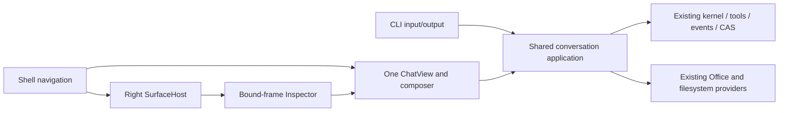

# ADR-0017 / RFC: общий ChatView, shell и visual annotations

Дата: 2026-10-23. Статус: **принят для поэтапной реализации; срез 1a выполнен**.
Owner: application/chat UI. Основание: [аудит с кодом и browser evidence](../architecture/visual-annotator-audit.md).
Это последовательность ограниченных изменений, не новый runtime-контракт.
После реализации поведение переносится в canonical docs, этот RFC остаётся
историей решения. Совместимые C# 7.3/.NET Framework 4.8 и текущий статический JS
сохраняются; CLI не получает зависимость от Office/WebView2.

## Проблема и результат

Одна source-сессия имеет разные черновики в Project и Plugin UI. Повторный выбор
плагина пересоздаёт его frame. Office/workspace используют общий kernel/store,
но разную подготовку контекста, схемы ресурсных tools и транспорт отправки.
Визуальное сходство трёх composer не устранило эти различия.

Цель: один ChatView/composer с общим session state, один application path для
общего поведения и существующие source-specific adapters. Shell управляет
навигацией; preview показывает ресурс; Inspector передаёт выбор в тот же composer.
Source chat плагина, его publication и выбранный data project не сливаются.

## Решения для принятия

| Вопрос | Предлагаемое решение | Отклонённая альтернатива / причина |
|---|---|---|
| Общий UI | Развивать существующие message/composer функции до одного owner и одного active mount; сохранять богатую Office presentation | Новый renderer/framework или три стилизованные копии |
| Draft | Один owner по точной session identity; text, selected inputs, preferences и revision. Surface не владеет draft | Отдельный Map внутри каждого `bindComposer` |
| Application | Общие input/receipt, context preparation, descriptors и lifecycle в `RNAssistant.Application`/Core; CLI только ввод/вывод | Перенести Office dependencies в CLI либо оставить два алгоритма под одинаковыми именами |
| Resources | Общие typed selector/descriptor/validation/projection owners; capability-specific schemas, существующие Office/file providers | Огромная схема с несвязанными nullable полями или второй resolver |
| Workspace | Различать владельца истории и подключённые ресурсы. Постепенно расширять существующий workspace context | Требовать папку для каждого Office-чата или выдавать смену active workbook за право записи |
| History | Сохранить текущие поддерживаемые streams и CAS in place; в фазе 1 формат/пути не меняются | Новая БД, dual-write или скрытая конверсия старого model protocol |
| `Host/DocumentKey` | Последующий ограниченный cutover в том же ChatStore после решения native owner/layout и проверки всех consumers | Косметически переименовать поля и объявить runtime объединённым |
| Plugin | Source workspace + chat + isolated preview/release; grants data project остаются отдельными | Отдельный тип истории для плагина или доступ preview к main bridge |
| Browser | Локальный SurfaceHost поверх существующих HTML/plugin frame owners; reuse по exact identity | Новый универсальный internet browser, новый WebView на каждое переключение |
| Annotator | Небольшой host-owned JS Inspector, typed input evidence, существующие ресурсные чтения и mutations | DOM snapshot store, новый patch engine, прямое сохранение DOM |
| Дерево | Workspaces/документы/чаты и существующие разделы плагинов | Общее дерево файлов: пользователь исключил его из scope |

## Владение состоянием и переходы

Shell хранит route, selected chat/workspace, раскрытие дерева и геометрию.
ChatView отображает typed projections; lifecycle/outcomes определяет kernel,
а существующий `RunViewStateProjector` строит отображаемое состояние. Общий draft owner не пишет assistant
messages и не становится второй историей. Surface хранит exact resource binding,
instance lifetime и view navigation. Inspector не владеет историей или файлами.
Историю маршрутов нельзя воспроизводить как model/tool calls.

| Intent | Действие | Что должно сохраняться |
|---|---|---|
| OpenPlugin | Выбрать source workspace и существующий выбранный/последний чат, свернуть дерево, открыть release/preview справа | Тот же центральный ChatView, точный draft; для отсутствующего чата empty state и явное создание |
| OpenProject / OpenOffice | Выбрать владельца чата; Office source подключается явно к exact document | Не создавать чат от простой навигации; прежний run остаётся привязанным к исходному owner |
| OpenHTML / OpenResource | Открыть exact source через существующий resource owner | Chat selection неизменен; read не выдаёт write permission |
| Back/Forward | Восстановить route/selection и доступную surface | Не запускать повторно send, publication или tool effects |
| Hide / show surface | Удержать живой instance при той же identity; вновь проверить grant/liveness | Не создавать новые subscriptions или WebView без причины |
| Close surface | Отозвать только её transport/Inspector и освободить listeners | Draft и чат сохраняются; shared resources освобождает их владелец |
| Close host | Существующие cancel/drain и сохранённая история | Продолжение работы после закрытия окна не входит в этот RFC |

По умолчанию при смене workspace закрывается surface с несовместимым owner/grant;
она не переносится в другой чат по совпадению URL/имени. Повтор того же exact
resource/instance без reload использует текущую surface. Изменение source/release
или explicit reload создаёт новую generation и инвалидирует live DOM selection.
Back к отсутствующему источнику показывает unavailable, не открывает похожий файл.

Текст draft должен сохраняться до подтверждённой доставки; новый ввод не очищается
поздним acknowledgement старого. Один input получает один request/operation ID,
который сохраняется при повторе того же намерения. Один view-owner управляет
pending state и подписками. Office queue/steer и workspace confirmation не теряют
семантику при общей кнопке Send.

Фаза 1 объединяет drafts в открытом host. Полное восстановление несохранённого
ввода после пересоздания WebView — отдельный gate фазы 3: выбрать защищённый
user-state persistence в существующем владельце chat-input/staging. Не сохранять
resource bodies, secrets или защищённый transcript в localStorage; там остаётся
несекретная геометрия. Отсутствие текущего draft persistence нельзя скрывать
обещанием, что reload истории восстанавливает несохранённый ввод.

## Минимальный контракт Inspector и annotation

Предлагаемые типы ниже ещё не реализованы. Typed DTO разделяют захват и принятие
пользовательского input; универсальный nullable bridge payload не вводится.

1. **Begin inspection:** доверенный host выбирает exact surface/frame и session;
   передаёт ограниченную команду activate/deactivate/dispose. Путь к файлу из
   preview никогда не становится полномочием. Для HTML используется существующий
   snapshot assembly/isolated channel; для plugin — exact `CoreWebView2Frame`
   после загрузки и существующий проверяемый Frame transport.
2. **Selection:** JS возвращает request/generation correlation, optional stable UI
   ID, tag, bounded safe attributes/text, selector, ancestry и geometry. Host сам
   добавляет source `ResourceRef`, binding/grant и preview generation. Source
   revision обязательна для дальнейшего разрешения; content hash её не заменяет.
3. **Draft annotation:** typed selection + необязательный пользовательский comment
   в общем draft. Selection без comment — Inspect-only MVP, без отдельного pipeline.
   Edit/remove не создают conversation events; cancel удаляет только свои staging
   entries через existing owner и никогда не делает прямой CAS GC.
4. **Accepted input:** immutable bounded payload в существующем CAS, exact links
   в обычном user-message/input event. Допуск, fingerprint и replay принадлежат
   `ConversationInputJournal`/ChatStore; повтор не создаёт второй input/chip.
   Workspace не получает фиктивную `DocumentAuthorityId`: надо расширить общую
   scope-aware ingestion boundary, а не вызывать document-only commit под fake host.
5. **Model projection:** смысловой target источника, comment и ограниченное
   описание selection. Exact IDs/revisions/instance tokens остаются runtime-only.
   Дальнейшее чтение — `common.resources_*`; изменяется реальный HTML/CSS/JS через
   существующие tools с source-read/preparation/read-back guards.
6. **Refresh/check:** разрешение selection учитывает revision/generation и
   однозначность. Изменённая версия — stale; несколько кандидатов — ambiguous;
   отсутствующий источник — unavailable/unresolved. Никакого первого похожего
   элемента или молчаливого reattach. DOM, созданный JS, не выдаётся за HTML-source.

Начальные пределы для проверки перед интеграцией: selection ≤16 KiB UTF-8,
text excerpt ≤512 символов, selector ≤1024, ≤12 разрешённых attributes,
≤8 ancestor hints. Не снимать значения input/textarea/select/contenteditable,
пароли, cookies, storage, tokens или необработанный `outerHTML`. При сборе текста
исключать sensitive descendants, а не только сам выбранный node. Screenshot не
включается в JSON. Комментарий — пользовательский intent; DOM — недоверенные данные.

`R1@v1`, `E1`, `O1`, `Q1` остаются текущими diagnostic aliases, scoped to chat.
Не использовать `E1` повторно для элемента. Composer может показывать локальные
подписи «Выделение 1»/«Комментарий 1»; это не новый resolver и не tool argument.
Compaction/replay сохраняют ссылки обычного user input через existing owners;
живой frame после restart не считается восстановленным без новой проверки.

Overlay: pointer-events none, capture click только в active mode, Escape/off и
dispose снимают listeners. Scroll/resize пересчитывают geometry; coordinates не
identity. Open shadow root может проверяться отдельно; closed shadow и чужие
nested frames в MVP возвращают unsupported. Native injection/CSP/navigation
проверяются на Windows, main bridge и plugin isolation не расширяются.
Сам UI RNAssistant, source maps, визуальные diff и скриншоты — вне первого MVP.

## Последовательность и карта файлов

| Этап | Изменения / владельцы | Удаляемое дублирование и gate |
|---|---|---|
| 0 — выполнен | Этот RFC и связанный аудит, реальные browser observations | Никакого application cutover; принять RFC перед кодом |
| 1a — первый срез | `app-chat-state.js`, `app-chat-composer.js`, `app-workspace-chat.js`, consumers в `app-project-chats.js`/`app-plugins.js` | Один session draft owner вместо двух Map; общий acknowledgement behavior. Один чат на двух экранах показывает один текст, late ack не стирает новое, retry не дублирует send |
| 1b — полный ChatView | `app-chat.js` и тематические chat modules; один view controller/mount в `web/index.html`; navigation adapters остаются временно | Удалить отдельные project/plugin transcript/composer controllers и лишние формы после переключения consumers. Сохранить Office history paging, attachments, edit, activity, questions, queue/steer, focus/scroll и source-chat возможности |
| 2 — application/resource parity | `RNAssistant.Application/Workspace`, `ConversationModelSession`, `ConversationKernelAdapter`, resource handlers/catalog и typed input contracts | По одному общему owner для descriptor/selectors, accepted inputs и context preparation; host-specific capture/COM остаются. CLI и UI тестируют один и тот же application path, разные source capabilities не выравниваются фиктивными tools |
| 3 — shell | `app.js`, `app-layout.js`, `app-navigation-tree.js`, plugin/project navigation, `web/index.html` | Общий central chat + right surface, explicit route history, сохранение layout/drafts. Убрать безусловный plugin reopen и implicit chat creation. Принять protected draft persistence gate до заявления о reopen parity |
| 4 — browser surface | Существующие HTML preview owners, `PluginWebViewHost`, `AssistantPaneControl` | Общий surface lifecycle поверх разных trust boundaries; reload/back/forward только разрешённых ресурсов, старый instance отзывается ровно один раз. Windows frame/isolation/disposal gate |
| 5 — annotator | Новый небольшой JS Inspector, общий composer input, typed DTO в Contracts, existing ingestion/resources/patchers | Никаких отдельных CAS/resolver/patcher. Много selections, no-comment selection, cancel/retry/compaction, stale/ambiguous guards; одна подтверждённая правка исходника и повторная проверка preview |
| 6 — cleanup/performance | Owners затронутых частей и canonical docs | Удалить заменённые consumers/handlers и временные seams; сравнить baseline на одинаковых fixtures, явно оставить native gaps |

1a не закрывает всю фазу 1; одинаковый renderer не закрывает фазу 2. Нельзя
совместить 1a с массовой заменой kernel, schema protocol, storage layout и WebView.
Каждый оставшийся временный adapter получает consumer, owner и removal gate в
`MIGRATION_MAP`; не вводить новый adapter, если достаточно переключить consumer.

Storage `Host/DocumentKey` — отдельная подзадача фазы 2 после выбора layout:
один ChatStore, явная owner identity, проверенные list/load/append/delete/trajectory/
CAS reachability consumers и interrupted migration. Никаких физического переноса
всех историй, dual-write или удаления данных в первой UI-правке. Совместимость
current-supported streams не означает разрешения запускать старый model protocol.

## Проверки, rollback и открытые решения

| Риск | Минимальная проверка |
|---|---|
| Общий draft/send | Browser: одна workspace session через project/plugin, Office через тот же draft owner с отдельной identity; independent sessions, failed send, late ack, repeated submit; существующий `chat-input-delivery.test.js` |
| History/presentation | Office paging и full workspace transcript, saved messages/attachments/unknown/approval; `chat-history-paging.test.js`, `workspace-chat-layout.test.js` после согласования history control |
| Runtime/resource parity | Focused Harness через production application boundary: одинаковый input/read selector в CLI и UI, explicit source capability differences, no effect on rejected target; без отдельного test-only loop |
| Office | Windows: несколько/несохранённые/read-only книги, rename/Save As, close/reopen, COM unavailable, смена target во время approval; runtime не пишет в другую книгу |
| Workspace/plugin | Missing/moved root, read-only/grant revoke, source/release/data isolation, navigation при run, plugin JS failure, forged frame messages |
| Shell lifetime | Повторные переходы, focus/Escape, narrow layout, one mount/subscription, exact source reuse, close/drain, Back не повторяет action |
| Inspector | Nested/repeated text, scroll/zoom/transform, dynamic DOM, unsupported frames/shadow, dirty revision, sensitive values, forged/oversized payload, dispose/off обычные клики |
| Accepted annotations | Duplicate bridge/send, два похожих ресурса, exact source mapping, compaction/reopen, source patch + read-back, ambiguous/stale refusal |
| Performance | Тот же browser-ready fixture; отдельно native cold start/RAM/WebView2 controllers. Не называть JS heap памятью всего приложения |

Phase 1 rollback — возврат только code/UI change, без преобразования event/CAS
формата или пользовательских файлов. Для каждого более позднего durable contract
нужен свой version/admission и rollback gate до переключения; downgrade не должен
угадывать новый payload. Не поддерживать старый и новый writer одновременно.

Открыто до соответствующих этапов: защищённое хранение несохранённого draft после
закрытия host; окончательный storage-owner layout (связать с D07); long-history
workspace paging; native Frame injection и DOM→source mapping для generated JS;
одиночный `undefined.create` в rapid-preview probe. Эти вопросы не требуют нового
runtime или блокировки конкретного исправления общего draft в фазе 1a.

Пользователь принял RFC после аудита. Срез 1a удалил оба локальных `drafts Map`:
Project и Plugin теперь читают одно состояние по `workspaceId/sessionId` в
существующем `state.chatDrafts`. Browser-проверка охватывает общий текст,
mode/reasoning, файловую ссылку, retry с тем же request ID, двойной submit и
поздний acknowledgement. Первый срез 1b перенёс Project и Plugin на один
физический workspace transcript/composer. Следующий срез подключил Office к
тому же in-memory draft owner и versioned acknowledgement: late ack не стирает
поздний ввод, включая идентичный текст и переключение чатов. Следующий срез
объединил физическую ленту Office/Project/Plugin с isolation фоновых render.
Последующие срезы перенесли общий composer и нейтральные controls, а единый
ChatView controller получил mount, маршрутизацию формы и общие workspace
approval/questions. Этап 1b завершён host-neutral; Windows/Office/WebView2
qualification остаётся открытой. Остальные этапы выполняются
последовательно по своим gates. Текущее evidence — в [PROGRESS](../stabilization/PROGRESS.md).
