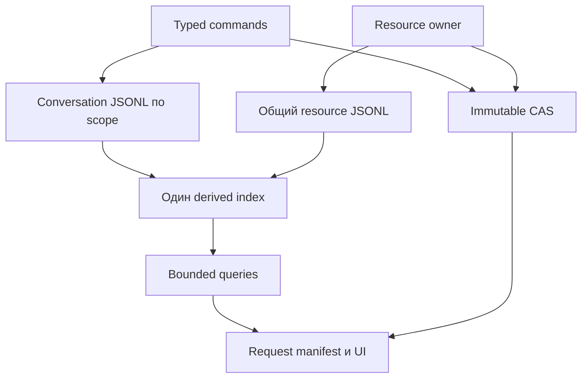
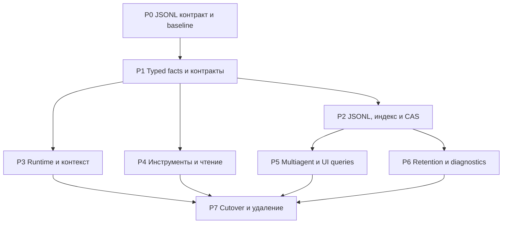

# RNAssistant — детальный план реализации для агента

# Назначение и исходные условия

Задача агента — уменьшить нагрузку хранения, контекста и файловых инструментов RNAssistant, сохранив JSONL append-only и неизменяемый CAS. План связывает 23 выявленные проблемы с архитектурными решениями, конкретными владельцами кода, удаляемыми механизмами и проверками. Начать с §0; этапы и карта файлов находятся в §8, критерии приёмки — в §10.

**Обязательная основа хранения — физически append-only JSONL и неизменяемые тела CAS.** Индексы и checkpoints восстанавливаются из canonical facts; они не становятся вторым источником истины. Предложенные изменения охватывают commit/recovery, multiagent, context preparation, инструменты, диагностику и maintenance.

Принятые сообщения, результаты, наблюдения, изменения run и необходимые recovery facts добавляются новыми записями. Исправление или смена состояния не переписывает принятый префикс. Закрытые сегменты неизменяемы. Незавершённый непринятый хвост после сбоя обрабатывается отдельно и не считается историей. CAS не хранит изменяемые объекты.

SQLite предлагается сохранить только как **один общий восстанавливаемый индекс**: текущие строки, locators, cursors, counters и ограниченные checkpoints. Все необходимые факты восстанавливаются из JSONL + CAS. Отсутствие индекса допускает repair; отсутствие работоспособной зависимости SQLite в выбранном runtime не означает незаметное переключение на второй backend.

Главное упрощение — убрать полный `ChatSession` из обычного чтения, записи, формирования контекста и UI. Сегментация сама по себе не исправляет полную материализацию истории.

Пользователь разрешил пересмотр архитектуры и отказ от совместимости с прежним форматом. Целевой вариант не содержит legacy reader, dual-write, автоматического импорта или постоянных альтернативных реализаций. Старые пользовательские данные и ключи сохраняются; отказ от совместимости не разрешает их удаление.

Основание: анализ репозитория `Mutagrey/RNAssistant`, `main`, commit **12fddb740001ad9eaee35233126484e4deb7b389**. Контрольная сверка main 6 ноября 2026 года подтвердила тот же commit. Перед реализацией проверить только новые изменения по затронутым владельцам; ссылки на исходники ниже закреплены за проверенным снимком.

**Граница доказанности.** Лишние обходы, записи, копии и причины ложных повторных чтений подтверждены исходниками. Числа ускорения, абсолютные задержки и доли реального диска/памяти на рабочей Windows/Office-системе не измерены. В текущей среде нет .NET/Mono; build, Harness и Office qualification при составлении плана не выполнялись. Измерения и проверки ниже — задания реализации, а не уже полученные результаты.

Сохраняются C# 7.3/.NET Framework 4.8, разделение Core/Application/OfficeHosts, запуск `ConversationRunService → AgentKernel`, semantic targets, E-ссылки и read-back. Новые внутренние IDs, cursors и revisions не становятся обязательными аргументами модели. Сохраняются группы чатов, свободное общение агентов и существующий explicit fork; новые обязательные роли или Agent entity не вводятся.

# 0. Порядок работы агента

## 0.1. Задача и результат

Оптимизировать обычный одиночный чат и параллельную работу агентов: уменьшить сохраняемый объём, повторное чтение/декодирование, материализацию истории и время под блокировками. Результат реализации — один работающий путь хранения и контекста с удалёнными заменёнными механизмами. Уменьшение числа классов само по себе не является критерием; должны исчезнуть конкретные обходы, копии и протоколы согласования.

Обязательные условия пользователя: JSONL остаётся каноническим append-only хранилищем, CAS — immutable; совместимость со старым форматом не является целью; старые пользовательские данные не удаляются. Система сохраняет свободное общение обычных чатов, semantic targets и правила evidence. Укрупнение журналов и общий derived index — выбранное направление реализации, которое агент проверяет по конкретным invariants, а не заменяет новым общим исследованием.

## 0.2. Первый проход по репозиторию

1. Прочитать AGENTS.md, docs/README.md и начало docs/stabilization/PROGRESS.md. Проверить HEAD и незавершённые изменения; чужую работу не перемещать, не сбрасывать и не коммитить.

2. Прочитать §§1–2 этого плана, затем нужные F из §7 и карту файлов §8.2. Поиск начинать с rg и читать нужные методы, не загружать целиком docs, tests и пользовательские истории.

3. Для первой группы изменений подтвердить путь вызовов: producer → canonical commit → index/reducer → consumer. Для каждого события назвать consumer и recovery rationale. Отсутствие пользовательского отображения ещё не делает событие мусором.

4. Зафиксировать короткое решение P0: границы conversation/resource streams, body/occurrence, commit/ack boundary, составные index keys, порядок locks и repair. Открытые вопросы сформулировать как проверяемые условия. Изменение рекомендованного решения допускается при конкретном противоречии или измеренном узком месте; JSONL authority и остальные пользовательские условия сохраняются.

5. Снять минимальный baseline на synthetic fixtures и scripted providers. Разделить normal path при догнанном индексе, catch-up и полный repair. Проверить одиночный чат отдельно от multiagent.

6. Выбрать первый сквозной срез §8.3. Сначала изменить общий контракт и одного владельца, затем переключить оба host consumer. Не создавать универсальный framework заранее.

7. После каждого завершённого среза удалить заменённый путь, выполнить только релевантные проверки и обновить canonical document. Отчитаться по §12. Переход к следующему срезу определяется зависимостями и найденными рисками, а не необходимостью повторять полный аудит.

## 0.3. Карточка одной задачи реализации

Перед изменением достаточно короткой записи с шестью полями: **F/симптом; owner и методы; новый контракт/инвариант; удаляемый путь; минимальная проверка T; ожидаемое изменение counters**. Это рабочая запись в существующем плане/трекере проекта, не новая подсистема задач и не обязательный task list runtime-агента.

Задача не завершена, пока новый путь скрыто вызывает старую полную материализацию, требует второй authoritative registry или оставляет временный adapter без ближайшего условия удаления. Число PR/commits не фиксировано: один понятный инвариант на срез, существующая стратегия веток из AGENTS.md.

## 0.4. Как пользоваться проверками

T01–T16 — группы требований, а не заказ на шестнадцать новых test-файлов. Сначала найти соответствующее existing Harness coverage, затем добавить только отсутствующий failure/property сценарий. Проверки одной области не запускают полный unrelated suite. Реальный Office/COM/WebView2 результат подтверждается отдельно на подходящей Windows-среде; от пользователя доступны только фотографии экрана.

Полный индексный rebuild, integrity audit, backup и диагностика потери питания не включаются в каждый обычный запрос. Для документационных изменений достаточно проверить diff, paths и ссылки. Время и объём реализации уточняются после P0; произвольные оценки ускорения или обещания удаления всего storage-контура не являются результатом.

# 1. Архитектурное решение до оптимизации отдельных функций

## 1.1. Корень проблемы

Сегодня одну историю обслуживают канонический JSONL, SQLite-проекция, полный JSON-root, материализованный `ChatSession`, разрастающийся header checkpoint, runtime snapshots, заново восстановленный working set и полная диагностика запросов. Индекс не помогает, если после него код всё равно читает, сравнивает или копирует весь агрегат.

Поэтому оптимизировать нужно две независимые величины: **сколько действительно нужных данных сохраняется** и **сколько старых данных затрагивает новая операция**. Сохранённая история может расти линейно; стоимость маленького append и подготовки одного запроса не должна расти вслед за ней. Источники: [aggregate save](https://github.com/Mutagrey/RNAssistant/blob/12fddb740001ad9eaee35233126484e4deb7b389/src/RNAssistant.Core/Storage/ChatStore.cs#L960), [полный header](https://github.com/Mutagrey/RNAssistant/blob/12fddb740001ad9eaee35233126484e4deb7b389/src/RNAssistant.Core/Storage/ChatHeaderReducer.cs#L18), [context compiler](https://github.com/Mutagrey/RNAssistant/blob/12fddb740001ad9eaee35233126484e4deb7b389/src/RNAssistant.Core/Services/ModelContextCompiler.cs#L204).

## 1.2. Сравнение архитектур

| Вариант | Что упрощает | Что остаётся или добавляется | Решение |
|---|---|---|---|
| Только ускорить нынешние per-chat JSONL, sidecars и aggregate Save | Локальные hot spots | Полные snapshots, повторные reducers, многожурнальные send, рост затрат с историей | Независимые исправления допустимы, конечная архитектура не подходит |
| Per-chat JSONL плюс общий mail journal | Одно место принятия send | Input application/run остаются в другом журнале; нужны linkage, receipts и два cursor | Лишний протокол для текущей задачи |
| **JSONL разговоров на document/workspace + общий JSONL ресурсов + CAS + один derived index** | Одна запись для локального send; маленькие commits; адресные queries; меньше файлов/владельцев | Короткие append locks, явный JSONL→index catch-up и cross-owner recovery | **Рекомендуемый вариант** |
| Тот же JSONL, но собственные файловые индексы вместо SQLite | Убирает SQL dependency | Придётся реализовать поиск, составные ключи, атомарное обновление индекса, paging и repair | Не выбирать без доказанной невозможности использовать существующий provider |
| Один глобальный JSONL для всех разговоров и ресурсов | Максимально простая общая последовательность | Общая очередь append и общая область отказа всего профиля | Не нужно ради локальных операций |
| SQLite как канонический event store | Иные свойства транзакций | Меняет заданную основу хранения | Исключено требованием пользователя |

Выбранное решение не создаёт универсальную event-sourcing платформу. Нужно переработать существующие `ChatStore`, `ResourceAuthorityStore`, context preparation и общий result commit. Один codec/append primitive и typed reducer переиспользуются этими владельцами.

## 1.3. Граница журналов — основное архитектурное упрощение

**Разговоры.** Один логический segmented journal на реальный scope общения: документ Office либо workspace. В нём факты всех его чатов, input/inbox, local receipts, membership и run/control transitions. Это позволяет принять `agents.send` или `agents.spawn` одной строкой. Другая область имеет другой append lock. Не использовать регистрационный ключ `"office"` как scope ID: он не идентифицирует документ. Существующие ограничения общения: [Office scope](https://github.com/Mutagrey/RNAssistant/blob/12fddb740001ad9eaee35233126484e4deb7b389/src/RNAssistant.Office/Controller/AssistantController.AgentCommunication.cs#L18), [Workspace scope](https://github.com/Mutagrey/RNAssistant/blob/12fddb740001ad9eaee35233126484e4deb7b389/src/RNAssistant.Application/Workspace/WorkspaceConversationService.AgentCommunication.cs#L34).

**Ресурсы.** Один отдельный segmented resource journal для многих логических resource scopes. Физический файл не получает собственную БД и набор новых журналов. `ResourceAuthorityScopeId` остаётся смысловой идентичностью; текущий Workspace-файл имеет scope `("file", id)`, который может использоваться из нескольких workspace. Нельзя дублировать его head в каждом разговоре. Здесь сохраняется короткая сериализация resource commits; исчезают широкие snapshots и глобальная блокировка обычных чтений. Источники: [file scope](https://github.com/Mutagrey/RNAssistant/blob/12fddb740001ad9eaee35233126484e4deb7b389/src/RNAssistant.Core/Storage/WorkspaceFileService.cs#L1734), [нынешние отдельные authority/revisions файлы и общий lock](https://github.com/Mutagrey/RNAssistant/blob/12fddb740001ad9eaee35233126484e4deb7b389/src/RNAssistant.Core/Storage/ResourceAuthorityStore.cs#L412).

**Группы и registry.** Оставить одного существующего смыслового владельца. Группы сейчас публикуются через resource authority; им не требуется одновременно новая копия в conversation journal. Навигационные группы и causal-chain participants различаются. Перенос группы к другому owner допустим только отдельным обоснованным срезом, не как скрытое следствие нового layout. [Текущий контракт групп](https://github.com/Mutagrey/RNAssistant/blob/12fddb740001ad9eaee35233126484e4deb7b389/docs/session-events.md).

Изменение имени/пути документа обновляет привязку существующей identity, если это тот же документ; не переносит физически всю историю. Настоящая смена scope — отдельная операция с действующими ограничениями, а не переименование каталога для обхода isolation.

## 1.4. Индекс: одна реализация, без собственной мини-БД

Рекомендация — один `index.sqlite` на новый storage root. Он содержит адресные metadata/read models всех journals и маленькую строку applied cursor для каждого stream. Нет отдельной БД на чат, source-файл или агента; нет полной копии event payload, `root_json` и гигантского `header_json`.

Это **необязательный источник данных, но обязательная зависимость штатного query path** выбранной реализации. Его утрата запускает восстановление; отказ загрузки provider — явная ошибка зависимости. Не строить второй постоянный query backend «на всякий случай».

SQLite уже подключён в Core; Windows выбирает `winsqlite3`. Версия managed NuGet не доказывает версию native engine. Проверить фактическую поставку в net48/Office и поддерживаемом CLI runtime, нужные SQL operations, два процесса и корректную работу в выбранном локальном root. Источники: [provider selection и opening](https://github.com/Mutagrey/RNAssistant/blob/12fddb740001ad9eaee35233126484e4deb7b389/src/RNAssistant.Core/Storage/ChatStore.SqliteProjection.cs#L89), [Core dependencies](https://github.com/Mutagrey/RNAssistant/blob/12fddb740001ad9eaee35233126484e4deb7b389/src/RNAssistant.Core/packages.config), [delivery targets](https://github.com/Mutagrey/RNAssistant/blob/12fddb740001ad9eaee35233126484e4deb7b389/Directory.Build.targets#L118).

Общий индекс уменьшает число файлов и helpers, но увеличивает область его repair и создаёт общую очередь коротких write transactions. Это явный tradeoff: измерить wait time, а не обещать бесконечную параллельность. На первом шаге не вводить sharding, WAL tuning, daemon или собственный scheduler. Connection lifetime ограничен и принадлежит storage owner; один connection нельзя использовать конкурентно без предусмотренной сериализации.

Если provider действительно непригоден для обязательного runtime, сначала устранить конкретную проблему упаковки/зависимости. Если это невозможно, пересмотреть только реализацию derived index отдельным ADR до cutover, сохранив JSONL authority. Не поставлять одновременно оба варианта. Отсутствие Windows evidence в этой среде не доказывает невозможность SQLite.

## 1.5. Какие классы проблем устраняются

| Изменение | Удаляемый класс проблем |
|---|---|
| Typed delta вместо Save полного ChatSession | Потеря чужих изменений через старый aggregate, O(H) diff/clone, сохранение частичного объекта как полного |
| Одна запись на local send/spawn в scope | Частично принятый input/receipt/participant и локальный handshake между чатами |
| Один общий result commit Office/Workspace | Разная externalization, разные history/evidence interpretations одного результата |
| Body отдельно от occurrence | Новая большая CAS-обёртка при каждом call ID/timestamp и повтор source в tool result |
| Bounded state и selection до hydration | Зависимость обычного шага от всего архива, огромные receipts и копии |
| Actual request manifest как единственная delivery authority | Пустые per-run словари, потеря whole observation после partial, лишние reads для восстановления guard |
| Один typed index reducer и один индекс | Per-chat connection/schema/rebuild обвязка, полные root/header blobs, несколько независимых представлений факта |
| Optional diagnostics отдельно | Бессрочные SSE/request roots и блокировка результата очередью trace |

**Что сохраняется принципиально:** append lock, CAS durability, проверка целого frame, offsets/locators, suffix catch-up, recovery внешних effects, один reducer и rebuild. При JSONL нельзя честно обещать удалить согласование с derived index. Упрощение заключается в одном маленьком протоколе вместо полного replay/агрегатов, а не в сокрытии этого протокола.

# 2. Целевая модель и протокол хранения

## 2.1. Владельцы и минимальный API

Storage owner предоставляет смысловые операции `Commit(identity, guards, typedDelta)`, `OpenContext(chat, limits)`, `ReadFacts(refs, limits)`, `ReadWindow(chat, cursor, limit)` и адресные head/receipt queries. Это уточнение существующих интерфейсов, не набор обязательных новых сервисов. Host adapters отвечают за источники и внешние effects; context owner — за ограниченный набор ссылок и фактическую доставку.

Журналы ссылаются на уже опубликованные CAS bodies. Индекс ускоряет навигацию; запрос читает тела только после отбора. Diagram не означает атомарности между conversation и resource journals.

Разделить четыре предмета: immutable source body/view; observation с identity/coverage/provenance; terminal result с outcome/effect/eligibility/correlation; manifest конкретного model request. Одно тело может участвовать во многих observations/results. Нельзя включать call ID, timestamp и статус в content identity общего source. Для произвольного domain JSON допустим один сохранённый payload; не вырезать эвристически чужие поля `text`/`rows`.

## 2.2. Одна строка JSONL — единица принятия

Commit frame — один ограниченный UTF-8 JSON object с завершающим LF. Он содержит format/stream identity, sequence, operation ID и fingerprint, проверку целостности и typed fact либо небольшую группу связанных facts. Большие сообщения, domain payloads и source bodies представлены CAS refs. Sequence задаёт порядок stream; E и message IDs сохраняют свою предметную область. Каждый frame связан с предыдущей проверенной границей через PreviousHash/существующий integrity contract; header следующего segment и первый frame после него продолжают однозначную цепочку. Независимых checksums отдельных строк недостаточно. [Существующая проверка цепочки](https://github.com/Mutagrey/RNAssistant/blob/12fddb740001ad9eaee35233126484e4deb7b389/src/RNAssistant.Core/Storage/ChatStore.EventLog.cs#L154).

JSONL требует UTF-8 и отдельного JSON value на строку; для этого storage-контракта завершающий LF обязателен. Требование LF здесь строже общей рекомендации формата и задаёт границу полного frame. [JSON Lines format](https://jsonlines.org/).

Одна запись может одновременно содержать факт принятия agent message и данные для inbox, receipt и participant membership. Это **один факт с несколькими проекциями**, а не несколько файловых append. Frame ограничен по metadata bytes; большие arbitrary batches, полная session или все historical aliases внутрь строки не помещаются. Порог выбирается в P0 по реальным typed records и проверяется на границе сериализации.

Один вызов Write не делает запись атомарной. Читатель принимает только целый frame с корректной identity, sequence, LF и integrity. Протокол хеширования/защиты должен покрывать согласованные metadata и payload bytes; использовать существующие protection/hash primitives, один раз кодировать запись, не придумывать альтернативные JSON canonicalizers в каждом reader.

Fact identity отделена от locator: `(stream, segment, offset, length, expected fact/commit identity)`. Fact не переименовывается при rebuild индекса. Locator проверяется перед использованием; чужой segment или несовпадающий payload не создаёт E. Архивные E доступны адресно и не загружаются все в runtime.

## 2.3. Порядок записи, публикации и чтения

1. Проверить форму команды, подготовить immutable bodies и зарегистрировать межпроцессную storage activity до CAS publication. Хеширование, compression, LLM/COM и тяжёлые reads выполняются вне append lock.

2. Завершить защищённое CAS-тело, выполнить durable flush и atomic name publication с квалифицированной платформенной границей устойчивости. Новый journal frame не может ссылаться на ещё не опубликованные bytes. Оставшийся без journal ref orphan допустим.

3. Взять короткий append lock точного stream. Догнать его подтверждённый suffix в общий индекс, проверить operation ID/fingerprint и предметные guards. Отставший индекс не считается пустым состоянием.

4. Закодировать и добавить один frame, завершить durable flush. После этого accepted fact существует независимо от успешности индекса и уведомления. `FileStream.Flush(true)` предназначен для записи промежуточных буферов на диск; гарантии rename, файловой системы и потери питания квалифицируются отдельно. [Microsoft FileStream.Flush](https://learn.microsoft.com/en-us/dotnet/api/system.io.filestream.flush?view=netframework-4.8).

5. В одной короткой транзакции **только индекса** применить typed reducer и продвинуть applied cursor этого stream. Сам JSONL append в эту SQL transaction не входит. Затем вернуть durable receipt и послать необязательное уведомление runtime/UI.

6. Если индекс или notify отказал после durable append, ответ/восстановление различает `committed` и `projection unavailable`. Нельзя сообщать «эффект не выполнен» и повторять внешнее действие. Следующая guarded команда сначала догоняет индекс; при невозможности восстановления явно останавливается.

Читатели используют подтверждённый prefix. Обычный исторический locator может читаться без append lock; catch-up, который обнаруживает новый хвост, синхронизируется с writer и не принимает ещё не flushed bytes. Если writer умер после полной записи без подтверждения, recovery под lock валидирует и обеспечивает flush полного frame перед его публикацией. Для caller это неопределённый исход, разрешаемый тем же operation ID.

Идемпотентность хранится в canonical facts: одинаковые scoped operation ID и fingerprint возвращают прежний receipt; другой payload с тем же ID — конфликт. Утрата индекса не разрешает повторно принять операцию. Ключи идемпотентности нельзя хранить только в RAM или с произвольным TTL, пока контракт допускает поздний retry.

## 2.4. Сегменты и восстановление хвоста

Логический journal состоит из последовательно нумерованных сегментов. Начальный header содержит format, storage generation, stream identity и segment identity. Следующий header связывает новый segment с точной подтверждённой границей предыдущего. Layout и naming детерминированы; `active-store.json`, отдельный обязательный manifest всех segments и ещё один authoritative pointer не нужны.

Rotation выполняется только под append lock. После durable границы текущего segment подготовить и устойчиво опубликовать header следующего детерминированного номера; он содержит stream identity и predecessor boundary: segment, final length, sequence, integrity anchor. **Валидный successor header закрывает предыдущий segment.** Отдельный seal-event, active manifest и переименование старого файла не нужны. Последующие facts пишутся только в новый segment. Переиспользуется подготовка temp, но конечная публикация header имеет **create-only semantics**: temp durably flushed до публикации, существующий successor проверяется и продолжается при совпадении identity/boundary, никогда не заменяется. Нынешний WriteAtomic использует File.Replace при наличии target, поэтому его нельзя применить здесь без изменения final-publication contract. То же правило действует для первого header при повторной initialization. [StorageFileSystem.WriteAtomic](https://github.com/Mutagrey/RNAssistant/blob/12fddb740001ad9eaee35233126484e4deb7b389/src/RNAssistant.Core/Storage/StorageFileSystem.cs#L50).

Crash до публикации следующего header оставляет прежний подтверждённый segment; rotation повторяется с тем же следующим номером. Валидный опубликованный header без facts допустим — запись продолжается в нём. Orphan temp не является journal. Два расходящихся successors, несовместимый header, пропущенный sequence или повреждение принятого prefix дают явную ошибку и запрещают автоматическое продолжение.

Последний frame без LF не публикуется обычным reader. Если его JSON, schema, sequence, integrity/связь с конкретным предыдущим prefix и необходимые references полностью валидны, recovery под append lock дописывает LF и выполняет flush, после чего принимает frame; уже полученные полные данные не выбрасываются. Доказанно оборванный неполный suffix не применяется: допустимо сохранить диагностическую копию и удалить только эти неподтверждённые bytes перед продолжением. **Полный record с неверной integrity/schema и повреждение середины нельзя молча отрезать как обычный crash tail.** Закрытые segments не переписываются; checkpoint или compaction контекста не разрешает удалить старые semantic segments.

Порог rotation задаётся bytes/records, не каждым model step и не типом события. На обычном append не перечислять все segments, не считать заново их hashes и не сериализовать всю карту. Индекс хранит маленький active position; reader проверяет следующий номер адресно. Boundary anchor обновляется инкрементально, rotation не перечитывает весь старый segment под lock. При отсутствии пригодного cursor полный streaming discovery/rebuild допустим как repair.

## 2.5. Derived index и checkpoints

Минимальные read models выводятся из реальных queries, а не из копирования классов session:

| Данные индекса | Ключ / назначение |
|---|---|
| Applied cursor | stream ID → segment, verified end offset, sequence, boundary identity, reducer/index version |
| Chat metadata и run state | scope + chat ID; небольшие current fields, counts и exact ownership/control versions |
| Message/terminal/observation locators | stream + chat + stable fact ID; sequence/ordinal для адресного window |
| Evidence и aliases | chat + E/alias; foreign E не принимается из-за совпавшего короткого имени |
| Inputs, receipts и participants | exact scope/root/chain + operation/message ID; pending pages и duplicate lookup |
| Resource heads, revisions, attempts, views | semantic resource scope + identity/revision/attempt ID; без копии всех commits |
| Artifact/group navigation | текущие metadata и refs единственного владельца, history отдельно |
| Working checkpoint | chat + applied position; ограниченное состояние из §5 |
| CAS reachability | типизированные refs/ownership, полностью восстановимые из canonical facts |

Глобальные E/ordinal primary keys нынешней per-chat схемы непригодны для общего индекса. Составные ключи обязательны; E1 двух чатов остаются разными. `COUNT(*)` всех messages/artifacts/locators на каждом cursor read, deep OFFSET, чтение всех artifacts с окном, полные root/header blobs и full-session fallback удаляются. Источники текущих проблем: [schema](https://github.com/Mutagrey/RNAssistant/blob/12fddb740001ad9eaee35233126484e4deb7b389/src/RNAssistant.Core/Storage/ChatStore.SqliteProjection.cs#L173), [cursor counts](https://github.com/Mutagrey/RNAssistant/blob/12fddb740001ad9eaee35233126484e4deb7b389/src/RNAssistant.Core/Storage/ChatStore.SqliteProjection.cs#L257).

Один typed reducer обслуживает append, suffix catch-up и rebuild. Catch-up выполняется ограниченными порциями и один раз для общего индекса; перед guarded командой нужный stream должен быть догнан полностью. Общая база не требует догонять все journals перед любым query: только stream разговора и действительно нужные resource dependencies. Он не выполняет внешние effects, не вызывает модель и не переоценивает историческое принятие по нынешней policy. В canonical fact сохраняются принятые решения и достаточные данные для receipt; ссылка только на изменяемую index row недопустима.

Нормальный restart использует проверенный cursor/checkpoint и suffix. После утраты/повреждения/смены версии индекса допускается O(H) streaming rebuild с ограниченной RAM, одним владельцем и видимым состоянием repair. Не запускать его заново каждым агентом. Неизвестный canonical format/повреждение журнала не лечится сбросом authority. Ошибка SQL/unsupported feature/provider не равна corruption индекса: существующую классификацию error code 1 нужно исправить. [Текущий reset path](https://github.com/Mutagrey/RNAssistant/blob/12fddb740001ad9eaee35233126484e4deb7b389/src/RNAssistant.Core/Storage/ChatStore.SqliteProjection.cs#L62).

Checkpoint находится в этом же derived index и строится из уже ограниченного state. Нужен только маленький cursor на stream и bounded context state на чат, без дополнительного `working-set.log`/`checkpoint.json` и копии всей session. Частота сохранения зависит от событий/байтов, а не от решения LLM сделать summary.

## 2.6. Конкурентность и порядок locks

| Граница | Что защищает | Что запрещено держать внутри |
|---|---|---|
| Run lease exact chat | Единственный model loop между процессами | Не блокирует приём inbox |
| Append lock одного stream | Sequence, свежие guards, целый commit frame и его применение | LLM, COM, source hash/compression, ожидание агента |
| Shared operation admission / exclusive repair | Короткие journal/index operations, init/recovery/rotation против полного rebuild | Длительный CAS capture, LLM/COM и ожидание окончания run |
| Короткая index transaction | Согласованное обновление rows + cursor | Внешние effects и ожидание другого append lock |
| Resource gate exact identity | Live precondition, изменение и read-back ресурса | Чужие источники и весь архив истории |
| Storage activity / maintenance | CAS publication против GC/backup | Не превращается в глобальный lock всей обычной работы |

Порядок для metadata path: при необходимости resource gate → shared operation admission → соответствующий append lock → короткая index transaction. Admission охватывает все короткие journal/index operations, включая canonical init/append/recovery/rotation; это допуск, а не SQL transaction или index mutex. CAS preparation и длительные source operations остаются снаружи. Никогда не приобретать resource gate или чужой append lock, уже удерживая index transaction; не приобретать resource gate из append lock. Операция не удерживает два journal append locks одновременно. Полный repair общего индекса выполняет один storage owner через минимальный межпроцессный gate. Exclusive admission временно закрывает допуск ко всем коротким journal/index sections, дожидается их выхода и закрытия SQL snapshots/connections; новые обращения ожидают отменяемо либо получают repair-in-progress. Инициатор выходит из append/SQL/shared admission и паркует metadata continuation; после repair сначала повторно проверяет operation ID/receipt.

Repair **не ждёт окончания model runs, resource ownership или долгих CAS publication activities**. Иначе run/publisher может ждать собственный repair. Run lease, нужное resource ownership и защита CAS от GC не освобождаются безусловно ради индекса; repair owner сам не получает resource gates. Порядок допуска исключает shared section, ожидающую resource gate. После exclusive drain repair может отдельно взять append lock для проверки/adoption tail без открытой SQL transaction, затем отпустить его до rebuild. Gate admission не является запрещённым порядком SQL-mutex→append. Не удалять index из catch reader под append lock и не смешивать repair с более строгим GC/backup maintenance. Переиспользовать file-lock/activity primitives без broker/heartbeat framework.

Sequence журнала — порядок, не общий optimistic guard на любую команду. Проверять expected run state/version, invocation/control version/pause ID, конкретный resource revision или operation identity. Входящее сообщение не должно инвалидировать законный tool result. Старый callback после cancel не может управлять новой invocation.

Один shared resource journal и общий index всё ещё сериализуют короткие записи. Это сознательная простота; измерять длительность locks и wait, не обещать полного отсутствия общей точки записи. Hash, full-history scans и heavy bodies из этой точки исключаются.

## 2.7. Multiagent и внешние effects

Для local `agents.send` один conversation frame содержит exact sender/recipient/root/chain, operation fingerprint, message ID, body ref, reply/expect-reply и принятое membership/policy решение. Inbox, receipt и membership выводятся из него. Scope/root/participant limit проверяются под append lock; root учитывается, повторный контакт не занимает новый слот. Spawn аналогично может принять child metadata, membership и initial input одним frame.

Crash после append до notify или tool terminal восстанавливает известный receipt без повторной отправки. Принято в inbox, доставлено модели и обработано — разные состояния. Pending input не снимает pause/stop. Control request фиксируется устойчиво, затем сигналит live owner; `requested` не выдаётся за `confirmed`. Сохраняются invocation tokens, early replies, waits и явное recovery.

**Conversation и resource journals не образуют общую транзакцию.** Resource owner фиксирует attempt/prepared/possible-dispatch, подтверждённый outcome/revision/head. Conversation pending call заранее хранит exact attempt ID и owner locator. После устойчивого resource outcome разговор идемпотентно прикрепляет terminal result по receipt. Lookup head/attempt/receipt проверяет свежесть cursor **его owner stream**, а не только conversation stream. Известный immutable receipt можно прочитать напрямую по проверенному locator. Foreign fact готовится до conversation append lock; ресурсный catch-up из-под этого lock запрещён. Crash между этими шагами означает «известный результат ещё не прикреплён», а не разрешение повторить внешний effect.

Если возможный dispatch уже произошёл, а исход не доказан, сохраняется unknown и существующий conservative recovery. Поздний verified outcome принимается по exact attempt даже после cancel; не возобновляет run и не откатывает более новый resource head. Не добавлять 2PC, distributed rollback или глобальный coordinator.

Защиту history/CAS и key lifecycle сохранить. Индекс не должен раскрывать защищённые bodies/содержимое ради удобства запросов; индексировать минимальные разрешённые metadata и refs.

# 3. Что хранить, что буферизовать и что перестать записывать

## 3.1. Классификация данных

«Мусор» здесь означает запись, которая не нужна ни для принятой истории, ни для выполнения, восстановления, доказательства результата или конкретной включённой диагностики. Название события `started` само по себе ничего не доказывает: начало внешнего эффекта может быть обязательным, начало сериализации запроса — нет.

| Данные | Решение | Основание / срок жизни |
|---|---|---|
| Принятые user/assistant/agent messages | Durable | Пользовательская история; удаляются только по явной политике истории/действию пользователя |
| Принятое решение модели, запланированные calls, terminal results | Durable compact facts | Порядок, correlation, E и восстановление; source bodies только по references |
| Mutation prepared / possible dispatch / verified, failed или unknown outcome | Durable до соответствующей границы эффекта | Нельзя переносить в теряемый буфер |
| Accepted inputs, delivery/consumption receipts | Durable compact identities | Dedup/reconnect; тело завершённого input не обязано жить в RAM |
| Exact source snapshots и важные domain payloads | CAS с владельцем | Пока нужны истории, artifacts, pinned context, unresolved effects или backup |
| Resource head и существующие revisions | Indexed metadata + CAS refs | Текущие heads читаются адресно; исторические revisions по запросу |
| Принятая summary/граница compaction и explicit pins | Durable compact content/refs | Решения разговора; summary не создаёт evidence и не заменяет source |
| Технический checkpoint reducer/working state | Производная запись индекса | Ускоряет restart, восстанавливается из фактов; не новая semantic history |
| Фактический состав запроса и доставленные E/coverage | Durable compact manifest | Проверка ответа должна знать, что реально было отправлено |
| Все исключённые сообщения за всю историю в каждом ContextReceipt | Удалить из обязательного пути | Сохранять выбранные/существенно отклонённые candidates и агрегированные причины |
| Полный HTTP request и полный raw response | Opt-in diagnostics | Ограничение по времени/объёму и явный owner; не сохранять бессрочно по умолчанию |
| SSE chunks, промежуточный streaming text | RAM/ring buffer; final text durable один раз | UI streaming; авария может потерять только непринятый промежуточный текст |
| preparing/serializing/writing/flush start/finish | Counters либо bounded telemetry | Не отдельные факты пользовательской истории |
| Повтор того же source body с новым call ID/timestamp | Новое маленькое occurrence, прежний body ref | CAS дедуплицирует байты, но wrapper делает разные тела |
| Нетронутые no-hit файлы поисковых кандидатов | Не помещать целиком в CAS по умолчанию | Обычному навигационному поиску не нужен immutable snapshot всего корпуса |
| Производные table/text indexes | Rebuildable, bounded cache или persisted derivative | Не новая authority; ключ exact revision + transform/version |
| Временные scan buffers и неподтверждённые partial streams | Temp/RAM | Не CAS roots, убираются после операции/перезапуска |
| Ошибки | Durable compact outcome + при необходимости ограниченные детали | Не нужен полный дубль request/SSE для каждого отказа |

Для каждого оставшегося durable event агент должен назвать consumer и восстановительную/пользовательскую причину хранения. Если consumer существует только для диагностического экрана, сначала определить нужный уровень точности и retention. Если consumer отсутствует — удалить запись и мёртвый код её чтения.

Не ограничивать общую полезную историю или число сообщений/агентов искусственными продуктовыми бюджетами. Ограничиваются объём активного состояния, порции чтения, caches и необязательная диагностика. Большой pending inbox читается страницами; если вводится admission/backpressure, отказ должен быть явным и не терять уже принятые сообщения.

## 3.2. Контракт диагностики

Обычный режим хранит run/request identity, модель и настройки, prompt/schema/compiler identity, ordered selected refs, delivered coverage, usage, timings и компактный outcome. Это позволяет объяснить решение runtime и доставку evidence.

**Manifest не гарантирует восстановление exact wire из текущего состояния.** Prompt, skill, renderer, schema или retained source могли измениться/быть удалены. В Inspector различать сохранённые точные байты и реконструированное представление. Exact wire сохраняется один раз только при включённой диагностике и с ограниченной retention. Не создавать отдельную виртуальную машину воспроизведения старых renderer ради прежнего Inspector.

Требуется удалить зависимость обязательного commit от очереди raw trace. Переполнение диагностического буфера даёт счётчик dropped/truncated и ясный статус, но не блокирует принятие tool result. Ошибка обязательного durable commit, напротив, возвращается вызывающему и не маскируется.

## 3.3. Что можно держать в буфере

SSE, промежуточный UI text, scan buffers, counters и ещё не принятый результат подготовки можно держать в RAM. Принятый input должен быть durable до подтверждения пользователю; recovery boundary — до возможного внешнего dispatch; подтверждённый terminal outcome — до объявления завершения. Не переносить их в теряемый таймерный буфер ради скорости.

Сокращение flush сначала достигается одним semantic frame вместо нескольких дублирующих lifecycle записей и отказом от durable каждого SSE chunk. Дополнительный group-commit scheduler вводить только если после этих изменений измерения показывают доминирование flush; подтверждение всё равно выдаётся после общей durable границы. Это не prerequisite первого redesign.

## 3.4. Retention и GC

Текущий GC удаляет orphan, но не освобождает тело, на которое по-прежнему ссылается бесконечно хранимая диагностика. Поэтому уменьшение размера начинается с ownership/retention, а не с более частого полного обхода CAS. Источники: [ChatStore reachability](https://github.com/Mutagrey/RNAssistant/blob/12fddb740001ad9eaee35233126484e4deb7b389/src/RNAssistant.Core/Storage/ChatStore.cs#L548), [правила CAS maintenance](https://github.com/Mutagrey/RNAssistant/blob/12fddb740001ad9eaee35233126484e4deb7b389/docs/cas-maintenance.md#L118).

Новый порядок:

1. Семантические события содержат типизированные CAS refs и вложенные зависимости, необходимые для их интерпретации/восстановления. Reachability/ownership rows являются восстанавливаемым индексом этих фактов, а не второй authority; обновляются reducer вместе с applied cursor после durable JSONL append. Неизвестный event/owner type, повреждение журнала, несовпадение projection cursor или неполная closure блокируют GC. Не вводить независимо изменяемый refcount.

2. Диагностическая retention удаляет только optional diagnostics и их отдельные ownership refs. Canonical request manifest не должен содержать удерживающую raw-trace CAS ссылку без срока жизни; связь по request ID для Inspector допускает отсутствие истёкшего trace. Канонические семантические события и payloads, необходимые для их восстановления, автоматически не удаляются. Обычное логическое удаление/редактирование истории оформляется новым событием; физическое уничтожение пользовательской истории требует отдельной явной операции.

3. Pending/unresolved attempts, активные checkpoints, существующие artifacts и backup closure удерживают нужные тела.

4. GC выбирает действительно unreferenced bodies, применяет grace period и проверяет отсутствие конкурирующей публикации.

5. Первую реализацию удаления запускать в контролируемом maintenance без активных runs и storage activities. Повторно использовать RuntimeStorageActivity/run-registry protocol: activity регистрируется до CAS publish и удерживается до окончательной фиксации либо подтверждённого отказа JSONL commit, включая background capture, attachments и diagnostics вне run. Maintenance запрещает новые activities и держит исключающую границу от проверки quiescence до удаления. Одного process-local PersistenceSync или мгновенной проверки отсутствия runs недостаточно. Concurrent GC с epochs/heartbeat leases не является prerequisite.

6. Позднее разрешать фоновое удаление только с простым доказанным протоколом publish/recheck/delete. Возраст файла и process-local lock сами по себе не защищают от второго процесса.

7. Полная проверка содержимого и целостности — отдельный audit, не обязательный этап каждого запроса или каждой маленькой очистки.

Для canonical JSONL не применять recovery «удалить и перестроить sidecar». Corruption/unknown format дают явный отказ и предусмотренное восстановление. Только derived index можно согласованно пересоздать из фактов; при несогласованном cursor GC не доверяет отрицательному ответу «ссылок нет». Reachability охватывает все conversation journals, общий resource journal, unresolved attempts и вложенные refs. Под исключающим maintenance выполнить независимый inventory canonical файлов, затем проверить полноту cursors/closure. Перечислять streams только через index.sqlite недостаточно: новый journal мог быть flushed до создания его cursor. Ошибка обхода или неизвестный canonical файл блокируют GC. Этот scan допустим в maintenance, не на каждом append.

Резервная копия фиксирует проверенные префиксы **всех canonical journals**, их CAS closure и нужный key material штатным защищённым способом. В первом варианте выполнять её под исключающим maintenance после recovery/flush: закрытые segments копируются целиком, активные — до зафиксированного подтверждённого конца. Индекс можно не включать и затем rebuild; его наличие не заменяет JSONL. Проверить restore в отдельный root с protected messages/bodies, cross-owner receipts и unresolved effects. Переносимость DPAPI на другую Windows identity не предполагается; поддерживаемое окружение восстановления описать явно. Backup не является разрешением автоматически удалить оригинальную историю.

# 4. Структура хранения

## 4.1. Текущая структура

Базовый путь формируется от ApplicationData/RNAssistant. Чаты лежат в директории документа, authority использует отдельные журналы, CAS разбит по префиксу hash. Источники: [AppDataPaths](https://github.com/Mutagrey/RNAssistant/blob/12fddb740001ad9eaee35233126484e4deb7b389/src/RNAssistant.Core/Storage/AppDataPaths.cs#L26), [пути чатов](https://github.com/Mutagrey/RNAssistant/blob/12fddb740001ad9eaee35233126484e4deb7b389/src/RNAssistant.Core/Storage/ChatStore.EventLog.cs#L383), [resource authority paths](https://github.com/Mutagrey/RNAssistant/blob/12fddb740001ad9eaee35233126484e4deb7b389/src/RNAssistant.Core/Storage/ResourceAuthorityStore.cs#L412), [CAS path](https://github.com/Mutagrey/RNAssistant/blob/12fddb740001ad9eaee35233126484e4deb7b389/src/RNAssistant.Core/Storage/ChatBlobStore.cs#L322).

| Сейчас | Роль | Проблема для целевого устройства |
|---|---|---|
| `chats/<host+document>/<session>.events.jsonl` | Канонический чатовый журнал | Потребители материализуют весь чат; смешаны semantic facts и traces |
| Рядом `*.events.jsonl.projection.sqlite` | Disposable SQLite sidecar | Отдельные cursor, tail validation, rebuild, header checkpoint |
| `chats/<host+document>/active.txt` | Выбранный чат | Отдельная файловая запись метаданных |
| `chat-blobs/<prefix>/<hash>.blob` | Immutable CAS | Дедупликация есть; ownership/retention и repeated verification требуют изменения |
| `resource-authority/<scope-hash>.*.jsonl` | Heads/revisions/views | Дополнительные журналы и общая authority lock |
| `resource-authority/mutation-attempts.jsonl`, `vba-journals/` | Recovery внешних эффектов | Смысл нужен, факты должны обслуживаться одним resource journal |
| `workspaces/`, attachments, settings, secrets, skills, tools | Рабочие файлы и настройки | Не являются мусором истории и не подлежат массовому переносу/очистке |

## 4.2. Предлагаемое новое поколение

Имена условные; это один фиксированный новый storage root, а не механизм переключения произвольных backend.

| Путь | Назначение |
|---|---|
| `storage-v2/conversations/<scope>/00000001.jsonl` и последующие номера | Canonical commits всех чатов одного документа/workspace; scope в header проверяется |
| `storage-v2/resources/00000001.jsonl` и последующие номера | Canonical resource facts многих logical scopes: revisions, views, attempts, heads, существующие groups/registry у их владельца |
| `storage-v2/cas/…` | Общие immutable payloads с существующей проверкой, защитой и разумным hash fan-out |
| `storage-v2/index.sqlite` | Один disposable read index: composite keys, per-stream cursors, bounded checkpoints; сопровождающие файлы принадлежат SQLite |
| `storage-v2/diagnostics/…` | Необязательные bounded traces и их retention metadata; отдельное владение |
| `storage-v2/temp/…` | Незавершённые публикации, временные scan/repair buffers; не принятая история |
| Существующие coordination/key paths с явным ownership | Межпроцессные leases/activities, maintenance и protected key material; не новая копия settings/secrets |

Scope identifier стабилен; безопасное имя каталога — его storage locator, не название чата и не путь открытого файла. Один ресурс не создаёт три `authority/revisions/views` файла и отдельную SQLite-базу. Существующие semantic owners не сливаются только ради раскладки каталогов.

Format/generation записаны в canonical headers. Schema/reducer version индекса — его собственная metadata, она не меняет формат истории. Отдельные `active-store.json`, `segments-manifest.json`, список всех chats в `state.json` и полный `checkpoint.json` не нужны.

Корень выбирается в подходящем локальном каталоге, например LocalApplicationData/RNAssistant/storage-v2, с проверенными locking/durability semantics. Не предполагать, что прежний перенаправляемый AppData или сетевой/синхронизируемый путь автоматически подходит. Это deployment gate, не просьба переписать все пути settings, tools, skills и workspace.

Старый root сохраняется отдельно, не открывается как fallback и не участвует в GC нового поколения. Первый новый запуск честно открывает новую историю; автоматического importer нет. Выключить прежние writers до переключения установленного runtime.

# 5. Контекст, память и повторные чтения

## 5.1. Три независимых свойства

Наблюдение может одновременно:

- существовать в архиве;

- не быть доставлено в текущем запросе;

- относиться к прежнему состоянию живого источника.

Эти свойства нельзя выражать одним `observed/current` flag.

**Delivered guard формируется renderer по окончательному запросу после всех сокращений.** Manifest фиксирует состав подготовленных bytes, а не доказывает получение их провайдером. Для принятого ответа используется manifest его exact request ID. Неотправленный request, неопределённый transport outcome и последний подготовленный manifest не дают authority другому ответу. После manifest транспорт не меняет содержимое незаметно: изменение требует соответствующего нового manifest. Если из 1000 строк доставлено 40, guard описывает 40. Если доставлен только receipt, source body guard отсутствует. Ответ модели связывается с конкретным request manifest, а не с «последним когда-либо подготовленным» набором.

Несколько observations одной revision сосуществуют. Частичное observation не удаляет сохранённое whole observation. Whole delivered guard существует только когда whole body действительно включён в тот запрос, на который отвечает модель. Если в нём доставлен только excerpt, guard ограничен excerpt независимо от прежних доставок. E membership и source coverage различаются: terminal receipt может быть допустим для finish, но не давать право заменить весь файл.

Историческое observation, реально включённое в новый запрос, даёт тот же delivery/coverage guard, что новое `core.read`, но не доказывает live currentness. Новый вызов чтения не требуется только ради восстановления per-run словаря. Перед mutation отдельно проверяется живой источник.

Не менять модельные semantic targets на обязательные внутренние hashes/URIs/`R@v`. Внутренний resolver сопоставляет target с доставленными observations. Действующий контракт ссылок: [CONVERSATION_RESPONSE_V8](https://github.com/Mutagrey/RNAssistant/blob/12fddb740001ad9eaee35233126484e4deb7b389/docs/protocols/CONVERSATION_RESPONSE_V8.md#L253).

## 5.2. Инкрементальный working set

Принятый semantic fact инкрементально обновляет кандидатов следующего запроса через тот же typed reducer. Набор содержит current task/constraints, latest summary, bounded recent dialogue, ссылки на релевантные unresolved effects, ограниченные source observations и explicit pins. Сам факт находится в JSONL; working state — его производное представление.

Автоматический membership хранит refs/приоритеты. Его update и applied cursor согласованы внутри derived index после принятия JSONL frame. Отдельные события «гидратировали source», «добавили cache» и второй `working-set.log` не нужны. Explicit pins и принятая summary — самостоятельные durable решения. Ни одна из этих структур не владеет копией body/outcome.

Технический checkpoint содержит base position/version, текущие run/recovery refs, latest summary ref и window boundary, ограниченные observation/receipt/constraint refs и небольшие counters/high-water values. Он **не содержит** всех Messages, E, aliases, artifacts, receipts или resource generations. Его строят из bounded DTO; сериализовать весь ChatSession и потом обрезать запрещено. Полный alias/unresolved registry остаётся адресным индексом на диске.

Обычный restart загружает checkpoint, релевантные facts после него и refs без transcript. **Context replay чата отличается от storage catch-up общего stream.** Checkpoint отмечает последнюю обработанную позицию чата; query по `(stream, chat, sequence)` читает только его facts. Большой поток других чатов после старого checkpoint не проигрывается снова для этого чата, если общий индекс уже догнан. Checkpoint обновляется только у затронутых чатов, не у всех на каждый append. Checkpoint обновляется по накопленным bytes/events независимо от LLM compaction. Потеря/смена версии индекса или checkpoint может потребовать O(H) streaming repair: это отдельный режим storage owner с ограниченной RAM, не fallback каждого OpenContext. До восстановления критических guards отсутствие данных не разрешает действие.

Ограничить отдельно metadata candidates, суммарные hydrated bytes и итоговый token budget на всю preparation. Pins означают приоритет refs, а не обязательное бесконечное включение bodies. Все unresolved effects остаются durable и адресно проверяются при соответствующем admission; в prompt входит ограниченная релевантная часть. Overflow обязательных для конкретного действия данных даёт ясное ограничение/остановку этого действия. Не разрешать скрытый неограниченный refill из архива после исключения очередного candidate.

Порядок assembler:

1. Получить ограниченный набор metadata candidates и адресно выбранных исторических E.

2. Отфильтровать и дедуплицировать metadata по resource scope/identity, revision, representation, coverage и completeness. Один content hash позволяет разделять bytes, но не сливает observations разных ресурсов, E bindings или provenance. Данные для этого известны без загрузки тела.

3. Рассчитать допустимый набор и budget по сохранённым размерам/оценкам.

4. Гидратировать только выбранное; при необходимости точно измерить/сократить его и актуализировать delivery coverage.

5. Один раз построить immutable blocks, manifest и wire.

6. Использовать готовое представление при повторе того же transport request; policy-driven repair создаёт явную новую версию запроса с корректным manifest.

Не перечислять весь архив в prompt как «известные, но исключённые источники». Это снова O(истории). В prompt достаточно небольшого inventory текущих источников с semantic target, coverage и понятной доступностью. Runtime получает другие известные facts/observations адресно по canonical IDs через индексированные запросы основного storage owner. Это не новый semantic search по всей истории и не предположение, что `core.search` уже умеет искать забытые прошлые чтения.

## 5.3. Почему модель меньше перечитывает

Нужные тела и task constraints сохраняются в рабочем наборе независимо от нового run. Compaction сохраняет summary и anchors, runtime отдельно удерживает pending prerequisites и unknown effects. Следующий шаг автоматически получает выбранные ранее observations.

Если тело временно не вошло, runtime различает `not delivered`, `unavailable` и `superseded`. Он не выдаёт модельный отказ «сначала прочитай источник» из-за пустого технического словаря. Если содержимое требуется снова и retained snapshot пригоден, assembler может включить его из CAS в следующий запрос без нового live capture. Модель после этого выдаёт новый proposal. Подгрузка CAS после уже полученного proposal не делает его исходный запрос задним числом доставившим body; реальное отсутствие необходимого delivery guard остаётся основанием отказа.

Это не обещает отсутствия любых повторных чтений. Новый пользовательский запрос на свежие данные, внешнее изменение и mutation precondition могут требовать I/O. Цель — исключить чтения, вызванные потерей runtime knowledge или необоснованной полной перепроверкой архива.

## 5.4. Live validation

Не выполнять `CaptureFile` для всех исторически прочитанных файлов перед каждым model step. Immutable snapshot не требует повторного live hash, чтобы остаться тем же snapshot.

Доступность immutable observation и допуск его body в контекст не зависят от подтверждённой live currentness. Unknown/superseded currentness не превращает сохранённый payload в unavailable и не требует свежего чтения ради доставки исторического snapshot. Renderer указывает exact revision и честный статус, не объявляет его текущим без основания. Изменить currentness admission для retained source bodies, чтобы фильтр «body только при Current» не сохранял ложный preflight. Проверка актуальной publication активных skills/tools и trusted observation metadata остаётся отдельной; старый snapshot не подменяет текущий исполняемый контракт. Предпочесть более новую подходящую observation допустимо; потерять bindings старой из-за этого — нет.

Known heads обновляются после собственных подтверждённых mutations и достоверных provider events. Watcher, mtime и size — hints, не доказательство актуальности. Повторная доставка observation при сборке контекста не является новым live read. Явный `core.read` mutable semantic target сохраняет семантику чтения живого источника: retained snapshot используется только при достаточном provider-specific подтверждении той же версии, иначе проверяется выбранный источник. Новый обязательный аргумент `fresh` не вводится. Для произвольно изменяемого внешнего файла проверка может требовать полного hash/read. Дополнительно проверяется конкретный target перед mutation.

Внешний редактор может не соблюдать RNAssistant locks. Утверждать универсальную атомарную compare-and-write гарантию для любых файлов нельзя: она зависит от provider/ОС. Зафиксировать границу возможностей provider, проверять precondition и фактический результат, корректно показывать conflict/unknown.

## 5.5. Один ограниченный cache

Допустим общий bounded cache неизменяемых verified bodies/views у существующего storage owner. Ключ включает content identity, protection/key generation и версию представления. Concurrent requests одного body объединяются в одну загрузку в пределах процесса/storage owner; межпроцессный cache broker не требуется.

Cache ограничен байтами и числом элементов; большие тела не вытесняют весь полезный набор. Первое попадание проверяет CAS по действующему integrity contract; cache хранит уже проверенные immutable bytes/DTO. Смена ключа/формата инвалидирует нужную часть cache. Для mutable source нет бессрочного cache «mtime совпал — верим».

Не создавать отдельные полные копии в model cache, UI cache, per-agent cache и context cache. RAM cache не является основанием считать тело доставленным модели. Потеря cache меняет стоимость, но не факты и права.

## 5.6. Что не нужно строить для памяти модели

Не требуется history DAG или универсальный граф «источник → чтения → знания». Существующие groups и explicit fork сохраняются. Fork фиксирует точную родительскую границу и canonical child bindings, payloads разделяются через CAS. Исторические E не становятся автоматически foreign authority дочернего чата. Не превращать каждый новый request в рекурсивную материализацию цепочки родителей.

Полная пользовательская операция экспорта/fork может затронуть много истории; это отдельная измеряемая операция. Она не оправдывает full-session seed в каждом runtime checkpoint или неограниченный metadata frame. При изменении fork storage явно определить публикацию bounded child facts до доступности нового чата, переиспользовав тот же journal contract; не создавать новый generic DAG store.

# 6. Инструменты и ограниченное чтение

| Путь | Целевое решение | Честная граница стоимости |
|---|---|---|
| Текстовый файл, небольшой excerpt | Один verified read lease; reuse exact snapshot; seekable line/range index либо один cache-loaded body | Первое создание exact snapshot может требовать полного hash; повторное окно не должно повторять несколько полных проходов |
| Крупный сжатый source | Использовать уже существующие indexed parts/views для реального partial read, если измерения оправдывают | Byte offsets внутри целиком сжатого blob сами по себе не дают дешёвого seek |
| Excel/table | Передавать range/rows/fields provider до capture при доступном pushdown; иначе один exact typed dataset и страницы его индекса | Нельзя заявить pushdown, если COM provider всё равно читает всю таблицу |
| VBA procedure/whole module | Один capture/parse module; дальнейшие selections по нему или bounded host API | Один полный parse допустим, полный CAS hydration на каждую страницу — нет |
| Search | Ephemeral candidate scan; retain необходимые returned observations и компактный coverage receipt | No-hit не требует сохранения каждого полного файла; точный воспроизводимый отрицательный поиск всего старого корпуса — отдельная дорогая гарантия |
| Search continuation | Cursor содержит query/filter identity, exact snapshot либо live revision precondition и seekable position | Номер строки без индекса не даёт дешёвого seek; live version validation при отсутствии token может требовать полного hash |
| Повторное чтение тех же байтов | Новое компактное occurrence/evidence при необходимости, прежний body/view | Не помещать call ID, время или execution status в ключ общего source body |

Provider pushdown возвращает exact observation реально прочитанного фрагмента и его coverage. Hash выбранных клеток не выдаётся за revision всей таблицы. Общая revision нескольких страниц требует надёжного provider version token либо единого captured dataset; иначе это отдельные fragment observations без whole-source completeness/currentness.

Search continuation описывает наблюдённые версии и фактически просмотренную coverage, а не атомарный snapshot всего живого каталога на момент последней страницы. Изменение ранее просмотренного файла не обещать обнаружить без его перепроверки или достоверного общего version token. Гарантировать immutable corpus snapshot по умолчанию не нужно.

Search snippets по действующему протоколу являются навигацией. Не выдавать на их основании source mutation authority, если контракт инструмента не предоставил соответствующее exact observation. Whole replacement может требовать whole coverage; literal patch может работать с корректным excerpt и проверкой уникального `old`/revision у runtime. Не заставлять модель получать весь файл только потому, что runtime должен проверить precondition.

Изменить описания tools/инструкций там, где они провоцируют лишние whole reads или повторное чтение уже доставленного источника. Не вводить новый каталог инструментов ради хранения: улучшать существующие `core.find/read/search` и mutation paths.

Сохранить существующие пределы sources/scanned bytes, размера одного источника и cancellation на страницу search. Они учитывают source preparation/version validation, а не только matcher. Большой no-hit поиск не создаёт бесконечный список coverage в одном frame; receipt содержит ограниченную существенную coverage и агрегированные counters/status.

Continuation по закреплённому immutable snapshot продолжает его даже после изменения live файла. Continuation живого источника проверяет version precondition; без надёжного provider token это может потребовать полного hash/read выбранного файла. Seek устраняет повторный поиск по prefix, но не делает такую проверку бесплатной.

Один capture/parse для нескольких страниц относится к одному exact snapshot или достаточно подтверждённой неизменной версии. Новый explicit live read вправе получить новую версию. Старые revision bytes не заменяются незаметно; продолжить прежний immutable snapshot с его identity допустимо.

# 7. Полный реестр выявленных проблем

Приоритет «высокий» означает влияние на обычный шаг/запись/сохранность. «Средний» — отдельный сценарий или накопительное ухудшение. Это инженерная оценка по коду, не измеренная доля общей нагрузки. Этапы P0–P7 и проверки T01–T16 определены ниже.

## F01. Разные правила хранения результатов в Workspace и Office — высокий

**Факт.** Workspace сохраняет `Content = WireResult(record)` с полным JSON результата. Office отдельно externalizes большие tool bodies по порогу 8192. Поэтому source уже может существовать в CAS, но вновь записываться inline в каждом событии Workspace. [Workspace AppendAsync/WireResult](https://github.com/Mutagrey/RNAssistant/blob/12fddb740001ad9eaee35233126484e4deb7b389/src/RNAssistant.Application/Workspace/WorkspaceConversationService.cs#L2055), [Office MaterializeToolResultMessage](https://github.com/Mutagrey/RNAssistant/blob/12fddb740001ad9eaee35233126484e4deb7b389/src/RNAssistant.Office/Services/ConversationModelSession.cs#L508).

**Решение.** Один typed result commit. Общий source view/domain body хранится один раз; occurrence, call ID, E и статус отдельно. Удалить host-specific политику записи wire JSON как history truth. **P1/P2; T01:** повтор одинакового чтения увеличивает только компактную metadata history, не повторяет source body.

## F02. Полный model traffic и SSE сохраняются как обязательные данные — высокий

**Факт.** Persisted request/response trace не зависит только от debug traffic; raw response/chunks отмечены Mandatory. Ограниченная очередь trace может давать backpressure основному пути. [ModelTracePersistenceService](https://github.com/Mutagrey/RNAssistant/blob/12fddb740001ad9eaee35233126484e4deb7b389/src/RNAssistant.Core/Services/ModelTracePersistenceService.cs#L28), [event durability](https://github.com/Mutagrey/RNAssistant/blob/12fddb740001ad9eaee35233126484e4deb7b389/src/RNAssistant.Core/Persistence/IEventStore.cs#L103), [SessionTraceWriteQueue](https://github.com/Mutagrey/RNAssistant/blob/12fddb740001ad9eaee35233126484e4deb7b389/src/RNAssistant.Core/Services/SessionTraceWriteQueue.cs).

**Решение.** Durable manifest/accepted result; raw wire и SSE — ограниченный opt-in trace/RAM. Удалить обязательные trace writes и ожидание diagnostic queue в semantic commit. **P6; T15:** diagnostics off не пишет raw request/response/chunks; потеря diagnostic frame не меняет outcome или recovery.

## F03. GC не решает retention исторических traces — высокий

**Факт.** Все доступные historical payload refs остаются корнями; очистка orphan не удалит тело, на которое ссылается старый trace. Maintenance выполняет полные аудиты, но не выбрасывает нужность ссылок. [reachability](https://github.com/Mutagrey/RNAssistant/blob/12fddb740001ad9eaee35233126484e4deb7b389/src/RNAssistant.Core/Storage/ChatStore.cs#L548), [CasMaintenanceService](https://github.com/Mutagrey/RNAssistant/blob/12fddb740001ad9eaee35233126484e4deb7b389/src/RNAssistant.Core/Storage/CasMaintenanceService.cs#L53), [отсутствие pruning](https://github.com/Mutagrey/RNAssistant/blob/12fddb740001ad9eaee35233126484e4deb7b389/docs/cas-maintenance.md#L118).

**Решение.** Ownership и lifetime у ссылок, диагностическая retention перед GC, защита active/unresolved/backup roots. Не ускорять сборщик за счёт удаления reachable данных по возрасту. **P6; T13:** диагностические тела становятся собираемыми после истечения retention; факты и pins остаются.

## F04. Маленький commit материализует и сравнивает весь ChatSession — высокий

**Факт.** `SaveInternalLocked` читает projected session, создаёт словари и replay state, проверяет сообщения, обновляет cache. Тёплый root cache не устраняет `ToObject<ChatSession>` и обходы. [SaveInternalLocked](https://github.com/Mutagrey/RNAssistant/blob/12fddb740001ad9eaee35233126484e4deb7b389/src/RNAssistant.Core/Storage/ChatStore.cs#L960), [projection materialization](https://github.com/Mutagrey/RNAssistant/blob/12fddb740001ad9eaee35233126484e4deb7b389/src/RNAssistant.Core/Storage/ChatStore.SessionProjection.cs#L124).

**Решение.** Команда добавляет небольшой typed JSONL frame; reducer меняет только затронутые index rows. Domain guards заменяют full-session revision conflict. Удалить aggregate diff, generic root replay и передачу полного объекта в commit; semantic replay для recovery сохраняется. **P1/P2; T02:** append одной записи не читает старые message bodies и не увеличивает число обходов при росте H.

## F05. Trace и cache maintenance выполняют работу по всему root — высокий

**Факт.** `AppendTraceCore` обновляет projection cache; оценка размера обходит дерево даже при сохранении root. `llm.request` включён в projection events. [AppendTraceCore](https://github.com/Mutagrey/RNAssistant/blob/12fddb740001ad9eaee35233126484e4deb7b389/src/RNAssistant.Core/Storage/ChatStore.cs#L356), [AdvanceProjectionCache](https://github.com/Mutagrey/RNAssistant/blob/12fddb740001ad9eaee35233126484e4deb7b389/src/RNAssistant.Core/Storage/ChatStore.Caching.cs#L434), [projection classification](https://github.com/Mutagrey/RNAssistant/blob/12fddb740001ad9eaee35233126484e4deb7b389/src/RNAssistant.Core/Storage/ChatStore.Caching.cs#L335).

**Решение.** Доставка evidence — маленький request record. Диагностика не обновляет full session projection; root cache удаляется вместе с агрегатом. **P2/P6; T02/T15:** trace frame не трогает messages/history cache и не выполняет O(H) size walk.

## F06. Sidecar и header checkpoint растут вместе с историей — высокий

**Факт.** После flush JSONL синхронно обновляется SQLite. Каждый раз открывается соединение с `Pooling=false`; header checkpoint содержит исторические collections и сериализуется целиком. Лимит header cache может исключать большие записи из cache, что усиливает повторную работу. [AdvanceSqliteProjection](https://github.com/Mutagrey/RNAssistant/blob/12fddb740001ad9eaee35233126484e4deb7b389/src/RNAssistant.Core/Storage/ChatStore.SqliteProjection.cs#L975), [header write](https://github.com/Mutagrey/RNAssistant/blob/12fddb740001ad9eaee35233126484e4deb7b389/src/RNAssistant.Core/Storage/ChatStore.SqliteProjection.cs#L456), [ChatHeaderReducer](https://github.com/Mutagrey/RNAssistant/blob/12fddb740001ad9eaee35233126484e4deb7b389/src/RNAssistant.Core/Storage/ChatHeaderReducer.cs#L18).

**Дополнительные факты.** Cursor query делает общетабличные counts; window использует OFFSET и может загрузить все artifacts. Error code 1 классифицирован как damaged projection и запускает reset, хотя причиной может быть SQL/feature error. Эти helpers нельзя просто перенести в общую базу. [Cursor counts](https://github.com/Mutagrey/RNAssistant/blob/12fddb740001ad9eaee35233126484e4deb7b389/src/RNAssistant.Core/Storage/ChatStore.SqliteProjection.cs#L257), [window](https://github.com/Mutagrey/RNAssistant/blob/12fddb740001ad9eaee35233126484e4deb7b389/src/RNAssistant.Core/Storage/ChatStore.SqliteProjection.cs#L651), [reset classification](https://github.com/Mutagrey/RNAssistant/blob/12fddb740001ad9eaee35233126484e4deb7b389/src/RNAssistant.Core/Storage/ChatStore.SqliteProjection.cs#L62).

**Решение.** Один derived index с маленькими counters/current rows, composite keys и per-stream cursor. Удалить per-chat DB, full root/header, counts и artifacts scan на обычном read. Suffix catch-up/rebuild остаются одним протоколом JSONL owner; repair общего индекса координируется, не вызывается каждым reader. Connection lifetime определить у storage owner без небезопасного concurrent use. **P2; T02/T03/T16.**

## F07. Resource authority копирует все heads/commits под общей блокировкой — высокий

**Факт.** Scope journal уже умеет suffix replay, но `Capture` возвращает широкие snapshots; модели копируют коллекции heads/commits. Файловая `authority.lck` общая для scopes. [ResourceAuthorityStore](https://github.com/Mutagrey/RNAssistant/blob/12fddb740001ad9eaee35233126484e4deb7b389/src/RNAssistant.Core/Storage/ResourceAuthorityStore.cs#L50), [ResourceAuthoritySnapshot](https://github.com/Mutagrey/RNAssistant/blob/12fddb740001ad9eaee35233126484e4deb7b389/src/RNAssistant.Core/Models/ResourceAuthorityModels.cs#L231).

**Решение.** Адресные head/revision/view queries и небольшой набор зависимостей. Логические resource scopes сохраняются в одном segmented resource journal; expected revision проверяется под его коротким append lock. Удалить full commits lists, отдельные companion journals и глобальную блокировку обычных reads. Сериализация коротких resource writes остаётся и измеряется. Chat result связывается по exact resource receipt, без обещания общей транзакции двух journals. **P2/P4; T04/T11/T16.**

## F08. Artifact metadata/read paths восстанавливают лишнюю историю — средний

**Факт.** Session projection инспектирует resource refs сообщений и snapshot history; artifact owner выполняет широкие history/head queries и metadata CAS reads даже без body. [SessionProjection artifacts](https://github.com/Mutagrey/RNAssistant/blob/12fddb740001ad9eaee35233126484e4deb7b389/src/RNAssistant.Core/Storage/ChatStore.SessionProjection.cs#L147), [DocumentArtifactStore.Records](https://github.com/Mutagrey/RNAssistant/blob/12fddb740001ad9eaee35233126484e4deb7b389/src/RNAssistant.Core/Storage/DocumentArtifactStore.Records.cs#L86), [DocumentArtifactStore.Removal](https://github.com/Mutagrey/RNAssistant/blob/12fddb740001ad9eaee35233126484e4deb7b389/src/RNAssistant.Core/Storage/DocumentArtifactStore.Removal.cs#L23).

**Решение.** Current artifact card и revision list читаются отдельно; metadata индексируется, immutable metadata cache ограничен. Удалить повторные linear `Any/GetHead` и обязательное восстановление artifact history вместе с чатом. **P2/P5; T16.**

## F09. Перед шагом хешируются все исторически прочитанные файлы — высокий

**Факт.** `CaptureContextAuthority` проходит сообщения и повторно `CaptureFile` для прежних reads; live SHA и retained CAS verification происходят до отбора нужного контекста. [CaptureContextAuthority](https://github.com/Mutagrey/RNAssistant/blob/12fddb740001ad9eaee35233126484e4deb7b389/src/RNAssistant.Application/Workspace/WorkspaceConversationService.cs#L1802), [CaptureFile](https://github.com/Mutagrey/RNAssistant/blob/12fddb740001ad9eaee35233126484e4deb7b389/src/RNAssistant.Core/Storage/WorkspaceFileService.cs#L385).

**Решение.** Выбрать working dependencies до проверки, разделить immutable snapshot и live freshness. Одновременно изменить currentness admission исторических source bodies: иначе удаление preflight оставит их исключёнными как non-Current и снова вызовет reread. Для ряда source atoms такая проверка присутствует в [compiler currency gate](https://github.com/Mutagrey/RNAssistant/blob/12fddb740001ad9eaee35233126484e4deb7b389/src/RNAssistant.Core/Services/ModelContextCompiler.cs#L246). Trusted metadata и актуальная publication выбранных skills/tools проверяются отдельно. Проверять выбранный свежий read/конкретную mutation, не архив. **P3; T02/T05:** unrelated files не открываются на следующем шаге.

## F10. Context/compaction сначала обходят весь архив, затем ограничивают набор — высокий

**Факт.** Working set восстанавливается из сообщений; compiler строит atoms/evidence для всей истории до поздних limits. `DescribeMessages` для каждого исключённого сообщения ищет его atoms; при большом архиве возможна квадратичная работа. Большой receipt сохраняется в session metadata. [ContextWorkingSet](https://github.com/Mutagrey/RNAssistant/blob/12fddb740001ad9eaee35233126484e4deb7b389/src/RNAssistant.Core/Services/ContextWorkingSet.cs#L24), [compiler selection](https://github.com/Mutagrey/RNAssistant/blob/12fddb740001ad9eaee35233126484e4deb7b389/src/RNAssistant.Core/Services/ModelContextCompiler.cs#L204), [DescribeMessages](https://github.com/Mutagrey/RNAssistant/blob/12fddb740001ad9eaee35233126484e4deb7b389/src/RNAssistant.Core/Services/ModelContextCompiler.cs#L1258).

**Решение.** Инкрементальный bounded membership, indexed candidates, selection before hydration. Receipt описывает фактический request и агрегированные exclusions, не весь архив. Compactor работает с выбранным окном. **P3; T02/T06.**

## F11. Поздняя дедупликация, повторные hashes и JSON roundtrips — высокий

**Факт.** Compiler клонирует facts через JSON; active dedup идёт после hydration; `BodyKey` снова парсит/хеширует тела. `ModelContextSnapshot` хранит JSON-строки и разбирает их в getters. [compiler dedup](https://github.com/Mutagrey/RNAssistant/blob/12fddb740001ad9eaee35233126484e4deb7b389/src/RNAssistant.Core/Services/ModelContextCompiler.cs#L630), [BodyKey](https://github.com/Mutagrey/RNAssistant/blob/12fddb740001ad9eaee35233126484e4deb7b389/src/RNAssistant.Core/Services/ModelContextCompiler.cs#L780), [ModelContextSnapshot](https://github.com/Mutagrey/RNAssistant/blob/12fddb740001ad9eaee35233126484e4deb7b389/src/RNAssistant.Core/Models/ModelContextModels.cs#L213).

**Решение.** Immutable/read-only DTO, identity/coverage key при фиксации observation, один renderer/wire, общий bounded verified cache. Удалить roundtrip getters, body-key recomputation и повторное восстановление typed facts из wire JSON. **P3; T01/T02/T07.**

## F12. Per-run observation guard заставляет читать заново; partial read затирает whole — высокий

**Факт.** `_observed/_delivered` создаются пустыми на run. Восстановление file delivery зависит от уже заполненного `_observed`; затем mutation требует эту запись. Последнее observation target заменяет предыдущее. [Workspace ports](https://github.com/Mutagrey/RNAssistant/blob/12fddb740001ad9eaee35233126484e4deb7b389/src/RNAssistant.Application/Workspace/WorkspaceConversationService.cs#L1191), [RetainDeliveredObservations](https://github.com/Mutagrey/RNAssistant/blob/12fddb740001ad9eaee35233126484e4deb7b389/src/RNAssistant.Application/Workspace/WorkspaceConversationService.cs#L1844), [observation replacement](https://github.com/Mutagrey/RNAssistant/blob/12fddb740001ad9eaee35233126484e4deb7b389/src/RNAssistant.Application/Workspace/WorkspaceResourceHandler.cs#L286).

**Решение.** Guards только из manifest конкретного успешного request, несколько coverages на revision. Summary/receipt-only не дают body authority. Удалить параллельные per-run dictionaries как источник истины. **P3; T05:** whole observation прошлого run, снова включённая в конкретный request с принятым ответом, допускает patch без нового read при верной live precondition.

## F13. Частичное чтение текстового файла делает несколько полных проходов — высокий

**Факт.** Capture, exact-read verification и `ResourceTextWindow` способны повторно проходить файл/retained body; scanner идёт до EOF для подсчёта строк. Это несколько логических проходов, не доказанные физические чтения диска. [Workspace ReadFile](https://github.com/Mutagrey/RNAssistant/blob/12fddb740001ad9eaee35233126484e4deb7b389/src/RNAssistant.Core/Storage/WorkspaceFileService.cs#L317), [ResourceTextWindow](https://github.com/Mutagrey/RNAssistant/blob/12fddb740001ad9eaee35233126484e4deb7b389/src/RNAssistant.Core/Services/ResourceTextWindow.cs#L35), [CAS verified read](https://github.com/Mutagrey/RNAssistant/blob/12fddb740001ad9eaee35233126484e4deb7b389/src/RNAssistant.Core/Storage/ChatBlobStore.cs#L125).

**Решение.** Один verified lease, cached line metadata/seekable exact view, не вычислять total count дорогим способом на каждом окне. Удалить capture→verify→reverify→whole decode chain. **P4; T07:** warm excerpt читает нужное окно/один already-loaded body, а не повторяет полные passes.

## F14. CAS дедуплицирует хранение, но повторно читает/хеширует/декодирует — высокий

**Факт.** Hash-dedup и compression уже есть. Однако `StoreText/Matches`, `ReadBytes`, `ReadText` и `ReadPrefix` могут читать и проверять полное тело; небольшой verification cache не равен content cache. [ChatBlobStore](https://github.com/Mutagrey/RNAssistant/blob/12fddb740001ad9eaee35233126484e4deb7b389/src/RNAssistant.Core/Storage/ChatBlobStore.cs#L196), [ReadBytes/ReadPrefix](https://github.com/Mutagrey/RNAssistant/blob/12fddb740001ad9eaee35233126484e4deb7b389/src/RNAssistant.Core/Storage/ChatBlobStore.cs#L254).

**Решение.** Reuse immutable identity и verified bytes, singleflight concurrent hydration; integrity сохраняется на cold read. Не пытаться исправить это одной сменой hash или ещё одним LRU вокруг полного ChatSession. **P4; T07:** один unchanged snapshot не проходит несколько identical full decodes на подготовку request.

## F15. Excel/table limit применяется после materialization всей таблицы — высокий в таблицах

**Факт.** Mutable logical ref превращается во floating read; structured view собирает text pages, парсит полный JSON, создаёт rows/parts и только затем применяет fields/offset/limit. [ResourceReadToolHandler](https://github.com/Mutagrey/RNAssistant/blob/12fddb740001ad9eaee35233126484e4deb7b389/src/RNAssistant.Office/Tools/ResourceReadToolHandler.cs#L42), [ResourceStructuredViewService](https://github.com/Mutagrey/RNAssistant/blob/12fddb740001ad9eaee35233126484e4deb7b389/src/RNAssistant.Office/Services/ResourceStructuredViewService.cs#L43), [ExcelResourceProvider](https://github.com/Mutagrey/RNAssistant/blob/12fddb740001ad9eaee35233126484e4deb7b389/src/RNAssistant.Office/Services/ExcelResourceProvider.cs#L95).

**Решение.** Provider pushdown либо один captured typed dataset, после capture exact revision во всех внутренних вызовах. Удалить повторные whole JSON roundtrips для каждой страницы. **P4; T08:** для страниц одного exact snapshot счётчики показывают реальный узкий read или один полный capture с reuse; новый explicit live read сохраняет свою семантику.

## F16. VBA paging повторно гидратирует полный module — средний/высокий на больших модулях

**Факт.** ReadProcedure делает whole read; exact page может загрузить payload целиком и взять substring. RetainedText shortcut применяется не ко всем страницам. [ResourceGatewayService.WholeRead](https://github.com/Mutagrey/RNAssistant/blob/12fddb740001ad9eaee35233126484e4deb7b389/src/RNAssistant.Office/Services/ResourceGatewayService.WholeRead.cs#L318), [ResourceSnapshotReadService](https://github.com/Mutagrey/RNAssistant/blob/12fddb740001ad9eaee35233126484e4deb7b389/src/RNAssistant.Office/Services/ResourceSnapshotReadService.cs#L31).

**Решение.** Передавать уже captured body/view; parse/line index один на revision; сохранить существующее bounded line API. Не внедрять универсальный chunk engine ради маленького модуля. **P4; T08:** N страниц одного exact snapshot не дают N полных CAS hydrations.

## F17. Search сохраняет no-hit кандидатов и переигрывает пройденный prefix — средний/высокий при поиске

**Факт.** Candidate capture в CAS выполняется до выяснения совпадений; continuation перепроверяет прежние pins и читает текущий файл с начала, пропуская строки. [WorkspaceFileResourceProvider](https://github.com/Mutagrey/RNAssistant/blob/12fddb740001ad9eaee35233126484e4deb7b389/src/RNAssistant.Core/Services/WorkspaceFileResourceProvider.cs#L97), [ResourceTextSearch](https://github.com/Mutagrey/RNAssistant/blob/12fddb740001ad9eaee35233126484e4deb7b389/src/RNAssistant.Core/Services/ResourceTextSearch.cs#L55).

**Решение.** Ephemeral scan, promotion только нужных returned views, компактная coverage/status запись; continuation по точной позиции. Удалить обязательный CAS capture всего candidate corpus и prefix rescans. **P4; T09:** no-hit scan не создаёт body на каждый файл; изменённый cursor не выдаёт ложный complete snapshot.

## F18. Inbox/UI state перечитывает исторический input journal — высокий

**Факт.** ProjectChat/PendingInputs идут через replay; indexed input journal сначала получает все locators и фильтрует в C#. Это не утверждение, что такая работа делается на каждом SSE frame. [ProjectChat](https://github.com/Mutagrey/RNAssistant/blob/12fddb740001ad9eaee35233126484e4deb7b389/src/RNAssistant.Application/PluginApplicationService.cs#L833), [ReadIndexedInputJournal](https://github.com/Mutagrey/RNAssistant/blob/12fddb740001ad9eaee35233126484e4deb7b389/src/RNAssistant.Core/Storage/ChatStore.EventLocators.cs#L45), [ConversationInboxService](https://github.com/Mutagrey/RNAssistant/blob/12fddb740001ad9eaee35233126484e4deb7b389/src/RNAssistant.Application/Conversations/ConversationInboxService.cs#L241).

**Решение.** Индексированные pending-by-cursor и exact receipt lookup и bounded UI snapshot/delta. Удалить broad locator scan/replay из state query. **P2/P5; T12:** unchanged state не читает historical bodies; receipt lookup адресный.

## F19. Agents.send сканирует общий каталог под общей блокировкой — высокий для multiagent

**Факт.** FindAgent/ReadCatalog и participant reservation загружают широкие каталоги/историю; `includeStorageUsage=false` экономит CAS size, но не устраняет глобальный scan. [AgentCommunicationService](https://github.com/Mutagrey/RNAssistant/blob/12fddb740001ad9eaee35233126484e4deb7b389/src/RNAssistant.Application/Conversations/AgentCommunicationService.cs#L248), [Participants](https://github.com/Mutagrey/RNAssistant/blob/12fddb740001ad9eaee35233126484e4deb7b389/src/RNAssistant.Application/Conversations/AgentCommunicationService.Participants.cs#L17).

**Решение.** Индекс `(scope, agent alias) → chat`, прямые participant/receipt rows и один canonical conversation-scope frame на delivery. Удалить broad catalog scans и локальный многожурнальный delivery handshake после переключения. **P2/P5; T10/T11:** один send не зависит от числа unrelated chats и не принимается дважды.

## F20. Office клонирует полную session на progress/checkpoint — высокий

**Факт.** Run owner получает snapshot через `CloneSessionSnapshot`; tool transitions инициируют повторные копии collections/evidence. Строки могут переиспользоваться, поэтому это не обязательно полное копирование всех текстовых байтов, но стоимость объектов зависит от истории. [ChatCloneService](https://github.com/Mutagrey/RNAssistant/blob/12fddb740001ad9eaee35233126484e4deb7b389/src/RNAssistant.Office/Services/ChatCloneService.cs#L31), [ConversationRunOwner](https://github.com/Mutagrey/RNAssistant/blob/12fddb740001ad9eaee35233126484e4deb7b389/src/RNAssistant.Application/Conversations/ConversationRunOwner.cs#L193).

**Решение.** Маленький immutable run state, refs и bounded UI DTO. Удалить full-session snapshot delegate на progress; полезные ограниченные clone helpers оставить. **P3/P5; T02/T12.**

## F21. Inbox удерживает всю историю посещённых чатов и линейно обновляет inputs — высокий накопительный

**Факт.** `_inboxes` хранит sessions/Inputs/Accepted без idle eviction; terminal bodies остаются после replay. Initialization выполняется под общим lock, `Apply` ищет input линейно. [Inbox cache/lifetime](https://github.com/Mutagrey/RNAssistant/blob/12fddb740001ad9eaee35233126484e4deb7b389/src/RNAssistant.Application/Conversations/ConversationInboxService.cs#L65), [ReadInboxReplay](https://github.com/Mutagrey/RNAssistant/blob/12fddb740001ad9eaee35233126484e4deb7b389/src/RNAssistant.Application/Conversations/ConversationInboxService.cs#L612), [Apply](https://github.com/Mutagrey/RNAssistant/blob/12fddb740001ad9eaee35233126484e4deb7b389/src/RNAssistant.Application/Conversations/ConversationInboxService.cs#L933).

**Решение.** Pending/in-flight dictionary и ограниченный loaded batch; canonical historical receipts в JSONL, адресный lookup через индекс; короткий map lock, per-chat initialization, idle eviction при отсутствии активного run. **P5; T12:** посещение многих idle chats не удерживает все session bodies; backlog не грузится целиком.

## F22. CLI event feed заново валидирует журнал после каждого append — средний

**Факт.** Warm validation reuse работает при неизменном файле; при append начинается full scan. Найденный production caller относится к CLI events/follow, это не доказанная причина UI polling. Существующий тест ожидает такую revalidation. [ChatStore.EventReader](https://github.com/Mutagrey/RNAssistant/blob/12fddb740001ad9eaee35233126484e4deb7b389/src/RNAssistant.Core/Storage/ChatStore.EventReader.cs#L44), [ConversationEventFeed](https://github.com/Mutagrey/RNAssistant/blob/12fddb740001ad9eaee35233126484e4deb7b389/src/RNAssistant.Core/Services/ConversationEventFeed.cs#L67), [EventFeedTests](https://github.com/Mutagrey/RNAssistant/blob/12fddb740001ad9eaee35233126484e4deb7b389/tests/RNAssistant.Harness/Program.EventFeedTests.cs#L42).

**Решение.** Общий validated suffix reader и адресные locators с segment-aware cursor/limit. Старый подтверждённый prefix не перечитывается после каждого append; полный integrity audit отдельный. Обновить тестовую семантику, не просто удалить неудобный assert. **P2/P5; T16:** новый event не вызывает прочтение всего прошлого feed.

## F23. У small-body CAS publish нет явной durable flush границы — высокий для надёжности

**Факт.** Small-body путь использует `File.WriteAllBytes` внутри atomic replace, тогда как streaming codec явно вызывает `Flush(true)`. Проверка hash после записи подтверждает читаемость байтов, но не доказывает устойчивость при потере питания. [ChatBlobStore.StoreBytes](https://github.com/Mutagrey/RNAssistant/blob/12fddb740001ad9eaee35233126484e4deb7b389/src/RNAssistant.Core/Storage/ChatBlobStore.cs#L214), [streaming Flush](https://github.com/Mutagrey/RNAssistant/blob/12fddb740001ad9eaee35233126484e4deb7b389/src/RNAssistant.Core/Storage/CasBlobCodec.cs#L92).

**Решение.** Сделать проверяемым единый publish contract: завершённое защищённое тело, durable flush, atomic name publication и предусмотренная платформой durability boundary до ссылки в canonical JSONL. Storage activity охватывает весь CAS→JSONL промежуток. Не выдавать process kill за power-loss qualification. **P2; T03/T13.**

# 8. Поэтапный план реализации для агента

Этапы — зависимости и проверяемые результаты, не обязательное число PR. Делить работу на вертикальные срезы по одному инварианту. P2 и перевод consumers P3/P5 образуют общий gate: нельзя выпускать новый JSONL layout, который всё ещё обслуживает старый `Save(ChatSession)` через полную материализацию.

Ссылки T в ранних этапах обозначают assertions изменённого owner. Полные T02/T05/T06/T12/T16 закрываются после интеграции storage и consumers. Backend unit test не заменяет проверку пути инструмента, контекста и UI.

Допустим один временный adapter к ещё не переключённому consumer с owner и условием удаления в существующем MIGRATION_MAP. Он не читает legacy нового runtime, не делает dual-write и не становится постоянной архитектурой. Разные агенты не переписывают одновременно одного owner.

Независимые изменения общего result representation, bounded reads и необязательной диагностики можно сделать ранними срезами. Они не должны ждать полного cutover; освобождение CAS через GC, напротив, ждёт доказанного ownership и maintenance.

## P0. Зафиксировать архитектуру JSONL и baseline

**Цель:** подтвердить границы владельцев и стоимость, не заново выбирать основной формат хранения.

Работа:

1. Сверить HEAD и целевые diffs после проверенного commit; прочитать только нужные canonical docs и AGENTS.md.

2. Зафиксировать ADR: conversation-scope segmented JSONL, общий resource JSONL, immutable CAS, один disposable index. Указать stable scope identities, отсутствие общей транзакции journals, successor-header rotation и неизменность committed prefix.

3. Составить inventory всех event producers: тип, consumer, payload bytes, frequency, recovery reason, ref ownership. Пометить mandatory semantic, derived и optional diagnostic. Не удалять `started` по одному названию.

4. Прототипировать минимальный путь append→index→receipt и fault injection до создания широкой новой схемы. Проверить frame size с protection overhead, составные ключи E/ordinal, возможное число CAS refs и размер checkpoint. Пороги bytes/records обосновать fixtures.

5. Квалифицировать существующий SQLite provider как индексную зависимость: managed/native loading, фактическая версия, минимальные queries, два процесса, index repair, локальный root. WAL не является prerequisite и не включается автоматически. Windows evidence отдельно; пользователь может предоставить только фотографии экрана.

6. Переиспользовать точечные counters §10; подготовить синтетические H = 1k/10k/100k с одинаковым active set, 1/4/8 агентов, отдельные настоящие процессы и общий источник для contention. Можно уменьшить размеры для быстрого воспроизведения, сохранив порядок роста.

7. Снять раздельно bytes metadata/source/diagnostics, logical reads/hash/decode, full-session clones, lock waits и preparation time. Не запрашивать пользовательские histories/logs и не выдавать synthetic fixtures за полевой профиль.

**Выход:** короткий ADR, baseline table, producer inventory и открытые платформенные gates. Не создавать новый profiler framework.

**Gate:** JSONL выбран окончательно; один query engine и один commit protocol; стоимость истории отделена от active set. P1/P3/P4 движутся независимо от неподтверждённого Windows probe, deployment нового runtime ждёт обязательной квалификации.

## P1. Упростить typed facts, result commit и API

**Цель:** удалить host drift и большой aggregate из контракта до включения нового layout.

Работа:

1. Переработать существующие `ConversationCommit/ConversationRunCommit` и `IConversationStore`: exact chat/run/scope, typed delta, body/observation refs, operation ID/fingerprint, предметные guards и durable receipt.

2. Общий kernel-fact→message/result/run-state перевод вынести из Office `ConversationKernelAdapter.Store` и Workspace `AppendAsync` к одному существующему Core/Application owner. Host adapters оставляют capabilities, sources, dispatch/read-back и presentation.

3. Разделить immutable source/view, domain payload, маленький receipt и occurrence. E eligibility, outcome и correlation не вычисляются заново из произвольного wire JSON.

4. Развести read DTO: ChatMetadata, RunState, MessageWindow, PendingInputPage, ExactFact/E lookup и OpenContext. Окно не является «частичным ChatSession», который можно случайно сохранить как полный.

5. Зафиксировать frame encoding/integrity и один rotation protocol §2.4. Metadata record ограничен, большие тела — refs. Commit batch относится к одному предметному переходу, не generic transaction DSL.

6. Определить CAS ownership и вложенные dependencies. Resource receipt адресуется по устойчивому attempt ID; conversation pending call заранее знает его owner.

7. Удалить технические events без consumer, если их смысл уже полностью представлен accepted fact. Не потерять prepared/possible-dispatch и неизвестный effect.

**Удалить:** два правила externalization, новые полные WireResult в Content, host-specific authoritative JSON результата и избыточный общий session revision guard.

**Gate T01/T05:** fake Office/Workspace одинаково фиксируют результат, source не дублируется в metadata, correlations/eligibility сохранены. Schema/codec минимальны и достаточны для deterministic replay.

## P2. Реализовать JSONL append, общий индекс и надёжный CAS

**Цель:** один проверяемый протокол записи и адресного чтения без полного ChatSession.

Работа:

1. Переработать существующие ChatStore/ResourceAuthorityStore под layout §4. Не создавать цепочку OldStore→NewStore→Facade и отдельную платформу journal plugins.

2. Реализовать bounded frame append, stable locators, scope/sequence/hash-chain validation, LF recovery и successor-header rotation. Header публикуется create-only после temp flush; существующий segment с facts никогда не File.Replace. Для valid frame с потерянным подтверждением — прежний receipt. Для полного неверного record/повреждённого prefix — fail closed.

3. CAS small/streaming paths привести к одному publish contract. Storage activity удерживается от начала publication до canonical outcome. Hash/compression/body reads вне append lock; protection/content identity без ненужной смены.

4. Один `index.sqlite`: composite keys по stream/scope/chat, адресные receipt/E/head queries, pending pages, counters, bounded working checkpoints и applied cursor каждого stream. Удалить full counts на read, root/header blobs, deep OFFSET и все artifacts с окном.

5. Commit под stream lock сначала догоняет индекс и проверяет guards, затем durably appends JSONL, затем одной индексной transaction применяет delta+cursor. Индексный отказ после append возвращает/восстанавливает committed outcome. Внешний effect не повторяется.

6. Fresh reader закрывает прежний SQL snapshot перед ожиданием append lock, повторно проверяет cursor и применяет только suffix нужного stream. Не выполнять global catch-up всех journals перед любым запросом. Разные агенты не проигрывают один и тот же suffix в своих копиях.

7. Полный rebuild выполняется одним owner через короткий межпроцессный repair gate: инициатор выходит из append/SQL/shared admission, metadata continuation паркуется, connections закрываются. Дренировать короткие journal/index sections, включая init/append/recovery/rotation; не ждать model runs, resource ownership или CAS/GC activities, которые могут сами ждать индекс. Нужные leases и CAS pin сохраняются; после repair проверяется прежний operation ID. Streaming O(H) допустим; полная session в RAM не нужна. SQL/provider error отличать от повреждения индекса. Canonical JSONL не удаляется при repair.

8. Resource authority переводится в общий resource journal с logical scopes и узкими queries. Не создавать per-file DB, не дублировать resource head в workspace. Группы/registry сохраняют смыслового владельца. Attempt/outcome/head одного ресурса фиксируются согласованно; conversation linkage адресно восстанавливается. Freshness receipt/head проверяется по resource stream либо immutable locator до conversation append lock; отсутствие его stale index row не разрешает redispatch.

9. Feed читает locators/validated suffix по cursor. Historical E проверяется адресно; index rows не заменяют immutable факт, когда требуется его проверка. Body hydration ленивый.

10. Явно проверить порядок locks: CAS/GC activity → resource gate при необходимости → shared operation admission → один stream append → короткая index transaction. Ни index→append ожидания, ни одновременных locks двух journals.

**Удалить:** per-chat SQLite wrappers/schema, companion resource journals, aggregate diff/generic root replay, full-root/header caches, repeated prefix validation. **Сохранить:** JSONL, один typed reducer, cursor/catch-up/rebuild, exact effect recovery и короткие append locks.

**Gate T02/T03/T04/T16:** normal append не читает архив; ни missing-body accepted ref, ни двойного результата; projection failure не отменяет committed факт; rebuild сохраняет E/receipts/heads; rotation не меняет закрытые bytes.

**Интеграционный предел:** новый формат проверяется в отдельном test root до переключения consumers. Один host не пишет старую историю, пока другой считает новый layout общей authority.

## P3. Ограничить runtime state и подготовку контекста

**Цель:** стоимость обычного шага зависит от active set; новый run не заставляет заново читать сохранённый источник.

Работа:

1. Runtime session содержит небольшие metadata/run state, working refs, bounded recent/UI windows и loaded pending batch. Полная history collection не является обязательным полем run owner.

2. Удалить full-session snapshot delegate на progress/checkpoint; передавать immutable facts и небольшие typed updates.

3. Обновлять working state одним reducer по принятым facts. Checkpoint строить из bounded DTO и сохранять в index по bytes/events, независимо от LLM compaction. Не создавать отдельный журнал membership.

4. Normal context restart загружает checked checkpoint и только последующие факты этого чата по index. Не replay-ит чужой scope traffic. Storage catch-up общего stream отдельно. Lost index/checkpoint — отдельный streaming repair; отсутствие critical guards не разрешает действие.

5. Compiler: metadata selection/dedup → bounded hydration → one render. Общие limits candidates/bytes/tokens действуют на всю preparation, включая refills и pins.

6. Удалить JSON roundtrip getters/clones, повторный BodyKey hash, весь excluded-message inventory и whole-history atoms. Receipt хранит фактическую доставку, существенные причины исключения и counters.

7. Manifest составить по окончательному request; accepted response привязать к exact request ID. Request из другого run или неотправленный prepared manifest не создаёт authority.

8. Заменить per-run _observed/_delivered request-scoped guards; несколько observations одной revision сосуществуют. Excerpt/receipt не даёт whole guard.

9. Удалить history-wide CaptureContextAuthority. Исторический immutable snapshot не требует live hash/статуса Current для повторной доставки; renderer показывает его revision/status. Explicit core.read и mutation проверяют нужный живой target; актуальная publication активных skills/tools не подменяется историческим snapshot.

10. Compaction работает с выбранным окном и сохраняет constraints/anchors. Unknown effects остаются в адресном registry независимо от prompt. По уточнению пользователя: в prompt передаётся компактная сводка, подробности читаются адресно; количество записей само по себе не блокирует чат. Guard блокирует конкретное небезопасное действие; остановка подготовки допустима при превышении реального технического бюджета обязательными сведениями, без удаления истории. Свести инструкции tools/model с этими semantics: не заставлять повторять read из-за нового run/пустого cache и не объявлять post-proposal hydration прежней доставкой.

**Удалить:** Restore(session.Messages), hot reconstruction typed facts из ToolResultHistoryReader/HistoricalContextProjector, full receipt, full progress snapshots и архивный preflight.

**Gate T02/T05/T06:** одинаковый active set при разной H даёт bounded preparation/restart с пригодным index; retained source доступен в новом request без лишнего live read; summary/receipt/excerpt не расширяют полномочия.

## P4. Сделать реальные чтения инструментов ограниченными

**Цель:** после устранения ложных calls уменьшить стоимость оставшихся необходимых reads.

Работа:

1. Один bounded verified cache/singleflight у storage/view owner; immutable identity вычисляется при создании body/view.

2. Убрать повторные verification/full decode в цепочке CaptureFile→OpenExactRead→ResourceTextWindow для одного exact snapshot. Развести first capture, explicit current read и reuse exact snapshot.

3. Для text windows переиспользовать line/range metadata. Total count не вычислять полным проходом на каждом запросе, если он уже известен; неизвестность сообщать явно.

4. Не пытаться seek внутри целиком сжатого blob простым byte offset. Большие частично читаемые views обслуживать существующими indexed parts, если это реально требуется; маленькие — одним cached body.

5. Excel/table: pushdown до provider capture либо один exact dataset. Частичный hash не становится whole-table revision; совместимость страниц требует надёжной version identity.

6. VBA: один captured module/parse, selections по нему; убрать повторную whole hydration каждой страницы.

7. Search: scan buffers вне CAS, retain только нужное, bounded sources/bytes/preparation на страницу, seekable continuation с query/filter identity. Развести immutable snapshot continuation и live version validation; последняя может требовать полного hash. Negative result не заявляет atomic corpus snapshot.

8. Измерить ожидание существующего `source-reader.lck` отдельно от compute/I/O. Глобальный heavy-source slot — сознательная защита памяти, не автоматически дефект; не удалять его и не запускать неограниченные captures ради красивой параллельности. При необходимости сузить gate до действительно тяжёлой операции после уменьшения materialization.

Источник последнего ограничения: [RuntimeStorageActivity](https://github.com/Mutagrey/RNAssistant/blob/12fddb740001ad9eaee35233126484e4deb7b389/src/RNAssistant.Core/Storage/RuntimeStorageActivity.cs#L11).

**Удалить:** prefix rescans, repeated full-body pages, late-only table selection и обязательный no-hit CAS capture. Не добавлять chunk framework, новый hash algorithm или семейство независимых caches без измеренной необходимости.

**Gate T07/T08/T09:** counters подтверждают реальные уменьшенные reads; partial evidence не выдаёт whole authority; явный live read не возвращает молча старый cache.

## P5. Multiagent, inbox и адресные UI queries

**Цель:** локальная доставка фиксируется одной строкой; агенты разделяют bodies и не держат полные архивы.

Работа:

1. Scoped query `scope + alias → chat` заменяет общий ListHeaders в send/find. Conversation scope соответствует фактическому документу/workspace, не registration key.

2. Для send один frame принимает input, receipt и membership. Для spawn — child metadata, membership и initial input при наличии. Scope/root/chain, idempotency и participant limit проверяются под append lock.

3. Удалить только local prepared/accepted handshake и промежуточные состояния, вызванные раздельными чатами. Saved waits, control requested/confirmed и unknown external effect recovery сохраняются. Перевести ResolveWaitRequests и reply_to validation с прежнего Prepared/history scan на адресную проекцию AgentMessageAccepted: собственный message ID, exact peer, expectReply, chain и состояние принятого ответа. Correlation завершённых inputs остаётся в индексе после вытеснения их bodies из RAM. [Нынешняя зависимость wait от Prepared](https://github.com/Mutagrey/RNAssistant/blob/12fddb740001ad9eaee35233126484e4deb7b389/src/RNAssistant.Application/Conversations/AgentCommunicationService.cs#L200).

4. После crash до notify/tool terminal ToolRuntime находит прежний canonical receipt через восстановленный индекс. Не пересылает message заново. Другой payload с тем же operation ID — conflict.

5. Run lease общий для Office/Workspace по exact chat identity; не блокирует inbox. Pause/resume/cancel проверяют invocation/control version/pause ID. Early replies и wake subscription сохраняют существующие гарантии.

6. Pending input в stopped/paused чате остаётся pending. Durable control request не означает немедленную остановку COM; live подтверждение отдельное. Восстановление не запускает чат только по факту наличия сообщения.

7. Cross-owner resource outcome→chat result связывается идемпотентно по attempt/receipt. Не держать два append locks и не повторять effect, если attachment результата не удался.

8. Inbox держит dictionary только loaded pending/in-flight, маленький recent receipt cache и idle eviction. Backlog читается страницами, historical receipts доступны через индекс.

9. UI получает bounded snapshot и typed deltas с exact generation/revision. Пропущенная delta восстанавливается ограниченным запросом; прежние streaming/page/window semantics сохраняются.

10. Chat/artifact cards, history pages, catalog и CLI follow используют адресные queries/keyset cursor. Lock map не удерживается на I/O. Shared index write contention измеряется отдельно от scope append.

**Удалить:** full inbox replay на read state, broad catalog scans, per-chat send handshake, historical body retention idle runtime, full progress clones и CLI full-prefix scan.

**Gate T10/T11/T12/T16:** ровно одно принятое сообщение и membership при retry; последний слот не занят дважды; scope isolation, paused inbox и two-process ownership корректны; unrelated agents не ждут чужого LLM/COM под storage lock.

## P6. Отделить diagnostics и ввести retention/maintenance

**Цель:** прекратить бессрочный рост вспомогательных данных и не ослабить обязательные факты.

Работа:

1. Применить таблицу §3.1 ко всем event producers; для каждого mandatory типа указать consumer/recovery rationale.

2. Request manifest и accepted result сохранять компактно. Raw wire/SSE — off по умолчанию или явный диагностический режим с byte/time limits; конкретные defaults выбрать по baseline, не выдавать произвольные числа за измеренные.

3. Diagnostic queue не backpressure semantic commit; переполнение диагностируется compact counter/status.

4. Retention снимает ownership только у expired optional diagnostics, которые не входят в канонический семантический журнал. Semantic events и необходимое для их восстановления содержимое сохраняются; удаление проекции или истечение диагностического TTL не разрешает удаление таких bodies.

5. GC работает с доказанной closure canonical refs и межпроцессным maintenance. Независимый inventory canonical файлов обнаруживает также streams без index cursor; неполный обход/неизвестный canonical файл блокирует удаление. Проверить все CAS writers, включая background/source/attachments/diagnostics вне run.

6. Rebuildable navigation indexes отделить от referenced exact view bytes.

7. Реализовать backup проверенных префиксов всех JSONL streams + CAS closure и restore с rebuild индекса в поддерживаемом окружении; восстановление ключей не обещает перенос DPAPI на другого пользователя.

8. Обновить Inspector: exact captured wire vs reconstructed representation, причина omitted/not-delivered/unavailable, короткие счётчики нагрузки. Существующие views переиспользовать.

**Удалить:** обязательные raw trace roots, full request receipt по архиву, duplicated lifecycle events без consumer, unconditional full integrity audit в обычном запросе. Полный integrity audit как maintenance сохраняется.

**Gate T13/T15:** bounded trace growth при длинном scripted run; GC не гоняется с publish, не удаляет pinned/nested refs; backup реально восстанавливается; диагностическая ошибка не теряет accepted input/result.

## P7. Переключение нового формата, удаление старых путей и квалификация

**Цель:** завершить одну архитектуру, не оставить новый layout рядом с прежним production path.

Работа:

1. Зафиксировать новый local root, generation/format в canonical headers и отдельную версию derived index. Никаких active-store pointer, legacy fallback или автоматического import.

2. Остановить прежние writers и закрыть connections до смены установленного runtime. Новый flag не остановит уже запущенный старый binary.

3. Идемпотентно создать root/первые headers через create-only publish contract: existing valid header/segment проверяется, а не заменяется. Crash initialization не даёт открыть неизвестный/частичный canonical stream как пустую готовую историю. Неполный derived index можно rebuild после проверки headers.

4. Сохранить старые history/CAS/key material, settings/tools/skills/workspaces/attachments по владельцам. Не вызывать ClearRuntimeData и не переносить весь AppData root.

5. UI ясно сообщает: новый формат открывает новую историю; прежние bytes сохранены, импорт/legacy reader отсутствуют. Rollback сохраняет оба поколения.

6. Удалить временные adapters и заменённые пути §9; обновить старые test assumptions. Удалить ненужные compile items, новые .cs включить в old-style csproj. SQLite dependency остаётся для единственного derived index.

7. Проверить startup/repair, большие каталоги и pending backlog, pagination, exact evidence, unknown effects, multiagent controls и bounded context. Restore проходит с одним JSONL+CAS, без сохранённого индекса.

8. Обновить canonical docs/status/risk register по владельцам. Этот handoff и ADR объясняют решение, не становятся второй конкурирующей нормативной спецификацией.

9. Для неподтверждённых Windows/Office/COM/WebView2 gates подготовить небольшой экранный probe и сценарий для фотографий. Не просить логи, dumps или файлы.

10. Представить mapping F→изменение→T, net production code delta, удалённые механизмы, baseline/candidate counters и незакрытые gates. Push, release, production cutover и Windows qualification не считать автоматически выполненными.

**Gate:** необходимые T подтверждены в релевантной среде; старый aggregate path недостижим; committed JSONL prefix не меняется; старые данные сохранены; разговоры, ссылки и control работают. Непроверенные platform gates явно открыты.

Rollback — остановить новый runtime и отдельно запустить прежний с прежним root, сохранив новую историю. Смешивание поколений, чтение нового формата старым binary и автоматическое обратное преобразование не поддерживаются.

## 8.1. Порядок и безопасная параллельная работа агентов

P2/P3 согласуют read/write contracts до параллельного изменения consumers. P3 не должен строить второй store, P4 — второй observation registry, P5 — второй scheduler. Практическое распределение после P1: один owner storage/CAS; один owner context/delivery; один owner tools/queries. Интегратор владеет изменением общих DTO и тестовыми gates. Это распределение работы над кодом, не новые постоянные роли runtime-агентов.

## 8.2. Карта входа в код

Имена в таблице — существующие файлы проверенного commit. Ссылки содержат точные пути от корня репозитория. Читать сначала указанный owner/метод, затем непосредственных callers; таблица не требует загружать все перечисленные файлы одновременно.

| Пакет | Стартовые файлы | Что проследить первым |
|---|---|---|
| P0 | [AGENTS.md](https://github.com/Mutagrey/RNAssistant/blob/12fddb740001ad9eaee35233126484e4deb7b389/AGENTS.md); [README.md](https://github.com/Mutagrey/RNAssistant/blob/12fddb740001ad9eaee35233126484e4deb7b389/docs/README.md); [PROGRESS.md](https://github.com/Mutagrey/RNAssistant/blob/12fddb740001ad9eaee35233126484e4deb7b389/docs/stabilization/PROGRESS.md); [ChatStore.SqliteProjection.cs](https://github.com/Mutagrey/RNAssistant/blob/12fddb740001ad9eaee35233126484e4deb7b389/src/RNAssistant.Core/Storage/ChatStore.SqliteProjection.cs) | Текущие constraints, точки измерения, provider и реальный путь query/commit |
| P1 | [IConversationStore.cs](https://github.com/Mutagrey/RNAssistant/blob/12fddb740001ad9eaee35233126484e4deb7b389/src/RNAssistant.Core/Persistence/IConversationStore.cs); [ConversationRunCommit.cs](https://github.com/Mutagrey/RNAssistant/blob/12fddb740001ad9eaee35233126484e4deb7b389/src/RNAssistant.Core/Persistence/ConversationRunCommit.cs); [ToolExecutionRecord.cs](https://github.com/Mutagrey/RNAssistant/blob/12fddb740001ad9eaee35233126484e4deb7b389/src/RNAssistant.Core/Tools/ToolExecutionRecord.cs); [ConversationKernelAdapter.Store.cs](https://github.com/Mutagrey/RNAssistant/blob/12fddb740001ad9eaee35233126484e4deb7b389/src/RNAssistant.Office/Services/ConversationKernelAdapter.Store.cs); [ConversationModelSession.cs](https://github.com/Mutagrey/RNAssistant/blob/12fddb740001ad9eaee35233126484e4deb7b389/src/RNAssistant.Office/Services/ConversationModelSession.cs); [WorkspaceConversationService.cs](https://github.com/Mutagrey/RNAssistant/blob/12fddb740001ad9eaee35233126484e4deb7b389/src/RNAssistant.Application/Workspace/WorkspaceConversationService.cs) | ToolCompleted → typed delta; MaterializeToolResultMessage и WorkspacePorts.AppendAsync/WireResult; единая externalization |
| P2 | [ChatStore.cs](https://github.com/Mutagrey/RNAssistant/blob/12fddb740001ad9eaee35233126484e4deb7b389/src/RNAssistant.Core/Storage/ChatStore.cs); [ChatStore.EventLog.cs](https://github.com/Mutagrey/RNAssistant/blob/12fddb740001ad9eaee35233126484e4deb7b389/src/RNAssistant.Core/Storage/ChatStore.EventLog.cs); [JsonlRecordReader.cs](https://github.com/Mutagrey/RNAssistant/blob/12fddb740001ad9eaee35233126484e4deb7b389/src/RNAssistant.Core/Storage/JsonlRecordReader.cs); [JsonlRecordWriter.cs](https://github.com/Mutagrey/RNAssistant/blob/12fddb740001ad9eaee35233126484e4deb7b389/src/RNAssistant.Core/Storage/JsonlRecordWriter.cs); [StorageFileSystem.cs](https://github.com/Mutagrey/RNAssistant/blob/12fddb740001ad9eaee35233126484e4deb7b389/src/RNAssistant.Core/Storage/StorageFileSystem.cs); [ChatBlobStore.cs](https://github.com/Mutagrey/RNAssistant/blob/12fddb740001ad9eaee35233126484e4deb7b389/src/RNAssistant.Core/Storage/ChatBlobStore.cs); [ResourceAuthorityStore.cs](https://github.com/Mutagrey/RNAssistant/blob/12fddb740001ad9eaee35233126484e4deb7b389/src/RNAssistant.Core/Storage/ResourceAuthorityStore.cs); [RuntimeStorageActivity.cs](https://github.com/Mutagrey/RNAssistant/blob/12fddb740001ad9eaee35233126484e4deb7b389/src/RNAssistant.Core/Storage/RuntimeStorageActivity.cs) | SaveInternalLocked → append → projection; CAS publication; create-only header; resource owner и repair admission |
| P3 | [ContextWorkingSet.cs](https://github.com/Mutagrey/RNAssistant/blob/12fddb740001ad9eaee35233126484e4deb7b389/src/RNAssistant.Core/Services/ContextWorkingSet.cs); [ModelContextCompiler.cs](https://github.com/Mutagrey/RNAssistant/blob/12fddb740001ad9eaee35233126484e4deb7b389/src/RNAssistant.Core/Services/ModelContextCompiler.cs); [ModelContextModels.cs](https://github.com/Mutagrey/RNAssistant/blob/12fddb740001ad9eaee35233126484e4deb7b389/src/RNAssistant.Core/Models/ModelContextModels.cs); [ModelRequestPreparation.cs](https://github.com/Mutagrey/RNAssistant/blob/12fddb740001ad9eaee35233126484e4deb7b389/src/RNAssistant.Core/ModelProtocol/ModelRequestPreparation.cs); host consumers P1 | Restore, selection, BodyKey/Clone, manifest, _observed/_delivered и CaptureContextAuthority |
| P4 | [WorkspaceFileService.cs](https://github.com/Mutagrey/RNAssistant/blob/12fddb740001ad9eaee35233126484e4deb7b389/src/RNAssistant.Core/Storage/WorkspaceFileService.cs); [ResourceTextWindow.cs](https://github.com/Mutagrey/RNAssistant/blob/12fddb740001ad9eaee35233126484e4deb7b389/src/RNAssistant.Core/Services/ResourceTextWindow.cs); [ResourceStructuredViewService.cs](https://github.com/Mutagrey/RNAssistant/blob/12fddb740001ad9eaee35233126484e4deb7b389/src/RNAssistant.Office/Services/ResourceStructuredViewService.cs); [ResourceGatewayService.WholeRead.cs](https://github.com/Mutagrey/RNAssistant/blob/12fddb740001ad9eaee35233126484e4deb7b389/src/RNAssistant.Office/Services/ResourceGatewayService.WholeRead.cs); [ResourceSnapshotReadService.cs](https://github.com/Mutagrey/RNAssistant/blob/12fddb740001ad9eaee35233126484e4deb7b389/src/RNAssistant.Office/Services/ResourceSnapshotReadService.cs); [WorkspaceFileResourceProvider.cs](https://github.com/Mutagrey/RNAssistant/blob/12fddb740001ad9eaee35233126484e4deb7b389/src/RNAssistant.Core/Services/WorkspaceFileResourceProvider.cs); [ResourceTextSearch.cs](https://github.com/Mutagrey/RNAssistant/blob/12fddb740001ad9eaee35233126484e4deb7b389/src/RNAssistant.Core/Services/ResourceTextSearch.cs) | Capture → verify → decode → selection; один exact snapshot для окон; search continuation и scan budgets |
| P5 | [AgentCommunicationService.cs](https://github.com/Mutagrey/RNAssistant/blob/12fddb740001ad9eaee35233126484e4deb7b389/src/RNAssistant.Application/Conversations/AgentCommunicationService.cs); [ConversationInboxService.cs](https://github.com/Mutagrey/RNAssistant/blob/12fddb740001ad9eaee35233126484e4deb7b389/src/RNAssistant.Application/Conversations/ConversationInboxService.cs); [ConversationLeaseService.cs](https://github.com/Mutagrey/RNAssistant/blob/12fddb740001ad9eaee35233126484e4deb7b389/src/RNAssistant.Application/Conversations/ConversationLeaseService.cs); [ConversationRunOwner.cs](https://github.com/Mutagrey/RNAssistant/blob/12fddb740001ad9eaee35233126484e4deb7b389/src/RNAssistant.Application/Conversations/ConversationRunOwner.cs); [ConversationEventFeed.cs](https://github.com/Mutagrey/RNAssistant/blob/12fddb740001ad9eaee35233126484e4deb7b389/src/RNAssistant.Core/Services/ConversationEventFeed.cs); [ChatCloneService.cs](https://github.com/Mutagrey/RNAssistant/blob/12fddb740001ad9eaee35233126484e4deb7b389/src/RNAssistant.Office/Services/ChatCloneService.cs) | Send/receipt/membership, ResolveWaitRequests/reply_to, pending load, exact ownership и full snapshot callbacks |
| P6 | [ModelTracePersistenceService.cs](https://github.com/Mutagrey/RNAssistant/blob/12fddb740001ad9eaee35233126484e4deb7b389/src/RNAssistant.Core/Services/ModelTracePersistenceService.cs); [SessionTraceWriteQueue.cs](https://github.com/Mutagrey/RNAssistant/blob/12fddb740001ad9eaee35233126484e4deb7b389/src/RNAssistant.Core/Services/SessionTraceWriteQueue.cs); [IEventStore.cs](https://github.com/Mutagrey/RNAssistant/blob/12fddb740001ad9eaee35233126484e4deb7b389/src/RNAssistant.Core/Persistence/IEventStore.cs); [LlmClient.cs](https://github.com/Mutagrey/RNAssistant/blob/12fddb740001ad9eaee35233126484e4deb7b389/src/RNAssistant.Core/Llm/LlmClient.cs); [CasMaintenanceService.cs](https://github.com/Mutagrey/RNAssistant/blob/12fddb740001ad9eaee35233126484e4deb7b389/src/RNAssistant.Core/Storage/CasMaintenanceService.cs) | Mandatory trace classification, backpressure, canonical refs, независимый inventory и backup closure |
| P7 | [AppDataPaths.cs](https://github.com/Mutagrey/RNAssistant/blob/12fddb740001ad9eaee35233126484e4deb7b389/src/RNAssistant.Core/Storage/AppDataPaths.cs); [AssistantController.cs](https://github.com/Mutagrey/RNAssistant/blob/12fddb740001ad9eaee35233126484e4deb7b389/src/RNAssistant.Office/Controller/AssistantController.cs); [WorkspaceConversationService.cs](https://github.com/Mutagrey/RNAssistant/blob/12fddb740001ad9eaee35233126484e4deb7b389/src/RNAssistant.Application/Workspace/WorkspaceConversationService.cs); [MIGRATION_MAP.md](https://github.com/Mutagrey/RNAssistant/blob/12fddb740001ad9eaee35233126484e4deb7b389/docs/stabilization/MIGRATION_MAP.md) | Создание storage owners, единственное переключение consumers, новые compile items и удаление adapters |

**Опорные проверки.** Все перечисленные ниже файлы находятся в tests/RNAssistant.Harness; сначала выбрать один релевантный сценарий через существующий Harness, затем расширить только недостающее поведение.

| Область | Существующее coverage для начала |
|---|---|
| P1 result parity | [Program.ToolResultWireTests.cs](https://github.com/Mutagrey/RNAssistant/blob/12fddb740001ad9eaee35233126484e4deb7b389/tests/RNAssistant.Harness/Program.ToolResultWireTests.cs), [Program.ToolResultPresentationTests.cs](https://github.com/Mutagrey/RNAssistant/blob/12fddb740001ad9eaee35233126484e4deb7b389/tests/RNAssistant.Harness/Program.ToolResultPresentationTests.cs), [Program.WorkspaceModelTests.cs](https://github.com/Mutagrey/RNAssistant/blob/12fddb740001ad9eaee35233126484e4deb7b389/tests/RNAssistant.Harness/Program.WorkspaceModelTests.cs) |
| P2 append/index/resource | [Program.SessionEventStoreTests.cs](https://github.com/Mutagrey/RNAssistant/blob/12fddb740001ad9eaee35233126484e4deb7b389/tests/RNAssistant.Harness/Program.SessionEventStoreTests.cs), [Program.ChatReadPerformanceTests.cs](https://github.com/Mutagrey/RNAssistant/blob/12fddb740001ad9eaee35233126484e4deb7b389/tests/RNAssistant.Harness/Program.ChatReadPerformanceTests.cs), [Program.ResourceAuthorityTests.cs](https://github.com/Mutagrey/RNAssistant/blob/12fddb740001ad9eaee35233126484e4deb7b389/tests/RNAssistant.Harness/Program.ResourceAuthorityTests.cs), [Program.EventFeedTests.cs](https://github.com/Mutagrey/RNAssistant/blob/12fddb740001ad9eaee35233126484e4deb7b389/tests/RNAssistant.Harness/Program.EventFeedTests.cs) |
| P3 context/delivery | [Program.ContextContinuityTests.cs](https://github.com/Mutagrey/RNAssistant/blob/12fddb740001ad9eaee35233126484e4deb7b389/tests/RNAssistant.Harness/Program.ContextContinuityTests.cs), [Program.ContextPerformanceTests.cs](https://github.com/Mutagrey/RNAssistant/blob/12fddb740001ad9eaee35233126484e4deb7b389/tests/RNAssistant.Harness/Program.ContextPerformanceTests.cs), [Program.WorkspaceModelTests.cs](https://github.com/Mutagrey/RNAssistant/blob/12fddb740001ad9eaee35233126484e4deb7b389/tests/RNAssistant.Harness/Program.WorkspaceModelTests.cs) |
| P4 bounded source reads | [Program.WorkspaceSourceReaderTests.cs](https://github.com/Mutagrey/RNAssistant/blob/12fddb740001ad9eaee35233126484e4deb7b389/tests/RNAssistant.Harness/Program.WorkspaceSourceReaderTests.cs), [Program.ResourceGatewayTests.cs](https://github.com/Mutagrey/RNAssistant/blob/12fddb740001ad9eaee35233126484e4deb7b389/tests/RNAssistant.Harness/Program.ResourceGatewayTests.cs), [Program.SearchToolTests.cs](https://github.com/Mutagrey/RNAssistant/blob/12fddb740001ad9eaee35233126484e4deb7b389/tests/RNAssistant.Harness/Program.SearchToolTests.cs) |
| P5 multiagent/inbox | [Program.AgentCommunicationTests.cs](https://github.com/Mutagrey/RNAssistant/blob/12fddb740001ad9eaee35233126484e4deb7b389/tests/RNAssistant.Harness/Program.AgentCommunicationTests.cs), [Program.AgentSpawnTests.cs](https://github.com/Mutagrey/RNAssistant/blob/12fddb740001ad9eaee35233126484e4deb7b389/tests/RNAssistant.Harness/Program.AgentSpawnTests.cs), [Program.AgentConcurrencyTests.cs](https://github.com/Mutagrey/RNAssistant/blob/12fddb740001ad9eaee35233126484e4deb7b389/tests/RNAssistant.Harness/Program.AgentConcurrencyTests.cs), [Program.ConversationInboxTests.cs](https://github.com/Mutagrey/RNAssistant/blob/12fddb740001ad9eaee35233126484e4deb7b389/tests/RNAssistant.Harness/Program.ConversationInboxTests.cs) |
| P6 CAS maintenance | [Program.CasMaintenanceTests.cs](https://github.com/Mutagrey/RNAssistant/blob/12fddb740001ad9eaee35233126484e4deb7b389/tests/RNAssistant.Harness/Program.CasMaintenanceTests.cs) |

Наличие файла с тестами не означает, что нужный новый инвариант уже покрыт. Проверить конкретные assertions; не считать fake-provider запуск доказательством работы реального Office.

## 8.3. Первый сквозной срез

**Сценарий:** один успешный core.read одного exact source в Office и Workspace, затем повторное использование результата в следующем request.

1. Один scripted provider возвращает одинаковый typed read result с source identity, revision, view и coverage. Проверить оба host adapter без реального COM/LLM.

2. Общий result commit принимает ToolCompleted, immutable body/view refs, outcome/eligibility и correlation. Host не формирует собственную authoritative JSON-версию результата.

3. В изолированном новом test root JSONL принимает компактный факт; индекс и read API возвращают тот же результат. Повторная операция использует прежний body, сохраняя отдельный occurrence и правильный receipt. Прежний operation ID возвращает прежний receipt.

4. Следующий request выбирает metadata, загружает retained body и формирует actual delivery manifest. Смена run сама по себе не вызывает live read. Для нового explicit live read и mutation сохраняется соответствующая проверка текущего источника.

5. Restart с пригодным index/checkpoint восстанавливает ограниченное состояние; request и окно истории читают выбранные facts. Excerpt/receipt не получает whole guard, чужой resource не получает guard из-за совпавшего hash.

6. Сравнить counters на одинаковом active set при разных размерах архива: старые message bodies не читаются на append/preparation, source не сериализуется повторно в большой wrapper, CPU/allocations не скрываются за поздним limit.

**Граница завершения:** T01/T05 и релевантная часть T02/T06 проходят через реальные adapters/общий owner на fake sources. Код Office-specific externalization и Workspace authoritative WireResult для этого пути удалён. Новый write path остаётся в изолированном root до durability и интеграционного gate P2/P7; production cutover не подменяется unit test.

После этого развивать соседние срезы: text exact reuse; source→manifest→mutation guard; local agent send/wait; bounded UI/inbox; diagnostics/GC. P2/P3 согласуют общий read/write contract до параллельных правок.

## 8.4. Порядок небольших срезов

Эта разбивка уточняет P0–P7 и не создаёт отдельный параллельный roadmap.

| Срез | Конкретный результат | Минимальный gate |
|---|---|---|
| P2a Один append | CAS publication, typed frame, receipt, сначала один segment; затем create-only rotation | T03: lost ack, valid no-LF, оборванный suffix, неверный полный hash, существующий header |
| P2b Один query | Append сообщения → index rows/cursor → message window и receipt lookup | T02/T16: без full root/header/counts; E1 двух чатов не конфликтуют |
| P2c Catch-up и repair | Один reducer; короткий admission; index failure не отменяет JSONL commit | T03/T11: два процесса, живой run во время repair, CAS pin сохранён |
| P2d Resource publication | Logical scopes в одном resource stream; exact attempt/outcome/head и linkage к разговору | T04: поздний outcome и crash перед chat result без redispatch |
| P5a Send и wait | Scoped lookup, один frame доставки, correlation по принятому message | T10: retry, early reply, wait после eviction/restart/rebuild |
| P5b Spawn и runtime state | Child creation, control tokens, pending pages, idle eviction | T10–T12: participant race, paused inbox, exact run ownership |
| P6a Diagnostics | Compact manifest; raw wire/SSE опциональны и не блокируют результат | T15: отказ/переполнение trace sink не теряет accepted facts |
| P6b Maintenance | Inventory всех canonical streams, closure, GC и restore без индекса | T13: новый stream без cursor удерживает CAS body |
| P7 Удаление и переключение | Один production path, прежние данные отдельно, adapters удалены | T14 и интеграционные T изменённых consumers |

P6a может выполняться раньше полного storage cutover после готовности manifest и его consumers. P6b зависит от доказанного ownership и publication protocol. P3/P4 можно разделить между разработчиками после согласования P1/P2 contracts; один общий файл/owner одновременно меняет один исполнитель. Соседний дефект фиксируется в существующем risk register, если не мешает текущему инварианту.

Новый .cs включается в old-style csproj сразу при добавлении; P7 проверяет, что не осталось лишних compile items и старых production paths.

# 9. Реестр обязательного удаления кода

Удаляется конкретный старый путь реализации после переключения consumers. Canonical JSONL, segment/cursor validation, один typed reducer и возможность rebuild производных представлений остаются частью целевой архитектуры. Удаляемый generic JSON-root replay нельзя смешивать с необходимым восстановлением по семантическим событиям.

| Текущий участок | Что должно исчезнуть | Что сохранить |
|---|---|---|
| `ChatStore.SaveInternalLocked` | Full session read, before/after aggregate diff, словарь всех messages, replay/materialize на commit | Typed validation и предметные semantics |
| `ChatStore.SqliteProjection.cs` | Per-chat DB/schema/open wrappers, full root/header, COUNT всех rows, deep OFFSET, reader-local destructive reset | Один derived index, маленькие per-stream cursors, typed queries/catch-up и согласованный rebuild |
| `ChatStore.SessionProjection.cs` | Generic root patch replay, stored full root, исторические message clones | Один typed event reducer и bounded DTO/usage |
| `ChatStore.Caching.cs` | Full root/header caches и обходы дерева для size estimate | Один небольшой cache действительно immutable data, если измерен эффект |
| `ChatHeaderReducer.cs` | Исторические collections внутри header checkpoint, сериализация всего checkpoint | Производные counters/fields, восстановимые из событий |
| `ChatStore.EventLog/EventReader/EventLocators` | Повторная full-prefix validation, per-chat дублированная обвязка, широкий locator scan | JSONL append, integrity/sequence checks, segment locators, suffix reader и адресный E lookup |
| `ResourceAuthorityStore`, document registry, mutation/VBA journal transport | Раздельные companion файлы и duplicated append helpers, глобальные reader locks, широкие snapshots | Общий resource JSONL с logical scopes, короткий append lock, typed identities/preimages/effect recovery |
| Office `ConversationKernelAdapter.Store` и Workspace `AppendAsync` | Два преобразователя тех же kernel facts в durable session | Host source/effect adapters |
| `ChatStore.TraceLifecycle` / `AddTurnLifecycleEvents` | Автоматическая вторая lifecycle history из session diff | Единственные необходимые kernel/recovery facts |
| `ModelTracePersistenceService`, trace queue policies | Mandatory raw wire/SSE, backpressure от необязательной диагностики | Compact manifest, bounded opt-in trace |
| `ContextWorkingSet.Restore`, большие проходы compiler | Реконструкция working set из архива на каждом шаге | Bounded selection и сохранённые refs |
| `DescribeMessages`, большой LastContextReceipt | Поэлементный receipt всех исключённых messages, вложенные поиска atoms | Actual delivery + bounded reason details/counters |
| `ModelContextSnapshot` JSON getters, compiler Clone/BodyKey | JSON roundtrips, повторный parse/hash известного body | Immutable DTO и один prepared wire |
| Workspace observation dictionaries / history-wide CaptureContextAuthority | Отдельная per-run authority и full live preflight | Request-scoped delivery guards и actual mutation precondition |
| `ToolResultHistoryReader/HistoricalContextProjector` в hot path | Восстановление уже типизированного факта из wire JSON | При необходимости отдельное on-demand presentation чтение |
| `ConversationRunOwner` full snapshot delegate | Копия полного ChatSession на progress | Exact run ownership и маленькое state |
| `ChatCloneService.CloneSessionSnapshot` hot calls | Full history clone | Ограниченные bridge/fork/preview helpers, если ещё нужны |
| Inbox replay queries / unbounded `_inboxes` | Полная historical hydration на state/receipt и lifetime retention | Durable identities, pending pagination, bounded runtime cache |
| Agent FindAgent/ReadCatalog и local delivery handshake | Global scans, sender/recipient handshake и Prepared/history scan для wait | Один conversation frame, адресные message/reply correlations, scope/participant policy, exact control/wait и cross-owner recovery |
| Table/VBA/search materializers | Whole hydration per page, late-only limits, no-hit capture, prefix rescans | Exact snapshot/coverage и полезные существующие indexes |

У семи нынешних файлов (`SqliteProjection`, `SessionProjection`, `Caching`, `EventLocators`, `EventLog`, `EventReader`, `ChatHeaderReducer`) суммарно **3748 строк** в проверенном снимке. Это размер затронутого контура, а не обещание чистого удаления 3748 строк: новая схема/queries/guards тоже требуют кода. Измерять итоговые additions/deletions production-кода отдельно от тестов и документации. Новый typed reducer, segment protocol и rebuild производных таблиц также включаются в итоговый production delta.

Критерий упрощения: уменьшились количество independent authorities, проекционных протоколов, recovery paths и повторных policy implementations. Если новая реализация только оборачивает старый агрегат или добавляет ещё один projection/cache manager, архитектурный gate не пройден, даже если один benchmark ускорился.

# 10. План измерений и приёмочных проверок

## 10.1. Что измерять

Встроить counters в существующие boundaries, а не обходить всё приложение новым profiler framework.

| Группа | Показатели | Зачем |
|---|---|---|
| Metadata | frames/bytes прочитано/добавлено, rows затронуто, suffix frames, segment opens, flush count, index connection/transaction time | Выявить O(H), лишние roundtrips и мелкие writes |
| Файлы/CAS | logical read/write bytes, opens, hashes bytes, decode/parse count, unique body bytes, reused body refs | Отделить dedup хранения от повторного CPU/I/O |
| Контекст | candidates examined, selected/hydrated items/bytes, discarded count, receipt bytes, render/serialize count | Доказать отбор до hydration и отсутствие скрытого refill |
| Runtime memory | retained live sessions, pending batches, body cache bytes, allocations/peak memory | Проверить bounded lifetime, не только размер CAS |
| Параллельность | wait/hold time по stream append, index writer, run lease, resource gate, source-reader slot, maintenance | Найти конкретный owner ожидания |
| Диагностика | raw trace bytes, frames dropped/truncated, queue wait, retention-eligible bytes | Проверить, что diagnostics не становятся authority bottleneck |
| Пользовательский путь | model-step preparation, append/result commit, history page, inbox state, send ack, startup | p50/p95/p99 после достаточного числа повторов на указанной среде |

Logical bytes и число вызовов не называются физическим дисковым I/O. Холодный и тёплый запуск, process cache и OS cache отмечаются отдельно. Времена fake-provider не выдаются за Office COM performance.

Baseline и candidate запускать на одинаковых fixtures, конфигурации, cache state и режиме diagnostics. Не включать реальные платные model calls по умолчанию; scripted model/provider достаточно для алгоритмических проверок. Действующие ограничения live-model qualification сохраняются.

## 10.2. Проверяемая форма стоимости

Обозначения: N (в fixtures H) — число исторических записей, K — ограниченный рабочий набор, W — окно UI, Δ — затронутые новым commit данные, B — bytes реально материализованных immutable representations, L — ещё не применённые facts необходимых streams. B учитывает полный cold decode/verify, если он нужен для малого excerpt, а не только выданный модели текст.

Таблица ниже относится к догнанным необходимым cursors, L = 0. При отставании дополнительно требуется O(L) catch-up; после утраты индекса возможен O(H) streaming rebuild. Это измеряемая отдельная работа, не скрытая «bounded preparation». Другие чаты используют уже продвинутый общий индекс и не повторяют её.

| Операция | Требуемая форма работы после изменений |
|---|---|
| Commit малого результата | Индексные обращения + O(Δ); без O(N) обхода старых messages |
| Сборка запроса | Индексные обращения + ограниченные candidates + O(B); не O(N) и не O(N²) |
| History page | Индексный seek + O(W) выбранных rows/bodies |
| Input receipt | Адресный indexed lookup, без replay inbox |
| Agents.send | Адресные scoped queries и один JSONL frame под коротким lock, без обхода всех chats |
| Event feed после cursor | Индексный seek + ограниченный suffix |
| Reuse exact source | Один cache/verified body path, без live revalidation всех источников |
| Первый capture или обязательная проверка mutable file | Может быть O(размеру выбранного источника); это честная цена нужной гарантии |
| Первый rebuild после утраты индекса | O(H) streaming replay с ограниченной памятью, отдельно от обычного шага |
| Maintenance/backup/явное удаление большой истории | Может быть пропорционально затронутым данным; выполняется вне обычного шага |

B-tree query не обязана иметь буквально константное время: допустим индексный рост порядка log N. Приёмка запрещает full archive materialization, не физическую зависимость базы любого размера от cache/индекса.

Грубая модель повторных чтений: при r одинаковых чтениях source размером S целевой объём body остаётся близок к одному набору immutable representations S, а r увеличивает только маленькие occurrence/receipt metadata. Полные requests больше не создают r новых больших diagnostic blobs в обычном режиме. Это ожидаемое свойство формата, не измеренная экономия процентов.

## 10.3. Минимальный набор сценариев

Ниже не требование написать 16 новых test-файлов: сначала использовать релевантный existing Harness coverage. Добавлять только отсутствующие проверки инвариантов и реальных failure modes.

### T01. Один владелец result/source и host parity

Одинаковый typed source read через fake Office и Workspace даёт одинаковую persisted форму. Повторить неизменившийся read много раз: unique source bodies стабилизируются, увеличиваются только occurrences/receipts. В metadata нет полного source в нескольких полях. Trusted eligibility, call correlation и маленькие inline receipts сохраняются.

### T02. Стоимость не растёт линейно с архивом

Истории 1k/10k/100k при одинаковом K, W, новом Δ и L = 0. Отдельно измерить большой L, проверить однократный catch-up и отсутствие global preflight всех journals. Проверить append, request preparation, progress и cold bounded load. Счётчики не показывают чтение старых messages, full root serialization, full-history atoms или receipt для каждого исключённого сообщения. Проверить общий предел candidates/bytes при переполненных pins и нескольких refills. Здесь cold load означает запуск с корректными persisted read models. Отдельный repair после уничтожения/смены версии проекций может быть O(числу событий), но выполняется потоково с ограниченной памятью и без полного ChatSession.

### T03. CAS/JSONL/index, rotation и повреждение authority

Fault injection до/после CAS flush/publish, JSONL Write/Flush, index transaction и ответа. Ни accepted missing-body ref, ни duplicate result. Valid committed frame с потерянным ack возвращает прежний receipt после retry/rebuild. JSONL committed + index failure остаётся committed; следующая guarded команда не использует stale index.

Отдельно проверить полный валидный frame без LF (recovery завершает framing), оборванный неполный suffix, полный неверный hash/schema и повреждение середины/закрытого segment. Последние случаи fail closed; repair не удаляет authority. До/после каждой границы successor-header rotation, пустой следующий segment, отсутствующий/чужой successor — детерминированный исход. Закрытый prefix byte-for-byte не меняется. Повтор initialization/rotation при уже существующем валидном segment с facts оставляет его bytes неизменными.

Удалить все derived rows/checkpoints, сохранив JSONL+CAS. Streaming rebuild восстанавливает messages, heads, pending inputs, receipts, E/manifest bindings, groups и unresolved effects. Повтор прежних operation IDs не создаёт inputs/participant slots/effects. Process-kill evidence отделить от power-loss/platform durability.

### T04. Неопределённый внешний эффект и поздний результат

Падение после prepared, possible dispatch и реального эффекта до достоверного outcome. Unknown effect не повторяется автоматически. Crash после resource outcome до conversation result восстанавливает attachment по exact attempt/receipt без dispatch. Отдельно resource JSONL flushed, его index transaction отказала, conversation cursor актуален: проверяется resource cursor/immutable locator, отсутствие stale row не означает невыполненный effect. Cancel/terminal run между dispatch и read-back не теряет поздний verified outcome; он не управляет новой invocation и не откатывает более новый head. Один физический файл из двух workspace имеет одного semantic owner и общие preconditions.

### T05. Actual delivery, eligibility и cross-run reuse

Whole observation из прошлого run реально доставлено новому request: patch не требует нового read при совпавшем live precondition. Отдельно: excerpt-only, receipt-only, summary-only и never-sent manifest не дают whole authority. Частичный read не удаляет stored whole, но guard текущего request остаётся ровно его coverage. Подгрузка CAS после proposal не расширяет delivery задним числом. Failed/unknown E не подтверждает satisfied claim. Два semantic resources с одинаковыми bytes и разные coverage/fields одной revision не обмениваются guards из-за общего hash; набор excerpts не становится whole без доказанного правила покрытия.

### T06. Restart и compaction

Обычный restart с пригодным index/checkpoint загружает bounded state и suffix; запись checkpoint не сериализует полный агрегат перед обрезкой. Проверить частоту checkpoint при длинном run без LLM compaction. Lost checkpoint/index даёт один streaming repair с ограниченной RAM, не несколько replay на каждого агента. После checkpoint неактивного чата другие чаты/resources создают большой поток: при догнанном index его OpenContext читает только собственные релевантные facts.

Compaction сохраняет constraints/anchors и незавершённые prerequisites; summary не выпускает E. Historical E читается адресно; missing body отмечается unavailable и не подменяется live bytes другой revision. Fork не запускает рекурсивную whole-parent materialization на каждом request. После restart retained body доставляется без открытия live file даже при ещё неизвестной currentness; если live file изменился, последующая mutation даёт корректный conflict.

### T07. Текстовые окна, CAS cache и явное свежее чтение

Раздельно измерить first capture, repeated exact-window reuse и новый explicit live read. Warm excerpts не дают нескольких whole hash/decode passes. Cold CAS corruption обнаруживается; key generation меняет cache identity. Два concurrent consumers одного immutable body выполняют одну загрузку в пределах процесса. Внешнее изменение без watcher event не обходит mutation precondition/current-read semantics.

### T08. Excel/table и VBA

Узкий table request делает реальный provider pushdown либо один full capture с последующим reuse для страниц того же exact snapshot. Новый explicit live read не обязан использовать старую версию. Hash fragment не становится whole revision. N страниц VBA не гидратят полный module N раз. Изменение живого источника между страницами не выдаёт ложный цельный snapshot; actual read-back сохраняется для Office mutation.

### T09. Search и continuation

Большой no-hit набор маленьких файлов и один большой источник соблюдают sources/bytes/preparation limits/cancellation без full CAS body на candidate и без огромного coverage frame. Cursor продолжает поиск с seekable boundary и учитывает query/filter. Immutable continuation остаётся на прежнем snapshot после live изменения; live continuation проверяет revision, при необходимости оплачивая полный hash, и даёт conflict/restart/partial status при изменении. Search receipt не утверждает атомарное состояние всего corpus, snippets не становятся write authority.

### T10. Один JSONL frame для local agent delivery

Crash до/после JSONL frame и после него до index/notify/tool terminal: input, receipt и membership принимаются целиком либо не принимаются. Lost notify восстанавливается по pending state; lost tool terminal — по прежнему receipt. Spawn не создаёт orphan видимого child без принятого membership/creation facts.

Два процесса повторяют operation ID — один результат; другой payload — conflict. Два новых участника претендуют на последний разрешённый слот — проходит один. Scope/root/chain policy сохраняется; общий index не разрешает cross-scope send. После удаления индекса и rebuild duplicate lookup даёт тот же ответ. Reply приходит до регистрации wait, затем применяется и уходит из pending RAM; после restart/rebuild wait(any/all) по исходному message ID учитывает его. Чужой peer/reply не удовлетворяет условию; пропущенный notify не вызывает зависание.

### T11. Два процесса, run lease и control guards

Один чат — один model loop; inbox принимает input во время model/agent wait. Stale pause/resume/cancel не действует на новую invocation/pause, входящий input не инвалидирует правильный control guard. Stopped/paused чат не запускается от самой доставки; requested control не выдаётся за confirmed.

Два настоящих процесса и несколько streams не создают lock inversion через общий index. Reader отпускает SQL snapshot перед append lock; repair не запускается из append/SQL section и не удаляет базу из reader catch. Отказ индекса внутри active run и после read-back не создаёт цикл ожидания, не теряет CAS pin, не запускает второй run и не повторяет effect; repair ждёт только короткие journal/index sections, включая init/append/recovery/rotation, без ожидания длинных CAS activities. Разные chats/resources не стоят под общей lock во время LLM/COM/hash. Два агента с одной source revision: после изменения A mutation B получает conflict. Общий index/resource write wait измерен отдельно.

### T12. Inbox/UI/memory lifetime

Много открытых/закрытых idle chats и большой backlog. В RAM остаются active runs, ограниченные окна и loaded batches; completed input bodies не удерживаются ради receipt. Unchanged state query не replay-ит journal. Пропущенная UI delta восстанавливается bounded snapshot; paging/streaming и exact session generation работают.

### T13. Retention, вложенные refs, GC и backup

Истёкшие diagnostics освобождают свои refs; active/pinned/unresolved/backup dependencies читаемы. Exact retained view не исчезает при очистке navigation cache. Процесс A остановлен после CAS publish до JSONL commit; GC в B не удаляет body. Background attachment/diagnostic writer участвует в том же gate. Unknown owner/incomplete closure блокирует удаление. Новый stream содержит durable JSONL, но ещё не имеет cursor в index, а его body старше grace period: независимый inventory обнаруживает stream, GC восстанавливает reachability либо отказывается от удаления. Backup после recovery восстанавливается в отдельный root и читает encrypted messages и bodies в поддерживаемой среде.

### T14. Cutover и сохранность прежних данных

Прервать создание headers, rotation successor и schema индекса на разных границах. Новый runtime не начинает run на неизвестном/неполном canonical stream и не fallback-ит в старый root; неполный index восстанавливается только после проверки authority. Старые history/CAS/keys/settings/tools/skills/workspace files остаются неизменны. Новый формат не перезаписывает единственный ключ архива. Старые данные явно не импортируются; rollback сохраняет оба поколения.

### T15. Диагностические режимы и рост данных

Длинный scripted run с diagnostics off и on. В off нет raw request/response/SSE retention; compact manifests и accepted facts есть. В on trace bounded, overflow явно виден. Диагностический sink unavailable/full не блокирует semantic result; обязательный storage failure не маскируется. Inspector различает captured exact wire и reconstruction.

### T16. Адресные metadata и feed queries

Карточка чата не читает messages/CAS; artifact current metadata не восстанавливает всю revision history; head query не копирует все commits. Window использует seek/keyset, не deep OFFSET и не all-artifacts hydration. Cursor read не делает COUNT всего индекса.

E1/ordinal 1 нескольких чатов/scopes не конфликтуют в общем index. CLI follow читает ограниченный suffix/точные locators и показывает immutable исторический переход. Большое число segments не приводит к полному directory/hash scan на append.

SQL feature/provider error не классифицируется как corruption и не вызывает reset здорового индекса. Утрата/повреждение индекса запускает один согласованный streaming rebuild; ordinary startup/каждый model step его не повторяет. Полный integrity audit отдельный.

## 10.4. Матрица покрытия

| Проблемы | Этапы | Проверки |
|---|---|---|
| F01 | P1/P2 | T01 |
| F02, F05 | P2/P6 | T02, T15 |
| F03 | P6 | T13 |
| F04, F06 | P1/P2 | T02, T03, T16 |
| F07, F08 | P2/P4/P5 | T04, T11, T16 |
| F09–F12 | P3 | T02, T05, T06, T07 |
| F13–F14 | P4 | T07 |
| F15–F16 | P4 | T08 |
| F17 | P4 | T09 |
| F18, F20–F21 | P3/P5 | T02, T12 |
| F19 | P2/P5 | T10, T11 |
| F22 | P2/P5 | T16 |
| F23 | P2 | T03, T13 |
| Cutover/JSONL authority и index repair | P0/P2/P6/P7 | T03, T04, T13, T14 |

# 11. Что не включать в реализацию

Чтобы оптимизация сокращала код, явно исключить:

- Перенос canonical events из JSONL в SQLite; два постоянных query backend, dual-write, автоматическую миграцию и бесшумный fallback.

- SQL-сервер, отдельный daemon/broker, IPC-discovery и распределённые transactions.

- Новый actor/event bus/CQRS framework, generic graph store или plugin framework для БД.

- Новый постоянный Agent entity, обязательные роли/иерархии и очередную систему задач для runtime-агентов.

- History DAG, knowledge graph и semantic/vector search по всему архиву как prerequisite исправления контекста.

- Глобальный immutable snapshot всех файлов ради обычного поиска.

- Собственную файловую мини-БД, универсальный chunk/Merkle/LSM engine, новый codec/hash или segment-manifest authority без необходимости.

- Переписывание всех tools, wire v8, UI shell или COM execution ради смены хранения.

- Бесконечное расширение prompt, полную историю E в памяти и отдельную копию source на каждого агента.

- Переименование namespaces/разбиение файлов как самостоятельную «оптимизацию».

- Уменьшение durability обязательных facts и удаление mutation recovery под видом сокращения логов.

- Автоматическую очистку старых данных или неподтверждённый релиз.

Изменение common contracts допустимо, если удаляет конкретный старый path и проверено relevant gate. Если кандидат не удаляет механизм, не уменьшает форму стоимости и не исправляет подтверждённый дефект, отложить его.

# 12. Формат отчёта агента по каждому срезу

Каждый завершённый срез описывать в одной компактной записи:

1. Какие F устранены и какой owner изменён.

2. Какое поведение теперь выполняется иначе.

3. Какой старый path/зависимость удалены.

4. Какие T/существующие проверки выполнены, на каком runtime.

5. Counters до/после на одинаковой fixture; отдельно logical I/O, CPU/allocations и timings.

6. Что остаётся неизвестным и какой конкретный gate это закрывает.

7. Изменённые canonical docs и оставшийся временный adapter с условием удаления, если он ещё существует.

Не писать «производительность улучшена», если подтверждено только отсутствие линейного обхода. Корректно: «при H=... не материализуются старые rows; reads bounded; задержка на Windows ещё не измерена».

# 13. Готовое задание агенту

> Выполни упрощение ядра RNAssistant по этому плану. Начни с §0, P0 и сверки HEAD; используй карту файлов §8.2. Первую задачу опиши как F → owner/методы → новый инвариант → удаляемый путь → проверка → counters. Затем выполни первый сквозной срез §8.3 и продолжай по зависимостям §8.4. Не повторяй полный аудит и не начинай с массового переименования классов. **Каноническая основа остаётся физически append-only JSONL + immutable CAS.** Не заменяй её SQL event store. Один conversation journal обслуживает реальный document/workspace; общий resource journal содержит logical resource scopes. Группы и registry сохраняют единственного смыслового владельца.
>
> Оставь один общий disposable SQLite index с composite keys и per-stream cursor. Это dependency штатных queries, не authority. Квалифицируй существующий provider; не создавай постоянный альтернативный backend. JSONL flush предшествует index update. Index failure после append не отменяет принятую операцию.
>
> Удали полный ChatSession из hot read/write/context/UI paths. Используй typed delta, общий result commit Office/Workspace, bounded runtime/working refs, selection до hydration, exact request manifest и предметные guards. Сохрани JSONL frame validation, locators, suffix catch-up и один streaming rebuild; не обещай устранить необходимые части append-only хранения.
>
> Покрой F01–F23 через P1–P7. Для local send/spawn используй один bounded frame, восстанавливающий input/receipt/membership. Cross-owner resource outcome прикрепляй к разговору по exact attempt/receipt без redispatch и без общей транзакции journals. Сохрани E eligibility, actual delivery, semantic targets, scope isolation, pause/control, unknown effects и поздний verified outcome.
>
> Раздели semantic facts, derived data и optional diagnostics. Raw request/response/SSE не записываются бессрочно по умолчанию. Новые occurrences ссылаются на прежние immutable bodies. Не считай cache доставкой модели и не ослабляй live mutation preconditions.
>
> Каждый срез переключает consumers и удаляет старый путь. Временный adapter имеет owner/условие удаления в существующем MIGRATION_MAP. Не добавляй broker, actor framework, собственную мини-БД, DAG, per-file DB, семейство caches или второй replay stream.
>
> Новый root и формат без legacy reader/importer/fallback. Старые данные/ключи не удаляй; ClearRuntimeData не вызывай. Доказать CAS→JSONL durability, rotation/recovery и исключение GC от publication до commit. Checkpoint не разрешает удаление semantic prefix.
>
> Докажи T01–T16 минимальным релевантным Harness coverage и недостающими failure/property сценариями. Сначала counters/форма стоимости, затем timings. Не выдумывай .NET/Office evidence, не делай live-model calls по умолчанию; от пользователя доступны только фото Windows-экрана, не logs/dumps/files.
>
> Отчёт: F→изменение→проверка, удалённые mechanisms, net production code delta, baseline/candidate показатели и открытые platform/release gates. Не объявляй работу завершённой при достижимом aggregate-diff/full-history path. Проверка неизменности committed JSONL и rebuild всех фактов без индекса обязательна.

# 14. Опорные документы и границы источников

Для реализации начать с актуальной [карты документации](https://github.com/Mutagrey/RNAssistant/blob/12fddb740001ad9eaee35233126484e4deb7b389/docs/README.md), а не загружать весь docs. Основные владельцы контрактов:

- [Session events](https://github.com/Mutagrey/RNAssistant/blob/12fddb740001ad9eaee35233126484e4deb7b389/docs/session-events.md) — текущая persistence/recovery семантика, которую нужно заменить новым согласованным контрактом.

- [Conversation protocol](https://github.com/Mutagrey/RNAssistant/blob/12fddb740001ad9eaee35233126484e4deb7b389/docs/conversation-protocol.md) — lifecycle, multiagent, request composition.

- [Conversation response v8](https://github.com/Mutagrey/RNAssistant/blob/12fddb740001ad9eaee35233126484e4deb7b389/docs/protocols/CONVERSATION_RESPONSE_V8.md) — model-facing references, evidence eligibility/delivery и admission.

- [Resource Fabric](https://github.com/Mutagrey/RNAssistant/blob/12fddb740001ad9eaee35233126484e4deb7b389/docs/resource-fabric.md) — identity, providers, observations/views и mutations.

- [CAS maintenance](https://github.com/Mutagrey/RNAssistant/blob/12fddb740001ad9eaee35233126484e4deb7b389/docs/cas-maintenance.md) — ownership/retention/audit/GC.

- [Artifact Library](https://github.com/Mutagrey/RNAssistant/blob/12fddb740001ad9eaee35233126484e4deb7b389/docs/artifact-library.md) — artifacts и retained revisions.

- [Harness guide](https://github.com/Mutagrey/RNAssistant/blob/12fddb740001ad9eaee35233126484e4deb7b389/tests/RNAssistant.Harness/README.md) — минимальные релевантные проверки.

- [AGENTS.md](https://github.com/Mutagrey/RNAssistant/blob/12fddb740001ad9eaee35233126484e4deb7b389/AGENTS.md) — C#/.NET, boundaries, work mode и Windows evidence constraints.

Внешние первичные источники уточняют только базовый файловый контракт: [JSON Lines](https://jsonlines.org/) — UTF-8 и framing; [Microsoft FileStream.Flush](https://learn.microsoft.com/en-us/dotnet/api/system.io.filestream.flush?view=netframework-4.8) — semantics flush. Они не доказывают crash/power-loss гарантии всего приложения. Платформенные доказательства CAS publication/rename, SQLite provider и shared-process locking получает реализация. Архитектурные выводы сделаны по коду RNAssistant; заявленного измеренного ускорения здесь нет.

**Результат этого документа — оценённая целевая архитектура и полный handoff. Реализация, build, production cutover, публикация и удаление пользовательских данных при его подготовке не выполнялись.**
