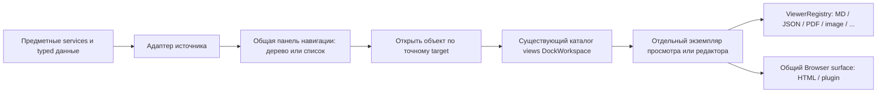

# Архитектура UI RNAssistant

Обновлено: 2026-11-02. Owner: Web presentation; host/runtime contracts — их текущие
domain owners. Стратегия и продолжение общего chat-среза разрешены пользователем;
детали визуальных решений остаются на ревью.
Это canonical document владения, зависимостей и lifecycle UI.

Основание: запрос «UI Strategy Transition» и сохранённый без изменений
[исходный документ](reference/RNAssistant_UI_Architecture_and_Agent_Rules.md), v1.0 от 2026-11-01.
Документ-источник задаёт цель, а не доказательство наличия архитектуры.
Исходный аудит ниже относится к baseline **4ea3d6e4**; изменения S1a отмечены явно.

## Единственные владельцы документации

| Документ | Ответственность |
|---|---|
| Этот документ | Текущая архитектура, результаты аудита, целевые границы и lifecycle |
| [Screen Map](UI_SCREEN_MAP.md) | Экраны, подэкраны, маршруты, размещение, состояния и контекст |
| [Design System](UI_DESIGN_SYSTEM.md) | Tokens, компоненты, повторное использование и статус визуальных решений |
| [Migration Plan](UI_MIGRATION_PLAN.md) | Срезы, baseline, проверки, откат и удаление временных путей |
| [Decisions](UI_DECISIONS.md) | История согласований, без повторения нормативных правил |

[UI_LAYOUT_UX](UI_LAYOUT_UX.md), [старый UI design](../ui-design.md) и Prototype
Package сохраняются как история/evidence. Их старые планы, запрет production и
порядок P0–P4 больше не управляют работой. Точные runtime, resource, plugin и
storage contracts остаются в domain docs из [README](../README.md).
Новые документы про SDK, компоненты или performance отдельно пока не нужны.

## Единый чат: обязательная целевая граница

Уточнение пользователя 2026-11-02: один Chat View и одна реализация всех общих
возможностей для любого чата. Office/project/plugin — источники контекста и
адаптеры services/tools, не самостоятельные виды chat UI. Различаться могут
доступные ресурсы/инструменты и реальные ограничения модели/сессии; тип источника
сам по себе не ограничивает вложения, контекст, ввод, историю или действия чата.
Отсутствующий контракт — открытая задача миграции, не постоянное исключение.

Каждый открытый Chat View получает exact target и собственное presentation state:
draft/edit, scroll, окно истории, загрузки, ошибки и lifecycle подписок. Общие
компоненты и команды получают этот scope явно; глобальный active chat не определяет
получателя позднего ответа или фонового события. Run/storage остаются у существующих
domain owners; вкладка не создаёт второй durable store или runtime.

**Текущее состояние не достигает этой цели.** S1a/S1b и S2a переиспользуют DOM,
компоненты и часть правил, но оставляют singleton `conversation`, глобальное
состояние Office и отдельную Workspace orchestration. Полное объединение и
несколько независимых Chat View входят в незавершённый S2. Размножать нынешний
singleton или переименовывать WorkspaceChat без смены ownership недостаточно.

В S2b.8 Workspace snapshot передан общему view owner; Office selected state и
навигационный singleton adapter ещё требуют переключения на этот механизм.

### S2b.1: состояние отрисовки и lifecycle представления

Первый ограниченный шаг S2 после уточнения единого чата, 2026-11-02. Owner —
[`ConversationView`](../../web/js/app-conversation-view.js): один экземпляр на DOM
transcript, explicit target, generation, keyed DOM cache, scroll/follow/anchor,
coalesced frames, visibility и освобождение listeners/observers. Office и Workspace
используют один owner; plugin source использует тот же Workspace target, без
отдельного кэша или правил отрисовки. DockWorkspace передаёт только visibility.
Раскрытие карточки в transcript прекращает автоматическое следование за хвостом;
новые сообщения сохраняют позицию чтения до явного возврата к последним.

Удалены глобальные Office renderer/scroll caches, `_workspaceEntries`, отдельное
сохранение Office viewport и `conversationPosition`/dirty paint из DockWorkspace.
Смена target и suspend перед reparenting отсекают старые frames, включая A→B→A.
Hidden view не рисует tokens, отключает resize observation и при возврате применяет
актуальную projection. Cleanup thumbnails ограничен subtree этого представления.
Сохраняются максимум 16 позиций чтения на view: только target/key/offset, без истории
или DOM прежних чатов. Сами сообщения по-прежнему ограничены cap 240.

Это **не завершение шага 1/S2**: `messageView()` пока адаптирует единственную
production-вкладку к новому owner. Builders Office/Workspace, ввод/edit/actions,
получение snapshot и подписки runtime ещё используют прежних владельцев. Их
переключение на explicit view scope — следующий срез перед несколькими вкладками.
Transient UI cache не заменяет draft store, events или runtime authority.
Условие удаления adapter — в [Migration Map](../stabilization/MIGRATION_MAP.md#conversation-view-s2b1--2026-11-02).

### S2b.2: общий ввод, команды и состояние правки

Owner — `RNAssistantChatComposer` в существующем `app-chat-composer.js`.
Один controller на form принимает явные DOM nodes и adapters источников. Он
владеет input/keyboard/submit/stop/clear/confirmation bindings, точным target,
generation и незавершёнными edit records. Office/project/plugin передают сервисные
операции и адрес; отдельные `WorkspaceChat.actions`/`activeOwner` и глобальные
`state.editing*` удалены. Workspace input больше не имеет второго listener сохранения.

Edit record содержит исходный ввод/selection/scroll и текущий текст правки; ключ
включает источник, workspace и session. Он сохраняется при переключении и refresh,
удаляется при cancel/accepted edit/dispose. Нормальный draft и подтверждение доставки
по-прежнему принадлежат ChatDrafts/ConversationInput; нового durable store нет.
Отрисовка controls больше не записывает текст в edit state. Это устраняет сброс
Office-правки на snapshot и разное поведение правок Office/Workspace при переключении.

Команды получают captured scope; submit использует его session/workspace address.
Отложенный focus/selection и quick-action reply проверяют generation, включая
A→B→A. Enter и form submit используют доступность той же Send button; IME,
Shift+Enter и modified Escape имеют одно правило для всех источников. Поздний
ACK Workspace edit очищает только тот record, который был отправлен.
Office также сохраняет record до успешного ответа; ошибка отправки и refresh не
стирают текст правки. Пока edit request выполняется, ввод правки read-only;
обычный следующий draft во время отправки сообщения остаётся редактируемым.

Временный `chatComposer()` ещё выбирает singleton form, как `messageView()` —
transcript. Workspace preference/draft adapter, общие builders и доставка snapshots
ещё требуют explicit instance scope. Несколько независимых UI-вкладок пока не
включены. Сохранение scratch edit между перезапусками приложения не добавлено.

### S2b.3: адресная сборка ленты и команды истории

Owner — Messages / ConversationView. Общие builders сообщений, групп запусков и
Office live tail получают короткоживущий presentation context: view, точный target,
borrowed snapshot и captured commands существующего ChatComposer. Helpers больше
не выбирают `messageView()` / active chat при сборке этих units. Office adapter
собирает snapshot из прежнего state; Workspace передаёт свой существующий snapshot.
Нового read model, durable store или command registry нет.

Footer один для источников; fork/edit/delete/history вызываются через captured
commands. Inspector и changes summary получают адрес сообщения. Binding generation
отличается от paint generation: hide/reparent сохраняет пригодность прежних actions,
смена target, A→B→A и dispose её отменяют. Смена command generation обновляет footer
без пересоздания тела сообщения. При последовательном удалении сообщений запуска
смена чата останавливает оставшиеся команды с уведомлением; они не переадресуются.

`state.liveFullRenderPending` удалён: pending full paint принадлежит view cache;
новый run определяется по его ID. Coalescing, leaf-only token updates, stable DOM,
scroll/disclosures и cap 240 сохранены. Это не завершает instance scoping:
snapshot delivery/subscriptions, preference/draft adapter и вспомогательные
inbox/approval/context/media readers ещё связаны с текущим owner. До переключения
этих consumers production остаётся с одним conversation view.

### S2b.4: lifecycle чтений и доставка поздних ответов

Owner — ConversationView / существующий ConversationObserver. View создаёт
подписки через `observe(options)`, передаёт им свой binding scope и владеет
suspend/resume/dispose. Office inbox, его дополнительное чтение истории и
Workspace snapshot используют один механизм. Source adapters задают exact target,
свой navigation generation, read/callbacks, интервал и условия опроса.

Ожидающие ответы/ошибки проверяют view binding, source/address, navigation generation
и lifecycle epoch. Stop, hide и dispose отсекают старые delivery; новый read не ждёт
ответа прежнего binding. Повторные refresh объединяются в один следующий read.
Hidden view не опрашивается; событие обновления или незавершённое чтение сохраняет
один catch-up при возврате, включая waiting/idle без polling timer. Реальный bridge
request завершается своим прежним transport; run и durable receipts не отменяются.
Без пропущенного обновления возврат соблюдает source `shouldPoll`: компоновка
простаивающего чата не вызывает чтений данных.

Удалены global `chatInboxObserver` и `state.inboxChatRefreshing`. Workspace factory
принимает view явно; после dispose/смены binding её push callback не обновляет view.
Поздний ответ deleteMessage применяет только catalog, если исходный command scope
устарел; ошибка не подменяет notice другого чата или нового визита в тот же чат.

Это ещё не общая per-target data factory: Office `state`, Workspace `active`,
preference/draft adapter и вспомогательные inbox/approval/context/media consumers
остаются у прежних owners. Глобальная доставка full push snapshots и оставшиеся one-off
service operations ещё требуют адресации перед несколькими live Chat View.

### S2b.5: общие команды настроек чата

Owner — существующий ChatComposer. `preferences()` даёт общий presentation contract
модели, режима, reasoning и доступности; `setPreference()` захватывает exact target,
владеет ожиданием и проверяет binding до доставки результата. Source adapter создаёт
короткоживущий `preferenceService(scope)` с write/read/apply; UI не знает bridge
операций. Общий ConversationInput сохраняет единственный барьер отправки по адресу.

Удалены `state.modelSaving/modeSaving/reasoningSaving`, отдельные Workspace команды
настройки и их renderer, preference-ветка Workspace runChat. Source factories
сохраняют Office navigation drain и Workspace revision guard. Неопределённый ответ
не повторяет запись: выполняется read-back; его отказ отдаётся transport owner.
После A→B→A старый ответ не применяется, текущий визит получает свежее чтение.

Office режим отображается после ACK, ввод во время сохранения остаётся доступным,
Send ждёт завершения. Workspace mode/reasoning остаются в существующем ChatDrafts и
передаются при отправке; это прежний service contract, не второй UI/store. Модель
сохраняется сервисом обоих источников. Геометрия и список возможностей не менялись.

Полные Office/Workspace snapshots, draft/file binding и вспомогательные readers
ещё используют singleton adapters. Срез адресует команды настроек, а не завершает
per-target data factory или несколько production chat views.

### S2b.6: общая привязка черновика

ChatComposer владеет capture/restore/accept/append текста для обоих источников.
Он удерживает только ссылку на текущую запись ChatDrafts; storage, версии, receipts
и attachment metadata остаются у прежних владельцев. Source adapters предоставляют
чтение/запись существующего store, не копируют текст и правила восстановления.

ACK обновляет обычный draft, не текст незавершённой правки. Поздняя ссылка на файл
также добавляется в обычный draft, в том числе у фонового target. Версионные guards
сохраняют новый ввод; unchanged record не переназначает textarea и не сбрасывает
cursor. Dispose удаляет binding и не допускает поздней записи в DOM.

Workspace `current/loaded/mode/reasoning` удалены: адрес берётся из controller,
настройки — из ChatDrafts или source snapshot. `sharedComposer` пока остаётся
file/service adapter единственной form; полные snapshots, full push routing и
вспомогательные context/approval/media consumers ещё требуют instance scope.
Несколько независимых chat views этим срезом не включаются.

### S2b.7: адресный приём полного состояния

ConversationState создаёт immutable snapshot source с точным source/workspace/session.
Office и Workspace adapters описывают адрес в своих DTO; общие `read/accept/matches`
проверяют его до изменения UI и обработки receipt. Source не хранит данные, не
клонирует историю и не создаёт registry. Revision/window/lifecycle guards прежние.
Office selection проверяет также вложенный init при смене host; full push использует
тот же matcher. Workspace read/submit/confirmation/cancel/delete и создание/fork
проверяют ожидаемый адрес (для новой сессии — исходный workspace и возвращённый ID).

Это граница приёма, а не завершённый per-view data owner: Office selected state,
Workspace active snapshot и full push routing к нескольким views ещё мигрируют.
Singleton adapters не размножаются; следующим шагом переносится их владение данными.

### S2b.8: snapshot принадлежит представлению

ConversationView владеет одним `SnapshotOwner` из ConversationState. Owner получает
exact source и merge policy, хранит единственный принятый объект с окном ≤240
сообщений. `bindProjection` переиспользует owner того же target; замена/clear/dispose
освобождают его snapshot и делают старые callbacks неактуальными ещё до нового paint.
Hide/reparent сохраняют объект. View не владеет durable history, run или draft store.

Первый production consumer — проект/плагин. Удалены `active` из ProjectChats и
удержание snapshot в Workspace run observer. Renderer, preferences, история,
Inspector и plugin consumers заимствуют один объект у view; второй read model не
создан. Revision/terminal/preview sequence и paging guards остаются у source policy.
Read/open/stop/submit/preferences захватывают owner; ответ старого визита A не
обновляет новый A. Preference read-back создаёт service для нового binding.

`ProjectChats` пока обращается к одному `conversationView` через temporary adapter.
Office snapshot и полная адресная доставка push ещё не перенесены. Это первый
consumer общего owner, не завершение S2 и не включение нескольких chat tabs.

## S1b: фактическая граница переноса

Owner: Web presentation. Один [DockWorkspace](../../web/js/app-dock-workspace.js)
размещает существующие `chatDropZone` / `workspaceChatView` как один `conversation`
и существующий `chatInspector`. Одни messages/chatForm/input, один активный owner.
Прототипный iframe не является production dependency. Shell reference перенесён
в [Design System](UI_DESIGN_SYSTEM.md#эталон-оболочки-завершённый-dockview-demo),
команды — в [Screen Map](UI_SCREEN_MAP.md#команды-оболочки-s1b).

Dockview — единственный владелец групп, вкладок, split, maximize и serialization.
Старые Inspector grid/overlay/splitter, width/open preference и перенос двух
кнопок между chat/preview headers удалены. Навигационный splitter и ещё не
перенесённые HTML/plugin preview splitters остаются до их среза.
`switchTab` размещает остальные sections той же Shell, временная граница описана
в [Migration Map](../stabilization/MIGRATION_MAP.md).

Геометрия Shell имеет общий источник в production tokens; ShellLayout читает их
при инициализации. Размер navigation устанавливается до создания Dockview, чтобы
начальная ширина Inspector не менялась вслед за поздним применением defaults.
NavigationTree остаётся одним renderer для Office/Workspace/plugin и других
деревьев; feature owners передают данные/действия, не свои размеры и состояния строк.
Владение CSS и границы version-pinned vendor adapter — в
[Design System](UI_DESIGN_SYSTEM.md#применение-правил-сейчас).

Три bounded singleton views (conversation, inspector, settings) сохраняют свои DOM nodes: renderer `always` выбран только для
них, не как глобальная политика. Закрытие паркует узел, а не уничтожает controller,
черновик или run. Listener компонента Dockview удаляется на dispose. На скрытом
conversation transcript paint откладывается; возвращение применяет актуальное
состояние и восстанавливает scroll/follow position того же exact owner/chat.
Фоновый mount не открывает скрытый чат. Inspector отменяет lazy usage request
при deactivation; resize не вызывает повторный render или bridge read.
Chooser — обычный дешёвый view без retained domain data. Полный view-scoping
глобального chat renderer остаётся S2; дубли экземпляров запрещены.

Навигация также перенесена по поведению Demo: один ShellLayout управляет wide/overlay,
rail repeat, scrim/Escape, выбором экрана и широким предпочтением. Старые проверки
820/620 px и fullscreen-дерево удалены; feature content breakpoints остаются у экранов.
Общий Tree сообщает о принятом выборе, не знает Shell и не держит второй state.
Dockview скрывает самостоятельную группу Inspector без dispose/повторного mount;
смешанная и единственная видимая группы защищены от случайного скрытия.

Опора lifecycle: [Dockview rendering API](https://dockview.dev/docs/core/panels/rendering/).
Локальная pinned версия 8.8.3, лицензия/provenance и hashes включены в существующие
vendor manifests. Demo использует тот же файл; второго loader нет. Host проектов
уже включает `web/**`, C# project/bridge/runtime/storage не менялись.

## Settings view S1c

Пользователь согласовал этот ограниченный срез после checkpoint Shell `2a4831c5`.
`settings` добавлен в существующий каталог DockWorkspace. Он размещает тот же
`#settingsView`, не копию формы. Прежние `#tab-settings`, navigation splitter и
root section удалены. Совместимый вызов `switchTab("settings")` только направляет
команду в workspace; собственного маршрута размещения больше нет.

`app-settings.js` владеет формой, dirty/revision/save и hooks `activate`,
`deactivate`, `canClose`. Переключение/перемещение не сбрасывает правки; фоновый
render также не перезаписывает dirty форму. Deactivation сохраняет поля, но
отменяет catalog preview прежним механизмом generation/cancellation. Сохранение
использует прежние contracts и подтверждённую revision; UI не считает ранний click
успехом. При согласии закрыть dirty вкладку её форма паркуется до перезапуска
приложения, без нового persistence/store. Save-in-flight не закрывается.

Все пользовательские close paths (крестик, Delete/Backspace, меню, группа,
замена раскладки) проверяют view guard до изменения группы. Движение/resize
не является закрытием. Pinned vendor DefaultTab сохраняет собственный renderer;
локальный adapter маршрутизирует close action. Browser reload восстанавливает
placement, но не обещает сохранение неприменённых настроек на диск.

Hover/focus остаётся у `RailPopovers`, click menus — у `ActionMenu`; поверхность,
строки и иконки принадлежат общему `app-product-components.css`. Старые отдельные
rail menu CSS удалены. Нового popup engine, registry, библиотеки или vendor нет.

## S2a: общая модель чата и черновик возможностей

Scope разрешён пользователем 2026-11-02: выбор модели должен работать одинаково в
Office, project и plugin chat. Реализация — In Review; это первый ограниченный
срез S2a, а не объявление полной parity всех функций чата.

- Один `app-model-picker.js` и `chatModelSelection` показывают выбор, default,
  metadata/capabilities и недоступность. WorkspaceChat предоставляет данные и
  dispatch; его прежнее отдельное меню «Настройки модели» удалено.
- `ChatSettingsResolver` — существующий Core owner разрешения chat override и
  общей политики редактирования model/reasoning. Office и Workspace используют
  его. `ChatSession.Model` — предпочтение; null означает текущий default.
  Фактически использованная модель остаётся в `LastRun.ModelConfiguration`.
  Новый run не записывает default поверх предпочтения. Approval/continuation
  использует принятую модель; проверки endpoint/digest/context/roles сохранены.
- Project и plugin идут через один typed `setProjectChatModel` adapter и
  `WorkspaceConversationService.SetModel`. Ответ содержит только адрес, model и
  revision. Существующая exact-session lease берётся без ожидания; input barrier
  и navigation generation защищают отправку и поздние ответы. При потерянном ACK
  под тем же barrier читается сохранённое состояние без повтора записи; если read-back
  также недоступен, отправка отключена до восстановления bridge. Нового store нет.
- `app-settings.js` владеет неприменёнными non-DOM полями возможностей, приоритетов
  и калибровки. Copy-on-write сохраняет applied settings и submitted snapshot.
  Все изменения повышают revision формы; ACK освобождает только подтверждённые
  версии полей. Reset также является черновиком. Ошибка сохраняет правки.
- `app-models.js` владеет одним cancellable catalog request. Form preview отделён
  от applied catalog и исчезает при deactivation; общий resolver получает draft
  context явно. Предпросмотр другого endpoint не меняет возможности текущего чата.
  Скрытая Settings view не строит списки моделей; закрытый picker не строит меню.

Оставшиеся расхождения attachments/context и view-scoping — в
[плане](UI_MIGRATION_PLAN.md#s2a-модель-чата-и-настройки-возможностей).

## Фактический аудит

### Повторная сверка с исходным планом — 2026-11-02

Перечитаны исходная спецификация, четыре canonical UI-docs, решения P1/P2,
реальные CSS/JS/HTML и замороженный Demo. На checkpoint S1b/S1c в `web/index.html`
один Shell, шесть root sections, 118 script и 44 stylesheet подключения, один
Dockview. Это исторический snapshot; request добавлен позднее в S3a. Каталог
не содержит все целевые виды. Проект общей модели приведён ниже отдельно.

| Responsibility | Текущий единственный owner | Результат сверки / открытая граница |
|---|---|---|
| Shell chrome, navigation, topbar/footer DOM | `app-layout.js` / ShellLayout; `app-product-navigation.css` | Убраны дубли rail/topbar/footer в Dock CSS, прежний flex Shell и старые navigation media rules. Шестерёнка находится снизу rail; настройки — singleton Dockview view S1c |
| Dock placement и presentation lifecycle | `app-dock-workspace.js` / Dockview | Передаёт Shell вычисленный context/layout snapshot и callbacks команд; не владеет DOM topbar/footer. Domain hooks conversation/Inspector пока адаптированы здесь для трёх singleton views |
| Menus | `app-action-menu.js` / ActionMenu | Один компонент для существующих меню и портального варианта в clipped Dock headers; прежний Dock menu renderer/keyboard path удалён |
| Tokens и навигационные элементы | `app-product-tokens.css`, `app-product-components.css` | Общие размеры/типографика/темы. Заголовки sidebar, дерево и контроли проверены в нескольких sections. CSS содержимого settings возвращён его screen owner |
| View catalog / command routes | `views` в DockWorkspace; ещё не мигрировавшие sections — `switchTab` | Единого расширенного публичного panel/command API для plugins пока нет. Расширять существующий каталог при переносе следующего view; не откладывать единство до финальной чистки |
| Chat / runtime data | Прежние ConversationState, WorkspaceChat, Office domain owners | Общие bounds/composer сохранены. Multiple live views, model/context/attachment parity и paged catalogs ещё открыты |
| StatusBar | Shell отображает переданные mode/connection/layout facts | Общая агрегация фоновых operations пока не подключена; новых guessed progress/events/stores не вводилось |
| Portability | Общие Tree/Toolbar/ActionMenu/OperationView в browser fixture | Проверены без Shell/bridge, включая dispose и обе темы. Это ещё не экспортированный plugin, полная `file://` или WebView2 qualification |

Архитектура соответствует направлению исходного плана, но **не объявляется полностью
реализованной**. До повторной сверки оставались реальные расхождения Shell CSS,
chooser и menu ownership; они исправлены в этом срезе. Временные root sections и
native previews остаются зарегистрированными migration boundaries, не вторым
продуктом. Сопоставление A–H / S1–S5 и gates — в
[Migration Plan](UI_MIGRATION_PLAN.md#сверка-с-исходным-планом).

### Исходный аудит 4ea3d6e4 и уже внесённые изменения

| Область | Что существует | Следствие для переноса |
|---|---|---|
| Production entry | Один [web/index.html](../../web/index.html), 7 корневых tab-секций; 116 внешних script-тегов и 43 stylesheet-тега | Это подсчёт подключений, не замер загрузки и не причина переписывать приложение |
| Host | [AssistantPaneControl](../../src/RNAssistant.Office/WebView/AssistantPaneControl.cs) + [AssistantWebBridge](../../src/RNAssistant.Office/WebView/AssistantWebBridge.cs); Desktop и Office shells используют этот UI | Не создавать Office UI и Desktop/Workspace UI отдельно; host boundaries сохраняются |
| Shell/navigation | [switchTab](../../web/js/app.js), [ShellLayout/splitters](../../web/js/app-layout.js), [PanelToggle](../../web/js/app-panel-toggle.js), rail/popovers | S1b: app-dock-workspace владеет conversation/inspector placement; route switch ещё сохраняет side effects остальных sections |
| Office/Workspace/plugin chat | Один messages, chatForm и chatInput; [WorkspaceChat.mount](../../web/js/app-workspace-chat.js) перемещает существующие узлы между owners office/project/plugin | Уже есть общий UI. Клонирование DOM создаст конфликт глобальных IDs и состояния |
| Data owners | Office: [chat-session](../../web/js/app-chat-session.js), [chat-state](../../web/js/app-chat-state.js), [inbox](../../web/js/app-chat-inbox.js). Workspace: [project-chats](../../web/js/app-project-chats.js), Application [WorkspaceConversationService](../../src/RNAssistant.Application/Workspace/WorkspaceConversationService.cs) | Различия target/receipts допустимы; не заменять их универсальным UI-store |
| Общие conversation rules | [ConversationState](../../web/js/app-conversation-state.js), [ConversationInput](../../web/js/app-conversation-input.js), [ConversationObserver](../../web/js/app-conversation-observer.js), [RunViewState](../../web/js/app-run-view-state.js) | Повторно использовать identity, revision, receipt и stale-response guards |
| Inspector/browser | Один [ChatInspector](../../web/js/app-chat-inspector.js) с owner switching; общий [Browser](../../web/js/app-browser-viewer.js) для HTML/plugin | S3b.3a: отдельные Dock views; singleton source providers остаются до S3b.3b |
| Viewers | [ViewerRegistry](../../web/js/app-viewer-registry.js), text/Markdown/JSON/image/PDF/task-list, [ViewerUI](../../web/js/app-viewer-ui.js) | Это registry форматов содержимого, не второй workspace/panel registry |
| Plugins/vendor | [RNPlugin SDK](../../web/plugin-host/sdk.js), [plugins](../../web/js/app-plugins.js), [vendor packages](../../web/vendor-packages.json), существующие generators | Есть Ready handshake и resource/command APIs; общего публичного UI/panel SDK пока нет |
| Data Templates | Отдельное переносимое приложение, [shell](../../web/data-templates/ui/shell.js), [browser](../../web/data-templates/ui/browser.js), [plugin adapter](../../web/data-templates/ui/plugin-adapter.js) | Его предметные вкладки и standalone entry не являются второй RNAssistant Shell |
| Demo | Dockview 8.8.3, P1/P2 оболочка; P3 iframe готового mock preview | UX evidence. Iframe на каждый чат не переносится в production |

Браузерный spot-check существующего product preview подтвердил смену
chatForm.data-owner project → office при единственном chatForm и messages.
Это проверка композиции на mock; реальный Office и Windows не запускались.

## Дубли и разрывы — с границами причинности

| ID | Наблюдение / доказательство | Решение |
|---|---|---|
| UI-01 | Demo [tokens.css](../../prototypes/ui/tokens.css) и production [app-product-tokens.css](../../web/css/app-product-tokens.css) имеют разные значения и имена | S1b переносит reference-палитру и shell-токены в app-product-tokens; production не зависит от Demo tokens |
| UI-02 | .composer/.messages оформляются в app-composer/app-chat и переопределяются в app-product-screens/app-responsive; старые aliases остаются в app.css/app-product-tokens | Каскад не равен двум приложениям, но ответственность размыта. Консолидировать только затронутые компоненты, удаляя заменённые selectors |
| UI-03 | Размещение сейчас распределено между app-layout, ChatInspector, ChatBrowser, plugin preview и switchTab | Workspace/Dockview получает размещение; виды сохраняют контент/lifecycle. Навигация вызывает один маршрут команд |
| UI-04 | Global state.activeChatId, один activeOwner, глобальные DOM IDs и renderer cache | Первый срез — один живой conversation view. Несколько одновременных чатов требуют отдельного среза scoping; копии UI запрещены |
| UI-05 | В baseline Office ограничивал prepend 240 сообщениями, Workspace накапливал страницы без лимита | Исправлено в S1a: один bounded window в ConversationState для Office/Workspace/plugin; возврат к последним и сохранение позиции. Evidence — Migration Plan |
| UI-06 | Office [GetChatSummaries](../../src/RNAssistant.Office/Services/ChatSessionService.cs) читает ListHeaders; Workspace [refreshCatalog](../../web/js/app-project-chats.js) запрашивает getProjectChats целиком | Metadata-only не означает paged catalog. Не объявлять целевую пагинацию списка уже реализованной |
| UI-07 | Разные generation/serial counters и active snapshots в Office/Workspace; общий observer уже есть | Убирать только доказанное дублирование presentation, сохраняя domain-specific binding/receipt semantics |
| UI-08 | Data Templates [browser.css](../../web/data-templates/styles/browser.css) имеет собственные standalone defaults, host передаёт appearance | Общие tokens/API нужны для реальных двух consumers; не ломать standalone режим и не строить SDK заранее |
| UI-09 | P3 iframe может сбросить mock-переписку при пересоздании; две ошибки MutationObserver в browser log не локализованы | Ограничение Demo, не доказанный production-дефект и не основание править runtime |
| UI-10 | Один DOM composer имел разных владельцев labels/edit/reply/stop/reasoning; модель и вложения всё ещё подключены по-разному | S1a объединяет presentation и bounds, но не закрывает полную parity. S1b объединяет размещение; следующий срез — единые model/context/attachment capabilities. Domain identity/receipts сохраняются |

NavigationTree + TreeAdapter — компонент и resource adapter, не два дерева.
Office и Workspace — разные domain owners общего UI, не обязательно дубли.
Внутренние EditorTabs, Diagnostics tabs и Data Templates tabs не заменяют Dockview:
они выбирают режим содержимого, а Dockview размещает независимые виды.
Статусы UI-05/UI-06/UI-09/UI-10 — в [BACKLOG](../stabilization/BACKLOG.md).

## Целевые границы

~~~mermaid
flowchart TD
  Shell["Одна Shell: topbar, rail, navigation, status"] --> Workspace["Один Workspace / Dockview: placement"]
  Workspace --> Views["Одна карта / registry видов"]
  Views --> Kit["Общие tokens и UI-компоненты"]
  Views --> Domain["Существующие chat / resource / diagnostics adapters"]
  Domain --> Host["Существующие typed bridge / plugin SDK / host"]
  Host --> Runtime["Domain services, storage, AgentKernel"]
~~~

- Shell отвечает за chrome, команды и навигацию; Workspace — только за группы,
  вкладки и раскладку. View владеет presentation state, domain — данными,
  runtime — execution/model context, host — privileged API.
- Одна registry описывает UI identity/type/factory/default placement/capabilities/
  persistence key/disposal policy. Это не service locator и не runtime authority.
  ViewerRegistry остаётся специализированным registry форматов.
- Один dispatch маршрута команд для topbar/rail/menu/shortcut; существующие
  handlers сохраняются. Новый universal command bus не требуется.
- Shared UI не импортирует Shell, Office или private bridge. Host services
  передаются предметным views/adapters. Plugins получают только публичный API;
  доверенная проверка capabilities/permissions остаётся у host.
- Layout persistence, presentation state и durable runtime state раздельны.
  В layout нет сообщений, файловых тел, токенов authority и несохранённых текстов.
- Shared components выделяются при реальном повторном использовании.
  Vendor/theme/UI-kit/SDK — границы ответственности, не задание создать пакеты.

## Lifecycle и async

У каждого тяжёлого вида: mount, activate, deactivate, dispose и явная политика
keep-alive/suspend/dispose. Dock-перемещение не запускает init или запрос заново.
Закрытие UI не означает отмену run; отмена выполняется отдельной командой владельца.
На deactivate приостанавливать только ненужную визуальную работу; на dispose
освобождать listeners, observers, timers, leases/object URLs и scoped requests.
Нельзя глобально отменять shared run или запрос другой сессии.

Чат сохраняет draft/selection/scroll anchor и минимальное окно данных.
Смена target увеличивает generation; поздние snapshots сверяются по owner,
session, run, revision и navigation generation. Подтверждение отправки и очистка
draft остаются привязаны к receipt, не к успешному завершению Promise.
Нельзя превращать lost connection/unknown effect в completed или автоматический retry.

Прогресс строится по текущим operation/run events. Queued/running/waiting/
cancel requested/cancelled/failed/unknown различаются, где это поддерживает
контракт. Неизвестный total — indeterminate. UI не вычисляет kernel outcome.
Существующие observer/push/fallback polling сохраняются; новый глобальный polling
или progress/task store без доказанной необходимости не вводится.

## Request view: владельцы — 2026-11-02

Реализовано по «Переключи на продакшен и коммит пуш». UX —
[Screen Map](UI_SCREEN_MAP.md#структура-запроса--production-2026-11-02).
Перенос расширяет существующий каталог `views` DockWorkspace; второй registry,
Shell/controller, transport или data store не вводится. Отдельные изменения
Settings/rail S1c сохранены. Runtime/Bridge/storage не менялись.

| Owner | Ответственность |
|---|---|
| DockWorkspace | Размещение request singleton и lifecycle; layout содержит только id вида `request`. Exact scope остаётся в памяти reader; после перезапуска нужен явный выбор запроса |
| Diagnostics navigation | Exact owner/workspace/chat/run/request + deep links; не размещает request DOM; alias `switchTab("request")` активирует существующий DockWorkspace |
| ModelContext reader | Existing metadata/body queries, cache/leases/generations; selection/group/page/mode. Видимость задаёт DockWorkspace; выбранный saved scope не зависит от активного чата |
| [`app-model-context-contents.js`](../../web/js/app-model-context-contents.js) | Оглавление по recorded composition/trace и точным JSON-полям; одна подготовка для grouped/wire, без классификации протокола |
| ViewerRegistry / text / Markdown / JSON | Один выбранный renderer, copy/source/cleanup; без знания session, bridge или исхода исполнения |
| Existing services/compiler/event/CAS | Истина attribution, допусков и данных; не переписываются этим UI-срезом |

Existing source/evidence/resource helpers переиспользуются, не копируются.
Первый срез опирается на текущие typed DTO. Полные границы частей смешанных
инструкций требуют compiler attribution: UI не ищет их по regex/заголовкам.
Закрытие view отменяет только его чтения и освобождает viewers, не run.
Move/split сохраняют DOM; transient removal Dockview не считается закрытием. Activate возобновляет только прерванное чтение по exact scope/generation;
dispose очищает scoped reads/listeners/leases, presentation cache остаётся bounded.

## Единая навигация и вкладки объектов — проектирование 2026-11-02

**Исходный аудит после zoom out пользователя; текущая реализация — S3b.1/S3b.2 ниже.**
Прежняя карта была инвентаризацией, а S3b описывал частный перенос plugin preview.
После проектирования общих owners реализованы навигация и независимые материалы.
Таблица ниже сохраняет исходные разрывы; Browser S3b.3 и editor scope S4 ещё открыты.

| Проверенный разрыв | Действующий код / следствие |
|---|---|
| Материалы смешивают каталог, выбор, команды и reader | `app-artifact-catalog.js`: `select` вызывает `clearPreview`, иногда `changeLink`/`openArtifactResource`; `preview` привязан к global activeChat/navigation. Просмотр другого объекта заменяет прежний, а выбор иногда меняет состояние чата |
| Библиотека переиспользует дерево, но имеет отдельное управление экраном | `app-prompts.js`: `renderInstructions` + `LibraryGroups`; выбранный prompt/skill/tool и редактор глобальны. Общее дерево не делает редакторы независимыми |
| HTML имеет несколько путей отображения | Catalog preview, HTML workspace/editor и `app-chat-browser.js`; последний переносит frame и явно перезагружает его после move |
| Плагин связан с chat placement | `app-plugins.js`: свой splitter, previewOpen/width, переключение Inspector и mount чата при открытии preview |
| Форматные renderers уже общие | ViewerRegistry + text/JSON/resource viewers. Их нужно размещать в отдельных instances, а не писать заново |
| Файлового обозревателя пока нет | Общий навигационный UI не создаёт файловый backend, произвольный доступ к path или новый store |

| Ответственность | Единственный owner / направление |
|---|---|
| Панель навигации | Общая обвязка существующего NavigationTree: заголовок источника/scope, поиск, фильтры, loading/error/empty, paging, выбор и раскрытия. Первый reuse доказывается на Материалах и Библиотеке. Table остаётся альтернативой дерева |
| Содержание и операции источника | Тематический adapter Материалов/Библиотеки/будущих Файлов преобразует существующие DTO, загружает ограниченные страницы и выполняет свои команды. Он не размещает views; общий UI не знает bridge/COM и не угадывает права |
| Открытие, identity, placement | Расширение нынешнего каталога `views` и маршрутов DockWorkspace для параметризованных объектов. Не второй registry или command bus. `ViewerRegistry` остаётся только фабрикой форматов |
| Состояние открытого объекта | Один view instance: exact target, собственные generation/reads/leases, scroll, format/page/zoom, dirty state. Domain services остаются владельцами данных и записи |
| Просмотр HTML | Расширение общего PreviewSurface/Browser presentation; один host кадров и lifecycle. HTML resource builder и plugin instance provider сохраняют разные источники, sandbox/permissions и host APIs |
| Редактирование | Предметный editor с dirty/save/conflict guard. Library tool editor не превращается в generic text editor. До scoping существующего editor нельзя объявлять несколько его экземпляров безопасными |

DockWorkspace выбирает тип view и управляет вкладкой; ViewerRegistry выбирает
renderer внутри просмотра. Общий Browser подключается как ещё один allowlisted
renderer этой же registry при миграции обоих consumers, а не через новый каталог
viewer-ов. Его provider не выдаёт привилегии renderer-у по одному имени формата.

Контракт открытия содержит **source + exact owner/document/workspace/session +
object identity + revision или явно обозначенный draft + purpose (view/edit)**.
Данные identity приходят от действующего владельца; UI key не становится authority.
Названия и индексы строк не являются identity. Повторное открытие того же target
активирует его вкладку; другой объект/явно выбранная версия открывается отдельно.
Markdown/JSON/исходник одного объекта — режимы его viewer, не новые global sections.

### Общие типы и возможности — до частных экранов

Требование пользователя: проектировать от общего к частному. Сначала фиксируются
типы, ownership, возможности и правила композиции; затем проверяется, какие
существующие экраны являются их экземплярами. Название текущего раздела не должно
определять устройство общих компонентов.

| Тип | Что описывает | Чего не содержит |
|---|---|---|
| Source adapter | Scope, metadata query/search, страницы/раскрытие веток, представление объектов и доступные команды | Dock placement, viewer DOM, копию durable данных |
| Object target | Точная identity и версия/draft, источник/owner, предметный тип | Название вместо ID, текущий индекс строки, выдуманные UI права |
| Capabilities / commands | Реально поддержанные данным объектом операции: открыть, редактировать, использовать в чате, скачать, версии и предметные действия | Автоматическую выдачу полномочий; host повторно проверяет доступ и revision |
| View type descriptor | Factory, проверку target, заголовок, singleton/per-object identity, поддерживаемые lifecycle/close/restore policies | Условия по именам экранов внутри Shell, данные объектов или новый transport |
| View instance | Target + локальное состояние представления + scoped async/resources | Глобальную выбранную запись как источник данных для всех вкладок |
| Renderer | Форматное отображение и его controls: text/MD/JSON/PDF/image/browser | Каталог источников, авторизацию, выбор чата, исполнение tools |

Source, предметный тип и renderer независимы: Markdown может прийти из Материалов,
Библиотеки или файлов; один HTML object может открываться для просмотра или в
предметном редакторе; plugin и HTML resource используют browser presentation с
разными привилегированными providers. Chat, Settings и Inspector остаются своими
view types и используют общий lifecycle, не притворяются файловыми viewers.

Минимальная матрица возможностей для проектирования (не утверждение backend parity):

| Семейство | Общая навигация | Просмотр | Изменение / особая возможность |
|---|---|---|---|
| Материалы | Scope, поиск, дерево/таблица, страницы, версии | Renderer по метаданным ресурса | Attach/use/edit/delete только отдельными командами владельца |
| Библиотека | Категории, поиск, дерево, selection | Те же форматные renderers либо предметные details | Сохранение/revision/built-in restrictions у prompt/skill/tool owner |
| Файлы (будущий source) | Разрешённый root, scoped paged tree | Те же renderers | Только операции будущего typed host contract, без прав по одному path |
| HTML resource | Открытие из любого поддержанного source | Общий Browser | Resource bindings, sandbox и аннотации действующего resource owner |
| Plugin instance | Выбор plugin/source workspace | Тот же Browser | Instance lifecycle, публикация/версии/SDK у plugin owner |

В точке сборки существующего UI связываются adapters, view descriptors и
renderer factories. Навигация получает adapter явно; она не строит свой registry
экранов. DockWorkspace остаётся единственным каталогом размещаемых view types;
ViewerRegistry — единственным каталогом форматов. Private plugin SDK/public
extension API не возникает автоматически из внутренних descriptors.

**Gate масштабируемости:** подключение второго source/viewer не требует новой
ветки по его имени в `switchTab`, `DockWorkspace.sync/createComponent` или общем
дереве. Lifecycle вызывается через descriptor/instance, зависимости передаются
предметной фабрике явно. Изменять общий компонент допустимо для новой общей
возможности с реальными consumers. Service locator, универсальный контроллер,
схема генерации всех форм и новый loader не являются необходимыми следствиями.

Состояние навигации (scope/search/filter/cursor/selection/expansion/scroll) отдельно
от состояния вкладки и durable data. Изменение дерева или активного чата не
подменяет target уже открытого просмотра. `open` ничего не подключает к запросу:
`use in chat`, attach, select active artifact, edit, delete — отдельные команды.
Для прежнего `changeLink` при выборе требуется явный перенос этого действия в UI.

Общие lifecycle hooks: mount/activate/deactivate/dispose. Закрытие просмотра не
удаляет объект и не отменяет run. Reader освобождает leases/object URLs; закрытие
редактора проверяет dirty/save; для живого plugin instance политика удержания
явная и ограниченная. Hidden view не делает eager reads/render. Лимиты открытых
тяжёлых views/байтов устанавливаются по baseline первого среза; без них срез не
закрывается. Нельзя молча выгружать dirty editor или живую сессию плагина.

Iframe lifetime — отдельный инвариант, не обещание сохранения одного DOM-узла.
Локальный probe Dockview 8.8.3: `renderer:always` сохраняет document при move,
но `fromJSON` пересоздаёт его. S3b.3a переносит HTML и plugin surface в общий
стабильный портал; Dockview перемещает только placeholder. Layout persistence
не хранит тела, secrets или runtime instance IDs и не обещает пережить reload сессии.

### S3b.1: реализованные владельцы — In Review

`app-navigation-pane.js` — общий header/search, command menu, loading/error/retry,
paging и cleanup. Он получает DOM nodes и явные callbacks, не знает bridge,
названий источников или протокола. NavigationTree остаётся единственным renderer;
TreeAdapter нормализует материалы и передаёт rendering в Pane, ключ позиции теперь
принадлежит конкретному дереву. Общий search binding вынесен из app.js; остальные
панели используют тот же обработчик уже до их полного переноса.

`app-prompts.js` владеет library metadata/dirty/save и стабильными ключами Id/key;
`app-artifact-catalog.js` — catalog query/generation, exact URI, paging (50 за запрос,
не более 500 накопленных строк) и отдельными командами изменения связи. Фильтр не
переключает открытый объект. Library filtering не вызывает renderer редактора.
Новый store, transport или bridge contract не добавлены.

`DockWorkspace.registerTargetRoute/openTarget` использует **существующий** каталог
views. Два explicit temporary section adapters валидируют target: library — host,
kind, Id/key и revision; materials — document/chat/navigation generation/URI.
Это маршруты к текущим singleton presentation owners, не самостоятельные Dock
instances. Они не предлагаются как восстанавливаемые Dock panels. Условия удаления
— [Migration Map](../stabilization/MIGRATION_MAP.md#navigation-target-routes-s3b1--2026-11-02).

На S3b.1 независимые views ещё отсутствовали. Material route заменён в S3b.2 ниже;
Library/VBA editors — S4. Общий Browser остаётся S3b.3.

### S3b.2: владельцы независимых просмотров — In Review

- `app-dock-workspace.js`: один catalog descriptors, placement и bounded instances.
  `registerView` задаёт singleton element/section/layout или per-object
  accepts/key/titleFor/create/maximumInstances. `objectViews` содержит лишь живые
  controllers для move/fromJSON, не является registry данных. Per-object target
  проверяется при открытии/restore; шесть material instances, без автоматического
  вытеснения. Factory возвращает element/activate/deactivate/dispose.
- `app-material-view.js`: immutable target (`chatId`, `documentId`, exact URI),
  локальный presentation cache, reader lifetime и команды просмотра. Ни active chat,
  ни source filter не меняют открытый target. В layout сохраняется metadata target;
  готовый DOM переживает move/split/fromJSON в текущем окне. Cold restart mementos
  формата/поиска/scroll пока не реализованы; тела/leases не сериализуются.
- `app-artifact-viewer-actions.js`: прежний owner paging/data-plane/media URL,
  расширен явными limits и pending identity guards. View injects captured send/fetch,
  AbortSignal/generation; hidden отменяет незаконченный read, close закрывает leases
  и URLs, late lease освобождается без отображения. Никакого нового transport/store.
- `ArtifactViewerService`/`ArtifactCatalogService.Source`: чтение сохранённого
  документа через существующий gateway/CAS. Typed ArtifactResourcePayload несёт
  documentId; ChatArtifactDto и CatalogItem дают scope/MIME/size metadata. JSON
  поступает как exact paged text; его структуру показывает общий JSON viewer.
- `app-artifact-viewers.js`: форматная presentation вне HTML editor; используется
  и новым view, и старым editor detail. `app-sequence-document-viewer.js` использует
  existing lossless JSON parser/raw slices и SequenceViewer rail; не знает полей
  предметной области. Остальные format viewers и ViewerRegistry сохранены.
- Catalog остаётся owner metadata/attach/use/edit/copy/delete; object menu получает
  его команды лишь при совпадении текущего actor/catalog scope. Историческая версия
  не получает current-head mutation commands. Read-only open не отбрасывает dirty
  editor и не присоединяет объект к контексту.

Source layout подключён descriptor-ом к тому же Dockview; нет ветки Shell по имени
формата. HTML singleton adapter и Library section adapter явно остаются до S3b.3/S4
в [Migration Map](../stabilization/MIGRATION_MAP.md#navigation-target-routes-s3b1--2026-11-02).

## Производительность, portability и поддержка

Сохранить bounded message windows, incremental rendering, lazy payload/media,
ограниченные caches, stale guards и read batching; перечень evidence и замеров —
в [Migration Plan](UI_MIGRATION_PLAN.md). DOM virtualization не доказывает bounded
data; закрытие вкладки не доказывает освобождение памяти.
Не делать eager preload всех чатов, parsing всего журнала или rerender ленты
на каждый token. Порог регрессии выводится из baseline, не придумывается.

Dependencies локальные, с версиями/лицензиями/хэшами. Dockview 8.8.3 уже проверен
в Demo только для документированных там операций; popout/floating/auto-hide и
реальная WebView2-совместимость не объявлены проверенными.
L1 — host-independent component; L2 — browser app с явными browser requirements;
L3 — host capabilities. File API/worker/module/storage/file:// поддержка
проверяется отдельно. Глобальный объект не заменяет handshake.
При изменении shared UI нужен standalone пример с Tree/Toolbar/Progress/theme,
на существующих assets; ещё одна инфраструктура сборки/loader не создаётся.

Продолжение общего chat-среза разрешено; следующие срезы сохраняют визуальные gates. Временный dual path
допустим только с owner, флагом при необходимости и условием удаления в
[Migration Map](../stabilization/MIGRATION_MAP.md). После проверки старый путь
удаляется вместе с consumers и мёртвыми зависимостями.

### S3b.3a: общий Browser и раздельные views — In Review

`app-browser-viewer.js` зарегистрирован в существующем ViewerRegistry как `browser`.
Его вход — provider-owned surface и portalHost; выход — element/activate/deactivate/
layout/destroy. Он не читает bridge, протокол, HTML или состояние чата. Постоянный
parent iframe сохраняет document; placeholder получает положение от Dockview.
ResizeObserver/rAF ограничивают запись геометрии; destroy снимает listeners/observer.
Shell передаёт изменение доступности навигации через существующий bindWorkspace.
Dockview получает CSS pixels; Browser placeholders используют `onlyWhenVisible`,
поскольку скрытому placeholder не нужен собственный retained render overlay.

`app-html-workspace.js` владеет текущей парой chatId/artifactId, исходниками,
resource leases, sandbox и аннотациями. Смена пары очищает просмотр с объяснением;
несохранённая правка обозначает показ последней сохранённой версии. Код редактируется
в Материалах, просмотр — вкладка HTML. Close инвалидирует preview generation/leases.
`app-plugins.js` владеет check/open/close, публикацией, версиями, SDK и аннотациями.
Выбор плагина не меняет разговор. «Чат исходников» — отдельная адресная команда;
выбор исходного чата не открывает Browser. Hidden прекращает polling; close меняет
epoch и закрывает instance; запоздалый open закрывается без восстановления вкладки.

Временные bounded owners: один live HTML workspace и один plugin workbench.
Сохранённые HTML objects и несколько plugin/release targets — **S3b.3b**; их нельзя
клонировать из текущих глобальных controllers. Catalog HTML adapter остаётся явно.
ChatBrowser, его CSS, splitter/overlay plugin placement и preview-пункт Inspector
удалены. Новый transport, store или runtime pipeline не добавлены.
