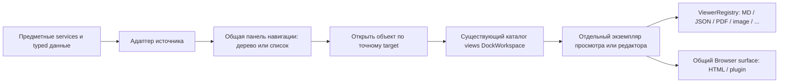

# Архитектура UI RNAssistant

## Plugin saved versions — In Review, 2026-11-13

Plugin rail открывает общий app-browser; app-plugin-view/app-plugin-release-view,
их template и CSS удалены. app-artifact-versions владеет общими checkpoint controls;
Application владеет Save/Activate/Delete, runtime IDs не выводятся модели. Метаданные
versions не читают working bodies; отдельное state/check capture bounded и отменяемо.
Dock owner нормализует schema 1→2 с выборочным pruning старых descriptors, без второго migrator.

## Local Browser source-only — In Review, 2026-11-13

`app-browser` — один новый view для локальных адресов, `browserTabId` является Dock
identity; pageSession остаётся runtime-only. Единственный history owner —
LocalBrowserPageRuntime; UI не хранит собственный стек. Источники читают existing
domain owners через typed ReadBrowserSource, bounded text viewer и revision guard.
PreviewSurface владеет toolbar/combobox. Исполнение закрыто B02 до qualification;
Shell iframe с авторским HTML не является fallback. Provider routes мигрируют
по следующему срезу versions, редактор остаётся прежним владельцем dirty buffer.

## Local Browser / Settings — In Review, 2026-11-13

F0: app-browser-target проверяет kind-specific identity/capabilities, включая Home,
Workspace/plugin и Removed. Native-independent contracts принадлежат Application;
resolve/completion возвращают metadata от существующих owners. Dock identity ещё
переключается в F1/F4; shared saved-view fixture сохраняет bounds и late-response guards.

Scope local-only принят пакетом пользователя. HTML page→parent→bridge→host HTTP
path и deployment editor удалены; Settings сохраняет пустой Developer disclosure.
Общие Settings lifecycle/tokens и LLM controls сохранены. Старый signed config
раздел ниже — superseded history. Общий native Browser/StartSurface ещё в работе;
это не завершение миграции всех views и не визуальное принятие.

## Подписанная конфигурация — In Review, 2026-11-12

`app-deployment-config` — presentation в существующем Settings;
`DeploymentConfigurationStore` в Core владеет проверкой подписи, версии, пароля,
сессией редактора и разрешениями. Typed Bridge отдаёт список/пути только unlock-сессии;
обычный status содержит лишь Applied/Absent/Rejected. Пароль открывает редактор,
private key требуется при подписи; путь по умолчанию приходит из build metadata
и может быть изменён в редакторе. Manual-any не расширяет доступ агента.
Retained DOM переживает Dock placement; deactivate очищает editor, late responses
не восстанавливают доступ. UI не хранит ключ/пароль в settings/history.
Разовые Mac/Windows utilities разделяют C# crypto и запись issuer files;
нового application store/registry/модельного инструмента нет.
[Контракт](../browser/03_CONTRACTS.md#signed-access).

## Единое дерево рабочей области — In Review, 2026-11-11

`app-workspace-navigation` соединяет presentation nodes Office и проектов в одном
NavigationPane/NavigationTree: поиск, selection, scroll и keyboard traversal общие.
Каталоги, guards и команды остаются у app-chat-state/app-project-chats. Проекты
загружаются после handshake, при возврате в раздел/окно и после своих изменений;
пассивный refresh не открывает чат и не меняет выбранный target.

Один `chatLayout` содержит общий Dockview независимо от источника чата. Старые
project layout, scope pickers, отдельные launcher/search/refresh удалены. Общие
approval/questions входят прямо в шаблон ConversationPanel; промежуточный
Workspace DOM-source удалён. Source routing остаётся у прежних adapters; runtime,
Bridge и storage не меняются. Это объединение навигации, не заявление полной parity
всех возможностей Office/Workspace/plugin.

## External Browser P5a — In Review, 2026-11-11

Одна experimental external-browser view использует existing Dockview/PreviewSurface.
`ExternalBrowserPage` владеет непривилегированным WebView2 и навигацией,
`ExternalBrowserDockHost` — placement/UI thread. Typed `ExternalBrowserCommand`
проходит existing source/token/binding gate; IDs назначает native owner.
Hide удерживает страницу, close/rebind/root reload освобождают её. Без нового store,
Application registry или Dockview. [Флаг и native gates](../browser/02_ARCHITECTURE_ADR.md#native-spike).
P6a: Open закрепляет chatId; native source отдаёт fixed isolated-world capture
existing ResourceGateway. Controller attachment отзывается до rebind/dispose и
подключается после native reset. Model не получает IDs/CDP; document guard сохраняется.

P6e adds `browser.navigate` through the existing tool/native owners. UI keeps its
current address/loading/manual controls; navigation advances runtime document binding,
never Dock placement/session ownership. Redirect and completion guards belong to
ExternalBrowserNavigation/Page, not Web presentation. [Contract](../browser/03_CONTRACTS.md).

P6f retains that UI/lifetime: the existing cursor highlights an observed link before
same-tab navigation; external fill/click use the same presentation and manual latch.
Link href/admission and async verification remain native/isolated-runtime concerns.

### Browser manual control / access — In Review, 2026-11-11

P6d хранит manual latch у `ExternalBrowserPage`; isolated script закрывает mutations
сразу при trusted input. Existing Inbox/AgentCommunication endpoints приостанавливают
exact Office/Workspace Run с user-only resume. `app-external-browser` показывает
native state и отправляет typed ResumeAgent с control revision; собственного scheduler
или очереди действий нет. Resume сериализуется с короткими Browser operations,
model/user waits не удерживают native/document gate. Подписанная политика ниже заменяет прежний Browser agent allowlist.
[Контракт](../browser/03_CONTRACTS.md#p6d-user-control).

### Browser action visualization — In Review, 2026-11-11

P6c — один `app-browser-action-view` внутри closed shadow root native page, загруженный
как embedded JS/CSS с existing product tokens. Это декорация над WebView2 content,
без Shell overlay над HWND и без новых store/registry/bridge/model tools.
`ExternalBrowserSemanticRead` передаёт view actual element после проверки exact target;
после короткой анимации action повторяет guard. Native owner убирает декорацию при
hide/navigation/dispose. View сама завершает idle timer и не перехватывает ввод.
`IExternalBrowserActionSource.PresentResult` — best-effort presentation после existing
ToolRuntime terminal publication; поздний result другого preparation не меняет view.
[Контракт](../browser/03_CONTRACTS.md#p6c-action-visualization), Windows evidence открыто.

## Native window — In Review, 2026-11-11

NativeHostCli — экспортный ABI/reflection loader. Один активный
`OfficeHosts.Windows.InProcessWindowHost` владеет формами, HWND, геометрией, STA и
`InProcessPanelSession` для точного документа. OfficeHosts разрешает старый
`Application.Hwnd` и прямой `ActiveWindow.Hwnd` в окно активной книги; VBA launcher
не меняется. Форма показывается с владельцем Office и без taskbar entry.
При вызове из другой книги Shell проверяет редакторы/черновики, затем старый runtime
завершается и создаётся новый с exact HWND; C++ shim следует за successor. Run
старого документа не переназначается. `AssistantHostForm` обрабатывает frame/system
commands/DPI; `CompanionForm` не содержит WebView. `Office.Services.AssistantWindowPolicy`
владеет host-neutral переходами; typed `IAssistantWindowHost` не содержит HWND/COM.
Office → OfficeHosts обратной зависимости нет. Desktop/VSTO этот owner не используют.

`GetHostWindowState` / `HostWindowCommand` входят в существующий catalog/envelope v2;
optional `hostWindow` bootstrap сообщает capabilities. Это additive capability,
не второй протокол. Token проверяется до domain switch gate; presentation обходится
без document maintenance и не входит в счётчик exclusive rebind. Root source check
сохранён; plugin/preview не получает native authority. Shutdown/SwitchDocument из Web
исполняются после публикации ACK; закрытие останавливает active runs и закрывает
admission до cleanup. Ошибка сохранения draft оставляет старую сессию открытой.

`app-window` отображает revisioned native snapshot, а Shell/DockWorkspace владеют
presentation. Compact временно максимизирует группу выбранного exact Chat View;
возврат восстанавливает Full placement штатным `fromJSON` с retained view instances,
актуальными metadata и исключением удалённых identities. Это не layout из одного чата.
Сохранённая Full-раскладка остаётся единственной durable раскладкой. Начальный выбор
чата заканчивается до применения сохранённого Compact; complex views сначала
возвращают Full. Compact/Companion не отменяют run и WebView не suspend/reload;
закрытие всей формы отменяет run. Геометрия/pin хранятся отдельно от SaveSettings
в `AppDataPaths.NativeWindowStateFile`: schema 1, DIP относительно monitor work area,
atomic read-merge-write по host profile под коротким межпроцессным lock вне STA.

Ограничения: [проверка и ревью](UI_MIGRATION_PLAN.md#native-window--in-review-2026-11-11).

## Очередь активных шагов — In Review, 2026-11-05

Core settings/typed SettingsControlsDto передают `MaxConcurrentAgentSteps` в прежнюю
форму. FIFO принадлежит Application/Conversations; Web не считает и не выдаёт slots.
Office progress phase queued_execution и Workspace typed executionQueued используют
общую activity row. Workspace run signature учитывает очередь; live draft отсутствует
до admission. Старый transient текст Office очищается на входе в очередь.
Нет дополнительных сообщений, stores, LLM calls, CSS или registry. Close/hide не
отменяет выполнение; restored snapshot без live owner не показывает старую очередь.

## Максимум участников — In Review, 2026-11-05

Core `MaxCollaborationAgents` проходит прежний SettingsControlsDto; Web не считает
участников. Application root journal обеспечивает общий предел spawn/send.
`app-agent-communication` сохраняет sender renderer и lifecycle recovery, но больше
не запрашивает состояние квоты сообщений. Удалены grant bridge/DTO/banner/styles;
общий Chat View не делает refresh этой квоты. Закрытие вкладки не управляет Run.

## Границы Settings — исправление, In Review, 2026-11-05

Settings использует существующую policy `onlyWhenVisible`, как общий Chat View.
DOM остаётся внутри Dock content; скрытие сохраняет его в прежнем parking вместе
с формой/dirty state. Удалено повторное масштабирование retained overlay при 125%.
Runtime, bridge и storage не меняются; Windows/WebView2 evidence отдельно.

## Пользовательские controls Run — In Review, 2026-11-04

`app-chat-inbox.buildPendingInputUnits` остаётся единым renderer Office/Workspace/plugin.
Typed `runPaused` отделяет execution pause от queue pause; `waitTarget` содержит exact
session/run/revision. Workspace cache учитывает эти поля, поэтому живая пауза видна
даже при `canSteer=true`. Общий handler продолжения использует `resumeAgentWaits`,
отмены сохранённого Waiting — `cancelAgentWait`; Application Recovery/Control владеют
lease/CAS/lifetime/read-back. Неприкреплённый Resume для сохранённого Run заменён,
queue-only Resume оставлен прежнему owner. Нет второго UI/store, новых model tools
или фонового LLM. Busy/notice принадлежат view; после ответа — одно чтение состояния,
без retry. Dispose отбрасывает позднюю presentation, принятая команда сохраняется.

## Границы Chat View — исправление, In Review, 2026-11-04

ConversationPanel использует `onlyWhenVisible`: DOM активного чата находится внутри
content-container своей Dockview-группы. `always` overlay повторно масштабировал
измеренный rect при CSS zoom. View object, DOM/черновик/scroll и runtime ownership
сохраняются при скрытии; dispose по-прежнему происходит только при закрытии.
Восстановление обычной/сохранённой/широкой раскладки берёт явную renderer policy из
текущего view descriptor, сохраняя placement и targets. Старый сохранённый `always`
не возвращает ошибку. Vendor код, chat storage, bridge и исполнение не менялись.

## Общее продолжение ожиданий — In Review, 2026-11-04

`app-agent-recovery` — presentation общей ConversationPanel Office/Workspace/plugin.
Меню читает существующий saved catalog только по запросу пользователя; закрытие,
rebind и dispose инвалидируют поздние ответы, не отменяют принятое выполнение.
Application `AgentCommunicationService.Recovery` владеет bounded discovery, exact
selection/revision/lease checks и receipts; очереди продолжают прежние Run.
`getRecoverableAgentWaits` / `resumeAgentWaits` — typed user bridge contracts.
UI не выводит membership из переписки и не хранит второй каталог. Именованные
группы и Inspector подключат ту же команду на своих этапах.
Открытие native picker «+»/модели закрывает recovery portal и инвалидирует его поздние
чтения. Один trigger не держит одновременно два меню; принятое выполнение продолжается.

## Universal Browser: toolbar и отдельный Chat View — In Review, 2026-11-05

PreviewSurface владеет одной строкой navigation/address/actions, раскрытием адреса
и сведениями о странице. Provider передаёт адрес, storage metadata, modes и доступные
callbacks; navigation history и новый store в UI не создаются. Общий ActionMenu
показывает статические сведения читаемыми строками; его позиционирование, Escape и
возврат фокуса переиспользованы. HtmlArtifactView сохраняет mode/file/page и один
iframe; BrowserObjectView — lazy load, stale generation и dispose. Live HTML preview
перемещает прежние mode/export controls в общий toolbar, исходный editor сохраняет
владение буфером. При deactivate/dispose раскрытие закрывается.

Исправление 2026-11-10: HtmlWorkspaceView перечитывает existing getHtmlWorkspace при
reload и resourceChanged своего document scope. Скрытая view откладывает чтение до
activate; событие во время чтения требует свежего результата до применения. Dirty
buffer сохраняется, смена исходника блокирует устаревшую запись. Runtime уже разрешает
актуальный logical head через RefreshSelected; новый bridge/storage не понадобился.

P4a baseline (2026-11-11): BrowserObjectView владеет lifecycle общего SourceDiff view;
ArtifactCatalogService/PluginApplicationService разрешают immutable source pair,
SourceComparisonService ограничивает чтение, existing TextDiff рисует результат.
Выбор baseline использует existing paged history + ActionMenu, нового store нет.
Hide/close отменяют pending reads и отсеивают late responses; смена режима сохраняет
iframe. Diff и P4b отложены в дальнейшей очереди; [контракт](../browser/03_CONTRACTS.md).

Saved HTML history (2026-11-10) использует typed getSavedHtmlHistory: ArtifactCatalogService
разрешает текущую публикацию документа по exact target и читает метаданные прежнего
DocumentArtifactStore. Порции по 50 формирует существующий ArtifactLibraryProjectionService.
ArtifactVersions перечитывает историю при открытии меню, отсеивает поздние ответы и
перезапускает stale cursor с первой страницы. Выбранный снимок, iframe и chat links неизменны.

P2a (2026-11-10): `HtmlProjectImportService` в Application копирует exact source из
ArtifactCatalogService в скрытый managed workspace, проверяет file read-back и затем
публикует existing association. Browser передаёт typed source/backing, хранит только
состояние действия и captured view generation. Поздний ответ не открывает workspace;
Created может открыть его через existing ProjectChats, без автоматического чата/Run.
Unknown не повторяется. File authority/CAS остаются у WorkspaceFileService/WorkspaceStore.

P2b (2026-11-11): stateless Application BrowserTargetResolver выдаёт typed target и
capabilities из verified metadata тех же owners в существующих responses. Общая Web
проверка сравнивает chat/document/exact source; HtmlArtifactView, MaterialView и live
HtmlWorkspaceView используют результат перед применением. Нет второго registry/store
или дополнительного запроса. Raw HTML inert; read-only live сохраняет доступный source.
Новый descriptor не заменяет mutation guards. P2c после решения от 2026-11-11
проверяет existing lifecycle owners, без нового session registry/bridge API:
hide/move/split/restore удерживают renderer; close Browser-вкладки освобождает его,
reopen загружает страницу заново. Run и сохранённые данные принадлежат прежним owners.

P3a (2026-11-11): PluginView.ready не открывает active release после failed source
check. Existing Browser/PreviewSurface показывает ошибку; explicit active command,
candidate watcher, instance/grant owners сохранены. Нового слоя/bridge API нет.
P3b: PluginReleaseView получает active head через existing `getPlugins` при открытии
действий; guard живёт в меню, не в Dock route. Runtime restore guard и instance owner
сохранены. Catalog error и stale menu/view response не разрешают действие.

«Обсудить» вызывает существующий ConversationPanel.open; DockWorkspace размещает
тот же exact Chat View рядом. На узком экране остаётся одна группа вкладок.
Нет второго composer, chat store или вложенного chat UI. HTML использует свой chatId;
plugin view закрепляет workspace/session только при явном открытии исходного чата.
Смена активной вкладки/страницы не переназначает получателя аннотаций. Drafts и ошибки
доставляются адресному Chat View; закрытие чата не удаляет draft/run. Повторное
«Обсудить» возвращает закреплённый чат. preserveChatOwner действует для всех owners.

Domain authority и CAS прежние; typed bridge читает history и запускает import P2a.
Новых registry/adapter/dual path нет.
ArtifactVersions и plugin history используют общий ActionMenu вместо собственных
details/popover DOM/CSS; exact revision guards и загрузка порциями сохранены.
Session coordinator, preview managed project, реальный Diff и native renderer
остаются отдельной работой: [план](../browser/04_MIGRATION_PLAN.md).
Концепция и отдельный Chat View согласованы; текущая production компоновка проходит
визуальное ревью. [Проверки и ограничения](../browser/06_PROGRESS.md).

## Сохранённое ожидание — In Review, 2026-11-04

Application/Core сохраняют Waiting в прежних events/CAS. Web получает typed
`hasPendingWait` через existing Office Inbox / Workspace snapshot и использует общий
`buildPendingInputUnits`. UI не создаёт scheduler или checkpoint store. Команда
exact Resume продолжает прежний Run через общий Application owner; close/dispose
view его не отменяет. Границы — [conversation](../conversation-protocol.md#межагентное-общение--2026-11-03).

## Участники, сообщения и совместная работа — Proposed, 2026-11-04

Уточнение пользователя: прежний насыщенный макет отклонён. Лента использует текущий
sender renderer, имя и аккуратный ID; нажатие открывает отправителя, без копирования.
Текущий `app-agent-communication.appendSender` уже вызывает
`RNAssistantConversationPanel.open(source/workspaceId/sessionId)` из истории и Inbox.
Для цвета/типографики достаточно существующего `AgentSender`; новый envelope DTO,
получатель, delivery stages и badges не нужны для этого среза.

Один renderer и общие tokens обслуживают Office/Workspace/plugin. Цвет стабилен по
agent_id и общему accent catalog, не зависит от вкладки/порядка/роли. Runtime endpoints,
исполнение и хранение не меняются. Optional reply navigation — отдельное небольшое
расширение typed metadata при реальной необходимости; body не парсится для routing.

Inspector остаётся отдельной последующей задачей: компактный список участников и
детали по выбору. Графы/временная шкала — диагностические виды по запросу, не элементы
каждой chat row. Предыдущая компоновка не утверждена. Application владеет bounded
typed projections, Web — presentation/lifecycle, существующие routes — переходами.

Отдельного `AgentEventLog` в текущем `src` нет: communication facts читаются через
`ConversationInboxService.AgentEvents/AppendAgentEvent` из SessionEvent, Run/tools —
через kernel/trajectory. Сейчас communication append не передаёт run/step: будущие
точные ссылки развивают typed факт, не восстанавливаются по времени/operation ID.
Нового журнала/store нет. Inspector читает metadata лениво, без фоновых LLM calls;
hide/dispose освобождают чтения, не отменяют Run. Состояние неизвестно, если фактов нет.

Экран — [Screen Map](UI_SCREEN_MAP.md#совместная-работа--proposed-2026-11-04),
компоненты — [Design System](UI_DESIGN_SYSTEM.md#участники-и-адресные-сообщения--proposed-2026-11-04),
форматы — [план runtime](../proposals/multi-agent-runtime-plan.md#сообщения-в-контексте-и-ui--proposed-2026-11-04).

Модель адресует HTML через явный document workspace; UI selection не участвует в
разрешении её операций. Controller обновляет выбранный logical workspace до текущей
публикации при выдаче состояния. HtmlWorkspaceView сохраняет собственные dirty buffers.

## Группы и происхождение чатов — In Review, 2026-11-05

Для дерева и Inspector используется одна optional Collaboration, не второй каталог
UI-папок. ConversationGroupService выдаёт typed group scopes с generation из
ResourceAuthorityStore, headers передают creator; Web строит вложенность общим NavigationTree. Creator берётся из
AgentCreation, не из fork ParentSessionId. Membership не управляет Run, правами или
Dockview placement. Подробнее — [runtime-план](../proposals/multi-agent-runtime-plan.md#группы-вложенность-и-обзор-чатов--proposed-2026-11-04).

Tree node key различает вхождения одного чата по group_id/chat_id; маршрут открытия
по-прежнему адресует единственный ChatId. Remove membership и delete chat идут разным
typed domain commands; удаление чата сохраняет existing deletion owner/guards.
Общий app-chat-groups декорирует прежние nodes Office/Workspace/plugin; кеш ≤256
областей, collapse ≤512 ключей, stale generations/reset replies отбрасываются.
Ошибка каталога сохраняет последнюю успешную структуру и монотонную generation;
неизвестный error с generation=0 не считается пустым authoritative snapshot.
Выбор чата вне группы не меняет membership. Mutations заблокированы до успешного refresh.
Цвет точки определяется стабильным ChatId в общем AgentCommunication presentation;
запись цвета в runtime и отдельный registry не нужны. Group ID не становится ключом Chat View; закрытие вкладки не меняет выполнение.

### Встроенные диалоги групп — In Review, 2026-11-07

Создание, переименование и удаление используют общий `RNAssistantDialog.open(options)`
из `app-dialog.js`. Компонент владеет только временным DOM, вводом, фокусом и состоянием
отправки. Он не зависит от Shell/bridge и не хранит группы или команды. HTML `<dialog>`
в top layer находится вне clipped Dockview content; controls и CSS принадлежат общим
product components/tokens. Специализированные Questions/Approval и редактор аннотаций
сохраняют своих owners.

`app-chat-groups` фиксирует исходные scope, group/revision и lifetime при открытии.
Смена области дерева через `setScope`/reset закрывает представление; ввод не переносится на новый target.
Отправка идёт через прежний `changeChatGroup`, busy admission и проверки scope,
generation/lifetime. Закрытие после dispatch не отменяет принятую мутацию.
Неподтверждённый результат остаётся ошибкой исходного scope: повтор submit заблокирован,
нужно явно перечитать каталог и открыть действие заново; автоматического retry нет.
Resolver возврата фокуса принадлежит вызывающему view и учитывает замену DOM дерева;
сначала фокусирует строку, если её action скрыт после ухода фокуса.

## Live HTML и размещение редакторов — In Review, 2026-11-03

`HtmlWorkspaceView` — адресный owner по chatId (до четырёх вкладок). Он владеет
рабочей копией файлов, CodeMirror, preview/leases, поколениями запросов и аннотациями.
Это локальная модель редактора; история, draft и authority остаются у прежних owners.
Save/delete/export используют исходный chatId/revision. Переключение чата не отменяет
запись; новая версия источника не заменяет несохранённый текст. Dockview проверяет
`canClose` адресного view; dispose отменяет чтения и освобождает ресурсы.

`HtmlWorkspaceSurface` оставлен маршрутизатором; singleton HTML editor/browser и
selected annotation facades удалены. Карточки аннотаций передают exact conversation
и source; pending/staged draft принадлежит исходному чату.

Library/VBA размещены в том же Dockview как по одному retained editor. Их действующие
domain/dirty/write owners сохранены; несколько независимых Library/VBA объектов этим
не объявляются реализованными. VBA использует общий NavigationPane. `onlyWhenVisible`
сохраняет editor DOM при переносе, не создавая scaled overlay при CSS zoom.

## Межагентные сообщения — In Review, 2026-11-03

Scope утверждён пользователем; owner — Application/Conversations для доставки и
общий Chat View для presentation. `app-agent-communication` подключается к lifecycle
существующей factory только для presentation. С 2026-11-04 mount/deactivate/move/split/
dispose не регистрируют и не удаляют runtime endpoints. Участники обнаруживаются по
сохранённому ChatStore через bound scope runtime; `SetAgentChatPresence` удалён вместе
с DTO и UI lease/ACK path. Init UI не очищает каталог. Host rebind заменяет только
Office binding, сохраняя Workspace bindings. Нового UI registry/store нет.

Один sender renderer используется Office/Workspace/plugin для истории и очереди;
origin приходит в typed DTO из durable факта. UI не назначает отправителя/цепочку.
Runtime, очередь и исполнение не зависят от наличия DOM. С 2026-11-05 квота
сообщений и её UI-state path удалены. `MaxCollaborationAgents=0` через существующий
SettingsControlsDto отключает tools; runtime проверяет текущую настройку перед
новым действием. UI не является владельцем ограничения.

`agents.spawn` создаёт ordinary thread без mount/selection. Закрытие Chat View
освобождает его presentation, не отменяет Run/wait и не запрещает новые сообщения.
Typed recovery/control запросы содержат source/workspace/session, независимо от
открытой вкладки. Отдельное представление Collaboration/Inspector ещё не реализовано.

Office agent-started runs передают progress тем же `inbox:<chatId>` маршрутом, что
обычная очередь, с exact chat/run identity. Отдельный `agents:` маршрут удалён:
общий Chat View показывает reasoning, streaming и шаг «Жду сообщения агентов».
Короткий sender ID вычисляет Core; Web только отображает его рядом с названием.
Ожидание/пробуждение и terminal scheduling принадлежат общему Inbox, не UI.
Peer input доставляется на границе завершённого model/tool действия без обязательного
wait и без отмены текущего вызова. UI только показывает pending/active/paused из owner;
отдельного переключателя автопродолжения или планировщика доставки в Web нет.

Обновлено: 2026-11-04. Owner: Web presentation; host/runtime contracts — их текущие
domain owners. Стратегия и продолжение общего chat-среза разрешены пользователем;
детали визуальных решений остаются на ревью.
Это canonical document владения, зависимостей и lifecycle UI.

Диагностика — singleton `diagnostics` в существующем Dockview (In Review,
2026-11-03). `app-diagnostics-navigation` владеет маршрутом и scope,
`app-trajectory` — bounded чтением и выбором, `app-run-journal` — presentation
дерева и одного reader. Дерево рисует общий NavigationTree, данные — существующие
JSON/payload viewers. Выбор с переключением раскрытия принадлежит опции
NavigationTree; прежний inline renderer удалён. Hide отменяет pending read,
close освобождает viewers, reopen читает метаданные с сохранённым выбором;
move/split/restore сохраняют DOM. Закрытие UI не отменяет domain run.
Источник чтения закреплён за owner/workspace/chat вкладки, а не текущим composer.
Смена активного чата не переадресует чтения/переходы открытой диагностики.
Явный вход из rail/status bar или строки другого чата меняет scope и отменяет
предыдущий запрос; response scope и generation по-прежнему проверяются.
Экспорт сохраняет дополнительную отмену при смене активного источника.
RunJournal группирует обмены по записанным request/attempt IDs внутри exact run;
уникальные step/call связи присоединяют метаданные и действия. Typed `RequestCause`
связывает повтор с исходной attempt и feedback; исходный ответ читает существующий
lazy payload reader. Core ModelProtocol/Kernel владеют причиной, UI её не выводит из соседства
событий и не добавляет свой retry controller. Lifecycle events
не создают самостоятельных обменов. Отсутствующая/неоднозначная связь показывается
явно. Обзор строится из той же bounded projection, по 30 строк, без body reads.
Срез finish (`ed8c4941`) сохраняет коррекцию в Core KernelState, без нового UI store.
Отдельный semantic verdict исходной попытки ещё не реализован; причина доступна у
следующего запроса и в terminal summary (см. [диагностику](../diagnostics.md#карта-экранов-и-маршрутов)).
NavigationTree откладывает DOM свёрнутых веток журнала до раскрытия; модель дерева
остаётся полной. Trajectory объединяет одинаковые pending reads по exact scope/query.
Refresh сохраняет текущие строки до ответа; смена source/query очищает прежние данные.

Основание: запрос «UI Strategy Transition» и сохранённый без изменений
[исходный документ](reference/RNAssistant_UI_Architecture_and_Agent_Rules.md), v1.0 от 2026-11-01.
Документ-источник задаёт цель, а не доказательство наличия архитектуры.
Исходный аудит ниже относится к baseline **4ea3d6e4**; изменения S1a отмечены явно.

## Единственные владельцы документации

| Документ | Ответственность |
|---|---|
| Этот документ | Текущая архитектура, результаты аудита, целевые границы и lifecycle |
| [Screen Map](UI_SCREEN_MAP.md) | Экраны, подэкраны, маршруты, размещение, состояния и контекст |
| [Design System](UI_DESIGN_SYSTEM.md) | Tokens, компоненты, повторное использование и статус визуальных решений |
| [Migration Plan](UI_MIGRATION_PLAN.md) | Срезы, baseline, проверки, откат и удаление временных путей |
| [Decisions](UI_DECISIONS.md) | История согласований, без повторения нормативных правил |

[UI_LAYOUT_UX](UI_LAYOUT_UX.md), [старый UI design](../ui-design.md) и Prototype
Package сохраняются как история/evidence. Их старые планы, запрет production и
порядок P0–P4 больше не управляют работой. Точные runtime, resource, plugin и
storage contracts остаются в domain docs из [README](../README.md).
Новые документы про SDK, компоненты или performance отдельно пока не нужны.

## Единый чат: обязательная целевая граница

Срез 2026-11-03, In Review: Workspace/plugin используют общий staged attachment
upload, CAS и renderer карточек. Прежний upload файла в папку проекта с вставкой
пути в composer удалён. Exact workspace/chat входит в lease owner; message event
закрепляет ресурс, текст читается ограниченным окном через `core.read`.
Очередь Workspace использует существующие ConversationInboxService и
ConversationApplicationService; отдельного worker/store нет. Queue ACK означает
сохранённый ввод, а не доставку модели; Steer остаётся привязан к exact run.
Редактирование/удаление/явное продолжение — typed scoped commands и общие pending
cards. Остановка сохраняет неприменённый ввод и не разрешает автоматический повтор.

`app-active-runs` — consumer метаданных ConversationRunOwner через typed bridge,
без чтения истории/каталога и без собственного runtime registry. Нижнее меню
показывает работающие запросы текущего assistant runtime, включая закрытые Chat
View. Переход использует существующий ConversationPanel.open; Stop адресует exact
source/workspace/session/run и сначала сигнализирует отмену. Close view освобождает
UI, но не отменяет run. Опрос метаданных раз в 2 секунды при видимом документе;
generation guard исключает поздний ответ до Stop. Список не объединяет владельцев
отдельных процессов/других окон Office. Pending approvals сами по себе не являются
работающими запросами.

Срез ленты 2026-11-03, In Review: существующие Messages / ConversationView владеют
сохранением принятых пояснений и `reason`, обновлением live-узлов и раскрытиями.
`ChatActivity.StepReason` поступает из принятого ответа через Office и
Workspace/plugin projections; результат инструмента не подменяет его.
Materialization/clone сохраняют поле. Новый store, renderer или Shell не вводится.
Уточнение после воспроизведения пропажи сообщений: ConversationState объединяет
пересекающиеся окна разных revisions по точным message IDs, обновляя пересечение
и сохраняя cap 240. Explicit latest, усечение и разрыв идентичности заменяют окно.
Уже загруженный префикс не исчезает с приходом следующей хвостовой страницы.
Messages идентифицирует сегмент по runtime run/первому step, независимо от live/saved;
transient — отдельный признак cache unit. Patch меняет дочерние узлы известных
контейнеров на месте: неизменённые принятые пояснения/calls не переносятся через
отсоединённое дерево. Сохраняются выделение текста, viewers, раскрытия и фокус.
Новый узел вставляется до удаления заменяемого; token paints остаются leaf-only.
Office Inbox переиспользует operation ID для неподтверждённой отправки; новый ввод
с тем же текстом после успешного ACK получает собственный ID. Второй store не введён.

Исправление по фото 2026-11-02: Application workspace projection использует общий
скрытый DTO для protocol results с ролью `user`; Web project/plugin adapter
обрабатывает stale Stop через один addressed refresh/retry. Общие renderer/composer
и kernel guards сохранены. Это исправление consumers, не завершение S2.

Уточнение пользователя 2026-11-02: один Chat View и одна реализация всех общих
возможностей для любого чата. Office/project/plugin — источники контекста и
адаптеры services/tools, не самостоятельные виды chat UI. Различаться могут
доступные ресурсы/инструменты и реальные ограничения модели/сессии; тип источника
сам по себе не ограничивает вложения, контекст, ввод, историю или действия чата.
Отсутствующий контракт — открытая задача миграции, не постоянное исключение.

Каждый открытый Chat View получает exact target и собственное presentation state:
draft/edit, scroll, окно истории, загрузки, ошибки и lifecycle подписок. Общие
компоненты и команды получают этот scope явно; глобальный active chat не определяет
получателя позднего ответа или фонового события. Run/storage остаются у существующих
domain owners; вкладка не создаёт второй durable store или runtime.

**Текущее состояние не достигает этой цели.** S1a/S1b и S2a переиспользуют DOM,
компоненты и часть правил, но оставляют singleton `conversation`, глобальное
состояние Office и отдельную Workspace orchestration. Эти ограничения baseline
сняты контрольной точкой ниже; S2b.1–S2b.12 далее описывают историю её подготовки.
Полная parity capabilities и остальные вторичные views не объявлены завершёнными.

Создание Office-чата возвращает пустую detail projection и typed `catalogChanges`:
новая строка и ID заменённого transient. Существующий revision-aware catalog merger
сохраняет остальные строки. Загрузка старой истории и полный catalog не принадлежат
этому пути; документ/Save As остаются у ChatSessionService, очередь навигации — у
source adapter. Изменение renderer не должно возвращать эти чтения при создании.
Явно созданный из навигации пустой чат сохраняется сразу и доступен после смены
выбора, в том числе пока другой чат выполняет ответ. Автоматический стартовый
пустой черновик остаётся временным; выбор другого чата удаляет его строку через
тот же `catalogChanges`, не оставляя неоткрываемый пункт в дереве.

### Независимые Chat View — In Review, 2026-11-03

`app-conversation-panel.js` — общая factory production DOM, composer, nodes и
lifecycle. DockWorkspace хранит экземпляры в существующем `objectViews`, descriptor
`conversation` — per-object по exact `{source, workspaceId?, sessionId}`. Второго
реестра, renderer ленты, runtime или store нет. `app-office-chat-view.js` и
Workspace adapter предоставляют source/commands; ProjectChats теперь каталог и
навигация, не владелец второго composer или переносимого DOM.

Приветствие Office/Workspace/plugin строит один `renderChatEmptyState`;
геометрия принадлежит общим chat tokens/CSS, действия — общему Button.
ConversationView начинает пустую ленту сверху, сохраняя обычный follow после
появления сообщений. Высота своей ленты определяет компактность приветствия.

У каждого view свои SnapshotOwner, composer/edit, history/scroll, preferences,
ошибки и observers. Drafts/receipts/runs остаются у прежних domain owners.
Команды и callbacks захватывают target и lifetime экземпляра. Close очищает
listeners/RAF/observers/viewers, сохраняет обычный draft, не отменяет run; после
удаления самого чата presentation закрывается без повторного сохранения draft.
Повторное открытие exact target активирует единственный существующий экземпляр.

Отрисовка Office-контекста адресуется существующему Chat View. При deferred startup
и восстановленной раскладке без чата отсутствующий DOM не считается отказом bridge;
контекст рисуется после создания представления по ответу истории.

Выбор Office-чата текущего документа из дерева сразу активирует его view;
native selection по-прежнему последовательно сохраняет выбор/привязку. Доставка
selection закреплена за lifetime выбранного view и поколением навигации; поздний
ответ не открывает закрытую вкладку и не перехватывает новый выбор. Промежуточный
selection preview не очищает уже загруженную ленту. Фоновый catalog sync читает
изменившийся открытый target через его observer; backend active pointer не служит
командой навигации. Ошибка отправки также обновляет только существующий view.

Окно истории — прежние 240 сообщений на source. Streaming сохраняет coalescing,
leaf paints и attached history; hidden views откладывают paint и polling,
activate читает пропущенное состояние. Максимум открытых Chat View — 12, In Review.
Shell восстанавливает только target/placement, без сериализации истории и inputs.

Previous/Latest используют поколение намерения внутри каждого source adapter:
одинаковая pending page читается один раз; новый переход, revision или dispose
делает прежний ответ неактуальным. Каталог Office кеширует только presentation
дерева, без истории/токенов. Общий NavigationTree меняет selection в существующем
DOM; фоновые tokens не обновляют чужие composer/Inspector. Скрытый select чатов
и неиспользуемые глобальные команды paging удалены; второго пути навигации нет.

`chatComposer()`, `messageView()`, `$()` и Office state accessors остаются **selected
facade для ещё не перенесённых вторичных consumers**, а не singleton Chat View.
Они возвращают существующий component/source, не создают копию store. Chat commands
ими не выбирают адрес. Owner и removal gate — [MIGRATION_MAP](../stabilization/MIGRATION_MAP.md#независимые-chat-view--2026-11-03).
Plugin source workbench принадлежит PluginView по exact pluginId, HTML live editor —
HtmlWorkspaceView по chatId. Selected annotation entrypoints удалены; Inspector остаётся общим
инструментом выбранного чата. Native document activation остаётся у Office services.

### S2b.1: состояние отрисовки и lifecycle представления

Первый ограниченный шаг S2 после уточнения единого чата, 2026-11-02. Owner —
[`ConversationView`](../../web/js/app-conversation-view.js): один экземпляр на DOM
transcript, explicit target, generation, keyed DOM cache, scroll/follow/anchor,
coalesced frames, visibility и освобождение listeners/observers. Office и Workspace
используют один owner; plugin source использует тот же Workspace target, без
отдельного кэша или правил отрисовки. DockWorkspace передаёт только visibility.
Раскрытие карточки в transcript прекращает автоматическое следование за хвостом;
новые сообщения сохраняют позицию чтения до явного возврата к последним.

Удалены глобальные Office renderer/scroll caches, `_workspaceEntries`, отдельное
сохранение Office viewport и `conversationPosition`/dirty paint из DockWorkspace.
Смена target и suspend перед reparenting отсекают старые frames, включая A→B→A.
Hidden view не рисует tokens, отключает resize observation и при возврате применяет
актуальную projection. Cleanup thumbnails ограничен subtree этого представления.
Сохраняются максимум 16 позиций чтения на view: только target/key/offset, без истории
или DOM прежних чатов. Сами сообщения по-прежнему ограничены cap 240.

Это **не завершение шага 1/S2**: `messageView()` пока адаптирует единственную
production-вкладку к новому owner. Builders Office/Workspace, ввод/edit/actions,
получение snapshot и подписки runtime ещё используют прежних владельцев. Их
переключение на explicit view scope — следующий срез перед несколькими вкладками.
Transient UI cache не заменяет draft store, events или runtime authority.
Условие удаления adapter — в [Migration Map](../stabilization/MIGRATION_MAP.md#conversation-view-s2b1--2026-11-02).

### S2b.2: общий ввод, команды и состояние правки

Owner — `RNAssistantChatComposer` в существующем `app-chat-composer.js`.
Один controller на form принимает явные DOM nodes и adapters источников. Он
владеет input/keyboard/submit/stop/clear/confirmation bindings, точным target,
generation и незавершёнными edit records. Office/project/plugin передают сервисные
операции и адрес; отдельные `WorkspaceChat.actions`/`activeOwner` и глобальные
`state.editing*` удалены. Workspace input больше не имеет второго listener сохранения.

Edit record содержит исходный ввод/selection/scroll и текущий текст правки; ключ
включает источник, workspace и session. Он сохраняется при переключении и refresh,
удаляется при cancel/accepted edit/dispose. Нормальный draft и подтверждение доставки
по-прежнему принадлежат ChatDrafts/ConversationInput; нового durable store нет.
Отрисовка controls больше не записывает текст в edit state. Это устраняет сброс
Office-правки на snapshot и разное поведение правок Office/Workspace при переключении.

Команды получают captured scope; submit использует его session/workspace address.
Отложенный focus/selection и quick-action reply проверяют generation, включая
A→B→A. Enter и form submit используют доступность той же Send button; IME,
Shift+Enter и modified Escape имеют одно правило для всех источников. Поздний
ACK Workspace edit очищает только тот record, который был отправлен.
Office также сохраняет record до успешного ответа; ошибка отправки и refresh не
стирают текст правки. Пока edit request выполняется, ввод правки read-only;
обычный следующий draft во время отправки сообщения остаётся редактируемым.

На момент S2b.2 `chatComposer()` и `messageView()` выбирали singleton DOM.
Независимые Chat View заменили его instance scope и addressed commands. Сохранение scratch edit между перезапусками приложения не добавлено.

### S2b.3: адресная сборка ленты и команды истории

Owner — Messages / ConversationView. Общие builders сообщений, групп запусков и
Office live tail получают короткоживущий presentation context: view, точный target,
borrowed snapshot и captured commands существующего ChatComposer. Helpers больше
не выбирают `messageView()` / active chat при сборке этих units. Office adapter
собирает snapshot из прежнего state; Workspace передаёт свой существующий snapshot.
Нового read model, durable store или command registry нет.

Footer один для источников; fork/edit/delete/history вызываются через captured
commands. Inspector и changes summary получают адрес сообщения. Binding generation
отличается от paint generation: hide/reparent сохраняет пригодность прежних actions,
смена target, A→B→A и dispose её отменяют. Смена command generation обновляет footer
без пересоздания тела сообщения. При последовательном удалении сообщений запуска
смена чата останавливает оставшиеся команды с уведомлением; они не переадресуются.

`state.liveFullRenderPending` удалён: pending full paint принадлежит view cache;
новый run определяется по его ID. Coalescing, leaf-only token updates, stable DOM,
scroll/disclosures и cap 240 сохранены. Это не завершает instance scoping:
snapshot delivery/subscriptions, preference/draft adapter и вспомогательные
inbox/approval/context/media readers ещё связаны с текущим owner. До переключения
этих consumers production остаётся с одним conversation view.

### S2b.4: lifecycle чтений и доставка поздних ответов

Owner — ConversationView / существующий ConversationObserver. View создаёт
подписки через `observe(options)`, передаёт им свой binding scope и владеет
suspend/resume/dispose. Office inbox, его дополнительное чтение истории и
Workspace snapshot используют один механизм. Source adapters задают exact target,
свой navigation generation, read/callbacks, интервал и условия опроса.

Ожидающие ответы/ошибки проверяют view binding, source/address, navigation generation
и lifecycle epoch. Stop, hide и dispose отсекают старые delivery; новый read не ждёт
ответа прежнего binding. Повторные refresh объединяются в один следующий read.
Hidden view не опрашивается; событие обновления или незавершённое чтение сохраняет
один catch-up при возврате, включая waiting/idle без polling timer. Реальный bridge
request завершается своим прежним transport; run и durable receipts не отменяются.
Без пропущенного обновления возврат соблюдает source `shouldPoll`: компоновка
простаивающего чата не вызывает чтений данных.

Удалены global `chatInboxObserver` и `state.inboxChatRefreshing`. Workspace factory
принимает view явно; после dispose/смены binding её push callback не обновляет view.
Поздний ответ deleteMessage применяет только catalog, если исходный command scope
устарел; ошибка не подменяет notice другого чата или нового визита в тот же чат.

Это ещё не общая per-target data factory: Office `state`, Workspace `active`,
preference/draft adapter и вспомогательные inbox/approval/context/media consumers
остаются у прежних owners. Глобальная доставка full push snapshots и оставшиеся one-off
service operations ещё требуют адресации перед несколькими live Chat View.

### S2b.5: общие команды настроек чата

Owner — существующий ChatComposer. `preferences()` даёт общий presentation contract
модели, режима, reasoning и доступности; `setPreference()` захватывает exact target,
владеет ожиданием и проверяет binding до доставки результата. Source adapter создаёт
короткоживущий `preferenceService(scope)` с write/read/apply; UI не знает bridge
операций. Общий ConversationInput сохраняет единственный барьер отправки по адресу.

Удалены `state.modelSaving/modeSaving/reasoningSaving`, отдельные Workspace команды
настройки и их renderer, preference-ветка Workspace runChat. Source factories
сохраняют Office navigation drain и Workspace revision guard. Неопределённый ответ
не повторяет запись: выполняется read-back; его отказ отдаётся transport owner.
После A→B→A старый ответ не применяется, текущий визит получает свежее чтение.

Office режим отображается после ACK, ввод во время сохранения остаётся доступным,
Send ждёт завершения. Workspace mode/reasoning остаются в существующем ChatDrafts и
передаются при отправке; это прежний service contract, не второй UI/store. Модель
сохраняется сервисом обоих источников. Геометрия и список возможностей не менялись.

Полные Office/Workspace snapshots, draft/file binding и вспомогательные readers
ещё используют singleton adapters. Срез адресует команды настроек, а не завершает
per-target data factory или несколько production chat views.

### S2b.6: общая привязка черновика

ChatComposer владеет capture/restore/accept/append текста для обоих источников.
Он удерживает только ссылку на текущую запись ChatDrafts; storage, версии, receipts
и attachment metadata остаются у прежних владельцев. Source adapters предоставляют
чтение/запись существующего store, не копируют текст и правила восстановления.

ACK обновляет обычный draft, не текст незавершённой правки. Поздняя ссылка на файл
также добавляется в обычный draft, в том числе у фонового target. Версионные guards
сохраняют новый ввод; unchanged record не переназначает textarea и не сбрасывает
cursor. Dispose удаляет binding и не допускает поздней записи в DOM.

Workspace `current/loaded/mode/reasoning` удалены: адрес берётся из controller,
настройки — из ChatDrafts или source snapshot. `sharedComposer` пока остаётся
file/service adapter единственной form; полные snapshots, full push routing и
вспомогательные context/approval/media consumers ещё требуют instance scope.
Несколько независимых chat views этим срезом не включаются.

### S2b.7: адресный приём полного состояния

ConversationState создаёт immutable snapshot source с точным source/workspace/session.
Office и Workspace adapters описывают адрес в своих DTO; общие `read/accept/matches`
проверяют его до изменения UI и обработки receipt. Source не хранит данные, не
клонирует историю и не создаёт registry. Revision/window/lifecycle guards прежние.
Office selection проверяет также вложенный init при смене host; full push использует
тот же matcher. Workspace read/submit/confirmation/cancel/delete и создание/fork
проверяют ожидаемый адрес (для новой сессии — исходный workspace и возвращённый ID).

Это граница приёма, а не завершённый per-view data owner: Office selected state,
Workspace active snapshot и full push routing к нескольким views ещё мигрируют.
Singleton adapters не размножаются; следующим шагом переносится их владение данными.

### S2b.8: snapshot принадлежит представлению

ConversationView владеет одним `SnapshotOwner` из ConversationState. Owner получает
exact source и merge policy, хранит единственный принятый объект с окном ≤240
сообщений. `bindProjection` переиспользует owner того же target; замена/clear/dispose
освобождают его snapshot и делают старые callbacks неактуальными ещё до нового paint.
Hide/reparent сохраняют объект. View не владеет durable history, run или draft store.

Первый production consumer — проект/плагин. Удалены `active` из ProjectChats и
удержание snapshot в Workspace run observer. Renderer, preferences, история,
Inspector и plugin consumers заимствуют один объект у view; второй read model не
создан. Revision/terminal/preview sequence и paging guards остаются у source policy.
Read/open/stop/submit/preferences захватывают owner; ответ старого визита A не
обновляет новый A. Preference read-back создаёт service для нового binding.

`ProjectChats` пока обращается к одному `conversationView` через temporary adapter.
Office snapshot и полная адресная доставка push ещё не перенесены. Это первый
consumer общего owner, не завершение S2 и не включение нескольких chat tabs.

### S2b.9: проекция Office без второй копии данных

Лента, границы истории и model/mode/reasoning Office хранятся в общем SnapshotOwner.
Прежние шесть полей `state` — явный временный accessor facade к этому объекту,
без собственного значения, dual-write или сохранения response DTO. Нормализация
и revision/paging policy остаются в ChatState; одно окно ≤240 сообщений. Смена
выбранного чата, init/reconnect и bridge reset освобождают прежний owner.

`selectedOfficeProjection` — временный source adapter, а не ещё один ConversationView.
Office и Workspace пока используют один физический transcript. Поэтому скрытая
Office projection сохраняется отдельно от смонтированного Workspace view: full push
обновляет только живой owner своего адреса и не создаёт его после release. История,
retry detail и preference service проверяют захваченный owner, включая повторную
инициализацию того же chat ID без изменения navigation version.

Это ограниченный срез: context/artifacts, live run projection, navigation и часть
delivery consumers ещё используют selected state. Следующая граница — explicit
source/view factory и адресная доставка этих данных; затем убрать selected adapter
и шесть accessors, до включения независимых chat tabs. Копировать этот facade для
новой вкладки запрещено. Draft/receipt/runtime/storage остаются у прежних владельцев.

### S2b.10: контекст и метаданные материалов у source owner

Context, usage, artifacts/library metadata и четыре active artifact/checkpoint ID
переданы тому же Office SnapshotOwner. `createOfficeChatSnapshot` задаёт один набор
начальных значений; current facade содержит 14 accessors без собственных данных.
Полный ответ заимствуется по полям, без клонирования истории, контекста или материалов.
Смена source/reconnect/reset освобождает их вместе; частичный ответ нового чата
не наследует контекст/артефакты предыдущего. Empty selection не создаёт source.

Все четыре context commands передают `applyContextResponse` захваченный owner.
Поздний ответ после A → B → A или same-ID reset не меняет новую projection, не
закрывает её UI и не запускает refresh от имени нового визита. Staged selection
attachments по-прежнему принадлежат адресному draft store; команды не повторяются.

Это metadata/presentation cutover. HTML working copy, dirty state, source cache и
редактор остаются у HtmlWorkspace; независимые MaterialView сохраняют свой exact
target и leases. Live run projection, source/view factory и selected facade ещё
мигрируют. Новые вкладки не должны клонировать этот temporary adapter.

### S2b.11: адресная проекция потока Office

Office SnapshotOwner хранит normalized kernel `activeRunViewState` и заимствует
`liveRun` из существующего transient `chatRuns[chatId]`. У stream, reasoning и
activities больше нет второй выбранной копии. Пять `state.live*` — read-only
accessors к этому run; прежние writers и `resetLiveReasoning` удалены. Текущая
activity — ссылка на элемент единственной timeline. Kernel остаётся владельцем
lifecycle/outcome; этот срез не создаёт второй runtime/store.

Bridge маршрутизирует Office progress в существующий `app-chat-run.js`; reducer
обновляет exact chat/run и публикует ссылку только живому Office source того же
адреса. Неадресный chat progress отвергается. Release не создаёт новый source и
не отменяет run: background deltas продолжаются, возврат заимствует текущий run.
Новый run заменяет draft; retry/cancel/terminal guards и reasoning bound 24 000
сохранены. Полный snapshot и live output показываются без промежуточного сброса.

Selected adapter пока остаётся для одного физического transcript. Это ещё не
независимые chat tabs: следующий срез — explicit source/view factories, адресные
consumers и удаление selected facade. Нельзя размножать эти accessors по вкладкам.

### S2b.12: создание Office source и явный вход ленты

`createOfficeChatProjection(chatId)` создаёт адресный owner с единственным
`mergeOfficeChatSnapshot`. Full-state decoding, detail reset и bounded message
window больше не пишут по отдельности в глобальный selected state. Reducer
получает только current snapshot, response и options; не читает глобальный UI.
Он сохраняет лишь presentation fields, заимствует массивы/metadata/live run и
не удерживает response DTO с каталогами или HTML working copy.

Ревизия последнего snapshot хранится у owner. Selected adapter явно передаёт
knownRevision из существующей per-chat delivery map: ACK настройки/контекста или
каталог не должны сбрасывать reading window при последующем full refresh.
Сама map, navigation, catalogs, draft/receipt side effects и editor остаются
у прежних владельцев. Частичный selected response без ID получает адрес только
на этой существующей границе; factory принимает исключительно exact source.

`officeMessagePresentation(view, commands, snapshot)` получает данные явно и
отвергает snapshot другого target. Два source и два render inputs работают без
доступа к `state`; это проверка границы данных, не включение нескольких Dock tabs.
Следом — явный экземпляр Chat View с nodes/commands и lifecycle, переключение
остальных selected consumers, затем независимое размещение. Фасад пока не удалён.

## S1b: фактическая граница переноса

Owner: Web presentation. Один [DockWorkspace](../../web/js/app-dock-workspace.js)
размещает существующие `chatDropZone` / `workspaceChatView` как один `conversation`
и существующий `chatInspector`. Одни messages/chatForm/input, один активный owner.
Прототипный iframe не является production dependency. Shell reference перенесён
в [Design System](UI_DESIGN_SYSTEM.md#эталон-оболочки-завершённый-dockview-demo),
команды — в [Screen Map](UI_SCREEN_MAP.md#команды-оболочки-s1b).

Dockview — единственный владелец групп, вкладок, split, maximize и serialization.
Старые Inspector grid/overlay/splitter, width/open preference и перенос двух
кнопок между chat/preview headers удалены. Навигационный splitter и ещё не
перенесённые HTML/plugin preview splitters остаются до их среза.
`switchTab` размещает остальные sections той же Shell, временная граница описана
в [Migration Map](../stabilization/MIGRATION_MAP.md).

Геометрия Shell имеет общий источник в production tokens; ShellLayout читает их
при инициализации. Размеры controls StatusBar принадлежат Shell chrome
(`app-product-navigation.css`), включая ограничение высоты внутри нижней строки.
Размер navigation устанавливается до создания Dockview, чтобы
начальная ширина Inspector не менялась вслед за поздним применением defaults.
NavigationTree остаётся одним renderer для Office/Workspace/plugin и других
деревьев; feature owners передают данные/действия, не свои размеры и состояния строк.
Владение CSS и границы version-pinned vendor adapter — в
[Design System](UI_DESIGN_SYSTEM.md#применение-правил-сейчас).

Исторический S1b: три bounded singleton views (conversation, inspector, settings) сохраняли DOM nodes: renderer `always` выбран только для
них, не как глобальная политика. Закрытие паркует узел, а не уничтожает controller,
черновик или run. Listener компонента Dockview удаляется на dispose. На скрытом
conversation transcript paint откладывается; возвращение применяет актуальное
состояние и восстанавливает scroll/follow position того же exact owner/chat.
Фоновый mount не открывает скрытый чат. Inspector отменяет lazy usage request
при deactivation; resize не вызывает повторный render или bridge read.
Chooser — обычный дешёвый view без retained domain data. Полный view-scoping
глобального chat renderer остаётся S2; дубли экземпляров запрещены.

Навигация также перенесена по поведению Demo: один ShellLayout управляет wide/overlay,
rail repeat, scrim/Escape, выбором экрана и широким предпочтением. Старые проверки
820/620 px и fullscreen-дерево удалены; feature content breakpoints остаются у экранов.
Общий Tree сообщает о принятом выборе, не знает Shell и не держит второй state.
Dockview скрывает самостоятельную группу Inspector без dispose/повторного mount;
смешанная и единственная видимая группы защищены от случайного скрытия.

Опора lifecycle: [Dockview rendering API](https://dockview.dev/docs/core/panels/rendering/).
Локальная pinned версия 8.8.3, лицензия/provenance и hashes включены в существующие
vendor manifests. Demo использует тот же файл; второго loader нет. Host проектов
уже включает `web/**`, C# project/bridge/runtime/storage не менялись.

## Settings view S1c

Пользователь согласовал этот ограниченный срез после checkpoint Shell `2a4831c5`.
`settings` добавлен в существующий каталог DockWorkspace. Он размещает тот же
`#settingsView`, не копию формы. Прежние `#tab-settings`, navigation splitter и
root section удалены. Совместимый вызов `switchTab("settings")` только направляет
команду в workspace; собственного маршрута размещения больше нет.

`app-settings.js` владеет формой, dirty/revision/save и hooks `activate`,
`deactivate`, `canClose`. Переключение/перемещение не сбрасывает правки; фоновый
render также не перезаписывает dirty форму. Deactivation сохраняет поля, но
отменяет catalog preview прежним механизмом generation/cancellation. Сохранение
использует прежние contracts и подтверждённую revision; UI не считает ранний click
успехом. При согласии закрыть dirty вкладку её форма паркуется до перезапуска
приложения, без нового persistence/store. Save-in-flight не закрывается.

Все пользовательские close paths (крестик, Delete/Backspace, меню, группа,
замена раскладки) проверяют view guard до изменения группы. Движение/resize
не является закрытием. Pinned vendor DefaultTab сохраняет собственный renderer;
локальный adapter маршрутизирует close action. Browser reload восстанавливает
placement, но не обещает сохранение неприменённых настроек на диск.

Hover/focus остаётся у `RailPopovers`, click menus — у `ActionMenu`; поверхность,
строки и иконки принадлежат общему `app-product-components.css`. Старые отдельные
rail menu CSS удалены. Нового popup engine, registry, библиотеки или vendor нет.

### JSON-профиль агента — 2026-11-02

`app-settings.js` остаётся владельцем формы и acknowledged save. Один control
выбирает формат ответа; результат/история больше не имеют независимых переключателей.
Typed DTO передаёт уведомление миграции; сохранение очищает его. Пример использует
общий JSON viewer, не второй сериализатор реального запроса. Lab остаётся отдельным
consumer существующего диагностического сервиса, без production native dispatch.

## S2a: общая модель чата и черновик возможностей

Scope разрешён пользователем 2026-11-02: выбор модели должен работать одинаково в
Office, project и plugin chat. Реализация — In Review; это первый ограниченный
срез S2a, а не объявление полной parity всех функций чата.

- Один `app-model-picker.js` и `chatModelSelection` показывают выбор, default,
  metadata/capabilities и недоступность. WorkspaceChat предоставляет данные и
  dispatch; его прежнее отдельное меню «Настройки модели» удалено.
- `ChatSettingsResolver` — существующий Core owner разрешения chat override и
  общей политики редактирования model/reasoning. Office и Workspace используют
  его. `ChatSession.Model` — предпочтение; null означает текущий default.
  Фактически использованная модель остаётся в `LastRun.ModelConfiguration`.
  Новый run не записывает default поверх предпочтения. Approval/continuation
  использует принятую модель; проверки endpoint/digest/context/roles сохранены.
- Project и plugin идут через один typed `setProjectChatModel` adapter и
  `WorkspaceConversationService.SetModel`. Ответ содержит только адрес, model и
  revision. Существующая exact-session lease берётся без ожидания; input barrier
  и navigation generation защищают отправку и поздние ответы. При потерянном ACK
  под тем же barrier читается сохранённое состояние без повтора записи; если read-back
  также недоступен, отправка отключена до восстановления bridge. Нового store нет.
- `app-settings.js` владеет неприменёнными non-DOM полями возможностей, приоритетов
  и калибровки. Copy-on-write сохраняет applied settings и submitted snapshot.
  Все изменения повышают revision формы; ACK освобождает только подтверждённые
  версии полей. Reset также является черновиком. Ошибка сохраняет правки.
- `app-models.js` владеет одним cancellable catalog request. Form preview отделён
  от applied catalog и исчезает при deactivation; общий resolver получает draft
  context явно. Предпросмотр другого endpoint не меняет возможности текущего чата.
  Скрытая Settings view не строит списки моделей; закрытый picker не строит меню.

Оставшиеся расхождения attachments/context и view-scoping — в
[плане](UI_MIGRATION_PLAN.md#s2a-модель-чата-и-настройки-возможностей).

## Фактический аудит

### Повторная сверка с исходным планом — 2026-11-02

Перечитаны исходная спецификация, четыре canonical UI-docs, решения P1/P2,
реальные CSS/JS/HTML и замороженный Demo. На checkpoint S1b/S1c в `web/index.html`
один Shell, шесть root sections, 118 script и 44 stylesheet подключения, один
Dockview. Это исторический snapshot; request добавлен позднее в S3a. Каталог
не содержит все целевые виды. Проект общей модели приведён ниже отдельно.

| Responsibility | Текущий единственный owner | Результат сверки / открытая граница |
|---|---|---|
| Shell chrome, navigation, topbar/footer DOM | `app-layout.js` / ShellLayout; `app-product-navigation.css` | Убраны дубли rail/topbar/footer в Dock CSS, прежний flex Shell и старые navigation media rules. Шестерёнка находится снизу rail; настройки — singleton Dockview view S1c |
| Dock placement и presentation lifecycle | `app-dock-workspace.js` / Dockview | Передаёт Shell вычисленный context/layout snapshot и callbacks команд; не владеет DOM topbar/footer. Domain hooks conversation/Inspector пока адаптированы здесь для трёх singleton views |
| Menus | `app-action-menu.js` / ActionMenu | Один компонент для существующих меню и портального варианта в clipped Dock headers; прежний Dock menu renderer/keyboard path удалён |
| Tokens и навигационные элементы | `app-product-tokens.css`, `app-product-components.css` | Общие размеры/типографика/темы. Заголовки sidebar, дерево и контроли проверены в нескольких sections. CSS содержимого settings возвращён его screen owner |
| View catalog / command routes | `views` в DockWorkspace; ещё не мигрировавшие sections — `switchTab` | Единого расширенного публичного panel/command API для plugins пока нет. Расширять существующий каталог при переносе следующего view; не откладывать единство до финальной чистки |
| Chat / runtime data | Прежние ConversationState, WorkspaceChat, Office domain owners | Общие bounds/composer сохранены. Multiple live views, model/context/attachment parity и paged catalogs ещё открыты |
| StatusBar | Shell отображает переданные mode/connection/layout facts | Общая агрегация фоновых operations пока не подключена; новых guessed progress/events/stores не вводилось |
| Portability | Общие Tree/Toolbar/ActionMenu/OperationView в browser fixture | Проверены без Shell/bridge, включая dispose и обе темы. Это ещё не экспортированный plugin, полная `file://` или WebView2 qualification |

Архитектура соответствует направлению исходного плана, но **не объявляется полностью
реализованной**. До повторной сверки оставались реальные расхождения Shell CSS,
chooser и menu ownership; они исправлены в этом срезе. Временные root sections и
native previews остаются зарегистрированными migration boundaries, не вторым
продуктом. Сопоставление A–H / S1–S5 и gates — в
[Migration Plan](UI_MIGRATION_PLAN.md#сверка-с-исходным-планом).

### Исходный аудит 4ea3d6e4 и уже внесённые изменения

| Область | Что существует | Следствие для переноса |
|---|---|---|
| Production entry | Один [web/index.html](../../web/index.html), 7 корневых tab-секций; 116 внешних script-тегов и 43 stylesheet-тега | Это подсчёт подключений, не замер загрузки и не причина переписывать приложение |
| Host | [AssistantPaneControl](../../src/RNAssistant.Office/WebView/AssistantPaneControl.cs) + [AssistantWebBridge](../../src/RNAssistant.Office/WebView/AssistantWebBridge.cs); Desktop и Office shells используют этот UI | Не создавать Office UI и Desktop/Workspace UI отдельно; host boundaries сохраняются |
| Shell/navigation | [switchTab](../../web/js/app.js), [ShellLayout/splitters](../../web/js/app-layout.js), [PanelToggle](../../web/js/app-panel-toggle.js), rail/popovers | S1b: app-dock-workspace владеет conversation/inspector placement; route switch ещё сохраняет side effects остальных sections |
| Office/Workspace/plugin chat | Один messages, chatForm и chatInput; [WorkspaceChat.mount](../../web/js/app-workspace-chat.js) перемещает существующие узлы между owners office/project/plugin | Уже есть общий UI. Клонирование DOM создаст конфликт глобальных IDs и состояния |
| Data owners | Office: [chat-session](../../web/js/app-chat-session.js), [chat-state](../../web/js/app-chat-state.js), [inbox](../../web/js/app-chat-inbox.js). Workspace: [project-chats](../../web/js/app-project-chats.js), Application [WorkspaceConversationService](../../src/RNAssistant.Application/Workspace/WorkspaceConversationService.cs) | Различия target/receipts допустимы; не заменять их универсальным UI-store |
| Общие conversation rules | [ConversationState](../../web/js/app-conversation-state.js), [ConversationInput](../../web/js/app-conversation-input.js), [ConversationObserver](../../web/js/app-conversation-observer.js), [RunViewState](../../web/js/app-run-view-state.js) | Повторно использовать identity, revision, receipt и stale-response guards |
| Inspector/browser | Один [ChatInspector](../../web/js/app-chat-inspector.js) с owner switching; общий [Browser](../../web/js/app-browser-viewer.js) для HTML/plugin | S3b.3a: отдельные Dock views; singleton source providers остаются до S3b.3b |
| Viewers | [ViewerRegistry](../../web/js/app-viewer-registry.js), text/Markdown/JSON/image/PDF/task-list, [ViewerUI](../../web/js/app-viewer-ui.js) | Это registry форматов содержимого, не второй workspace/panel registry |
| Plugins/vendor | [RNPlugin SDK](../../web/plugin-host/sdk.js), [plugins](../../web/js/app-plugins.js), [vendor packages](../../web/vendor-packages.json), существующие generators | Есть Ready handshake и resource/command APIs; общего публичного UI/panel SDK пока нет |
| Data Templates | Отдельное переносимое приложение, [shell](../../web/data-templates/ui/shell.js), [browser](../../web/data-templates/ui/browser.js), [plugin adapter](../../web/data-templates/ui/plugin-adapter.js) | Его предметные вкладки и standalone entry не являются второй RNAssistant Shell |
| Demo | Dockview 8.8.3, P1/P2 оболочка; P3 iframe готового mock preview | UX evidence. Iframe на каждый чат не переносится в production |

Браузерный spot-check существующего product preview подтвердил смену
chatForm.data-owner project → office при единственном chatForm и messages.
Это проверка композиции на mock; реальный Office и Windows не запускались.

## Дубли и разрывы — с границами причинности

| ID | Наблюдение / доказательство | Решение |
|---|---|---|
| UI-01 | Demo [tokens.css](../../prototypes/ui/tokens.css) и production [app-product-tokens.css](../../web/css/app-product-tokens.css) имеют разные значения и имена | S1b переносит reference-палитру и shell-токены в app-product-tokens; production не зависит от Demo tokens |
| UI-02 | .composer/.messages оформляются в app-composer/app-chat и переопределяются в app-product-screens/app-responsive; старые aliases остаются в app.css/app-product-tokens | Каскад не равен двум приложениям, но ответственность размыта. Консолидировать только затронутые компоненты, удаляя заменённые selectors |
| UI-03 | Размещение сейчас распределено между app-layout, ChatInspector, ChatBrowser, plugin preview и switchTab | Workspace/Dockview получает размещение; виды сохраняют контент/lifecycle. Навигация вызывает один маршрут команд |
| UI-04 | Global state.activeChatId, один activeOwner, глобальные DOM IDs и renderer cache | Первый срез — один живой conversation view. Несколько одновременных чатов требуют отдельного среза scoping; копии UI запрещены |
| UI-05 | В baseline Office ограничивал prepend 240 сообщениями, Workspace накапливал страницы без лимита | Исправлено в S1a: один bounded window в ConversationState для Office/Workspace/plugin; возврат к последним и сохранение позиции. Evidence — Migration Plan |
| UI-06 | Office [GetChatSummaries](../../src/RNAssistant.Office/Services/ChatSessionService.cs) читает ListHeaders; Workspace [refreshCatalog](../../web/js/app-project-chats.js) запрашивает getProjectChats целиком | Metadata-only не означает paged catalog. Не объявлять целевую пагинацию списка уже реализованной |
| UI-07 | Разные generation/serial counters и active snapshots в Office/Workspace; общий observer уже есть | Убирать только доказанное дублирование presentation, сохраняя domain-specific binding/receipt semantics |
| UI-08 | Data Templates [browser.css](../../web/data-templates/styles/browser.css) имеет собственные standalone defaults, host передаёт appearance | Общие tokens/API нужны для реальных двух consumers; не ломать standalone режим и не строить SDK заранее |
| UI-09 | P3 iframe может сбросить mock-переписку при пересоздании; две ошибки MutationObserver в browser log не локализованы | Ограничение Demo, не доказанный production-дефект и не основание править runtime |
| UI-10 | Один DOM composer имел разных владельцев labels/edit/reply/stop/reasoning; модель и вложения всё ещё подключены по-разному | S1a объединяет presentation и bounds, но не закрывает полную parity. S1b объединяет размещение; следующий срез — единые model/context/attachment capabilities. Domain identity/receipts сохраняются |

NavigationTree + TreeAdapter — компонент и resource adapter, не два дерева.
Office и Workspace — разные domain owners общего UI, не обязательно дубли.
Внутренние EditorTabs, Diagnostics tabs и Data Templates tabs не заменяют Dockview:
они выбирают режим содержимого, а Dockview размещает независимые виды.
Статусы UI-05/UI-06/UI-09/UI-10 — в [BACKLOG](../stabilization/BACKLOG.md).

## Целевые границы

~~~mermaid
flowchart TD
  Shell["Одна Shell: topbar, rail, navigation, status"] --> Workspace["Один Workspace / Dockview: placement"]
  Workspace --> Views["Одна карта / registry видов"]
  Views --> Kit["Общие tokens и UI-компоненты"]
  Views --> Domain["Существующие chat / resource / diagnostics adapters"]
  Domain --> Host["Существующие typed bridge / plugin SDK / host"]
  Host --> Runtime["Domain services, storage, AgentKernel"]
~~~

- Shell отвечает за chrome, команды и навигацию; Workspace — только за группы,
  вкладки и раскладку. View владеет presentation state, domain — данными,
  runtime — execution/model context, host — privileged API.
- Одна registry описывает UI identity/type/factory/default placement/capabilities/
  persistence key/disposal policy. Это не service locator и не runtime authority.
  ViewerRegistry остаётся специализированным registry форматов.
- Один dispatch маршрута команд для topbar/rail/menu/shortcut; существующие
  handlers сохраняются. Новый universal command bus не требуется.
- Shared UI не импортирует Shell, Office или private bridge. Host services
  передаются предметным views/adapters. Plugins получают только публичный API;
  доверенная проверка capabilities/permissions остаётся у host.
- Layout persistence, presentation state и durable runtime state раздельны.
  В layout нет сообщений, файловых тел, токенов authority и несохранённых текстов.
- Shared components выделяются при реальном повторном использовании.
  Vendor/theme/UI-kit/SDK — границы ответственности, не задание создать пакеты.

## Lifecycle и async

У каждого тяжёлого вида: mount, activate, deactivate, dispose и явная политика
keep-alive/suspend/dispose. Dock-перемещение не запускает init или запрос заново.
Закрытие UI не означает отмену run; отмена выполняется отдельной командой владельца.
На deactivate приостанавливать только ненужную визуальную работу; на dispose
освобождать listeners, observers, timers, leases/object URLs и scoped requests.
Нельзя глобально отменять shared run или запрос другой сессии.

Чат сохраняет draft/selection/scroll anchor и минимальное окно данных.
Смена target увеличивает generation; поздние snapshots сверяются по owner,
session, run, revision и navigation generation. Подтверждение отправки и очистка
draft остаются привязаны к receipt, не к успешному завершению Promise.
Нельзя превращать lost connection/unknown effect в completed или автоматический retry.

Прогресс строится по текущим operation/run events. Queued/running/waiting/
cancel requested/cancelled/failed/unknown различаются, где это поддерживает
контракт. Неизвестный total — indeterminate. UI не вычисляет kernel outcome.
Существующие observer/push/fallback polling сохраняются; новый глобальный polling
или progress/task store без доказанной необходимости не вводится.

## Request view: владельцы — 2026-11-02

Реализовано по «Переключи на продакшен и коммит пуш». UX —
[Screen Map](UI_SCREEN_MAP.md#структура-запроса--production-2026-11-02).
Перенос расширяет существующий каталог `views` DockWorkspace; второй registry,
Shell/controller, transport или data store не вводится. Отдельные изменения
Settings/rail S1c сохранены. Runtime/Bridge/storage не менялись.

| Owner | Ответственность |
|---|---|
| DockWorkspace | Размещение request singleton и lifecycle; layout содержит только id вида `request`. Exact scope остаётся в памяти reader; после перезапуска нужен явный выбор запроса |
| Diagnostics navigation | Exact owner/workspace/chat/run/request + deep links; не размещает request DOM; alias `switchTab("request")` активирует существующий DockWorkspace |
| ModelContext reader | Existing metadata/body queries, cache/leases/generations; selection/group/page/mode. Видимость задаёт DockWorkspace; выбранный saved scope не зависит от активного чата |
| [`app-model-context-contents.js`](../../web/js/app-model-context-contents.js) | Оглавление по recorded composition/trace и точным JSON-полям; одна подготовка для grouped/wire, без классификации протокола |
| ViewerRegistry / text / Markdown / JSON | Один выбранный renderer, copy/source/cleanup; без знания session, bridge или исхода исполнения |
| Existing services/compiler/event/CAS | Истина attribution, допусков и данных; не переписываются этим UI-срезом |

Existing source/evidence/resource helpers переиспользуются, не копируются.
Первый срез опирается на текущие typed DTO. Полные границы частей смешанных
инструкций требуют compiler attribution: UI не ищет их по regex/заголовкам.
Закрытие view отменяет только его чтения и освобождает viewers, не run.
Move/split сохраняют DOM; transient removal Dockview не считается закрытием. Activate возобновляет только прерванное чтение по exact scope/generation;
dispose очищает scoped reads/listeners/leases, presentation cache остаётся bounded.

## Единая навигация и вкладки объектов — проектирование 2026-11-02

**Исходный аудит после zoom out пользователя; текущая реализация — S3b.1/S3b.2 ниже.**
Прежняя карта была инвентаризацией, а S3b описывал частный перенос plugin preview.
После проектирования общих owners реализованы навигация и независимые материалы.
Таблица ниже сохраняет исходные разрывы; Browser S3b.3 и editor scope S4 ещё открыты.

| Проверенный разрыв | Действующий код / следствие |
|---|---|
| Материалы смешивают каталог, выбор, команды и reader | `app-artifact-catalog.js`: `select` вызывает `clearPreview`, иногда `changeLink`/`openArtifactResource`; `preview` привязан к global activeChat/navigation. Просмотр другого объекта заменяет прежний, а выбор иногда меняет состояние чата |
| Библиотека переиспользует дерево, но имеет отдельное управление экраном | `app-prompts.js`: `renderInstructions` + `LibraryGroups`; выбранный prompt/skill/tool и редактор глобальны. Общее дерево не делает редакторы независимыми |
| HTML имеет несколько путей отображения | Catalog preview, HTML workspace/editor и `app-chat-browser.js`; последний переносит frame и явно перезагружает его после move |
| Плагин связан с chat placement | `app-plugins.js`: свой splitter, previewOpen/width, переключение Inspector и mount чата при открытии preview |
| Форматные renderers уже общие | ViewerRegistry + text/JSON/resource viewers. Их нужно размещать в отдельных instances, а не писать заново |
| Файлового обозревателя пока нет | Общий навигационный UI не создаёт файловый backend, произвольный доступ к path или новый store |

| Ответственность | Единственный owner / направление |
|---|---|
| Панель навигации | Общая обвязка существующего NavigationTree: заголовок источника/scope, поиск, фильтры, loading/error/empty, paging, выбор и раскрытия. Первый reuse доказывается на Материалах и Библиотеке. Table остаётся альтернативой дерева |
| Содержание и операции источника | Тематический adapter Материалов/Библиотеки/будущих Файлов преобразует существующие DTO, загружает ограниченные страницы и выполняет свои команды. Он не размещает views; общий UI не знает bridge/COM и не угадывает права |
| Открытие, identity, placement | Расширение нынешнего каталога `views` и маршрутов DockWorkspace для параметризованных объектов. Не второй registry или command bus. `ViewerRegistry` остаётся только фабрикой форматов |
| Состояние открытого объекта | Один view instance: exact target, собственные generation/reads/leases, scroll, format/page/zoom, dirty state. Domain services остаются владельцами данных и записи |
| Просмотр HTML | Расширение общего PreviewSurface/Browser presentation; один host кадров и lifecycle. HTML resource builder и plugin instance provider сохраняют разные источники, sandbox/permissions и host APIs |
| Редактирование | Предметный editor с dirty/save/conflict guard. Library tool editor не превращается в generic text editor. До scoping существующего editor нельзя объявлять несколько его экземпляров безопасными |

DockWorkspace выбирает тип view и управляет вкладкой; ViewerRegistry выбирает
renderer внутри просмотра. Общий Browser подключается как ещё один allowlisted
renderer этой же registry при миграции обоих consumers, а не через новый каталог
viewer-ов. Его provider не выдаёт привилегии renderer-у по одному имени формата.

Контракт открытия содержит **source + exact owner/document/workspace/session +
object identity + revision или явно обозначенный draft + purpose (view/edit)**.
Данные identity приходят от действующего владельца; UI key не становится authority.
Названия и индексы строк не являются identity. Повторное открытие того же target
активирует его вкладку; другой объект/явно выбранная версия открывается отдельно.
Markdown/JSON/исходник одного объекта — режимы его viewer, не новые global sections.

### Общие типы и возможности — до частных экранов

Требование пользователя: проектировать от общего к частному. Сначала фиксируются
типы, ownership, возможности и правила композиции; затем проверяется, какие
существующие экраны являются их экземплярами. Название текущего раздела не должно
определять устройство общих компонентов.

| Тип | Что описывает | Чего не содержит |
|---|---|---|
| Source adapter | Scope, metadata query/search, страницы/раскрытие веток, представление объектов и доступные команды | Dock placement, viewer DOM, копию durable данных |
| Object target | Точная identity и версия/draft, источник/owner, предметный тип | Название вместо ID, текущий индекс строки, выдуманные UI права |
| Capabilities / commands | Реально поддержанные данным объектом операции: открыть, редактировать, использовать в чате, скачать, версии и предметные действия | Автоматическую выдачу полномочий; host повторно проверяет доступ и revision |
| View type descriptor | Factory, проверку target, заголовок, singleton/per-object identity, поддерживаемые lifecycle/close/restore policies | Условия по именам экранов внутри Shell, данные объектов или новый transport |
| View instance | Target + локальное состояние представления + scoped async/resources | Глобальную выбранную запись как источник данных для всех вкладок |
| Renderer | Форматное отображение и его controls: text/MD/JSON/PDF/image/browser | Каталог источников, авторизацию, выбор чата, исполнение tools |

Source, предметный тип и renderer независимы: Markdown может прийти из Материалов,
Библиотеки или файлов; один HTML object может открываться для просмотра или в
предметном редакторе; plugin и HTML resource используют browser presentation с
разными привилегированными providers. Chat, Settings и Inspector остаются своими
view types и используют общий lifecycle, не притворяются файловыми viewers.

Минимальная матрица возможностей для проектирования (не утверждение backend parity):

| Семейство | Общая навигация | Просмотр | Изменение / особая возможность |
|---|---|---|---|
| Материалы | Scope, поиск, дерево/таблица, страницы, версии | Renderer по метаданным ресурса | Attach/use/edit/delete только отдельными командами владельца |
| Библиотека | Категории, поиск, дерево, selection | Те же форматные renderers либо предметные details | Сохранение/revision/built-in restrictions у prompt/skill/tool owner |
| Файлы (будущий source) | Разрешённый root, scoped paged tree | Те же renderers | Только операции будущего typed host contract, без прав по одному path |
| HTML resource | Открытие из любого поддержанного source | Общий Browser | Resource bindings, sandbox и аннотации действующего resource owner |
| Plugin instance | Выбор plugin/source workspace | Тот же Browser | Instance lifecycle, публикация/версии/SDK у plugin owner |

В точке сборки существующего UI связываются adapters, view descriptors и
renderer factories. Навигация получает adapter явно; она не строит свой registry
экранов. DockWorkspace остаётся единственным каталогом размещаемых view types;
ViewerRegistry — единственным каталогом форматов. Private plugin SDK/public
extension API не возникает автоматически из внутренних descriptors.

**Gate масштабируемости:** подключение второго source/viewer не требует новой
ветки по его имени в `switchTab`, `DockWorkspace.sync/createComponent` или общем
дереве. Lifecycle вызывается через descriptor/instance, зависимости передаются
предметной фабрике явно. Изменять общий компонент допустимо для новой общей
возможности с реальными consumers. Service locator, универсальный контроллер,
схема генерации всех форм и новый loader не являются необходимыми следствиями.

Состояние навигации (scope/search/filter/cursor/selection/expansion/scroll) отдельно
от состояния вкладки и durable data. Изменение дерева или активного чата не
подменяет target уже открытого просмотра. `open` ничего не подключает к запросу:
`use in chat`, attach, select active artifact, edit, delete — отдельные команды.
Для прежнего `changeLink` при выборе требуется явный перенос этого действия в UI.

Общие lifecycle hooks: mount/activate/deactivate/dispose. Закрытие просмотра не
удаляет объект и не отменяет run. Reader освобождает leases/object URLs; закрытие
редактора проверяет dirty/save; для живого plugin instance политика удержания
явная и ограниченная. Hidden view не делает eager reads/render. Лимиты открытых
тяжёлых views/байтов устанавливаются по baseline первого среза; без них срез не
закрывается. Нельзя молча выгружать dirty editor или живую сессию плагина.

Iframe lifetime — отдельный инвариант, не обещание сохранения одного DOM-узла.
Локальный probe Dockview 8.8.3: `renderer:always` сохраняет document при move,
но `fromJSON` пересоздаёт его. S3b.3a переносит HTML и plugin surface в общий
стабильный портал; Dockview перемещает только placeholder. Layout persistence
не хранит тела, secrets или runtime instance IDs и не обещает пережить reload сессии.

### S3b.1: реализованные владельцы — In Review

`app-navigation-pane.js` — общий header/search, command menu, loading/error/retry,
paging и cleanup. Он получает DOM nodes и явные callbacks, не знает bridge,
названий источников или протокола. NavigationTree остаётся единственным renderer;
TreeAdapter нормализует материалы и передаёт rendering в Pane, ключ позиции теперь
принадлежит конкретному дереву. Общий search binding вынесен из app.js; остальные
панели используют тот же обработчик уже до их полного переноса.

`app-prompts.js` владеет library metadata/dirty/save и стабильными ключами Id/key;
`app-artifact-catalog.js` — catalog query/generation, exact URI, paging (50 за запрос,
не более 500 накопленных строк) и отдельными командами изменения связи. Фильтр не
переключает открытый объект. Library filtering не вызывает renderer редактора.
Новый store, transport или bridge contract не добавлены.

`DockWorkspace.registerTargetRoute/openTarget` использует **существующий** каталог
views. Два explicit temporary section adapters валидируют target: library — host,
kind, Id/key и revision; materials — document/chat/navigation generation/URI.
Это маршруты к текущим singleton presentation owners, не самостоятельные Dock
instances. Они не предлагаются как восстанавливаемые Dock panels. Условия удаления
— [Migration Map](../stabilization/MIGRATION_MAP.md#navigation-target-routes-s3b1--2026-11-02).

На S3b.1 независимые views ещё отсутствовали. Material route заменён в S3b.2 ниже;
Library/VBA editors — S4. Общий Browser остаётся S3b.3.

### S3b.2: владельцы независимых просмотров — In Review

- `app-dock-workspace.js`: один catalog descriptors, placement и bounded instances.
  `registerView` задаёт singleton element/section/layout или per-object
  accepts/key/titleFor/create/maximumInstances. `objectViews` содержит лишь живые
  controllers для move/fromJSON, не является registry данных. Per-object target
  проверяется при открытии/restore; шесть material instances, без автоматического
  вытеснения. Factory возвращает element/activate/deactivate/dispose.
- `app-material-view.js`: immutable target (`chatId`, `documentId`, exact URI),
  локальный presentation cache, reader lifetime и команды просмотра. Ни active chat,
  ни source filter не меняют открытый target. В layout сохраняется metadata target;
  готовый DOM переживает move/split/fromJSON в текущем окне. Cold restart mementos
  формата/поиска/scroll пока не реализованы; тела/leases не сериализуются.
- `app-artifact-viewer-actions.js`: прежний owner paging/data-plane/media URL,
  расширен явными limits и pending identity guards. View injects captured send/fetch,
  AbortSignal/generation; hidden отменяет незаконченный read, close закрывает leases
  и URLs, late lease освобождается без отображения. Никакого нового transport/store.
- `ArtifactViewerService`/`ArtifactCatalogService.Source`: чтение сохранённого
  документа через существующий gateway/CAS. Typed ArtifactResourcePayload несёт
  documentId; ChatArtifactDto и CatalogItem дают scope/MIME/size metadata. JSON
  поступает как exact paged text; его структуру показывает общий JSON viewer.
- `app-artifact-viewers.js`: форматная presentation вне HTML editor; используется
  и новым view, и старым editor detail. `app-sequence-document-viewer.js` использует
  existing lossless JSON parser/raw slices и SequenceViewer rail; не знает полей
  предметной области. Остальные format viewers и ViewerRegistry сохранены.
- Catalog остаётся owner metadata/attach/use/edit/copy/delete; object menu получает
  его команды лишь при совпадении текущего actor/catalog scope. Историческая версия
  не получает current-head mutation commands. Read-only open не отбрасывает dirty
  editor и не присоединяет объект к контексту.

Source layout подключён descriptor-ом к тому же Dockview; нет ветки Shell по имени
формата. HTML singleton adapter и Library section adapter явно остаются до S3b.3/S4
в [Migration Map](../stabilization/MIGRATION_MAP.md#navigation-target-routes-s3b1--2026-11-02).

## Производительность, portability и поддержка

Сохранить bounded message windows, incremental rendering, lazy payload/media,
ограниченные caches, stale guards и read batching; перечень evidence и замеров —
в [Migration Plan](UI_MIGRATION_PLAN.md). DOM virtualization не доказывает bounded
data; закрытие вкладки не доказывает освобождение памяти.
Не делать eager preload всех чатов, parsing всего журнала или rerender ленты
на каждый token. Порог регрессии выводится из baseline, не придумывается.

Dependencies локальные, с версиями/лицензиями/хэшами. Dockview 8.8.3 уже проверен
в Demo только для документированных там операций; popout/floating/auto-hide и
реальная WebView2-совместимость не объявлены проверенными.
L1 — host-independent component; L2 — browser app с явными browser requirements;
L3 — host capabilities. File API/worker/module/storage/file:// поддержка
проверяется отдельно. Глобальный объект не заменяет handshake.
При изменении shared UI нужен standalone пример с Tree/Toolbar/Progress/theme,
на существующих assets; ещё одна инфраструктура сборки/loader не создаётся.

Продолжение общего chat-среза разрешено; следующие срезы сохраняют визуальные gates. Временный dual path
допустим только с owner, флагом при необходимости и условием удаления в
[Migration Map](../stabilization/MIGRATION_MAP.md). После проверки старый путь
удаляется вместе с consumers и мёртвыми зависимостями.

### S3b.3a: общий Browser и раздельные views — In Review

`app-browser-viewer.js` зарегистрирован в существующем ViewerRegistry как `browser`.
Его вход — provider-owned surface и portalHost; выход — element/activate/deactivate/
layout/destroy. Он не читает bridge, протокол, HTML или состояние чата. Постоянный
parent iframe сохраняет document; placeholder получает положение от Dockview.
ResizeObserver/rAF ограничивают запись геометрии; destroy снимает listeners/observer.
Shell передаёт изменение доступности навигации через существующий bindWorkspace.
Dockview получает CSS pixels; Browser placeholders используют `onlyWhenVisible`,
поскольку скрытому placeholder не нужен собственный retained render overlay.

`app-html-workspace.js` владеет текущей парой chatId/artifactId, исходниками,
resource leases, sandbox и аннотациями. Смена пары очищает просмотр с объяснением;
несохранённая правка обозначает показ последней сохранённой версии. Код редактируется
в Материалах, просмотр — вкладка HTML. Close инвалидирует preview generation/leases.
`app-plugins.js` владеет check/open/close, публикацией, версиями, SDK и аннотациями.
Выбор плагина не меняет разговор. «Чат исходников» — отдельная адресная команда;
выбор исходного чата не открывает Browser. Hidden прекращает polling; close меняет
epoch и закрывает instance; запоздалый open закрывается без восстановления вкладки.

Временные bounded owners: один live HTML workspace и один plugin workbench.
Сохранённые HTML/release objects вынесены в factories S3b.3b ниже. Текущие mutable
controllers остаются отдельным adapter до S3b.3c; их нельзя клонировать.
ChatBrowser, его CSS, splitter/overlay plugin placement и preview-пункт Inspector
удалены. Новый transport, store или runtime pipeline не добавлены.

### S3b.3b: сохранённые Browser objects — In Review

| Владелец | Ответственность |
|---|---|
| MaterialView / PluginReleaseView | Проверка и ключ exact target, bounded descriptor в существующем Dock catalog (6 материалов / 4 релиза) |
| BrowserObjectView | Только UI lifetime: lazy activate, cancel/stale generation, retained ready DOM, reload/status/dispose |
| HtmlArtifactView | exportArtifact + ResourceDownload; точные HTML/CSS/JS, сохранённые resource views, sandbox без host bridge; постраничный TextViewer |
| HtmlResourceExport | Один encoder retained resource views → существующий standalone snapshot transport; не второй store |
| PluginReleaseView / PluginApplicationService | openPlugin/closePlugin exact release; прежние instance authority, sandbox и пробные данные |
| Plugins | Единственный владелец restore с expectedActiveReleaseId, invalidation кандидата/рабочего instance после успеха |
| ArtifactDownload | Один bounded/streaming download для MaterialView, HTML Browser и Catalog; transport передаётся явно |

BrowserObjectView не интерпретирует данные и не вызывает runtime напрямую. Providers
не знают layout. Готовый frame остаётся подключённым при hide/move/restore; незавершённое
чтение отменяется, поздний lease/instance закрывается. Перезагрузка явно пересоздаёт
страницу. HTML transfer ≤16 МиБ; encoded resource parts ≤32 МиБ / 2048 частей,
одна часть ≤8 МиБ; исходник ≤32 000 символов в DOM. Download использует существующий
stream writer или fallback ≤8 МиБ. Нет фоновой загрузки скрытых targets.

Project revision фиксирует код, но dynamic-head data bindings следуют прежней export
policy: снимок retained data берётся при открытии/явном reload и далее неизменен
внутри view. Он не обозначается историческим снимком данных на дату версии проекта.
Самостоятельный saved view не получает права активного HTML annotation source.

Удалены Catalog preview/read/source renderer/CSS и historical browsingRelease mode
в plugin workbench. Материалы из дерева, таблицы и ленты используют один descriptor.
Live HTML editor/annotation и plugin source/candidate/watch перенесены в instances
(S3b.3c, текущий статус в начале документа). Library/VBA уже размещены в Dockview;
их per-object scope и cold-start presentation mementos остаются открытыми.

### Plugin views и материалы — In Review, 2026-11-03

`app-plugin-view.js` создаёт адресный live view по `pluginId` в существующем Dock
catalog (до четырёх). Каждый экземпляр владеет DOM из template без global IDs,
candidate, source watch, iframe, generations и VisualInspector/Annotations.
`app-plugins.js` сохраняет каталог, оформление, кнопки rail и адресный переход в общий чат;
выделение всех разделов рисует ShellLayout по active target Dockview, без второго
обработчика выбора в Plugins. Второго registry/store нет. Старый singleton `plugin-browser` удалён. Скрытие
останавливает watch, ready iframe сохраняется; поздний open после close закрывается.
Аннотация разрешена только для выбранного чата соответствующего source workspace.
Её draft container включён в общий Chat View template до создания экземпляров;
поздняя вставка в глобальный composer удалена. Activate обновляет доступность
инспектора после перехода между плагинами.

ArtifactCatalog группирует документы по authority ID, HTML внутри — по source chat
из существующей retained publication record. `SourceChatId` на ChatArtifact — только
вычисляемое поле; typed catalog DTO переносит provenance, не новые полномочия.
Тело и история чата для группировки не загружаются. Известный заголовок чата берётся
из каталога/загруженных chat summaries, иначе явно показан короткий ID.
Общий TextViewer использует instance CodeMirror для исходника; paging/copy/readers
сохраняют прежние bounds. JSON source и Markdown source используют тот же компонент.
